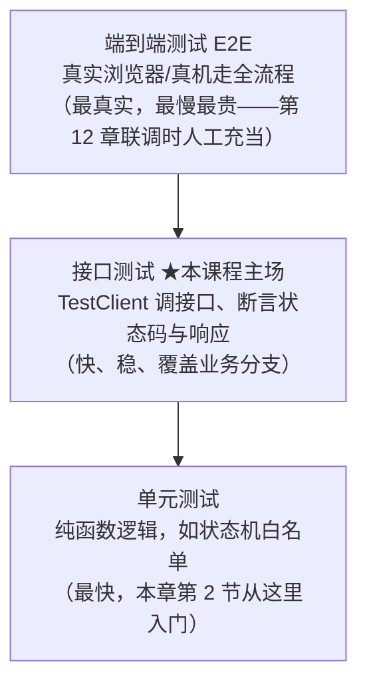
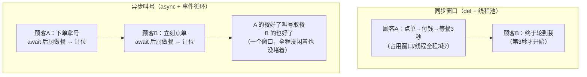
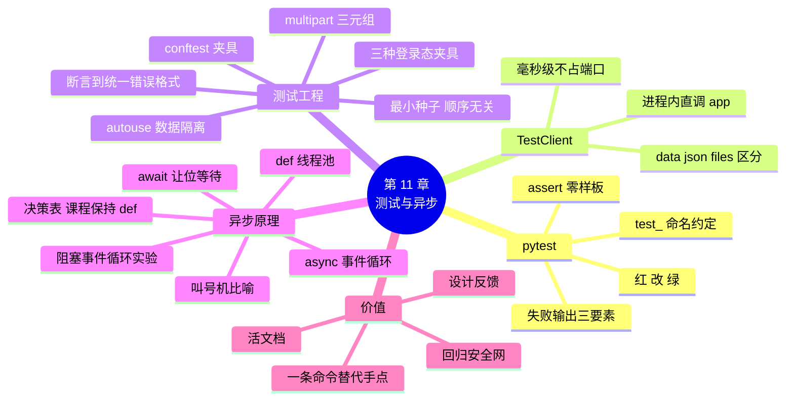

# 第 11 章 接口测试与异步基础

> **本章定位**：质量与原理篇。上半章给安居宝 19 个接口套上**自动化测试安全网**：pytest + TestClient——第 10 章要手点上百次的回归，从此一条命令零遗漏。下半章还清欠账：`async def` 从第 4~5 章的"照写即可"升级为"懂原理、知边界"——同步阻塞的代价、await 的让位语义、以及课程现有 def 接口为什么**不用改**。
>
> **开发约定**（延续）：`uvicorn main:app --reload` 运行服务，`http://127.0.0.1:8000/docs` 手工验收；本章起多一套仪式：`pytest -v` 自动化回归。

---

## 学习目标

完成本章学习后，你应当能够：

1. **会写测试**：写出 pytest 测试（test_ 命名、assert、`pytest -v` 运行），读懂失败输出（哪一行、期望什么、实际什么）。
2. **会调接口**：用 TestClient 不起服务直接调接口，为安居宝核心接口写出覆盖 200/201/401/403/404/409/422 各分支的测试。
3. **会隔离**：用 autouse 夹具实现"每个测试前重置数据"，说出测试互相污染的症状与危害。
4. **会带登录态**：在测试中登录拿 token、封装成 admin/owner/worker 三种身份夹具复用。
5. **懂异步**：用自己的话解释 await 的"让位"语义；实验验证 async 函数里写同步阻塞调用的代价；能按决策表选择 def 或 async def。

---

## 1. 本章项目任务与热身：手点一百次的痛

### 本章项目任务

| # | 交付物 | 说明 |
|---|--------|------|
| 1 | tests/ 测试目录 | conftest.py（隔离夹具 + 三种身份夹具）+ 四个测试文件 |
| 2 | 约 20 个测试函数 | 状态机全链路、权限三连、公告 CRUD、登录注册、附件 multipart |
| 3 | 一条命令回归 | `pytest -v` 全绿 |

### 热身：验货员的解放

第 10 章重构时算了笔账：六个模块 × 每模块 3~5 个接口 × 3 轮回归 = **上百次手点**。而且人会漏点、会烦、会在第十次重复时开始"这个应该没问题吧"——手动的可靠性随次数递减。

答案很直接：**自动化测试消灭的是"验货员"身份**——搬运（重构本身）仍然是你，但验收从此交给机器：一条命令、零遗漏、每次都同样认真。这是从"写代码的人"到"工程师"的分水岭之一。

### 测试的三重价值

1. **回归安全网**：改了代码（重构、加功能、修 bug）之后，一条命令验证"旧行为没坏"；
2. **活文档**：测试用例就是"接口该怎么用"的最准确范例——比文档还准，因为它会随代码一起更新、且不更新就报错；
3. **设计反馈**：难以写测试的代码，往往是职责不清的代码（要 mock 十个东西才能测一个函数）——第 10 章分层在此兑现隐性红利：service 层逻辑清晰，测起来顺手。

📊 **图 11-1** 测试金字塔（本课程主打中间层）：



### 小结

- 手动回归随次数递减的可靠性，交给机器一次解决。
- 三重价值：安全网、活文档、设计反馈；课程主打接口测试层。

---

## 2. pytest：第一个测试与断言的脾气

### 安装与三条约定

```bash
pip install pytest
pip freeze > requirements.txt
```

pytest 的哲学是**零样板**：不用类、不用框架 API，三条约定走天下——

1. 测试文件名 `test_*.py`；
2. 测试函数名 `test_*`；
3. 断言直接用 `assert`（不是 `self.assertEqual` 那套）。

### 第一个测试：给状态机白名单做单元测试

第一个测试对象选得讲究——TRANSITIONS 白名单是**纯函数逻辑**（不碰数据库、不碰 HTTP），最适合入门。新建 `tests/test_state_machine.py`：

```python
# tests/test_state_machine.py —— 状态机白名单的单元测试
from schemas import TRANSITIONS
from schemas import OrderStatus


def test_待受理可以派单或撤销():
    assert OrderStatus.assigned in TRANSITIONS[OrderStatus.pending]
    assert OrderStatus.canceled in TRANSITIONS[OrderStatus.pending]


def test_已评价是终点没有出边():
    assert TRANSITIONS[OrderStatus.rated] == []


def test_每个状态都在白名单里():
    for status in OrderStatus:
        assert status in TRANSITIONS, f"{status} 缺少白名单条目"
```

（中文测试函数名是合法的 Python——名字就是文档，怎么直白怎么来。）

在**项目根**运行：

```bash
pytest -v
```

预期输出：

```text
tests/test_state_machine.py::test_待受理可以派单或撤销 PASSED
tests/test_state_machine.py::test_已评价是终点没有出边 PASSED
tests/test_state_machine.py::test_每个状态都在白名单里 PASSED
======================== 3 passed in 0.5s ========================
```

> 💡 **让 pytest 认识项目根**：tests/ 里的测试要 `from schemas import ...`（项目根的模块），需要在**项目根也放一个空的 conftest.py**——pytest 看到 conftest 就把所在目录加入导入路径。两个 conftest 各司其职：根目录的空文件负责"让模块可导入"，tests/ 里的负责夹具（第 3 节）。

### 故意失败一次：读懂失败输出

把第三个测试改错一行（`assert status not in TRANSITIONS`），再跑：

```text
FAILED tests/test_state_machine.py::test_每个状态都在白名单里 - AssertionError: OrderStatus.pending 缺少白名单条目
...
>       assert status not in TRANSITIONS, f"{status} 缺少白名单条目"
E       AssertionError: OrderStatus.pending 缺少白名单条目
```

失败输出三要素：**哪个测试挂了、断言在哪一行、期望与实际是什么**。修测试和修代码的入口都在这里——"红 → 改 → 绿"是测试开发的日常节拍（改完记得把断言改回来）。

### 小结

- 三条约定 + assert，零样板开测；纯函数逻辑（状态机）是单元测试的最佳入门对象。
- 根目录空 conftest.py 解决导入路径；失败输出三要素是排错入口。

---

## 3. TestClient：不起服务也能调接口

### 定义与原理

> 💡 **一句话定义**
> **TestClient**：把 HTTP 请求**直接投递给 app 对象**的测试客户端——不占端口、不起 uvicorn、请求响应在进程内完成。快（毫秒级）是它对真实服务器的优势；它检阅的是 app 的全部行为（路由、依赖、校验、异常处理器、中间件）。

```python
from fastapi.testclient import TestClient
from main import app

client = TestClient(app)

resp = client.get("/notices")          # 像 requests 一样用，但不出网络
assert resp.status_code == 200
```

第一个接口测试（加进一个新文件 `tests/test_notices.py`）：

```python
# tests/test_notices.py —— 公告接口测试
from fastapi.testclient import TestClient

from main import app

client = TestClient(app)


def test_公告列表返回200且是数组():
    resp = client.get("/notices")
    assert resp.status_code == 200
    data = resp.json()
    assert isinstance(data, list)          # 响应是数组
    assert all("title" in n for n in data) # 每条都有 title 字段
```

### conftest.py 与夹具：pytest 的"依赖注入"

多个测试文件都要用 client、都要先准备好数据——重复三遍的事就该收敛（第 10 章的老原则）。pytest 的答案叫**夹具（fixture）**：带 `@pytest.fixture` 装饰器的函数，测试函数**声明同名参数**即可注入它的返回值——和第 9 章的 Depends 一个思想（参数的值由框架注入），一个在测试世界、一个在接口世界。

夹具统一放在 `tests/conftest.py`（pytest 自动发现、全体测试共享）。完整内容下一节交付——它同时解决两个问题：client 复用与**测试隔离**。

### 小结

- TestClient 进程内直调 app：毫秒级、检阅全部行为。
- 夹具 = 测试界的 Depends：声明参数即注入；公共夹具住 conftest.py。

---

## 4. 安居宝核心接口测试实战

### 先解决最大的坑：测试隔离

测试会写库！测试里建的工单、注册的用户会留在 MySQL 里——下一个测试（甚至你的开发环境）就被上一个测试的数据污染了。症状：单独跑某个测试是绿的，全量跑就红（顺序依赖）；开发库里莫名多出 `testowner` 用户。

**本课程的简易方案**（直白且理念正确）：

```python
# tests/conftest.py —— pytest 共享夹具：测试客户端 + 数据隔离 + 三种登录态
import pytest
from fastapi.testclient import TestClient

from core.database import SessionLocal
from core.security import pwd_context
from main import app
from models import Attachment, House, Notice, RepairOrder, User

# 密码哈希模块加载时只算一次（bcrypt 故意慢——第 8 章附录 C 的代价在此真实上演：
# 若放在夹具里每次重算，三个用户 × 0.25 秒 × 20 个测试 = 白等十几秒）
ADMIN_HASH = pwd_context.hash("admin123456")
OWNER_HASH = pwd_context.hash("owner123456")
WORKER_HASH = pwd_context.hash("worker123456")


@pytest.fixture(autouse=True)
def reset_db():
    """每个测试开始前：清空五张表 + 灌入最小种子（autouse——所有测试自动生效，无需声明）"""
    db = SessionLocal()
    try:
        for model in (Attachment, RepairOrder, Notice, House, User):   # 按外键依赖顺序删
            db.query(model).delete()
        db.commit()
        db.add_all([
            User(id=1, username="admin", password_hash=ADMIN_HASH, role="admin"),
            User(id=2, username="owner1", password_hash=OWNER_HASH, role="owner"),
            User(id=3, username="worker1", password_hash=WORKER_HASH, role="worker"),
            House(id=1, owner_id=2, building="1栋", unit="1单元", room="101"),
            RepairOrder(id=1, house_id=1, worker_id=None, type="水电",
                        description="测试用报修单", status="待受理", score=None),
            Notice(id=1, author_id=1, title="测试公告",
                   content="测试公告的正文内容，超过十个字。", category="公告"),
        ])
        db.commit()
    finally:
        db.close()


@pytest.fixture()
def client():
    """接口测试客户端"""
    return TestClient(app)


def _login(client, username, password):
    """登录并返回 Authorization 头（测试携带登录态的标准姿势）"""
    resp = client.post("/users/login", data={"username": username, "password": password})
    token = resp.json()["access_token"]
    return {"Authorization": f"Bearer {token}"}


@pytest.fixture()
def admin_headers(client):
    """管理员登录态"""
    return _login(client, "admin", "admin123456")


@pytest.fixture()
def owner_headers(client):
    """业主登录态"""
    return _login(client, "owner1", "owner123456")


@pytest.fixture()
def worker_headers(client):
    """维修工登录态"""
    return _login(client, "worker1", "worker123456")
```

三个设计点：

1. **autouse=True**：夹具自动对全部测试生效（不用每个函数声明 `reset_db` 参数）——隔离是纪律，不是选项；
2. **最小种子**：比 seed_data.py 更小（三用户一房一单一公告），每个测试站在同一起跑线，**顺序无关**（打乱顺序跑结果不变，这是隔离合格的验收标准）；
3. **三种身份夹具**：admin/owner/worker 各自登录拿 token——权限测试的三连弹药。

> 💡 认知框——**更专业的隔离方案**：独立测试库（TEST_DATABASE_URL 指向 anjubao_test）、或每个测试包在一个事务里跑完回滚（永不真正落库）。它们更快、更干净，但各多一层配置/魔法。本课程选最直白的清表法：**看得见的简单，好过看不见的快**。知道方向即可。

### 场景①：状态机全链路（第 4 章 12 用例的自动化版）

```python
# tests/test_state_flow.py —— 工单状态流转测试（第 4 章 12 组用例的自动化版）


def _change(client, headers, order_id, body):
    """小助手：发起一次状态流转"""
    return client.put(f"/repair-orders/{order_id}/status", json=body, headers=headers)


def test_合法链路_一路流转到已评价(client, admin_headers, worker_headers, owner_headers):
    # 派单（管理员）→ 开工（维修工）→ 完工（维修工）→ 评价（业主）
    assert _change(client, admin_headers, 1, {"new_status": "已派单", "worker_id": 3}).status_code == 200
    assert _change(client, worker_headers, 1, {"new_status": "维修中"}).status_code == 200
    assert _change(client, worker_headers, 1, {"new_status": "已完成"}).status_code == 200
    assert _change(client, owner_headers, 1, {"new_status": "已评价", "score": 5}).status_code == 200

    resp = client.get("/repair-orders/1")           # 验证最终落库结果
    assert resp.json()["status"] == "已评价"
    assert resp.json()["score"] == 5


def test_跳步_待受理直接评价_409(client, admin_headers):
    resp = _change(client, admin_headers, 1, {"new_status": "已评价", "score": 5})
    assert resp.status_code == 409
    assert "非法状态流转" in resp.json()["error"]["message"]    # 统一错误格式（第 4 章）在此被断言


def test_派单缺worker_id_400(client, admin_headers):
    resp = _change(client, admin_headers, 1, {"new_status": "已派单"})
    assert resp.status_code == 400


def test_评分越界_422(client, admin_headers, worker_headers, owner_headers):
    _change(client, admin_headers, 1, {"new_status": "已派单", "worker_id": 3})
    _change(client, worker_headers, 1, {"new_status": "维修中"})
    _change(client, worker_headers, 1, {"new_status": "已完成"})
    resp = _change(client, owner_headers, 1, {"new_status": "已评价", "score": 6})   # 1~5 之外
    assert resp.status_code == 422


def test_业主不能派单_403(client, owner_headers):
    resp = _change(client, owner_headers, 1, {"new_status": "已派单", "worker_id": 3})
    assert resp.status_code == 403


def test_维修工不能操作别人的单_403(client, worker_headers):
    # 1 号单尚未派给任何维修工，worker1 却想开工
    resp = _change(client, worker_headers, 1, {"new_status": "维修中"})
    assert resp.status_code == 403


def test_业主撤销待受理单_200(client, owner_headers):
    resp = _change(client, owner_headers, 1, {"new_status": "已取消"})
    assert resp.status_code == 200
    assert client.get("/repair-orders/1").json()["status"] == "已取消"
```

> 📌 注意 `resp.json()["error"]["message"]`——第 4 章统一错误格式在测试中的价值：**断言可以精确到"错误信息里含什么"**，而不只是状态码。

### 场景②：权限三连（401 → 403 → 200）

```python
# tests/test_permissions.py —— 权限测试三连模式


def test_无token调staff_401(client):
    resp = client.post("/users/staff",
                       json={"username": "newworker", "password": "abc12345", "role": "worker"})
    assert resp.status_code == 401


def test_维修工调staff_403(client, worker_headers):
    resp = client.post("/users/staff", headers=worker_headers,
                       json={"username": "newworker", "password": "abc12345", "role": "worker"})
    assert resp.status_code == 403


def test_管理员调staff_201(client, admin_headers):
    resp = client.post("/users/staff", headers=admin_headers,
                       json={"username": "newworker", "password": "abc12345", "role": "worker"})
    assert resp.status_code == 201
    assert resp.json()["role"] == "worker"


def test_统计接口仅管理员(client, owner_headers, admin_headers):
    assert client.get("/stats/workers", headers=owner_headers).status_code == 403
    assert client.get("/stats/workers", headers=admin_headers).status_code == 200
```

### 场景③：公告 CRUD 全流程 + 场景④：登录注册

```python
# tests/test_notices_crud.py —— 公告全生命周期
def test_公告CRUD全流程(client, admin_headers):
    # 发布 → 201
    resp = client.post("/notices", headers=admin_headers,
                       json={"title": "新公告", "content": "新公告的正文内容。", "category": "公告"})
    assert resp.status_code == 201
    new_id = resp.json()["id"]

    # 修改（部分更新：只改 title）→ 200 且其余字段未动
    resp = client.put(f"/notices/{new_id}", headers=admin_headers, json={"title": "改过的标题"})
    assert resp.status_code == 200
    assert resp.json()["title"] == "改过的标题"
    assert resp.json()["content"] == "新公告的正文内容。"

    # 删除 → 204；列表中已不可见
    assert client.delete(f"/notices/{new_id}", headers=admin_headers).status_code == 204
    ids = [n["id"] for n in client.get("/notices").json()]
    assert new_id not in ids
```

```python
# tests/test_auth.py —— 登录与注册
def test_登录成功返回token(client):
    resp = client.post("/users/login", data={"username": "admin", "password": "admin123456"})
    assert resp.status_code == 200
    assert "access_token" in resp.json()


def test_密码错误_401且提示不区分账号(client):
    resp = client.post("/users/login", data={"username": "admin", "password": "wrong"})
    assert resp.status_code == 401
    assert resp.json()["error"]["message"] == "用户名或密码错误"    # 第 9 章的安全细节被测试锁定


def test_重复注册_409(client):
    body = {"username": "newowner", "password": "abc12345"}
    assert client.post("/users/register", json=body).status_code == 201
    assert client.post("/users/register", json=body).status_code == 409
```

（登录测试用 `data=` 不是 `json=`——第 9 章讲过的"登录收表单"，在测试里原样体现。）

### 附件上传的 multipart 测试

```python
# tests/test_files.py —— 附件上传测试（multipart 的三元组写法）
def test_上传图片_201并可在列表见(client, owner_headers):
    # files 参数的三元组：(文件名, 内容字节, MIME 类型)
    resp = client.post(
        "/repair-orders/1/attachments",
        headers=owner_headers,
        files=[("files", ("kitchen.jpg", b"fake-image-bytes", "image/jpeg"))],
    )
    assert resp.status_code == 201
    assert resp.json()[0]["filename"] == "kitchen.jpg"

    resp = client.get("/repair-orders/1/attachments")
    assert resp.status_code == 200
    assert len(resp.json()) == 1
```

> 💡 测试用假字节（b"fake-image-bytes"）就够了——本章测的是**接口流程**（校验、落盘、元数据），不是图片解码。测试造数据的最小化原则：够触发目标分支即可。

### 全绿时刻与安全网闭环

```bash
pytest -v
```

```text
tests/test_auth.py::test_登录成功返回token PASSED
tests/test_auth.py::test_密码错误_401且提示不区分账号 PASSED
...（共 20 余项）
======================= 24 passed in 6.8s =======================
```

**安全网闭环实验（本章最重要的一次动手）**：打开 api 或 service 里的状态流转代码，删掉白名单校验那几行 → `pytest -v` → **跳步测试立刻变红**（不用你记得去测，网自己在那）→ 把代码改回 → 全绿。从此你改任何代码后的仪式只剩一条命令。

### 常见坑

- ⚠️ **测试间共享状态**：A 测试建的工单，B 测试以为存在——reset_db 夹具就是解药；出现"单跑绿、全跑红"先查隔离。
- ⚠️ **断言断了一半**：`assert resp.status_code == 200 and len(resp.json()["items"]) > 0` 若前半为假，后半根本没执行（and 短路）——关键断言分行写，失败信息才准确。
- ⚠️ **忘了删测试残留**：conftest 只清表，**磁盘上的 uploads/ 文件**测试后仍会累积（上传测试每次写盘）——收尾清一次 uploads/；专业的做法（临时目录夹具）见附录 A 的夹具作用域话题。

### 小结

- conftest 三件套：autouse 数据隔离、client、三种登录态夹具。
- 断言要落到统一错误格式的 message 层面；multipart 用三元组。
- 删码变红、改回全绿——安全网闭环是本章的毕业证。

---

## 5. 异步正课：async/await 还账

### 欠账清单

三处"照写即可"：第 4 章异常处理器的 `async def`、第 5 章上传接口的 `await file.read()`、第 10 章中间件的 `await call_next(request)`。本章把原理补齐——先从两个世界说起。

### 同步的世界：FastAPI 怎么跑你的 def 接口

FastAPI（背后是 uvicorn）用两种方式跑接口函数：

- **def 接口**（安居宝全部接口的现状）：扔进**线程池**——一个请求占一个线程，多个请求用多个线程并行。线程是"贵"的资源（每个占几 MB 内存），但对我们百来个并发的小系统绰绰有余；
- **async def 接口**：跑在**事件循环**里——单线程，靠"轮转"服务所有请求。

同步代码的代价在**等**：`time.sleep(3)` 或一条慢 SQL 期间，这个线程彻底干等——像点餐窗口被一个顾客占死：点单、付钱、站在窗口等餐做好，后面排队的全堵着。

### async/await 的语义：叫号机

> 💡 **一句话定义**
> `await` 的语义是**让位等待**："我要等了（等 I/O、等定时器），**这个窗口先让给别人**，好了叫我。"——快不是快在"等"本身（该 3 秒还是 3 秒），而是快在**等待期间别人不被堵**。

📊 **图 11-2**：



**图 11-2 同步堵窗口 vs 异步叫号机：await = 拿号让位**

### 亲手实验：把事件循环堵死的代价

加两个临时接口（体验完删除）：

```python
import asyncio
import time


@app.get("/slow-sync")
async def slow_sync():
    time.sleep(3)              # ❌ 同步阻塞写在 async 里：事件循环单线程，卡死 3 秒——所有人陪等
    return {"msg": "好了"}


@app.get("/slow-async")
async def slow_async():
    await asyncio.sleep(3)     # ✅ 异步等待：让位 3 秒，期间其他请求照常服务
    return {"msg": "好了"}


@app.get("/ping")
def ping():
    return {"msg": "pong"}
```

实验步骤：①访问 `/slow-sync`，在它转圈的 3 秒里**另开一个标签页**访问 `/ping`——转圈转不出来（被堵死了）；②换 `/slow-async` 重做——`/ping` 秒回。

**结论反直觉但至关重要**：async def 不是性能开关，**写错反而是性能陷阱**——async 里每一个同步阻塞调用（time.sleep、requests 库、同步数据库驱动）都会堵死整个事件循环，比 def 接口（只堵一个线程）更糟。

### 决策表：什么时候用哪个

| 场景 | 选择 | 原因 |
|------|------|------|
| 普通同步 SQLAlchemy、纯 CPU 逻辑（**课程现状**） | **def** | FastAPI 自动扔线程池，够用且安全 |
| 用了异步库（httpx.AsyncClient、异步驱动、大模型流式 SDK） | **async def + await** | 库的异步能力需要事件循环配合 |
| 理由不充分时 | def | "加 async 提速"是迷信，写错是事故 |

**课程现状声明**：安居宝现有接口**保持 def 不动**——这不是妥协，是决策表的正确输出。真正需要 async 的时刻在第 12 章之后：RAG 课程接大模型流式输出（一个请求等模型吐几十秒字），await 让位期间其他用户照常访问——那时 async 从"认知"变成"主角"。

### 常见坑

- ⚠️ **async def 里调 requests / time.sleep / 同步驱动**：堵死事件循环（本节实验亲眼所见）。要发请求用 httpx.AsyncClient，要睡眠用 asyncio.sleep。
- ⚠️ **忘写 await**：拿到协程对象而非结果——第 5 章上传接口预告过的 TypeError（`a bytes-like object is required`）就是它。
- ⚠️ **"全项目改成 async 就专业了"**：逐条过决策表再动手——先有异步库的场景，再有 async 的价值。

### 小结

- def 跑线程池（一请求一线程）；async 跑事件循环（单线程轮转）。
- await = 让位等待：快在等待期间不堵别人，不在等待本身变短。
- async 里写同步阻塞 = 堵死全场；课程接口保持 def 是正确决策。

---

## 6. 本章收官：安全网与原理图

### 测试覆盖清单

| 测试文件 | 覆盖 | 关键断言 |
|---------|------|---------|
| test_state_machine.py | 白名单单元逻辑 | 终点无出边、全状态在册 |
| test_state_flow.py | 状态机全链路 + 权限分权 | 合法链 200、跳步 409、缺参 400、越权 403、越界 422 |
| test_permissions.py | staff/stats 门禁三连 | 401 → 403 → 201/200 |
| test_notices_crud.py | 公告全生命周期 | 201→改 200→删 204→查 404 |
| test_auth.py | 登录注册 | token 下发、401 不区分账号、409 重复 |
| test_files.py | multipart 上传 | 文件名回显、列表可见 |

### 工作流升级

从本章起，安居宝的开发仪式固定为两件套：**改代码 → `pytest -v`（回归）→ /docs（手工体验新功能）**。第 12 章部署前的最后一道闸，就是这条命令全绿。



**本章你为安居宝交付了什么**：约 24 个自动化测试（状态机、权限、CRUD、认证、上传全覆盖）、数据隔离与身份夹具体系、异步原理与选型能力——**从此重构有网，改动有底**。

**下一章预告（终章）**：第 12 章《综合实战：AI 前端与项目交付》——编写提示词让 AI 生成安居宝的管理前端页面、联调（CORS 已铺路）、Docker 打包部署、简历话术定稿，以及为 RAG/Agent 课程埋下的全部伏笔总盘点。

---

## 附录

### 附录 A：pytest 速查

```bash
pytest                    # 跑全部
pytest -v                 # 显示每个测试名
pytest tests/test_auth.py # 只跑一个文件
pytest -k "登录"          # 按名字筛选
pytest --lf               # 只跑上次失败的（改一个测一个的节奏）
```

```python
@pytest.mark.parametrize("status,expected", [
    ("待受理", 200), ("已派单", 409),
])
def test_xxx(status, expected): ...

@pytest.fixture(scope="session")   # 作用域：function（默认，每测试重置）/ module / session
def expensive_setup(): ...
```

### 附录 B：TestClient 速查

```python
client.get("/notices?category=规章")                       # 查询参数直接拼 URL
client.post("/notices", json={...})                        # JSON 请求体
client.post("/users/login", data={...})                    # 表单（登录接口）
client.post(".../attachments", files=[("files", ("a.jpg", b"...", "image/jpeg"))])  # multipart 三元组
client.put("/x/1", json={...}, headers=admin_headers)      # 带登录态
client.delete("/x/1")                                      # 204 时 resp.text 为空

resp.status_code / resp.json() / resp.headers / resp.text  # 响应四件套
```

### 附录 C：异步进阶认知（RAG 课程的前置伏笔）

```python
import asyncio
import httpx

async def call_llm(prompt: str) -> str:
    async with httpx.AsyncClient(timeout=60) as client:      # 异步 HTTP 客户端
        resp = await client.post("https://大模型API/chat", json={"prompt": prompt})
        return resp.json()["answer"]

async def main():
    # gather：并发发起多个异步任务（三个请求同时等，总耗时≈最慢的那个，不是三者之和）
    answers = await asyncio.gather(
        call_llm("问题1"), call_llm("问题2"), call_llm("问题3"),
    )
```

将来的 RAG 课程里，"向大模型发请求"就是这样的 async 代码——流式输出（一个字一个字往外吐）更依赖事件循环的让位机制。今天学的 await 语义，就是那时的地基。
