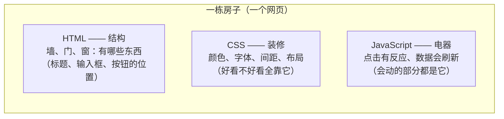
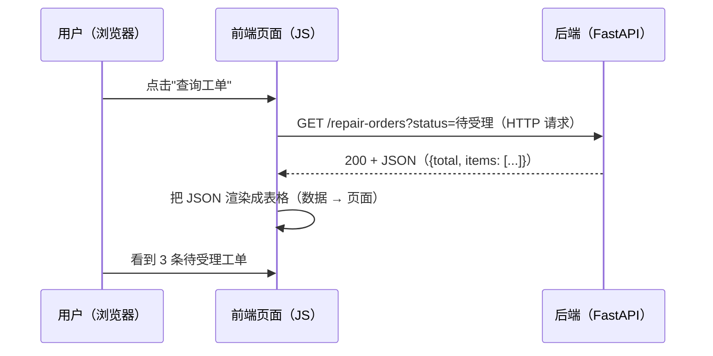
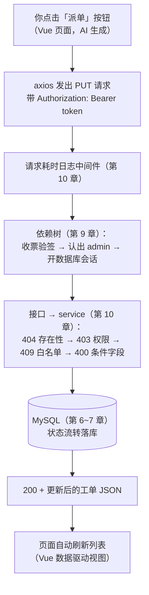
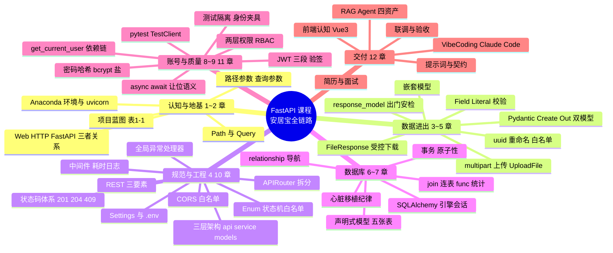

# 第 12 章 综合实战：AI 前端与项目交付

> **本章定位**：收官交付篇。课程目标的另一半在本章兑现：以 **Vue3 + Claude Code 的完整 VibeCoding 工作流**，让 AI 生成安居宝管理端前端并联调交付。你不需要写一行前端代码、也不需要自己编写提示词——**本章提供全部提示词，复制粘贴即可**；你的工作是三件：**搭环境、管契约、做验收**。
>
> 本章删除了原计划的 Docker 内容（后续课程专门安排），全力以赴做好"AI 协作开发"这一件事。
>
> **前置状态**：后端 v1.1.0 就绪（`pytest -v` 全绿）、`uvicorn main:app --reload` 常驻运行、CORS 白名单已含 5173 端口（第 10 章伏笔，本章兑现）。

---

## 学习目标

完成本章学习后，你应当能够：

1. **懂前端**：说出 HTML/CSS/JS 三件套的分工、前后端数据交互的完整链路、Vue3 与 React 的定位差异。
2. **会搭环境**：独立完成 Node.js → npm 镜像 → Claude Code → cc switch 的 VibeCoding 环境搭建。
3. **会用 AI**：用教材提供的三条提示词驱动 Claude Code 生成 Vue3 管理端（登录、工单管理、公告管理），看懂 AI 的执行过程并正确确认权限。
4. **会联调**：定位并修复 AI 生成代码的四类高频问题（路径/格式/token/CORS）；用 F12 Network 完成调试；在页面上走通完整业务流。
5. **会交付**：写出带真实数字的三段式简历 bullet；对照面试自查清单检验全课程知识；说出 RAG/Agent 课程将复用安居宝的哪四样资产。

---

## 1. 认识前端：网页世界的另一半

### 什么是前端

第 1 章说过：一个网站里**看得见、点得着**的部分是前端（页面、按钮、表单），**看不见**的部分是后端（接口、规则、数据）。九章以来我们一直在造"看不见的那一半"——本章轮到"看得见的那一半"。

前端由三种语言构成，各司其职（**图 12-1**）：



**图 12-1 前端三件套：结构、装修、电器**

### 前后端如何数据交互

回忆第 1 章的 F12 实验：打开任何网页，Network 面板里哗哗冒出几十个请求——**那些请求都是前端 JS 发的**。前后端的完整协作链路（**图 12-2**）：



**图 12-2 前端发请求、后端回 JSON、前端渲染——第 1 章时序图的"使用者视角"**

你写的每一个接口，终点都是被这样调用。**契约**（路径、方法、参数、响应结构）就是前后端之间的合同——第 4 章的《接口规范总表》此刻从内部文档变成**对外合同**。

### 前端常用框架：为什么要 Vue3

用原生 JS 写页面的痛苦：数据一变，就要手写代码找到页面上对应的位置、逐个更新它（"手动操作 DOM"）。框架的答案是**数据驱动视图**——你只管维护数据，页面自动跟着变。

| | 原生 JS | Vue3 | React |
|---|---------|------|-------|
| 心智 | 手动更新页面 | 声明数据，页面自动同步 | 同左（写法更偏 JS 函数） |
| 模板 | 无 | 接近 HTML，一眼能读懂 | JSX（HTML 与 JS 混写） |
| 中文资料 | — | **最丰富** | 丰富 |
| 学习曲线 | 看似简单实则琐碎 | 平缓 | 稍陡 |
| 国内使用 | — | 极广（中小公司主力） | 极广（大厂主流） |

**本课程选 Vue3**：模板语法接近 HTML（你至少看得懂 AI 生成的代码）、中文生态最好、学习曲线最平缓——后端工程师了解前端的友好入口。（本课程你**不写**前端代码，但"看得懂"是联调和验收的底线。）

### Node.js：前端工具链的底座

Node.js 常被误解为"另一个后端语言"，本章澄清它的真实身份——**前端工具的运行环境**。用已学概念平移（**这张表能扫清 80% 的陌生感**）：

| 前端世界 | 你已学的对应物 | 作用 |
|---------|--------------|------|
| Node.js | Python 解释器 | 运行 JS 代码/工具的底座 |
| npm | pip | 包管理器（装包） |
| package.json | requirements.txt | 依赖清单 |
| node_modules/ | site-packages/ | 装下来的包（巨大，不进 Git） |
| npm run dev | uvicorn main:app --reload | 启动开发服务器（带热重载） |

### 小结

- 三件套：HTML 结构、CSS 装修、JS 电器；框架解决"手动更新页面"之痛，Vue3 数据驱动、中文生态最好。
- 前后端靠 HTTP+JSON 协作，契约即合同；Node.js 是前端工具链底座（npm≈pip）。

---

## 2. VibeCoding 环境搭建：Node.js、Claude Code 与 cc switch

### 什么是 VibeCoding

> 💡 **一句话定义**
> **VibeCoding**：用自然语言与 AI 结对编程的工作流——你负责**定义需求、提供契约、验收结果**，AI 负责**编码执行**。不是"让 AI 替你写完就完"，而是像带一个不知疲倦的初级工程师：你给清楚任务书，它产出，你验收。

这正是课程目标后半句的正式名称。本章的主角 **Claude Code** 是 Anthropic 官方的 AI 编程助手——它不只在对话框里给代码片段，而是**直接在你的项目目录里工作**：创建文件、执行命令、安装依赖、多轮修改（每一步先请你批准）。

### 四步搭建（每步：操作 → 验证 → 排错）

**第一步：安装 Node.js（LTS 版）**

到 [https://nodejs.org](https://nodejs.org) 下载 **LTS**（长期支持版，目前 20+）Windows 安装包（.msi），一路下一步。验证（新开一个 CMD）：

```bash
node -v
npm -v
```

预期输出（版本号 ≥ 18 即可）：

```text
v20.11.1
10.2.4
```

**第二步：npm 换国内镜像**（第 1 章 pip 换清华源的既视感）：

```bash
npm config set registry https://registry.npmmirror.com
npm config get registry          # 验证：应输出 https://registry.npmmirror.com
```

**第三步：安装 Claude Code**：

```bash
npm install -g @anthropic-ai/claude-code
claude --version                  # 验证：输出版本号即成功
```

**第四步：安装 cc switch 并配置供应商**

Claude Code 需要接入可用的模型服务——**cc switch** 是社区提供的供应商管理工具，可以保存多套 API 配置并一键切换。

1. 到 cc switch 的 GitHub 仓库（搜索 "cc-switch"）的 Releases 页下载 Windows 安装包，安装；
2. 打开 cc switch，添加供应商：填入 **API 地址与密钥**（`以讲师下发的配置为准`，课堂统一提供）；
3. 点击"切换"应用到 Claude Code；
4. 验证：随便进入一个目录运行 `claude`，能正常对话即通。

> ⚠️ 本章涉及的外部工具版本迭代较快：**安装界面与命令以官方文档和讲师指引为准**，正文流程不会大变（装 Node → 装 Claude Code → 配供应商），细节差异按提示应对。

### Claude Code 初体验

在项目根目录下新建前端工作目录并进入（后端在 anjubao/，前端独立成邻居住）：

```bash
mkdir anjubao-web
cd anjubao-web
claude
```

进入交互界面后先认识三件事：

1. **权限确认机制**：它每次要执行命令（如 npm create vite）、创建/修改文件，都会先展示**将要做什么**并等你批准——这是安全阀，看清楚再按确认；本章任务都可放心批准；
2. **CLAUDE.md**：项目根的"名牌"文件——AI 每次启动先读它来认识项目（接下来由提示词一自动生成，内容包括安居宝的接口契约）；
3. **会话恢复**：终端意外关闭不用慌，重新 `claude --continue` 接着上次的上下文继续。

### 常见坑

- ⚠️ **Node 版本低于 18**：Claude Code 装不上或起不来——`node -v` 先检查，旧版先卸载再装 LTS。
- ⚠️ **npm 安装超时**：镜像没换或没生效（重开终端）。
- ⚠️ **API 报错/无响应**：九成是供应商配置问题——回 cc switch 检查地址密钥、重新切换。
- ⚠️ **在后端目录跑 claude**：AI 可能把前端文件生成进 anjubao/——进**anjubao-web/** 再启动。

### 小结

- 四步环境：Node LTS → npm 镜像 → Claude Code → cc switch 配供应商。
- Claude Code 在你的目录里干活、每步求批准；CLAUDE.md 是它的项目名牌。

---

## 3. 提示词实战：复制粘贴生成管理端

> 📌 **使用说明**：以下三条提示词**全文复制、逐条粘贴**到 Claude Code（第一条执行完、确认项目能跑，再发第二条）。提示词不需要你修改——契约、约束、格式都已写好；你要做的是**看懂 AI 在做什么**（每条提示词后附解说）、**正确批准权限**、在它完成后**验收**。

### 提示词一：初始化项目（复制粘贴全文）

```text
你是一位资深前端工程师。请在当前目录帮我创建一个 Vue 3 管理端项目，要求如下：

【技术要求】
1. 使用 Vite 脚手架创建 Vue 3 项目（JavaScript 版本，不用 TypeScript）；
2. 安装依赖：axios（HTTP 请求）、vue-router（页面路由）；
3. 目录结构：src/views/ 放页面组件，src/api/ 放接口封装，src/router/ 放路由配置；
4. 在项目根目录创建 CLAUDE.md，写入本项目的说明（Vue3 + Vite 管理端，对接下方后端接口）。

【后端信息（重要，后续开发都要遵守）】
- 后端 Base URL：http://127.0.0.1:8000（开发阶段后端已在本机运行）
- 认证方式：先调登录接口拿 token，之后每个请求带请求头 Authorization: Bearer <token>
- 登录接口：POST /users/login，请求体是表单格式（username、password），
  响应 {"access_token": "xxx", "token_type": "bearer"}
- 错误响应统一格式：{"error": {"code": 状态码, "message": "一句话原因", "detail": 附加信息}}，
  页面上的报错提示请展示 error.message
- 响应时间字段是 ISO 8601 格式字符串（如 "2026-10-23T09:15:00"），展示时格式化为
  "YYYY-MM-DD HH:mm"

【把以上后端信息原样写入 CLAUDE.md，作为项目的接口契约。】

完成后运行 npm run dev 确认项目能启动，并告诉我访问地址。
```

**它在做什么**（五要素对照）：角色（资深前端工程师）、上下文（技术栈与后端契约）、需求（建项目+装依赖+定结构）、约束（JS 版、目录规范）、输出（CLAUDE.md + 可运行）。**本条的核心价值是把接口契约固化进 CLAUDE.md**——此后 AI 每轮对话都自动带着这份"合同"，编造接口路径的概率大幅下降。

预期效果：AI 依次执行创建项目、安装依赖、写配置文件（每步请你批准），最后启动开发服务器并告诉你地址 `http://localhost:5173/`——浏览器打开能看到 Vite 的默认页。

### 提示词二：功能开发（复制粘贴全文）

```text
继续开发安居宝管理端，需要完成三个页面。请严格按 CLAUDE.md 中的接口契约开发，所有请求
统一封装在 src/api/ 下，token 从 localStorage 读取。

【页面一：登录页（/login）】
- 表单：用户名、密码，登录按钮；
- 调用 POST /users/login（表单格式提交）；成功后把 access_token 存入 localStorage，
  跳转到工单管理页；失败时展示 error.message。

【页面二：工单管理页（/orders）】
- 顶部筛选栏：状态下拉（全部/待受理/已派单/维修中/已完成/已评价/已取消）、
  类型下拉（全部/水电/电梯/门窗/其他）、查询按钮；
- 工单表格：列 = 工单号、类型、描述、状态、创建时间、操作；
  调用 GET /repair-orders?page=1&page_size=10&status=&type=，
  响应是分页包装 {"total": 总数, "page": 页码, "page_size": 每页条数, "items": [工单数组]}，
  工单字段：id, type, description, status, score, created_at, finished_at；
- 底部分页：上一页/下一页/页码展示（用 total 和 page_size 计算）；
- 操作列：
  - 状态为"待受理"时显示【派单】按钮：弹出对话框输入维修工ID（提示：种子数据维修工
    ID 为 3），确认后调用 PUT /repair-orders/{id}/status，
    请求体 {"new_status": "已派单", "worker_id": 输入值}；
  - 派单或其他操作失败时，展示 error.message 并保留当前页数据。

【页面三：公告管理页（/notices）】
- 公告表格：列 = 编号、标题、分类、发布时间、操作（删除按钮）；
  调用 GET /notices（响应是公告数组，字段：id, title, content, category, created_at）；
- 顶部【发布公告】按钮：弹出对话框（标题、正文、分类下拉：公告/规章），
  确认后调用 POST /notices，请求体 JSON {"title", "content", "category"}，
  成功后刷新列表；
- 删除按钮：确认后调用 DELETE /notices/{id}（成功返回 204 无响应体），刷新列表。

【整体要求】
- 顶部导航栏：安居宝 · 管理端，含"工单管理 / 公告管理 / 退出登录"三个入口；
  退出登录清除 localStorage 的 token 并跳回登录页；
- 未登录（localStorage 无 token）访问任何页面自动跳到 /login；
- 样式大方简洁即可（原生 CSS，不需要 UI 组件库）。

完成后运行 npm run dev，告诉我每个页面的访问路径和验收要点。
```

**它在做什么**：本条是功能主体——注意提示词里**每个接口都写清了方法、路径、请求格式、响应结构与字段名**（这就是"管契约"：AI 不用猜，你给的全是事实）；派单的流转规则（待受理→已派单需 worker_id）也一并交代。预期效果：AI 生成 views/ 三个页面 + api/ 封装 + 路由守卫，逐文件请你批准，最后给出三个页面的访问路径。

### 提示词三：联调修正与美化（备用，联调后按需粘贴）

```text
联调反馈如下，请修复并优化：
1. 【问题描述，例：工单列表请求返回 401】——检查 token 是否正确放入 Authorization 头
   （格式必须是 "Bearer " + token，Bearer 后有一个空格）；
2. 【问题描述，例：时间显示为 2026-10-23T09:15:00】——按 CLAUDE.md 的约定格式化时间；
3. 【样式问题，例：表格太挤 / 对话框太丑】——优化为 <你的期望描述>。
修复后列出你改动过的文件清单。
```

> 💡 提示词三是**模板**：三个占位（问题描述/期望描述）按第 4 节联调的真实发现填写——这是你与 AI 沟通的日常形态：**具体指出问题，而不是"重做一遍"**。

### 运行与预览

三条提示词跑完，开发服务器已在运行（没跑就 `npm run dev`）。浏览器打开：

```text
http://localhost:5173
```

自动跳转登录页——**5173，这个第 10 章就写进 CORS 白名单的数字，此刻完成伏笔闭环**。后端那个端口 8000 的 /docs 也开着：一边是 AI 刚生成的前端，一边是你九章亲手写的后端——它们马上要握手了。

### 小结

- 三条提示词：初始化（契约入 CLAUDE.md）→ 功能开发（每接口写清方法/路径/结构）→ 联调迭代（模板填空）。
- 你的角色：看懂进度、批准权限、验收结果；契约是 AI 世界观的边界。

---

## 4. 前后端联调：让页面活起来

### 联调四类高频问题（对照表贴在手边）

| 类别 | 症状 | 修法 |
|------|------|------|
| ① 路径/方法错 | 404 / 405 | 对照 /docs 核对 AI 写的路径与方法（CLAUDE.md 契约对了就少见） |
| ② 响应格式误解 | 页面空白/报 undefined | 分页是 {total, items} 包装、错误是 {error:{message}}——用提示词三纠正 |
| ③ token 问题 | 401 | Bearer 前缀与空格、localStorage 里的旧过期 token（先清空重登） |
| ④ CORS 报错 | F12 Console 跨域红字 | 核对后端白名单端口与页面地址栏端口一致（都是 5173 则已通） |

### 联调实战：从登录到派单

确保后端运行中（`uvicorn main:app --reload`，另开一个终端）。然后：

1. **登录**：用 seed 账号 `admin / dev123456`——登录成功跳转工单页；F12 的 Network 里能看到 `/users/login` 的 200 响应；
2. **工单列表**：页面自动加载 `GET /repair-orders`——看到的每一条数据，都是你第 2 章写查询参数、第 6 章换数据源、第 7 章数据库分页的那条链路；
3. **派单**：对一张"待受理"工单点【派单】、输入维修工 ID `3`——`PUT /repair-orders/{id}/status` 走第 4 章的状态机白名单、第 9 章的管理员权限、第 7 章的 relationship 校验。**一个按钮按下去，十二章的知识在一条链上会师**（**图 12-3**）：



**图 12-3 一次点击的完整旅程——课程全部知识在一条链上**

### 联调驱动的补接口实战：派单下拉框

联调中你会发现一个真实缺口：派单要填维修工 ID，但管理员**根本记不住谁是 3 号**——页面需要一份维修工名单，而后端还没有这个接口。**发现缺口 → 自己补上**，这是联调的日常（也顺便复习三层架构）：

api/users.py 加一个接口（管理员查维修工名单）：

```python
@router.get("/workers", response_model=list[UserOut])
def list_workers(
    db: Session = Depends(get_db),
    admin: User = Depends(get_current_admin),
):
    """维修工名单（管理端派单下拉用）"""
    return db.query(User).filter(User.role == "worker").all()
```

> ⚠️ 路由顺序提醒：`/users/workers` 是固定路径，若与 `/users/me/...` 并存注意定义顺序（固定在前——第 2 章的老规矩）。重启后端、/docs 里出现新接口后，用提示词三让前端把派单对话框改成**下拉选择**（提示词里写明新接口：GET /users/workers，返回 UserOut 数组，字段 id、username）。

### 验收标准（本章项目的毕业证）

在**页面上**（不是 /docs）完整走通：登录 → 查看待受理工单 → 派单给维修工 → 发布一条公告 → 公告列表可见 → 退出登录。全程 F12 Network 无红色请求（4xx/5xx 只出现在故意输错密码的测试里）。

### 小结

- 四类问题对照表；F12 Network 是联调主武器（第 1 章工具的终极回归）。
- 联调发现缺口就补接口——契约由你扩展，AI 跟着契约走。
- 页面走通完整业务流 = 毕业。

---

## 5. 课程收官：简历、面试与下一程

### 简历三段定稿（真实数字版）

> **安居宝 · 智慧物业报修服务平台（个人全栈项目）**
> - 基于 FastAPI + SQLAlchemy + MySQL 独立完成后端：**19 个 RESTful 接口**、5 张表、工单状态机与"存在性-权限-合法性-完整性"多层校验体系；
> - **JWT 认证 + 三角色 RBAC**（接口门禁与业务分权两层）、统一错误格式与全局异常处理、请求日志中间件，pytest 编写 **24 个接口测试**覆盖核心业务分支；
> - 采用 **VibeCoding 工作流（Claude Code）** 辅助生成 **Vue3 管理端**前端，独立完成接口契约设计、CORS 跨域联调与整体验收交付。

三个加粗数字就是你的底气——每一个都能在面试时现场演示（带上电脑，跑起服务打开页面，比任何话术都有力）。

### RAG/Agent 课程伏笔总盘点（四样资产）

下一门 AI 应用课程，将从安居宝的四样资产上长出来：

| 资产 | 在本课程的形态 | 在 RAG/Agent 课程的归宿 |
|------|--------------|----------------------|
| ① notice 表的规章正文 | 公告/规章的 content 字段 | **RAG 的检索语料**（"周末能装修吗？"→ AI 检索规章作答） |
| ② 维修报告文档 | 附件表的 pdf/txt/md | **RAG 的文档知识库**（AI 读报告回答维修历史） |
| ③ 工单增查接口 | POST /repair-orders 等 | **Agent 的 Tool**（AI 管家自然语言报修 → 调你的接口开工单） |
| ④ JWT 账号体系 | 三角色注册登录 | **AI 管家的身份底座**（知道在替谁办事、有什么权限） |

第 5 章上传的每一份文档、第 9 章签发的每一张 token，都是给 AI 管家攒的家底——**这门课不是终点，是 AI 全链路的基座**。

### 十二章知识全景



**课程总账**：19 个接口、5 张表、24 个测试、一个三层架构工程、一套账号权限体系、一个 AI 生成的 Vue3 管理端——以及 12 章走完后，你手里那台能独立交付后端项目的完整工具链。

### 下一步建议

1. **衔接**：直接进入 RAG/Agent 课程——安居宝四资产即刻复用；
2. **深入方向**（认知名词，遇到再学）：Alembic 表结构迁移、接口限流、WebSocket 实时推送、Docker 容器化（后续课程安排）；
3. **习惯保持**：新项目从第 1 章的"蓝图先行"开始——需求矩阵、表设计、接口规范总表，然后才是代码。

---

## 附录

### 附录 A：提示词速查卡（可打印）

```text
【五要素模板】
角色：你是一位资深 ___ 工程师
上下文：本项目是 ___，技术栈 ___，后端契约如下（接口清单/格式/认证方式）
需求：请实现 ___（页面/功能，逐条列出）
约束：技术栈限制 ___、不用 ___、样式要求 ___
输出：完成后运行 ___ 并告诉我验收要点

【迭代模板】
联调反馈如下，请修复：
1.【具体现象 + 期望行为】
2.【具体现象 + 期望行为】
修复后列出改动的文件清单。
```

### 附录 B：Claude Code 常用操作速查

```bash
claude                    # 在当前目录启动
claude --continue         # 接着上次会话继续
claude --version          # 查看版本

# 会话内常用：
Esc                       # 中断当前生成
/clear                    # 清空上下文重新开始
exit                      # 退出
# 权限确认：看清它将执行的命令/文件变更再批准；本章任务均可放行
```

### 附录 C：全课程面试题自查清单（30 题，按章分组）

**第 1~2 章**：① Web/HTTP/FastAPI 三者关系？② GET/POST/PUT/DELETE 与 CRUD 对应？③ 路径参数与查询参数怎么选？④ 422 的 loc/msg/input 怎么用来排错？⑤ Path()/Query() 能做什么？

**第 3 章**：⑥ 查询参数传文件/大文本有什么问题？⑦ Pydantic 三模型（Create/Update/Out）为什么不能合一？⑧ response_model 是过滤器不是美容器——怎么理解？⑨ 为什么 Create 模型里不能有 status/id？

**第 4 章**：⑩ REST 三要素？⑪ 204 与 200 的区别、DELETE 幂等性？⑫ 400/404/409 的分界口诀？⑬ 白名单 vs 黑名单的安全观？⑭ 状态机校验顺序（404→409→400）为什么不能乱？

**第 5 章**：⑤→⑮ multipart 与 JSON 的适用场景与互斥？⑯ uuid 重命名防三件事？⑰ 文件存磁盘、元数据存库的理由与一致性代价？⑱ StaticFiles 与受控下载怎么选？

**第 6~7 章**⑲ ORM 三层映射？⑳ Session 三铁律与"假成功"？㉑ from_attributes 为什么必需？㉒ relationship 与 ForeignKey 分工、N+1 成因与解法？㉓ join 和 group_by 各解决什么？㉔ 事务边界在哪、异常时发生什么？

**第 8~9 章**：㉕ 明文存密码的泄露链条、盐防什么？㉖ JWT 三段结构、为什么 Payload 不能放密码？㉗ 401 与 403 的区别？㉘ 接口级门禁与业务级校验各管什么（举状态流转）？水平越权怎么防？

**第 10~12 章**：㉙ 三层架构职责与依赖方向、.env 为什么不进 Git？㉚ await 的让位语义、async 里写 time.sleep 会怎样？

> 用法：每题先口头作答再翻对应章节核对；答不出的章节重读小结。30 题全过，FastAPI 初级岗位的八股与场景题你已有底气。
