# 第 1 章 走进 Web 后端：认识 FastAPI 与「安居宝」项目

> **本章定位**：认知篇 + 环境搭建篇。全章不要求编写业务代码，任务是三件事：
> ① 建立 Web、HTTP、FastAPI 的概念地图；
> ② 全景认识「安居宝 · 智慧物业报修服务平台」项目——本章的项目介绍是**整门课程的总蓝图**，后续 11 章的所有开发都严格按照本章的定义进行；
> ③ 用本地 Anaconda 搭建开发环境，亲手跑通人生第一个 FastAPI 接口。

---

## 学习目标

完成本章学习后，你应当能够：

1. **说概念**：用自己的话说清 Web、HTTP、FastAPI 三者的关系；说出一次 HTTP 请求/响应的组成部分，认得 GET、POST、PUT、DELETE 四个方法和 200、201、404、403、500 五个状态码。
2. **讲理由**：说出选择 FastAPI 的至少 3 条理由，以及它与 Flask、Django 的主要区别。
3. **懂项目**：画出安居宝的报修业务流程；说出业主、维修工、管理员三种角色各自能做什么；说出 5 张数据库表的名称和用途；说出三层架构中每一层的职责。
4. **搭环境**：独立使用 conda 创建虚拟环境、安装 FastAPI、在 PyCharm 中配置解释器、运行服务并访问自动文档；遇到常见环境报错能对照排查表自行解决。

---

## 1. 我们每天都在用的 Web，到底是什么

### 定义

先从你最熟悉的场景开始：

- 打开手机 App 查快递，物流信息一秒就出来了；
- 在网页上输入"我家厨房水管漏水怎么办"，搜索引擎立刻给出答案；
- 扫码点餐，菜单图片、价格实时显示在手机上。

这些场景有一个共同点：**你的设备（手机、电脑）上并没有存这些数据，数据存在远方某台 24 小时开机的计算机上，你的设备通过网络"要"了过来**。

这台远方的计算机，叫**服务器（Server）**；你手里发起请求的设备上的程序（浏览器、App），叫**客户端（Client）**。这套"客户端向服务器要数据、服务器为客户端提供服务"的体系，就是 **Web**（万维网，World Wide Web）应用的基本形态。

> 💡 **一句话定义**
> Web 应用 = 客户端（提出请求）+ 网络 + 服务器（处理请求并返回数据）。

### 图示：客户端-服务器模型

**图 1-1** 用安居宝的一个真实场景展示这个模型——业主在手机上查看自家报修的进度：

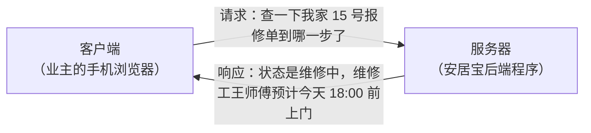

注意两点：

1. **永远是客户端先开口**。服务器不会无缘无故给你发消息，它只是"守在那里等请求"。
2. **一来一回构成一次完整的交互**：客户端发出**请求（Request）**，服务器返回**响应（Response）**。

### 前端与后端：一个网页里"看得见的"和"看不见的"

打开任何一个网页，都可以把它拆成两部分：

| 部分 | 名称 | 你能感知到吗 | 负责什么 | 运行在哪里 |
|------|------|-------------|---------|-----------|
| 页面、按钮、表单、图片 | **前端（Frontend）** | ✅ 看得见、点得着 | 展示信息、收集用户输入 | 你的浏览器/手机里 |
| 接口、业务规则、数据库 | **后端（Backend）** | ❌ 看不见 | 处理数据、执行规则、保管账号密码 | 远方的服务器上 |

**图 1-2** 展示了现代开发中最常用的**前后端分离**模式——前端和后端是两个独立的程序，通过网络对话：

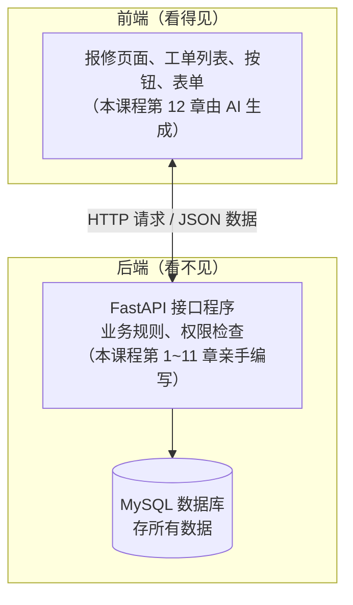

> 💡 **这门课的分工**
> 我们负责**后端**——用 FastAPI 把接口一个个写出来；前端页面在第 12 章通过"编写提示词让 AI 生成"的方式完成。这正是当前企业里非常流行的高效开发方式：**后端工程师定接口，AI 帮忙出页面**。

### 后端工程师到底做什么

后端看不见摸不着，那后端工程师整天在干什么？其实就三件事，用"物业前台"来类比：

| 后端的工作 | 物业前台的类比 | 安居宝中的例子 |
|-----------|---------------|---------------|
| **管数据** | 登记本：记录每一户、每一单 | 把报修单存进 MySQL，随时可查 |
| **管业务规则** | 规章制度：什么事能办、怎么办 | "待受理的工单才能撤销""维修工只能看派给自己的单" |
| **管权限** | 门禁：业主卡开自家门，员工卡进工作区 | 业主只能查自己家的工单，派单只有管理员能操作 |

记住这个类比——后面每一章写的代码，本质上都在做这三件事之一。

### 常见误区

- ❌ **"网站就是前端，后端可有可无。"**
  没有后端，页面上的数据从哪来？账号密码存在哪？下单谁来记账？前端只是"门面"，后端才是"账房+库房+保卫科"。
- ❌ **"App 和网站是两套完全不同的技术，学了网页后端对 App 没用。"**
  App 与服务器之间同样走 HTTP 请求。你学会写 FastAPI 接口，这个接口既能给网页用，也能给安卓 App、苹果 App、小程序用——**一套后端，多端复用**，这正是前后端分离的威力。
- ❌ **"后端就是写增删改查，没技术含量。"**
  增删改查是骨架，但权限、校验、事务、并发、安全才是血肉。本课程会带你从骨架一步步长出血肉。

### 小结

- Web 应用的基本形态是**客户端-服务器模型**：客户端发请求，服务器回响应，永远是客户端先开口。
- 一个 Web 项目分为**前端**（看得见，跑在用户设备上）和**后端**（看不见，跑在服务器上），两者通过网络对话。
- 后端工程师的三大职责：**管数据、管业务规则、管权限**。

---

## 2. HTTP：Web 世界的"通用语言"

### 定义

客户端和服务器隔着网络对话，用什么"语言"？答案是 **HTTP**（HyperText Transfer Protocol，超文本传输协议）。

> 💡 **一句话定义**
> HTTP 是一套**通信规则**：规定了请求长什么样、响应长什么样、用什么词表达"我要查数据"还是"我要提交数据"。就像寄快递必须用标准快递单，HTTP 规定了网络世界"单据"的标准格式。

**图 1-3** 是一次完整 HTTP 交互的时序图——业主查询自家 15 号报修单的进度：

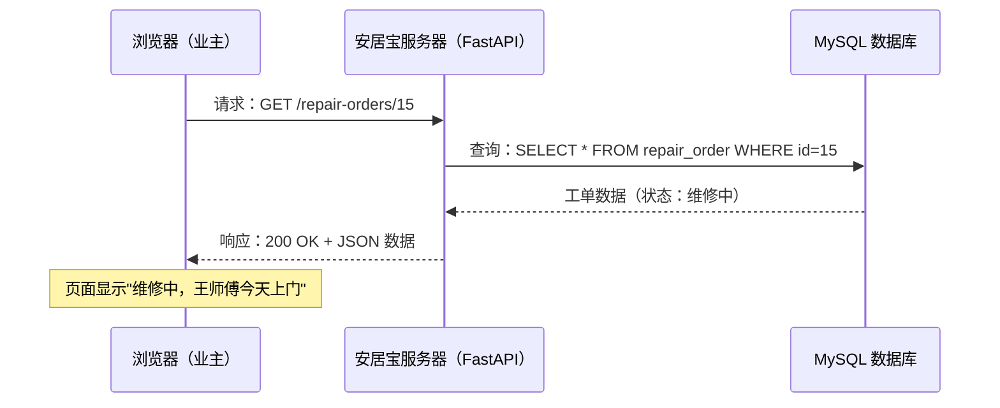

学完 MySQL 的你注意看中间两步：**服务器收到 HTTP 请求后，去数据库执行 SQL，再把查询结果包装成 HTTP 响应发回去**。后端开发的核心工作，就是写好中间这段"翻译+处理"的逻辑——这正是 FastAPI 帮我们做的事。

### URL 解剖：网络世界的"收货地址"

客户端怎么知道该向哪台服务器的哪个资源发请求？靠 **URL**（统一资源定位符）。把安居宝的一个接口地址拆开看：

```text
https://api.anjubao.com:8000/repair-orders?status=维修中&page=2
└─┬─┘   └──────┬──────┘└─┬─┘└─────┬─────┘└──────────┬──────────┘
 协议          主机      端口      路径           查询字符串
```

| 组成部分 | 例子 | 作用 | 后续章节 |
|---------|------|------|---------|
| 协议 | `https://` | 用什么规则通信 | 本章了解即可 |
| 主机 | `api.anjubao.com` | 找哪台服务器 | 开发阶段就是 `127.0.0.1`（你自己的电脑） |
| 端口 | `:8000` | 找服务器上的哪个程序 | FastAPI 开发默认用 8000 |
| **路径** | `/repair-orders` | 要操作哪个资源 | **第 2 章：路径参数** |
| **查询字符串** | `?status=维修中&page=2` | 附加的筛选条件 | **第 2 章：查询参数** |

> 📌 **划重点**
> 路径和查询字符串是 URL 中最"可编程"的两部分。第 2 章你会亲手写出 `/houses/{house_id}` 这样带**路径参数**的接口，以及 `?status=...&page=...` 这样接收**查询参数**的接口。

### 请求方法：用哪个"动词"

HTTP 用**方法（Method）**表达对资源要做的操作。最常用的四个，恰好对应数据的"增删改查"（CRUD）：

| 方法 | 语义 | 数据库操作 | 安居宝中的例子 |
|------|------|-----------|---------------|
| **GET** | 查询，获取数据 | SELECT | 查看工单列表、搜索公告 |
| **POST** | 新增，提交数据 | INSERT | 业主提交一张新报修单 |
| **PUT** | 修改，更新数据 | UPDATE | 管理员把工单状态改为"已派单" |
| **DELETE** | 删除数据 | DELETE | 业主撤销一张还没受理的报修单 |

> 💡 **记忆口诀**
> GET 查、POST 增、PUT 改、DELETE 删。这套"用 HTTP 方法表达操作"的设计风格叫 **REST**，第 4 章会专门展开。

### 状态码：服务器的"一句话答复"

每个 HTTP 响应都带一个三位数的**状态码（Status Code）**，告诉你这次请求的结果如何。先记住五个"必认"状态码：

| 状态码 | 含义 | 安居宝场景 |
|--------|------|-----------|
| **200** | 成功 | 查询工单成功 |
| **201** | 创建成功 | 提交报修单成功 |
| **404** | 资源不存在 | 查询 999 号工单，可根本没有这张单 |
| **403** | 禁止访问（没权限） | 业主 A 试图查看业主 B 家的工单 |
| **500** | 服务器内部错误 | 后端程序自己出了 Bug |

规律很简单：**2 开头是成功，4 开头是客户端的错（请求有问题），5 开头是服务端的错（程序有问题）**。第 4 章你会学会亲手控制每个接口返回的状态码。

### JSON：请求和响应里装的"货"

HTTP 负责"怎么送"，那"送什么"呢？现代 Web 前后端之间几乎都用 **JSON**（JavaScript Object Notation）格式传数据。好消息是：**JSON 长得和你会的 Python 字典几乎一模一样**。

一张工单的 JSON 数据：

```json
{
    "id": 15,
    "type": "水电",
    "description": "厨房水管漏水，橱柜底下一直滴水",
    "status": "维修中",
    "house": "3栋2单元501",
    "worker": "王师傅"
}
```

对照 Python 字典：

```python
# 这段 Python 字典数据，转成 JSON 后就是上面的样子
order = {
    "id": 15,
    "type": "水电",
    "description": "厨房水管漏水，橱柜底下一直滴水",
    "status": "维修中",
    "house": "3栋2单元501",
    "worker": "王师傅",
}
```

区别只有两点：JSON 的键必须用双引号；JSON 里没有 Python 的 `True/False/None`，写作 `true/false/null`。**你已有的 Python 字典功底，可以直接平移到 JSON 上。**

### 例子：亲手抓一个真实的 HTTP 请求（不动一行代码）

1. 用 Chrome 或 Edge 浏览器打开任意网站（比如 `https://www.baidu.com`）；
2. 按 **F12** 打开开发者工具，切换到 **Network（网络）** 面板；
3. 刷新页面，面板里会出现一长串请求记录；
4. 点击第一条，观察右侧：
   - **Headers**：请求方法（GET）、状态码（200）、URL；
   - **Response / Preview**：服务器返回的数据。

你会亲眼看到：打开一个网页的背后，是浏览器替你在几秒内发出了几十次 HTTP 请求。**从第 2 章起，你写的每一个接口，都会出现在这样的面板里。**

### 常见坑

- ⚠️ **URL 里直接写中文会怎样？**
  浏览器会自动把中文转成 `%E4%BF%AE%E5%A4%8D` 这样的编码（叫 URL 编码）。所以抓包时看到一串 `%xx` 不要慌，那是中文和特殊字符的"旅行装"。FastAPI 收到后会自动还原，你无需处理。
- ⚠️ **GET 和 POST 只是"习惯"不同吗？**
  不只是习惯：GET 的参数挂在 URL 上，会留在浏览器历史、服务器日志里，所以**密码等敏感信息绝不能用 GET 传**；POST 的数据放在请求体里，相对隐蔽（但真正的安全靠 HTTPS + 加密，第 8 章讲密码哈希时展开）。
- ⚠️ **404 和 500 该找谁？**
  404 多半是 URL 敲错了（找前端/调用方的问题）；500 是后端程序抛了异常（找后端的问题）。以后看到报错先看状态码，责任立刻分清。

### 小结

- HTTP 是客户端与服务器之间的**通信规则**：一次请求，一次响应。
- URL = 协议 + 主机 + 端口 + **路径** + **查询字符串**，后两者是编程的主战场。
- 四大方法：**GET 查、POST 增、PUT 改、DELETE 删**。
- 状态码：**2 成功、4 客户端错、5 服务端错**；必认 200/201/404/403/500。
- 数据载体是 **JSON**，它与 Python 字典几乎同形。

---

## 3. FastAPI 是什么：Web、HTTP、FastAPI 三者的关系

### Web 框架：为什么不能"赤手空拳"写后端

理论上，用 Python 标准库就能写出一个处理 HTTP 请求的程序。但你要自己干这些脏活累活：

- 自己解析 HTTP 报文的每一个字节，拆出方法、路径、参数；
- 自己把查询结果拼装成符合规范的 HTTP 响应文本；
- 自己处理端口监听、并发连接、字符编码、超时……

等你把"解析一个 POST 请求体"写完，业务代码一行还没动。**Web 框架**就是把这些通用脏活全部包办、让你只写业务逻辑的工具库。

> 💡 **一句话定义**
> Web 框架 = 替你处理 HTTP 底层细节的工具库，你只需要写"收到这个请求后做什么"。

**FastAPI** 就是这样一个 Python Web 框架，它的定位非常聚焦：**专门用来构建 API（接口）的现代高性能框架**。

### 图示：三者的关系

很多同学初学时分不清 Web、HTTP、FastAPI，一张图说清（**图 1-4**）：

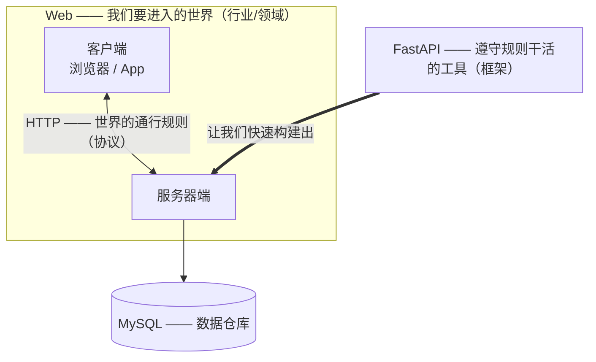

三句话记住关系：

| 概念 | 它是什么 | 类比 |
|------|---------|------|
| **Web** | 一个**领域**：所有基于浏览器/服务器模式的应用的总称 | "餐饮行业" |
| **HTTP** | 一套**规则**：这个领域里所有人必须遵守的通信协议 | "餐饮服务规范" |
| **FastAPI** | 一个**工具**：帮你在规则内高效干活的 Python 框架 | "一套现代化厨房设备" |

### uvicorn：为什么还需要一个"服务器"

装完 FastAPI 后，教程总让你同时装一个叫 **uvicorn** 的东西，它是什么？

- **FastAPI（框架）**：负责业务逻辑——"收到报修请求后该怎么处理"。但它自己不会监听网络端口。
- **uvicorn（服务器）**：负责网络通信——守着 8000 端口，把收到的 HTTP 请求转交给 FastAPI，再把处理结果发回客户端。

**图 1-5** 用"前台与部门"来类比二者的分工：

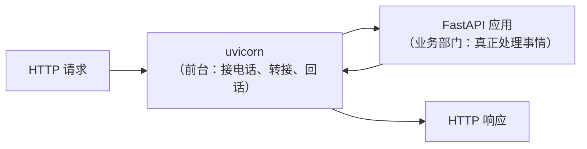

> 📌 **一句话**
> FastAPI 写"做什么"，uvicorn 管"怎么收发"。运行命令 `uvicorn main:app --reload` 的意思就是："uvicorn，请启动 main.py 里那个叫 app 的 FastAPI 应用"。本章第 6 节你会亲手敲出这条命令。

### FastAPI 的"见面礼"：自动文档

FastAPI 有一个让所有初学者眼前一亮、也是它风靡全球的功能：**自动生成交互式 API 文档**。

你只要写好接口，FastAPI 就自动为你生成一个网页（访问 `/docs` 路径），上面列着：

- 你有哪些接口、每个接口接收什么参数、参数是什么类型；
- 每个参数还能直接在网页上**填值、点击执行、当场看响应**——文档本身就是测试工具。

这份文档在你每次改代码后自动更新，永远不会"过期"。第 12 章让 AI 生成前端页面时，AI 也要靠这份文档理解你的接口——**自动文档是贯穿本课程的重要角色**。先记住它的地址规则：

| 地址 | 内容 |
|------|------|
| `http://127.0.0.1:8000/docs` | Swagger UI 交互式文档（主力，能在线测试） |
| `http://127.0.0.1:8000/redoc` | ReDoc 风格文档（更适合阅读） |

本章第 6 节搭好环境后，你会亲眼见到它。

### 常见坑

- ⚠️ **"FastAPI 和 Flask、Django 是竞争关系，学哪个都行？"**
  三者都是 Python Web 框架，但侧重不同：Django 是"全家桶"（自带后台管理、ORM 等一整套），Flask 是"轻量自由派"，FastAPI 是"API 专精派"。本课程目标是**接口开发 + 衔接 AI 应用**，FastAPI 是当前该场景下的最优选（理由详见第 4 节）。
- ⚠️ **"装了 FastAPI 就能跑起来？"**
  不能，还必须装 uvicorn。只装 FastAPI 不装服务器，就像买了厨房设备却没通水电。本章环境搭建时会一起装好。
- ⚠️ **"框架这么神奇，是不是不用学 HTTP 了？"**
  恰恰相反。框架替你干的是**体力活**（解析、拼装报文），但**判断活**（这个接口该用 GET 还是 POST？出错该返回 404 还是 403？）全靠你对 HTTP 的理解。第 2 节的知识是整个课程的理论地基。

### 小结

- **Web 是领域，HTTP 是规则，FastAPI 是工具**——三者是"世界—语言—装备"的关系。
- FastAPI 是专注于构建 API 的现代 Python Web 框架；运行时需搭配 uvicorn 服务器。
- 自动交互式文档（`/docs`）是 FastAPI 的招牌功能，本课程将全程使用它来测试接口。

---

## 4. 为什么选择 FastAPI

Python 能做 Web 的框架不止一个，为什么本课程、以及越来越多的 AI 公司选择 FastAPI？对比之后见分晓。

### 四大框架对比

| 对比项 | **FastAPI** | Flask | Django | Spring Boot（Java） |
|--------|------------|-------|--------|---------------------|
| 语言 | Python | Python | Python | Java |
| 上手难度 | ⭐ 低 | ⭐ 低 | ⭐⭐⭐ 中高 | ⭐⭐⭐⭐ 高 |
| 自动 API 文档 | ✅ 内置，零配置 | ❌ 需装插件 | ❌ 需装插件 | ⚠️ 需配置 |
| 数据自动校验 | ✅ 基于类型注解自动完成 | ❌ 手写 | ⚠️ 表单有，JSON 需手写 | ✅ 但写法繁琐 |
| 异步支持 | ✅ 原生 | ⚠️ 2.0 后部分支持 | ⚠️ 较新且不彻底 | ✅ |
| 性能 | 高（接近 Node.js/Go 级别） | 中 | 中 | 高 |
| 与 AI 生态（大模型、RAG、Agent）契合度 | ✅ **事实标准** | ⚠️ 可用 | ⚠️ 偏重 | ⚠️ 隔了一层语言 |
| 适合场景 | API 服务、AI 应用后端 | 小型网站 | 大而全的传统网站 | 大型企业系统 |

### 理由一：自动文档——写完接口，文档就有了

传统开发中，"写接口 1 小时，补文档 2 小时，文档还总过期"。FastAPI 把文档生成完全自动化（上一节已介绍），前后端协作效率直接翻倍。对企业来说这是实打实的成本节约，也是面试演示时最直观的加分项。

### 理由二：类型注解 + 自动校验——Python 基础直接变现

你已学过 Python 的类型提示（type hints）。在 FastAPI 里，类型提示不再只是"写给人看的注释"，而是**会真正干活的校验规则**：

```python
# 先睹为快（第 3 章正式讲解）：
# 声明 page 必须是 int，FastAPI 会自动完成三件事：
# 1. 把 URL 里的 "2" 转成数字 2
# 2. 如果有人传 ?page=abc，自动返回 422 错误，根本不会进你的代码
# 3. 自动文档里自动标明该参数的类型
def list_orders(page: int = 1):
    ...
```

一行类型注解，同时换来"转换 + 校验 + 文档"三份收益——这是 FastAPI 区别于 Flask 的核心体验。

### 理由三：异步高性能——天生适合 I/O 密集场景

Web 后端大量时间在"等"：等数据库返回、等文件读写。FastAPI 原生支持 `async/await` 异步编程，等待的同时可以服务别的请求，吞吐量远超传统同步框架（第 11 章会体验）。

### 理由四：AI 应用的事实标准——本课程选它的最重要原因

打开任何一个大模型相关项目——OpenAI 官方示例、LangChain 应用、RAG 知识库服务、Agent 平台——它们的 Web 层**几乎清一色用 FastAPI**。原因很直接：AI 应用需要流式输出、高并发、快速对接 Python 生态，FastAPI 全部命中。

> 📌 **课程体系的衔接**
> 本课程之后你将学习 **RAG（检索增强生成）** 和 **Agent（智能体）**。届时，安居宝会加装"AI 管家"：业主用自然语言说"我家厨房漏水"，AI 自动调用**你这门课写的接口**创建报修单。现在写好的每一个接口，都是将来 AI 管家的"手和脚"。**这门课不是孤立的，它是你 AI 应用开发之路的地基。**

### 就业视角

- 国内招聘市场中，"Python 后端 + AI 应用"岗位几乎默认要求 FastAPI；
- 简历上写"Flask 图书管理系统"和写"FastAPI 智慧物业报修平台（含 AI 管家）"，给面试官的印象完全不同；
- FastAPI 学习曲线平缓：你有 Python + MySQL 基础，本课程 12 章学完即可达到初级后端开发者的接口开发能力。

### 常见坑

- ⚠️ **"FastAPI 这么新，会不会不稳定？"**
  FastAPI 2018 年发布，如今是 GitHub 上星标数最高的 Python Web 框架之一（7 万+），被微软、Netflix、Uber 等公司用于生产环境，PyPI 月下载量数千万次。"新"是相对 Django（2005 年）而言，它早已是成熟的主流选择。
- ⚠️ **"是不是学完 FastAPI 就不用学 Django/Flask 了？"**
  不是"替代"而是"分工"。维护老项目可能遇到 Django/Flask，但**新项目、尤其是 AI 相关项目，FastAPI 是当前首选**。先把一门练精，其他框架触类旁通。

### 小结

- 选 FastAPI 的四大理由：**自动文档、类型校验、异步高性能、AI 生态事实标准**。
- 对本课程而言，第四条最关键：FastAPI 是通往 RAG、Agent 等 AI 应用课程的必经桥梁。

---

## 5. 「安居宝」项目全景：我们要亲手造一个什么系统

> 📌 **本节是整门课程的"总蓝图"。**
> 从这里开始，项目的定位、角色、业务流程、技术栈、三层架构、数据库表设计全部定稿。后续每一章开头的"本章项目任务"都会回指本节内容，所有代码实现严格以本节为准。请把本节当作你未来 11 章的"需求文档"来精读。

### 项目背景与定位

想象一个 2000 户的小区，物业报修现状是这样的：

- 业主打电话报修，前台**手写登记**，字迹潦草、经常漏记；
- 业主想知道修到哪一步了，只能**再打电话问**，前台翻本子找半天；
- 月底物业经理要统计"这个月修了多少单、哪个维修工干得多、水电类占比多少"，只能**手工数登记本**。

这就是真实存在于千行百业的痛点：**传统线下流程，缺一个信息化系统**。

**安居宝 · 智慧物业报修服务平台**就是解决这个痛点的 B 端（面向企业/物业）产品：

> **一句话定位**：面向小区的物业报修服务平台——业主在线提交报修、管理员受理派单、维修工接单处理、业主确认评价，全程线上流转、随时可查、自动统计。

物业管理是真实存在的千亿级行业（万科物业、碧桂园服务等头部企业都在做线上化），"物业 SaaS"是正经的企业级产品形态。**这个项目写进简历，是一个有真实业务背景的平台，而不是课程设计 Demo。**

### 角色与功能

安居宝有三种角色，**表 1-1** 是角色-功能矩阵。这张表就是后续所有章节的**接口需求清单**——课程结束时，表中每一个 ✅ 都会变成一个你亲手写出的接口：

| 功能 | 业主 | 维修工 | 管理员 | 实现章节 |
|------|:---:|:---:|:---:|:---:|
| 注册账号、登录 | ✅（自助注册） | —（账号由管理员创建） | —（账号由管理员创建） | 第 8~9 章 |
| 登记房屋信息 | — | — | ✅ | 第 6~7 章 |
| 提交报修单（含现场照片） | ✅ | — | — | 第 3、5 章 |
| 撤销报修单（仅限"待受理"状态） | ✅ | — | — | 第 4 章 |
| 查看自己房屋的报修记录 | ✅ | — | — | 第 7 章 |
| 确认完工并评价打分 | ✅ | — | — | 第 4 章 |
| 查看派给自己的工单 | — | ✅ | — | 第 7、9 章 |
| 更新工单维修状态 | — | ✅ | — | 第 4、9 章 |
| 受理并派单给维修工 | — | — | ✅ | 第 4、9 章 |
| 查看维修工绩效统计 | — | — | ✅ | 第 7 章 |
| 发布 / 修改 / 删除社区公告与规章 | — | — | ✅ | 第 4 章 |
| 浏览、搜索公告与规章 | ✅ | ✅ | ✅ | 第 2 章 |

**表 1-1 角色-功能矩阵（= 全课程接口需求清单）**

三点设计说明：

1. **业主自助注册，维修工/管理员由管理员创建**——这样第 9 章做权限控制时，"不同角色能做的事不同"就有了真实的业务依据（RBAC，基于角色的访问控制）。
2. **报修单必须挂在某套房屋下**，房屋必须归属某个业主——这条关系链（用户→房屋→工单）是第 7 章关联查询的主线。
3. 所有功能都刻意控制在"单表 CRUD + 一层关联"的难度内，**不涉及支付、购物车、多对多**等复杂场景。

### 业务流程

**主线：一张报修单的完整旅程**（**图 1-6**）：

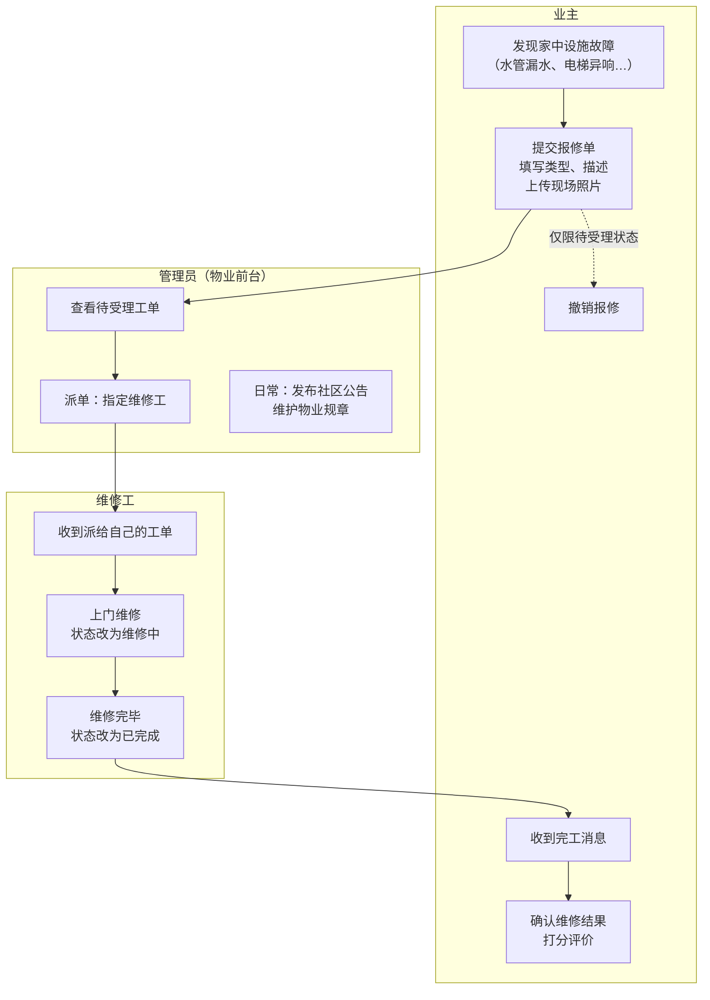

**图 1-6 安居宝核心业务流程图**

报修单的状态流转是本项目最重要的业务规则，**图 1-7** 用状态图精确定义（第 4 章将严格按这张图实现状态流转接口，不允许"跳步"）：

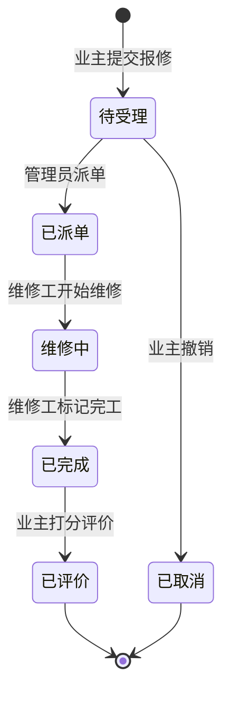

**图 1-7 报修工单状态机（五个主状态 + 一个取消态）**

> 📌 **状态机的三条铁律**（第 4 章用 HTTPException 强制执行）：
> ① 状态只能沿箭头方向流转，不能跳步、不能倒退；
> ② 只有"待受理"的单能被业主撤销；
> ③ 每一步流转都有权限要求——派单是管理员的事，改维修状态是维修工的事，评价是业主的事。

**辅线：公告与规章**。管理员发布社区公告（停水通知）和物业规章（装修管理规定），所有角色可浏览、按关键词搜索。别小看这条辅线——这些规章文本就是后续 **RAG 课程的检索语料**：将来业主问"周末能不能装修"，AI 管家会在这些规章里检索出依据再回答。

### 技术栈总览

| 技术 | 在本项目中的角色 | 学习章节 |
|------|----------------|---------|
| **Python 3.10** | 开发语言（你已掌握） | — |
| **FastAPI** | Web 框架，编写所有接口 | 第 1~12 章 |
| **Uvicorn** | ASGI 服务器，运行 FastAPI 应用 | 第 1 章 |
| **Pydantic** | 数据校验：请求体/响应模型 | 第 3 章 |
| **SQLAlchemy** | ORM 框架：用 Python 类操作数据库表 | 第 6~7 章 |
| **PyMySQL** | MySQL 驱动：连接 MySQL 5.6 | 第 6 章 |
| **passlib** | 密码哈希（注册时加密存储密码） | 第 8 章 |
| **PyJWT** | JWT 令牌的签发与校验（登录态） | 第 9 章 |
| **pytest + TestClient** | 接口自动化测试 | 第 11 章 |
| **Docker** | 容器化部署，一键交付 | 第 12 章 |
| **AI 生成前端** | 编写提示词，让 AI 产出前端页面并联调 | 第 12 章 |

开发工具（均已安装在你的电脑上）：**Anaconda**（环境与包管理）、**PyCharm**（IDE）、**MySQL 5.6**（数据库）。

### 系统架构与三层结构

安居宝后端采用经典的**三层架构**——像公司一样分三个部门，各司其职、逐级调用：

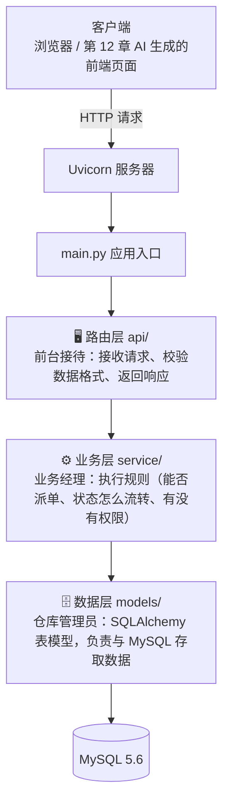

**图 1-8 安居宝三层架构**

| 层 | 文件夹 | 职责 | 类比 | 不该做什么 |
|----|--------|------|------|-----------|
| 路由层 | `api/` | 定义接口路径与方法；用 Pydantic 模型校验请求数据；调用业务层；返回响应 | 前台接待 | ❌ 不写业务规则、不直接碰数据库 |
| 业务层 | `service/` | 业务规则与流程判断（派单逻辑、状态流转合法性、权限判断、统计计算） | 业务经理 | ❌ 不解析 HTTP、不定义表结构 |
| 数据层 | `models/` | 定义数据库表模型（SQLAlchemy），提供数据存取 | 仓库管理员 | ❌ 不做业务判断 |

最终的项目目录结构如下（`core/` 放配置信息，`main.py` 是程序入口，二者不算业务层）：

```text
anjubao/
├── main.py              # 程序入口：创建 FastAPI 应用、注册各模块路由
├── requirements.txt     # 依赖清单（第 12 章 Docker 部署要用）
├── core/                # 配置：数据库连接串、JWT 密钥、文件上传目录等
│   └── config.py
├── api/                 # 路由层（接口 + Pydantic 请求/响应模型）
│   ├── auth.py          #   注册、登录接口
│   ├── house.py         #   房屋接口
│   ├── repair.py        #   报修工单接口
│   ├── notice.py        #   公告接口
│   └── file.py          #   文件上传下载接口
├── service/             # 业务层（业务规则）
│   ├── auth_service.py
│   ├── house_service.py
│   ├── repair_service.py
│   └── notice_service.py
├── models/              # 数据层（SQLAlchemy 表模型）
│   ├── user.py
│   ├── house.py
│   ├── repair_order.py
│   ├── attachment.py
│   └── notice.py
├── uploads/             # 上传文件的存放目录（照片、PDF 等）
└── tests/               # pytest 测试用例（第 11 章）
```

> 📌 **学习节奏：先跑起来，再专业起来**
> 第 2~5 章我们**不做分层**，所有代码写在一个 `main.py` 里，数据暂存在内存字典中——让你先把接口开发的手感练出来。第 6 章引入数据库后代码开始变多，第 10 章正式重构为上面的三层结构。**本节现在只需看懂图 1-8 的分工思想**，重构那天你会自然明白为什么要这样分。

### 数据库表设计

安居宝共 **5 张表**。**图 1-9** 是 ER 图（实体关系图），先整体看关系，再看每张表的字段明细：

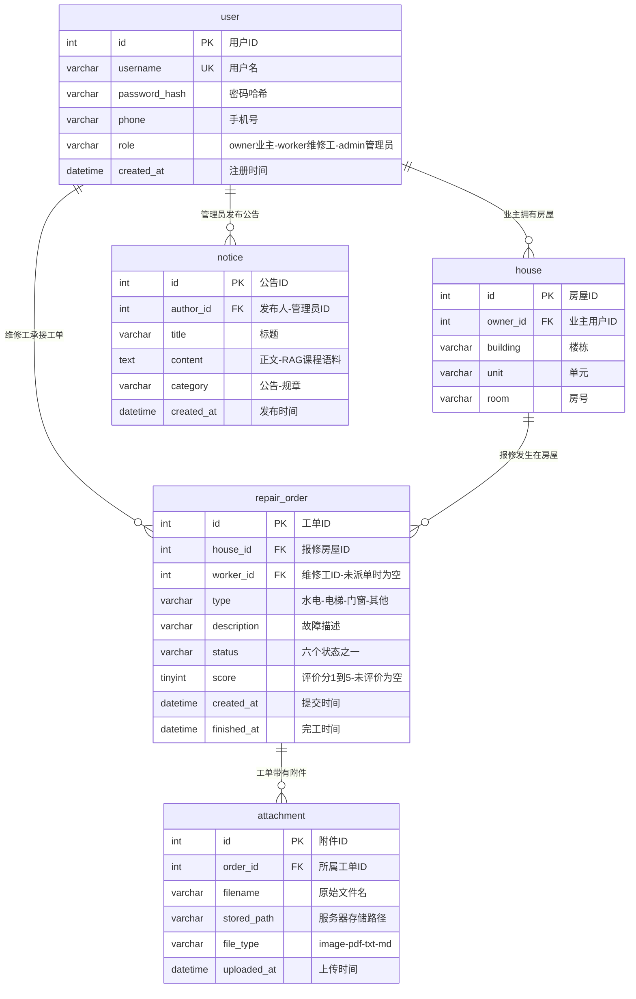

**图 1-9 安居宝 ER 图**

各表字段明细（第 6 章建表时以此为准）：

**表 user（用户表）**——三种角色共用一张表，用 `role` 字段区分：

| 字段 | 类型 | 约束 | 说明 |
|------|------|------|------|
| id | INT | 主键，自增 | 用户 ID |
| username | VARCHAR(50) | 唯一，非空 | 用户名（登录用） |
| password_hash | VARCHAR(255) | 非空 | 密码的哈希值（第 8 章讲为什么绝不存明文） |
| phone | VARCHAR(20) | — | 手机号（维修工上门联系用） |
| role | VARCHAR(10) | 非空，默认 'owner' | owner=业主 / worker=维修工 / admin=管理员 |
| created_at | DATETIME | 非空 | 注册时间 |

**表 house（房屋表）**——报修必须挂到具体房屋：

| 字段 | 类型 | 约束 | 说明 |
|------|------|------|------|
| id | INT | 主键，自增 | 房屋 ID |
| owner_id | INT | 外键 → user.id，非空 | 归属业主 |
| building | VARCHAR(20) | 非空 | 楼栋，如"3栋" |
| unit | VARCHAR(20) | 非空 | 单元，如"2单元" |
| room | VARCHAR(20) | 非空 | 房号，如"501" |

> 💡 building+unit+room 三字段联合唯一（一套房不能登记两次），第 6 章建表时实现。

**表 repair_order（报修工单表）**——项目核心表：

| 字段 | 类型 | 约束 | 说明 |
|------|------|------|------|
| id | INT | 主键，自增 | 工单 ID |
| house_id | INT | 外键 → house.id，非空 | 报修房屋 |
| worker_id | INT | 外键 → user.id，可空 | 维修工（NULL 表示尚未派单） |
| type | VARCHAR(10) | 非空 | 报修类型：水电 / 电梯 / 门窗 / 其他 |
| description | VARCHAR(500) | 非空 | 故障描述 |
| status | VARCHAR(10) | 非空，默认'待受理' | 待受理/已派单/维修中/已完成/已评价/已取消（见图 1-7） |
| score | TINYINT | 可空 | 业主评价 1~5 分（NULL 表示未评价） |
| created_at | DATETIME | 非空 | 提交时间 |
| finished_at | DATETIME | 可空 | 完工时间（用于统计维修时长） |

**表 attachment（附件表）**——存放报修照片与文档的元数据（文件本体存磁盘）：

| 字段 | 类型 | 约束 | 说明 |
|------|------|------|------|
| id | INT | 主键，自增 | 附件 ID |
| order_id | INT | 外键 → repair_order.id，非空 | 所属工单 |
| filename | VARCHAR(255) | 非空 | 上传时的原始文件名 |
| stored_path | VARCHAR(255) | 非空 | 在服务器 uploads/ 目录中的存储路径 |
| file_type | VARCHAR(10) | 非空 | image / pdf / txt / md |
| uploaded_at | DATETIME | 非空 | 上传时间 |

> 💡 **为什么文件本体不进数据库？** 数据库存大文件会迅速膨胀、备份困难、查询变慢。行业标准做法是：**文件放磁盘（或对象存储），数据库只存"文件在哪、叫什么"这条目录记录**。第 5 章按此实现。

**表 notice（公告/规章表）**——同时是后续 RAG 课程的语料库：

| 字段 | 类型 | 约束 | 说明 |
|------|------|------|------|
| id | INT | 主键，自增 | 公告 ID |
| author_id | INT | 外键 → user.id，非空 | 发布人（管理员） |
| title | VARCHAR(100) | 非空 | 标题 |
| content | TEXT | 非空 | 正文（规章全文，RAG 检索的对象） |
| category | VARCHAR(20) | 非空 | 公告（停水通知）/ 规章（装修管理规定） |
| created_at | DATETIME | 非空 | 发布时间 |

> 📌 **给已学完 MySQL 的你**：这 5 张表只用了主键、外键、唯一约束、默认值——全部在你的 MySQL 5.6 知识范围内，没有存储过程、没有触发器、没有多对多中间表。第 6 章我们会用 SQLAlchemy 把它们"翻译"成 Python 类。

### 开发路线图：12 章如何把安居宝盖起来

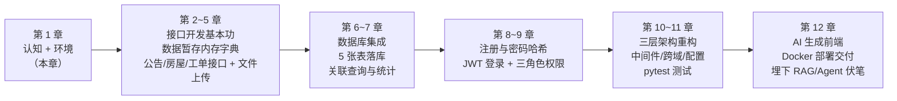

**图 1-10 课程开发路线图**

每章开头都会有一栏"**本章项目任务**"，明确告诉你这一章要为安居宝交付哪些接口——12 章走完，图 1-6 里的每一个环节都会变成真实可运行的代码。

### 小结

- 安居宝是面向小区的**物业报修服务平台**：业主报修 → 管理员派单 → 维修工维修 → 业主评价，辅以公告/规章模块。
- 三种角色（业主/维修工/管理员）、5 张表（user、house、repair_order、attachment、notice）、工单六态流转（图 1-7 是铁律）。
- 后端采用**三层架构**：api（接待）→ service（业务）→ models（数据）；第 2~5 章先用单文件，第 10 章重构到位。
- 公告/规章表与工单接口，是后续 RAG、Agent 课程的直接素材。

---

## 6. 动手搭建开发环境（Windows + Anaconda + PyCharm）

从本节开始动手。你的电脑上已安装 **Anaconda、PyCharm、MySQL 5.6**，我们按七步走。**每一步都给出：操作 → 预期结果 → 出错了怎么办**。全部完成后，你将跑通人生第一个 FastAPI 接口。

### 第一步：认识 Anaconda 与虚拟环境

Anaconda 是 Python 的"环境管理器 + 包管理器"。为什么要用它创建**虚拟环境**，而不是直接往系统 Python 里装包？

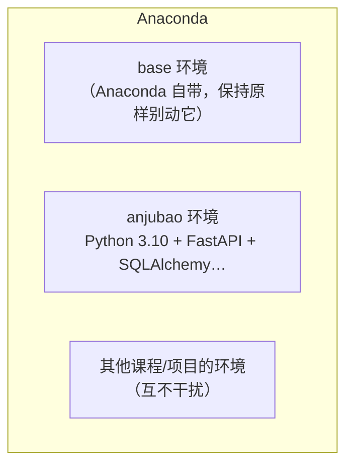

**图 1-11 一个项目一个环境，依赖互不打架**

> 💡 **虚拟环境的意义**：项目 A 要用某库的 1.0 版，项目 B 要用 2.0 版，装在一起必然打架。虚拟环境给每个项目一个**独立的 Python + 独立的包集合**，互不干扰，还能随时整个删除重来。企业开发人人如此，这是必须养成的职业习惯。

操作：点击 Windows 开始菜单，搜索 **"Anaconda Prompt"** 并打开（它是一个预配置好 conda 命令的终端窗口）。输入：

```bash
conda --version
```

预期输出（版本号可能不同）：

```text
conda 24.7.1
```

> ⚠️ 若提示"`conda` 不是内部或外部命令"：你打开的可能是普通 CMD 而不是 Anaconda Prompt，请从开始菜单重新打开；仍不行见本节末尾排错表。

### 第二步：创建项目专属虚拟环境

```bash
conda create -n anjubao python=3.10 -y
```

- `-n anjubao`：环境命名为 anjubao（与项目同名，好记）；
- `python=3.10`：指定 Python 版本。**为什么选 3.10**：FastAPI、SQLAlchemy 全生态对 3.10 兼容性最稳，且与 MySQL 5.6 时代的驱动配合无坑；
- `-y`：自动确认，省去手动输 y。

预期输出末尾：

```text
#
# To activate this environment, use
#
#     $ conda activate anjubao
#
# To deactivate an active environment, use
#
#     $ conda deactivate
```

激活环境：

```bash
conda activate anjubao
```

**成功的标志**：命令行前缀从 `(base)` 变成了 `(anjubao)`：

```text
(anjubao) C:\Users\Administrator>
```

> 📌 **从现在起直到课程结束，每次开发前都要确认前缀是 `(anjubao)`**。装错环境的包，是初学者 `ModuleNotFoundError` 的头号来源。

验证 Python 版本：

```bash
python --version
```

```text
Python 3.10.14
```

### 第三步：安装 FastAPI 与 Uvicorn

```bash
pip install fastapi "uvicorn[standard]"
```

> 💡 `uvicorn[standard]` 的方括号表示"附带标准扩展"（含热重载等功能），注意在 Anaconda Prompt 中要**加引号**，否则方括号可能被误解析。

如果下载速度极慢或超时，改用国内清华镜像源：

```bash
pip install fastapi "uvicorn[standard]" -i https://pypi.tuna.tsinghua.edu.cn/simple
```

预期输出末尾：

```text
Successfully installed annotated-types-0.7.0 anyio-4.4.0 fastapi-0.111.0 ...
```

验证安装：

```bash
pip list
```

在输出中能找到 `fastapi` 和 `uvicorn` 两行（版本号为最新版即可，不必与书中完全一致）。

### 第四步：用 PyCharm 创建项目并配置解释器

1. 打开 PyCharm → **New Project（新建项目）**；
2. Location 填 `C:\Users\你的用户名\anjubao`（项目根目录，与 conda 环境同名）；
3. 解释器选择：展开 Python Interpreter 设置 → **Conda Environment → Existing environment（已有环境）** → 选择 `anjubao` 环境的 python.exe（PyCharm 通常能在下拉列表中直接找到；找不到的话，路径一般在 `C:\Users\你的用户名\anaconda3\envs\anjubao\python.exe`）；
4. 点击 Create 打开项目。

**关键验证**：打开 PyCharm 底部 **Terminal（终端）**，输入：

```bash
python --version
```

必须显示 `Python 3.10.x`，且命令行前缀带 `(anjubao)` 或路径指向 anjubao 环境。若显示的是别的版本，说明解释器没配对——回到第 3 步重选（Settings → Project: anjubao → Python Interpreter）。

> ⚠️ **PyCharm 新建项目时不要勾选** "Create a main.py with hello world code" 之类的模板选项，我们从零建文件。

### 第五步：编写并运行第一个接口

在 PyCharm 项目根目录新建文件 `main.py`（右键项目 → New → Python File），输入以下代码——**建议逐行手敲**，敲的过程就是记忆的过程：

```python
# main.py —— 安居宝的第一个接口
from fastapi import FastAPI

# 创建 FastAPI 应用实例，title 和 version 会显示在自动文档的页面上
app = FastAPI(
    title="安居宝 · 智慧物业报修服务平台",
    description="FastAPI 课程实战项目后端",
    version="0.1.0",
)


# @app.get("/") 表示：当有人用 GET 方法访问路径 "/" 时，执行下面的函数
@app.get("/")
def hello():
    """首页接口：返回平台欢迎信息"""
    # FastAPI 会自动把这个 Python 字典转成 JSON 响应发回客户端
    return {"message": "你好，安居宝 · 智慧物业报修服务平台 v0.1"}
```

逐行解读：

| 代码 | 作用 |
|------|------|
| `from fastapi import FastAPI` | 从刚安装的 fastapi 包导入核心类 |
| `app = FastAPI(...)` | 创建应用实例，`app` 就是整个后端程序的本体 |
| `@app.get("/")` | **装饰器**：把函数注册为"GET /"这个接口的处理器（Python 基础课学过装饰器语法，这里见到它的真实用武之地） |
| `return {...}` | 返回 Python 字典，FastAPI 自动转成 JSON + 状态码 200 |

在 PyCharm 终端（确认处于 anjubao 环境）运行：

```bash
uvicorn main:app --reload
```

- `main:app` = "main.py 文件里的 app 对象"；
- `--reload` = 代码一改，服务自动重启（**仅开发环境使用**）。

预期输出：

```text
INFO:     Uvicorn running on http://127.0.0.1:8000 (Press CTRL+C to quit)
INFO:     Started reloader process [18516] using WatchFiles
INFO:     Started server process [21844]
INFO:     Waiting for application startup.
INFO:     Application startup complete.
```

看到 `Uvicorn running on http://127.0.0.1:8000`，说明你的第一个后端服务已经跑起来了。`127.0.0.1` 是"本机"的专用地址（也叫 localhost），`8000` 是端口——此刻这台"服务器"就是你自己的电脑。

**见证时刻**，打开浏览器依次访问：

1. `http://127.0.0.1:8000` → 页面显示：

   ```json
   {"message":"你好，安居宝 · 智慧物业报修服务平台 v0.1"}
   ```

   这就是你亲手发出的第一次 HTTP 请求得到的 JSON 响应（可回到第 2 节用 F12 观察它，状态码 200）。

2. `http://127.0.0.1:8000/docs` → **Swagger 自动文档**：页面上列着 `GET /` 接口，点开 → 点 **Try it out** → 点 **Execute**，下方直接显示响应 JSON 和状态码 200。你刚刚在文档里完成了一次接口测试——以后每个新接口都这样验收。

> 📌 停止服务：在终端按 `Ctrl + C`。服务运行期间该终端被占用，写代码用 PyCharm 编辑器即可，保存文件后 `--reload` 会自动重启服务。

### 第六步：检查 MySQL 5.6

第 6 章才会真正连接数据库，本节只确认它"活着"：

1. 按 `Win + R` 输入 `services.msc` 回车，在服务列表中找到 MySQL（名称通常为 `MySQL` 或 `MySQL56`），确认状态为"正在运行"；未运行则右键 → 启动。
2. 打开 Anaconda Prompt（任意环境均可），登录数据库：

```bash
mysql -u root -p
```

输入安装时设置的 root 密码，预期进入：

```text
Welcome to the MySQL monitor.  Commands end with ; or \g.
...
mysql>
```

3. 查看版本：

```sql
SELECT VERSION();
```

预期输出 `5.6.x` 开头的版本号。输入 `exit` 回车退出。

> ⚠️ 若提示"`mysql` 不是内部或外部命令"，说明 MySQL 的 bin 目录不在系统 PATH 中。两个办法：① 用完整路径调用，如 `"C:\Program Files\MySQL\MySQL Server 5.6\bin\mysql" -u root -p`；② 把该 bin 目录添加到系统环境变量 PATH（网上搜"MySQL 配置 PATH"有大量图文教程）。本课程只需能登录验证即可，第 6 章的代码连接走 PyMySQL 驱动，不依赖 PATH。

### 第七步：生成依赖清单 requirements.txt

在 anjubao 环境的终端中，于项目根目录执行：

```bash
pip freeze > requirements.txt
```

这会把当前环境里所有包及版本写入 `requirements.txt`。它的作用：

- 别人（或未来的你、或第 12 章的 Docker）拿到项目后，一条 `pip install -r requirements.txt` 即可复现完全相同的环境；
- 这是工程交付的标配文件，从第 1 章就养成习惯。

> 💡 后续章节每安装一个新包，记得重新执行一次该命令更新清单。

### 环境排错速查表

| 症状 | 最可能的原因 | 解决办法 |
|------|------------|---------|
| `conda 不是内部或外部命令` | 用了普通 CMD/PowerShell | 改用开始菜单的 **Anaconda Prompt** |
| `ModuleNotFoundError: No module named 'fastapi'` | PyCharm 解释器没选 anjubao 环境；或安装时不在 anjubao 环境 | 检查终端前缀是否 `(anjubao)`；重选 PyCharm 解释器（第四步） |
| `ERROR: [Errno 10048] error while attempting to bind on address ... 8000` | 8000 端口被占用（上次的服务没关，或别的程序占了） | 关掉旧的 uvicorn 窗口；或换端口：`uvicorn main:app --reload --port 8001` |
| PowerShell 中运行脚本报"禁止运行脚本" | PowerShell 执行策略限制 | 改用 **Anaconda Prompt** 或 PyCharm Terminal（本课程统一用它们，绕开此问题） |
| `pip install` 下载极慢/超时 | 默认源在国外 | 加 `-i https://pypi.tuna.tsinghua.edu.cn/simple` |
| 浏览器访问 127.0.0.1:8000 打不开 | 服务没启动，或端口敲错 | 看终端是否有 `Uvicorn running on ...`；核对端口号 |
| 访问 `/docs` 是空白页 | 网络受限加载不了 Swagger 的静态资源 | 属于个别内网环境问题，先用 `/redoc` 代替，课后找老师处理 |

### 小结

- 一个项目一个 conda 虚拟环境：`conda create -n anjubao python=3.10` → `conda activate anjubao`。
- 安装两件套：`pip install fastapi "uvicorn[standard]"`。
- PyCharm 必须把解释器指到 anjubao 环境，终端里 `python --version` 验证。
- 运行命令 `uvicorn main:app --reload`，浏览器访问 `127.0.0.1:8000` 看 JSON、`/docs` 玩自动文档。
- MySQL 5.6 确认服务运行、能用 root 登录、`SELECT VERSION();` 输出 5.6.x。
- `pip freeze > requirements.txt` 固化依赖清单。

---

## 本章小结

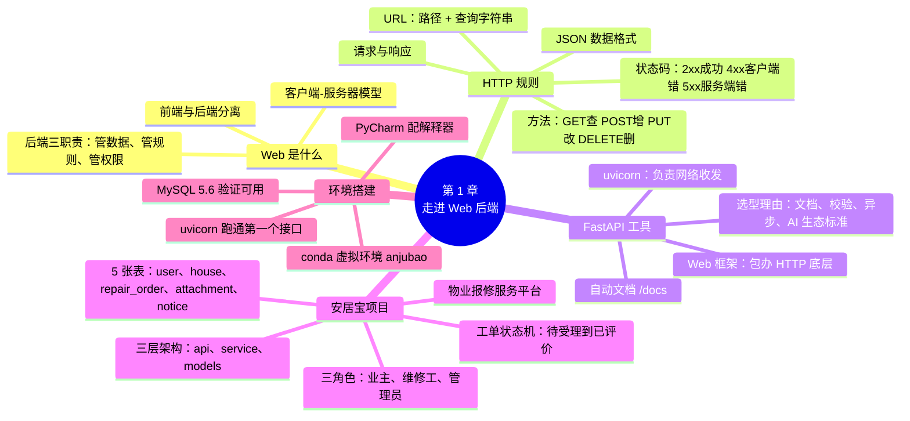

**本章你完成了什么**：建立了 Web 后端的完整认知地图；拿到了安居宝的"需求文档"（第 5 节，请反复阅读）；搭好了全套开发环境并跑通了第一个接口——从这一刻起，你的电脑上运行着一个真正的 Web 服务。

**下一章预告**：第 2 章正式开工，学习路径参数与查询参数，为安居宝实现第一批查询接口：房屋详情、工单筛选、公告搜索。

---

## 附录

### 附录 A：本章术语表

| 英文 | 中文 | 一句话解释 |
|------|------|-----------|
| Web | 万维网 | 基于客户端-服务器模式的应用体系 |
| Client | 客户端 | 发起请求的一方（浏览器、App） |
| Server | 服务器 | 接收请求、返回响应的一方 |
| HTTP | 超文本传输协议 | 客户端与服务器之间的通信规则 |
| Request / Response | 请求 / 响应 | HTTP 交互的两个方向 |
| URL | 统一资源定位符 | 网络资源的地址 |
| Method | 请求方法 | GET/POST/PUT/DELETE 等"动词" |
| Status Code | 状态码 | 响应结果的三位数编码 |
| JSON | JS 对象简谱 | 前后端交换数据的文本格式 |
| API | 应用程序接口 | 供程序调用的接口（本课程的核心产物） |
| Framework | 框架 | 包办通用底层逻辑的工具库 |
| ASGI Server | 异步服务器网关接口服务器 | uvicorn 这类服务器的统称 |
| ORM | 对象关系映射 | 用 Python 类操作数据库表的技术（第 6 章） |
| RBAC | 基于角色的访问控制 | 按角色分配权限（第 9 章） |
| CRUD | 增删改查 | Create/Read/Update/Delete |
| Virtual Environment | 虚拟环境 | 项目独享的 Python + 包集合 |
| IDE | 集成开发环境 | PyCharm 这类开发工具 |

### 附录 B：环境命令速查卡（可打印）

```bash
# ── 环境管理（在 Anaconda Prompt 中）──
conda --version                          # 查看 conda 版本
conda create -n anjubao python=3.10 -y   # 创建环境
conda activate anjubao                   # 激活环境（每次开发前！）
conda deactivate                         # 退出环境
conda env list                           # 列出所有环境
conda env remove -n 环境名               # 删除环境

# ── 包管理（先激活 anjubao）──
pip install fastapi "uvicorn[standard]"  # 安装
pip install 包名 -i https://pypi.tuna.tsinghua.edu.cn/simple   # 用清华镜像加速
pip list                                 # 查看已装的包
pip freeze > requirements.txt            # 导出依赖清单
pip install -r requirements.txt          # 按清单复现环境

# ── 运行项目（在 PyCharm Terminal，项目根目录）──
uvicorn main:app --reload                # 启动服务（开发模式）
uvicorn main:app --reload --port 8001    # 8000 被占用时换端口
# Ctrl + C 停止服务

# ── 浏览器访问 ──
# http://127.0.0.1:8000       接口本身
# http://127.0.0.1:8000/docs  Swagger 交互式文档（测试接口用）
# http://127.0.0.1:8000/redoc ReDoc 阅读式文档

# ── MySQL 验证 ──
mysql -u root -p        # 登录（回车后输密码）
SELECT VERSION();       # 应输出 5.6.x
exit                    # 退出
```

### 附录 C：Anaconda Prompt、CMD、PowerShell、PyCharm Terminal 的区别

| 终端 | 怎么打开 | conda 命令可用？ | 本课程用它吗 |
|------|---------|:---:|:---:|
| **Anaconda Prompt** | 开始菜单搜索 | ✅ 开箱即用 | ✅ 环境管理专用 |
| CMD | `Win+R` → `cmd` | ⚠️ 取决于安装时是否勾选配置 | 不推荐 |
| PowerShell | 开始菜单搜索 | ⚠️ 同上，且有脚本执行策略限制 | 不推荐 |
| **PyCharm Terminal** | PyCharm 底部 Terminal 标签 | ✅ 自动激活项目解释器对应的环境 | ✅ 运行项目专用 |

> 📌 **本课程统一约定**：装包、建环境用 **Anaconda Prompt**；运行 uvicorn、pytest 用 **PyCharm Terminal**。统一用这两个，可以绕开 90% 的"命令找不到"类问题。

### 附录 D：uvicorn 启动命令的常用参数

本课程的标准启动命令是 `uvicorn main:app --reload`，它的完整结构是：

```text
uvicorn main:app --reload --host 127.0.0.1 --port 8000
└─┬─┘ └───┬───┘ └──┬───┘ └───────┬───────┘ └────┬────┘
 服务器  位置参数   可选参数      可选参数        可选参数
       "模块:应用对象"（后三项不写时使用默认值）
```

常用参数一览：

| 参数 | 默认值 | 作用 | 使用场景 |
|------|--------|------|---------|
| `main:app` | （必填） | 指定"哪个文件里的哪个应用对象"，冒号前是模块名（main.py），冒号后是 `FastAPI()` 实例的变量名 | 每次启动都要写 |
| `--reload` | 关闭 | 监视代码文件，一有改动自动重启服务 | **开发时必开**；生产环境禁用 |
| `--host` | `127.0.0.1` | 监听的 IP 地址。`127.0.0.1` 只允许本机访问；改成 `0.0.0.0` 则允许局域网内其他设备访问 | 想用手机或同学电脑访问你本机服务时 |
| `--port` | `8000` | 监听的端口号 | 端口被占用时换端口（如 `--port 8001`） |
| `--log-level` | `info` | 日志详细程度：`critical` / `error` / `warning` / `info` / `debug` / `trace`，越往后越啰嗦 | 排查诡异问题时临时用 `debug` |
| `--workers` | 1 | 启动多个工作进程并行处理请求，压榨多核 CPU 性能 | **生产部署**用；与 `--reload` 互斥 |
| `--reload-dir` | 整个目录 | 只监视指定子目录的改动 | 项目大了之后加快重载速度（了解即可） |

三种典型用法（由近及远）：

```bash
# ① 日常开发（第 1~11 章一直用它）
uvicorn main:app --reload

# ② 局域网演示：让手机/同学电脑访问你本机的服务
#    先查本机局域网 IP：ipconfig（找"IPv4 地址"，如 192.168.1.100）
#    对方浏览器访问 http://192.168.1.100:8000/docs
uvicorn main:app --reload --host 0.0.0.0

# ③ 生产部署预览（第 12 章 Docker 里就是类似的形态）
#    不开热重载，多进程提升并发能力
uvicorn main:app --host 0.0.0.0 --port 8000 --workers 4
```

> ⚠️ 三个注意事项：
> ① `--reload` 与 `--workers` **不能同时使用**（热重载靠单进程监视文件，多进程会冲突）；
> ② `--host 0.0.0.0` 会把服务暴露到局域网，Windows 防火墙可能弹窗询问，选"允许"即可；演示完记得 `Ctrl + C` 关闭服务；
> ③ 查看所有参数的官方说明：`uvicorn --help`。
