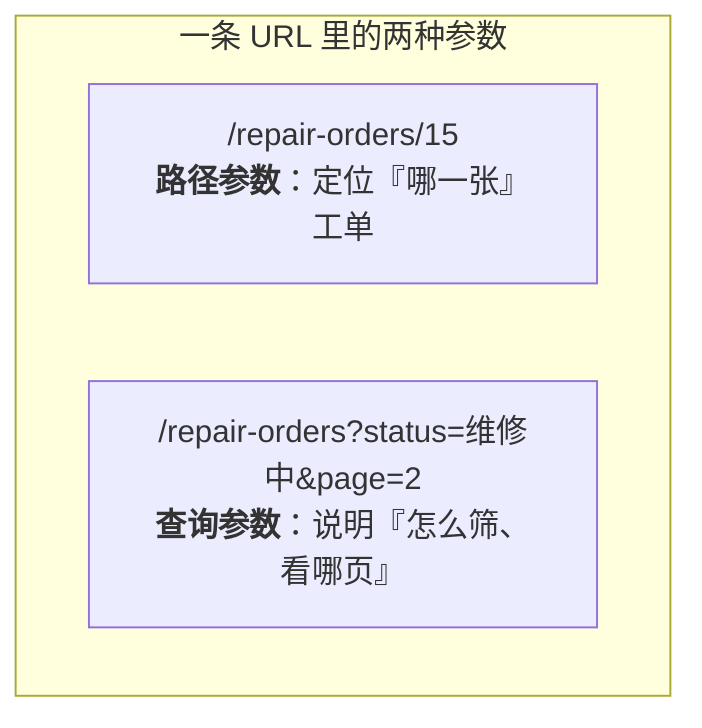
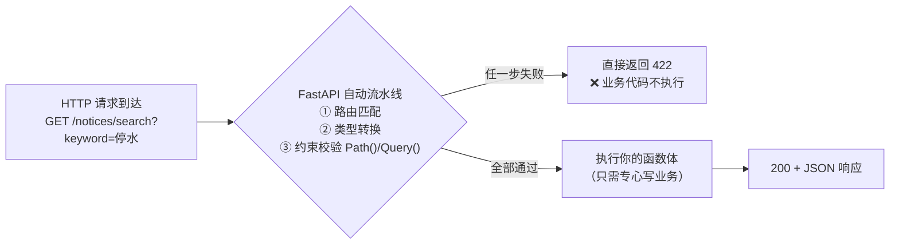
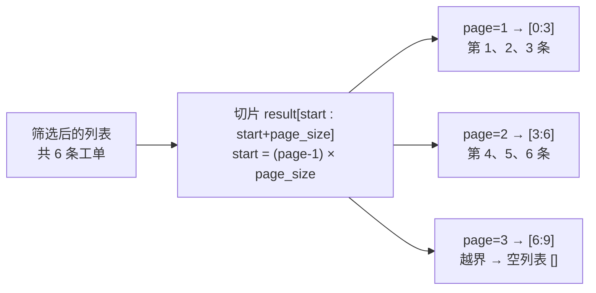
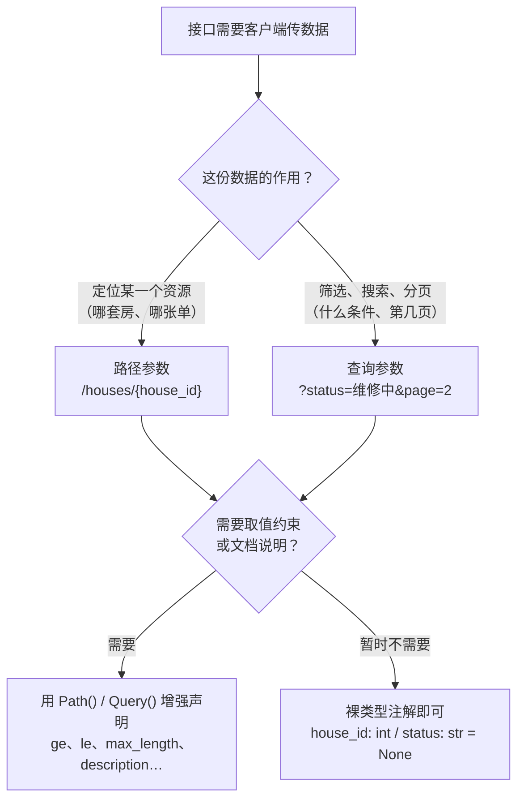

# 第 2 章 接收数据：路径参数与查询参数

> **本章定位**：实战起步篇。从本章起正式为安居宝开发接口，数据全部暂存在**内存字典/列表**中（第 6 章才换成 MySQL），让你心无旁骛地专注一件事：**URL 里的数据如何进入 Python 函数**。
>
> 本章覆盖知识点：GET 接口、路径参数、类型自动转换与校验、`Path()`、查询参数、`Query()`、422 错误解读、分页接口设计。
>
> **开发约定**（延续第 1 章第 5 节蓝图）：第 2~5 章所有代码写在单个 `main.py` 中，运行方式始终是 PyCharm Terminal 里的 `uvicorn main:app --reload`，测试方式始终是浏览器访问 `http://127.0.0.1:8000/docs`。

---

## 学习目标

完成本章学习后，你应当能够：

1. **分得清**：说出路径参数与查询参数在 URL 中的位置差异，并根据"定位资源还是筛选数据"正确选择参数类型。
2. **写得出**：编写带路径参数的接口，理解类型注解如何同时完成"自动转换 + 自动校验"；用 `Path()` / `Query()` 为参数添加取值约束和文档说明；实现带可选参数、默认值的多条件筛选接口和分页接口。
3. **看得懂**：读懂 422 校验错误的 JSON 结构（loc / msg / type / input），据此定位调用方传参问题。
4. **交得出**：为安居宝交付第一批 GET 查询接口——公告列表、公告搜索、房屋详情、工单筛选分页。

---

## 1. 本章项目任务与数据准备

### 本章项目任务（回指第 1 章表 1-1 需求清单）

| # | 接口 | 功能 | 本章知识点 |
|---|------|------|-----------|
| 1 | `GET /notices` | 公告列表，可按分类筛选 | 查询参数、可选参数 |
| 2 | `GET /notices/search` | 公告/规章关键词搜索 | `Query()` 约束 |
| 3 | `GET /houses/{house_id}` | 房屋详情 | 路径参数、`Path()` 约束、404 |
| 4 | `GET /repair-orders` | 工单多条件筛选 + 分页 | 路径/查询综合运用、分页设计 |

### 热身思考：hello 接口的"缺陷"

第 1 章我们跑通了第一个接口：

```python
@app.get("/")
def hello():
    return {"message": "你好，安居宝 · 智慧物业报修服务平台 v0.1"}
```

它能用，但有个致命缺陷：**返回的内容是写死的**。业主想看"3 栋 2 单元 501"的房屋信息，维修工想看"维修中"的工单列表——一个只会背一句话的接口什么都帮不上。

真实的接口必须做到：**你告诉它"要什么"，它按你说的给**。"要什么"这个信息，就藏在 URL 里。本章我们学习从 URL 中接收数据的两种方式——**路径参数**和**查询参数**。

### 内存数据准备

按第 1 章第 5 节的表设计，在 `main.py` 顶部定义三份内存数据。字段与将来的数据库表**一一对应**，第 6 章落库时你会看到它们原样"搬进" MySQL：

```python
# main.py —— 安居宝接口开发（第 2 章：数据暂存内存）
from fastapi import FastAPI, HTTPException, Path, Query

app = FastAPI(
    title="安居宝 · 智慧物业报修服务平台",
    description="FastAPI 课程实战项目后端",
    version="0.2.0",
)

# ─────────────────────────────────────────────
# 内存数据（第 6 章将全部替换为 MySQL 数据库表）
# ─────────────────────────────────────────────

# 维修工姓名对照（临时占位：用户表第 6 章才建，
# 现在先用字典把 worker_id 翻译成姓名，方便看数据）
WORKERS = {2: "王师傅", 3: "李师傅"}

# 房屋表 house 的内存版（对应第 1 章表设计）
HOUSES = [
    {"id": 1, "owner_id": 11, "building": "3栋", "unit": "2单元", "room": "501"},
    {"id": 2, "owner_id": 12, "building": "3栋", "unit": "2单元", "room": "502"},
    {"id": 3, "owner_id": 13, "building": "5栋", "unit": "1单元", "room": "1802"},
]

# 报修工单表 repair_order 的内存版（6 张单，覆盖全部六种状态）
REPAIR_ORDERS = [
    {"id": 1, "house_id": 1, "worker_id": None, "type": "水电",
     "description": "厨房水管漏水，橱柜底下一直滴水", "status": "待受理",
     "score": None, "created_at": "2026-10-22 09:15", "finished_at": None},
    {"id": 2, "house_id": 2, "worker_id": 2, "type": "电梯",
     "description": "1单元电梯上行时有异响", "status": "已派单",
     "score": None, "created_at": "2026-10-21 16:40", "finished_at": None},
    {"id": 3, "house_id": 3, "worker_id": 3, "type": "门窗",
     "description": "阳台推拉门脱轨关不上", "status": "维修中",
     "score": None, "created_at": "2026-10-20 10:05", "finished_at": None},
    {"id": 4, "house_id": 1, "worker_id": 2, "type": "水电",
     "description": "卫生间地漏堵塞下水慢", "status": "已完成",
     "score": None, "created_at": "2026-10-18 14:20", "finished_at": "2026-10-19 11:00"},
    {"id": 5, "house_id": 2, "worker_id": 3, "type": "其他",
     "description": "楼道感应灯不亮", "status": "已评价",
     "score": 5, "created_at": "2026-10-15 19:30", "finished_at": "2026-10-16 09:00"},
    {"id": 6, "house_id": 3, "worker_id": None, "type": "水电",
     "description": "重复提交的报修单", "status": "已取消",
     "score": None, "created_at": "2026-10-14 08:00", "finished_at": None},
]

# 公告/规章表 notice 的内存版（content 是将来 RAG 课程的语料，先写短一点）
NOTICES = [
    {"id": 1, "author_id": 1, "title": "停水通知：10月25日3栋临时停水",
     "content": "因市政管网检修，10月25日8:00-18:00期间3栋全天停水，请各户提前储水。",
     "category": "公告", "created_at": "2026-10-20 10:00"},
    {"id": 2, "author_id": 1, "title": "电梯年检通知",
     "content": "10月28日上午对全部电梯进行年检，期间电梯暂停使用，请走楼梯并注意安全。",
     "category": "公告", "created_at": "2026-10-19 15:30"},
    {"id": 3, "author_id": 1, "title": "住宅装修管理规定",
     "content": "装修施工时间为工作日8:00-12:00、14:00-18:00；周末及法定节假日禁止产生噪音的施工；装修垃圾须袋装并投放至指定点位。",
     "category": "规章", "created_at": "2026-10-01 09:00"},
    {"id": 4, "author_id": 1, "title": "消防通道管理规定",
     "content": "消防通道内禁止停放车辆、堆放杂物；违者物业将拍照留证并上报消防部门。",
     "category": "规章", "created_at": "2026-10-01 09:05"},
    {"id": 5, "author_id": 1, "title": "高空抛物监控启用公告",
     "content": "小区已启用高空抛物监控摄像头，覆盖全部楼栋立面，请广大业主共同监督。",
     "category": "公告", "created_at": "2026-09-28 17:00"},
]
```

> 📌 **三点说明**
> ① 这就是第 1 章说的"先跑起来"阶段：数据在内存里，**服务一重启就恢复原样**，任何修改都不会真正保存——第 6 章换成 MySQL 后才有真正的持久化。
> ② `version` 升到了 `0.2.0`，这是工程习惯：每交付一批功能，版本号向前走一步。
> ③ 导入行里出现了 `HTTPException`、`Path`、`Query` 三个新面孔，本章会逐一认识它们。

### 第一个列表接口：返回全部公告

先写最简单的接口热热身——把 `NOTICES` 整个返回：

```python
@app.get("/notices")
def list_notices():
    """公告列表：返回全部社区公告与物业规章"""
    return NOTICES
```

启动服务（`uvicorn main:app --reload`），浏览器访问 `http://127.0.0.1:8000/notices`，预期响应（节选前两条）：

```json
[
    {
        "id": 1,
        "author_id": 1,
        "title": "停水通知：10月25日3栋临时停水",
        "content": "因市政管网检修，10月25日8:00-18:00期间3栋全天停水，请各户提前储水。",
        "category": "公告",
        "created_at": "2026-10-20 10:00"
    },
    {
        "id": 2,
        "author_id": 1,
        "title": "电梯年检通知",
        "content": "10月28日上午对全部电梯进行年检，期间电梯暂停使用，请走楼梯并注意安全。",
        "category": "公告",
        "created_at": "2026-10-19 15:30"
    }
]
```

注意一个新现象：**返回 Python 列表，FastAPI 自动转成 JSON 数组**（第 1 章返回字典转成 JSON 对象，规律一致）。打开 `/docs`，能看到接口列表里多了 `GET /notices`，点 Try it out → Execute 也能得到同样结果。

但这个接口和第 1 节的 hello 一样"死板"：不管谁来问，答案都一样。下面开始让它"听话"。

### 小结

- 本章为安居宝交付 4 个查询接口，数据暂存内存列表，字段设计与第 1 章的 5 张表一致。
- 返回列表 → JSON 数组，返回字典 → JSON 对象，FastAPI 自动完成转换。
- 真实接口的核心能力是"**按调用方的要求返回数据**"，这要求接口能接收参数。

---

## 2. 路径参数：把数据嵌在 URL 里

### 定义

想查询"3 号房屋"的详情，最符合直觉的 URL 是把编号直接放进路径里：

```text
GET /houses/3
```

这里的 `3` 不是写死的，而是**占位符**——访问 `/houses/1` 查 1 号房，访问 `/houses/3` 查 3 号房。FastAPI 用花括号语法声明这种占位符：

```python
@app.get("/houses/{house_id}")
```

> 💡 **一句话定义**
> **路径参数（Path Parameter）**：URL 路径中的变量部分，用于**定位某一个具体资源**。`{house_id}` 是声明，客户端实际传入的值会作为函数参数送进来。

### 图示：一次请求的完整旅程

**图 2-1** 展示 `GET /houses/3` 从浏览器到响应的全过程，注意第 3、4 步是 FastAPI 自动替你做的：


**图 2-1 路径参数请求的完整旅程**

### 例子：房屋详情接口

```python
@app.get("/houses/{house_id}")
def get_house(house_id: int):
    """房屋详情：按编号查询某套房屋的信息"""
    for house in HOUSES:                # 遍历内存列表查找
        if house["id"] == house_id:     # 注意：house_id 已经是 int，可以直接 == 比较
            return house
    # 走到这里说明没找到，抛出 404 异常（见下方"先睹为快"框）
    raise HTTPException(status_code=404, detail=f"房屋 {house_id} 不存在")
```

访问 `http://127.0.0.1:8000/houses/1`，预期响应：

```json
{"id": 1, "owner_id": 11, "building": "3栋", "unit": "2单元", "room": "501"}
```

> 💡 **先睹为快：HTTPException 与 404**
> `raise HTTPException(status_code=404, detail="...")` 的意思是："别往下走了，直接给客户端返回 404 状态码和这段错误说明"。响应长这样：
>
> ```json
> {"detail": "房屋 99 不存在"}
> ```
>
> 本章你只需会这两行写法（查不到就 404），**为什么要这样设计、还有哪些玩法，第 4 章正式深入**。但从现在起就要养成习惯：**资源不存在必须返回 404，绝不能"查不到也返回 200 + 空数据"**——那会让调用方分不清"没有这个资源"和"资源存在但没内容"。

### 类型自动转换：类型注解在 FastAPI 里"真正干活"

注意函数签名里的 `house_id: int`。URL 里传来的一切**本来都是字符串**（`"3"`），但你声明了 `int`，FastAPI 就自动完成了转换——所以在函数体里可以直接用 `==` 和数字比较，不需要自己写 `int(house_id)`。

这印证了第 1 章"选 FastAPI 的理由二"：**类型注解不是注释，而是会干活的校验规则**。它同时带来三件事：

1. **转换**：`"3"` → `3`；
2. **校验**：转不了就拒绝（见下）；
3. **文档**：`/docs` 里自动标明该参数类型为 integer。

### 自动校验初体验：访问 /houses/abc

访问 `http://127.0.0.1:8000/houses/abc`，`"abc"` 显然转不成 int，预期响应（状态码 **422**）：

```json
{
    "detail": [
        {
            "type": "int_parsing",
            "loc": ["path", "house_id"],
            "msg": "Input should be a valid integer, unable to parse string as an integer",
            "input": "abc"
        }
    ]
}
```

先大致读懂它（第 7 节和附录 B 系统讲解）：

- `loc: ["path", "house_id"]`——出错的**位置**：路径里的 house_id 参数；
- `msg`——**人话原因**：应该是一个合法整数，但没法把这个字符串解析成整数；
- `input: "abc"`——客户端**实际传的值**。

**你的函数根本没有被执行**——非法请求在门口就被拦下了。这就是"自动校验"的价值：业务代码里永远不用写 `if not house_id.isdigit()` 这类防御代码。

### 常见坑

- ⚠️ **路径里的占位符名和函数形参名不一致** → 启动直接报错：

  ```python
  @app.get("/houses/{house_id}")
  def get_house(hid: int):        # ❌ 函数参数叫 hid，路径里叫 house_id
      ...
  # 启动报错：Path parameter 'house_id' not found in function signature
  ```

  规则：**两处名字必须完全相同**。
- ⚠️ **忘写类型注解** → 参数收到的是字符串 `"3"`，`house["id"] == house_id` 永远不成立（int 和 str 不相等），接口诡异地"永远 404"。排查时优先检查类型注解。
- ⚠️ **路由匹配顺序**：固定路径必须写在参数路径**前面**。假如将来有个"查我家房屋"接口 `/houses/mine`，而 `/houses/{house_id}` 定义在前，那么访问 `/houses/mine` 会先命中 `{house_id}`，把 `"mine"` 当编号去转 int，得到 422。FastAPI 按**定义顺序**逐个匹配路由，"具体的"要放前面，"带占位符的"放后面。

### 小结

- 路径参数用 `{参数名}` 声明，适合"定位某一个资源"的场景。
- 类型注解自动完成转换、校验、文档三件事；非法值直接 422，业务代码不会被执行。
- 查无此资源要 `raise HTTPException(status_code=404)`（第 4 章深入）。
- 占位符名与形参名必须一致；固定路由写在参数路由前面。

---

## 3. Path()：给路径参数立规矩、写说明

### 动机：int 还不够严

`/houses/3` 能查，`/houses/abc` 被拦——但 `/houses/0` 和 `/houses/-5` 呢？它们能顺利转成 int，可业务上房屋编号从 1 开始，0 号和 -5 号房根本不存在。光靠 `int` 只能保证"是个整数"，保证不了"是个**合法**的整数"。虽然最终会走到 404，但更好的做法是：**在门口就以"参数不合法"拦截**，并在文档里写清楚规则。

### 定义

`Path()` 是路径参数的**增强声明**：给参数附加取值约束和文档元数据。写法上，它占据函数参数的"默认值"位置：

```python
house_id: int = Path(ge=1)
#          ↑类型注解   ↑增强声明：必须 ≥ 1
```

### 常用配置项

| 配置项 | 含义 | 例子 |
|--------|------|------|
| `ge` | greater or equal，大于等于 | `Path(ge=1)` → 最小 1 |
| `le` | less or equal，小于等于 | `Path(le=100)` → 最大 100 |
| `gt` / `lt` | 严格大于 / 严格小于 | `Path(gt=0)` |
| `title` | 文档中显示的参数标题 | `Path(title="房屋ID")` |
| `description` | 文档中显示的详细说明 | `Path(description="要查询的房屋编号")` |
| `examples` | 文档中展示的示例值 | `Path(examples=[1, 3])` |

### 例子：升级房屋详情接口

```python
@app.get("/houses/{house_id}")
def get_house(
    house_id: int = Path(
        ge=1,
        title="房屋ID",
        description="要查询的房屋编号，从 1 开始",
        examples=[1, 3],
    )
):
    """房屋详情：按编号查询某套房屋的信息"""
    for house in HOUSES:
        if house["id"] == house_id:
            return house
    raise HTTPException(status_code=404, detail=f"房屋 {house_id} 不存在")
```

升级后重启服务，两处可见变化：

**① 拦截更精准**。访问 `/houses/0`，预期响应（422）：

```json
{
    "detail": [
        {
            "type": "greater_than_equal",
            "loc": ["path", "house_id"],
            "msg": "Input should be greater than or equal to 1",
            "input": 0,
            "ctx": {"ge": 1}
        }
    ]
}
```

错误类型从"解析不了"变成了明确的 `greater_than_equal`（应大于等于 1），`ctx` 里还带着你的约束规则——调用方一看就知道该怎么改。

**② 文档更专业**。打开 `/docs` 点开 `GET /houses/{house_id}`：参数表里出现了标题"房屋ID"、说明文字和示例值。对比升级前那个光秃秃的 `house_id`，这就是第 1 章说的"自动文档"被喂了元数据之后的效果——**第 12 章 AI 生成前端时，读的正是这份文档**，参数说明写得越清楚，AI 生成的前端越准确。

### Path() 与"裸注解"的关系

| 写法 | 效果 |
|------|------|
| `house_id: int` | 只保证是整数 |
| `house_id: int = Path(ge=1)` | 是整数，且 ≥ 1，文档带说明 |

`Path()` 不是替代类型注解，而是**叠加**在类型注解之上的第二层规则。

### 常见坑

- ⚠️ **带默认值的参数必须排在不带默认值的参数后面**——这是 Python 函数语法的旧知识（`def f(a, b=1)` 合法，`def f(a=1, b)` 语法错误），在 FastAPI 里同样生效。`Path(...)` 在语法上就是默认值，所以路径参数若用了 `Path()`，函数里其他无默认值的参数必须排在它前面（本章的接口都只有一个参数，暂时遇不到；第 6 章多参数时会再提醒）。
- ⚠️ **路径参数不能设成可选**。`Path(default=None)` 会让服务启动报错——路径参数是 URL 的一部分，天生必填；`/houses/{house_id}` 不存在"不传 house_id"的访问方式。想让参数可选，那是查询参数的领域（第 4 节）。
- ⚠️ **约束是"业务规则"，不要写成"物理极限"**。`ge=1` 合理（编号从 1 开始）；有人写 `le=3` 因为"目前只有 3 套房"——将来第 4 套房录入后接口就误杀了。约束应对应**永远成立的规则**。

### 小结

- `Path()` 给路径参数叠加取值约束（ge/le/gt/lt）与文档元数据（title/description/examples）。
- 非法值在门口就被 422 拦截，错误信息里直接写明违反了哪条约束。
- 路径参数天生必填，不能 `default=None`；约束要写业务上永远成立的规则。

---

## 4. 查询参数：URL 问号后的"筛选条件"

### 定义

再看一个需求："把所有**维修中**的工单列出来"。状态不是某个资源的编号，而是一个**筛选条件**。这类数据放在 URL 问号之后，以 `key=value` 形式传递，叫**查询参数（Query Parameter）**：

```text
GET /repair-orders?status=维修中&type=水电
                  └──────┬──────┘└────┬────┘
                     查询参数1      查询参数2
```

FastAPI 的判断规则简单到令人意外：

> 💡 **函数参数里，凡是没出现在路径花括号中的，一律自动视为查询参数。**

### 图示与对比：路径参数 vs 查询参数



**图 2-2 两种参数各管一件事**

| 对比项 | 路径参数 | 查询参数 |
|--------|---------|---------|
| 位置 | 路径中，`{}` 声明 | 问号后，`key=value` |
| 语义 | **定位资源**：哪一个 | **修饰请求**：怎么筛、翻到哪页 |
| 是否必填 | 天生必填 | 可必填、可可选 |
| 安居宝例子 | `/houses/3`（3 号房） | `?status=维修中`（只看维修中） |
| 声明方式 | 路径 `{house_id}` + 形参 | 只需形参（不在路径里即可） |

### 例子一：必填查询参数

```python
@app.get("/repair-orders/by-worker")
def list_orders_by_worker(worker_id: int):
    """按维修工查工单：worker_id 不在路径里 → 自动成为查询参数"""
    result = []
    for order in REPAIR_ORDERS:
        if order["worker_id"] == worker_id:
            result.append(order)
    return result
```

- 访问 `/repair-orders/by-worker?worker_id=2` → 返回王师傅名下的 2 张工单（id 为 2 和 4）；
- 访问 `/repair-orders/by-worker`（**不传参数**）→ 422 错误，`"type": "missing"`（缺少必填参数），`"loc": ["query", "worker_id"]`。

**不带默认值的查询参数 = 必填**，不传就 422。

### 例子二：可选查询参数与默认值

必填太苛刻——多数时候业主希望"不筛选就看全部"。给参数一个默认值，它就变成可选的：

```python
@app.get("/notices")
def list_notices(category: str | None = None):
    """公告列表：可按分类筛选（公告/规章），不传则返回全部"""
    if category is None:            # 没传筛选条件 → 全部返回
        return NOTICES
    result = []
    for notice in NOTICES:
        if notice["category"] == category:
            result.append(notice)
    return result
```

> 📌 此版本**替换**第 1 节的无参数版本：`/notices` 从此由这个函数处理（删掉旧版）。升级只新增了可选参数 `category`，"不传则返回全部"的分支保留了旧版的原有行为。

- 访问 `/notices` → 全部 5 条；
- 访问 `/notices?category=规章` → 只返回《住宅装修管理规定》《消防通道管理规定》2 条。

**关于 `str | None`**：这个类型读作"字符串**或** None"。因为参数默认值是 `None`，严谨的类型标注要允许 None 出现。竖线写法是 Python 3.10+ 的原生语法（第 1 章环境搭建选 Python 3.10，这里正好用上），**全课程统一使用这种写法**：可选参数就写 `类型 | None = None`。在旧教程或部分官方文档里，你可能见到等价的旧写法 `Union[类型, None]`（需 `from typing import Union`），认识即可，本课程不使用。

### 例子三：多参数组合筛选

查询参数可以有任意多个，FastAPI 自动逐一解析：

```python
@app.get("/repair-orders")
def list_orders(
    status: str | None = None,
    type: str | None = None,
):
    """工单列表：可按状态、类型组合筛选，都不传则返回全部"""
    result = REPAIR_ORDERS
    if status is not None:
        result = [o for o in result if o["status"] == status]
    if type is not None:
        result = [o for o in result if o["type"] == type]
    return result
```

| 访问 URL | 返回 |
|----------|------|
| `/repair-orders` | 全部 6 张 |
| `/repair-orders?status=维修中` | 1 张（id=3） |
| `/repair-orders?type=水电` | 3 张（id=1、4、6） |
| `/repair-orders?status=维修中&type=水电` | 0 张（返回 `[]`，两个条件同时满足的单不存在） |

> 💡 注意代码里的列表推导式 `[o for o in result if ...]`——这是 Python 基础课的旧知识，在筛选场景里非常好用。另注意最后一行：**筛选结果为空返回 `[]` + 200**，这不是错误，"没有符合条件的数据"本身就是一种正常答案。

### 常见坑

- ⚠️ **中文和空格会被 URL 编码**。`?status=维修中` 在浏览器地址栏回车后，实际发出的是 `?status=%E7%BB%B4%E4%BF%AE%E4%B8%AD`（第 1 章讲过的"旅行装"）。FastAPI 自动还原，你的代码收到的就是 `"维修中"`，无需处理；但在 F12 抓包里看到 `%xx` 不要以为出了 Bug。
- ⚠️ **布尔型查询参数的合法写法**。若参数声明为 `finished: bool = False`，客户端传 `?finished=true`、`1`、`yes`、`on` 都算 True（不区分大小写）；传 `?finished=是的` 会 422。
- ⚠️ **别把筛选条件做成路径**。`/notices/category/规章` 这种设计是"坏味道"：category 不是资源编号而是筛选条件，规范写法是 `/notices?category=规章`。判断标准回到图 2-2：**"哪一个"进路径，"怎么筛"进查询**。
- ⚠️ **参数名 `type` 与 Python 内置函数重名**。上面例子中 `type: str | None = None` 遮蔽了内置函数 `type()`。此处无伤大雅（函数体内没用到内置 type），但工程上更稳妥的命名是 `order_type` 并配合文档说明。本章为与数据库字段一致先用 `type`，知道有这回事即可。

### 小结

- 不在路径花括号里的函数参数，自动成为查询参数；它承载"筛选、搜索、分页"类修饰信息。
- 无默认值 = 必填（不传 422）；`类型 | None = None` = 可选。
- 多个查询参数可自由组合；筛选结果为空返回 `[]` + 200 是正常语义。

---

## 5. Query()：给查询参数立规矩、写说明

### 动机

和第 3 节的 `Path()` 完全同理：搜索关键词若不限长度，有人传一篇一万字的"关键词"；分页参数 page 若是 0 或 -1，切片逻辑就会出鬼。**`Query()` 是查询参数的增强声明**，配置项与 `Path()` 几乎是同一套：

| 配置项 | 含义 | 例子 |
|--------|------|------|
| `default` | 默认值（等价于直接写 `= None`） | `Query(default=None)` |
| `min_length` / `max_length` | 字符串最短/最长（按**字符**数，中文一个字算一个） | `Query(max_length=20)` |
| `ge` / `le` / `gt` / `lt` | 数值范围 | `Query(ge=1)` |
| `title` / `description` / `examples` | 文档元数据 | `Query(description="搜索关键词")` |

> 💡 **记忆策略**：Path 和 Query 是"两兄弟"，配置项通用，只是管辖范围不同——一个管路径参数，一个管查询参数。

### 例子：公告搜索接口

需求：按关键词模糊搜索公告标题和正文（"停水"能搜到《停水通知》）。

```python
@app.get("/notices/search")
def search_notices(
    keyword: str | None = Query(
        default=None,
        min_length=1,
        max_length=20,
        title="搜索关键词",
        description="在公告标题和正文中模糊搜索，1~20 个字符",
        examples=["停水", "装修"],
    ),
):
    """公告搜索：按关键词模糊匹配标题与正文，不传关键词则返回全部"""
    if keyword is None:
        return NOTICES
    result = []
    for notice in NOTICES:
        # 标题或正文任一命中即算匹配（in 判断子串，Python 旧知识）
        if keyword in notice["title"] or keyword in notice["content"]:
            result.append(notice)
    return result
```

测试三组用例：

| 访问 URL | 预期结果 |
|----------|---------|
| `/notices/search?keyword=停水` | 命中 1 条：《停水通知》 |
| `/notices/search?keyword=装修` | 命中 1 条：《住宅装修管理规定》（正文含"装修"） |
| `/notices/search?keyword=`（空串） | 422：`string_too_short`，违反 `min_length=1` |
| 传 21 个字的关键词 | 422：`string_too_long`，违反 `max_length=20` |

### 图示：校验流水线

至此可以画出 FastAPI 处理每个请求的完整流水线了（**图 2-3**）——**你的业务代码永远排在最后**：



**图 2-3 先校验、后业务——非法请求根本进不了你的代码**

### 路由顺序实战：search 与 {notice_id} 的先后

将来若要实现公告详情接口 `GET /notices/{notice_id}`，请注意**定义顺序**：

```python
@app.get("/notices/search")     # ✅ 固定路径，定义在前
def search_notices(...): ...

@app.get("/notices/{notice_id}")  # ✅ 参数路径，定义在后
def get_notice(notice_id: int): ...
```

若顺序颠倒，访问 `/notices/search` 会先命中 `{notice_id}`，把 `"search"` 当编号转 int 而报 422——这正是第 2 节"常见坑"里路由顺序问题的真实演练场。

### 常见坑

- ⚠️ **`Query(default=None)` 和直接 `= None` 的关系**：功能等价，`Query()` 只是为了能挂约束和文档。不需要任何约束时直接 `= None` 完全合法；但**工程习惯上建议查询参数一律用 `Query()` 并写 description**——文档是给协作者（包括第 12 章的 AI）看的。
- ⚠️ **`max_length=20` 对中文按字符计数**：20 个汉字就是超长，不是"20 字节"。设置长度约束时按业务语义（"关键词最多 20 个字"）来定。
- ⚠️ **数值约束配错类型**：`ge`/`le` 只对数值参数有意义；给字符串参数配 `ge=1` 不会报错但也不起作用（字符串用 `min_length`）。两兄弟的配置项虽然通用，但各有所辖：数值用 ge/le，字符串用 length。

### 小结

- `Query()` 与 `Path()` 配置项基本一致：default、length、ge/le、title/description/examples。
- 校验发生在业务代码之前，非法请求一律 422 拦截（图 2-3 流水线）。
- 固定路径（`/notices/search`）必须定义在参数路径（`/notices/{notice_id}`）之前。

---

## 6. 综合实战：工单多条件筛选与分页

本节把本章知识拧成一股绳，交付安居宝目前最复杂的查询接口。请注意流程：**先设计、再编码、后测试**——这是从"会写代码"到"会做工程"的第一步。

### 需求分析

物业前台的真实使用场景：

- "看看现在**待受理**的单"（按状态筛）；
- "这个月**水电**类的单多不多"（按类型筛）；
- "单子太多，**一页显示 3 条**，我翻页看"（分页）。

工单会越来越多（真实小区一个月几百张），一次全返回既慢又没法看，**分页是列表接口的标配**。

### 接口设计卡（先设计后编码）

| 设计项 | 决定 |
|--------|------|
| 方法与路径 | `GET /repair-orders` |
| 参数 status | 查询参数，可选，六个状态之一（图 1-7），`max_length=10` |
| 参数 type | 查询参数，可选，水电/电梯/门窗/其他 |
| 参数 page | 查询参数，默认 1，`ge=1` |
| 参数 page_size | 查询参数，默认 3，`ge=1, le=10`（防止一页拉全表） |
| 响应结构 | `{"total": 筛选后总数, "page": 当前页码, "page_size": 每页条数, "items": [本页数据]}` |

> 📌 **为什么响应不直接裸返回数组？** 前端页面要画"共 23 条 / 第 2 页 / 共 8 页"这样的页码条，光有本页数据算不出来，必须同时拿到 `total`。所以分页接口的行业惯例是返回**带元信息的包装对象**。第 4 章统一响应格式时还会升级这个结构。

### 分页原理

分页的本质是**列表切片**（Python 旧知识）。设筛选后共 `total` 条，每页 `page_size` 条：

```text
起始下标 start = (page - 1) × page_size
本页数据 = result[start : start + page_size]
```



**图 2-4 分页 = 换算起点 + 列表切片**（注意 page=3：切片越界不报错，返回空列表，这正好符合"第 3 页没有数据"的语义）

### 完整实现

```python
@app.get("/repair-orders")
def list_orders(
    status: str | None = Query(
        default=None, max_length=10,
        description="按状态筛选：待受理/已派单/维修中/已完成/已评价/已取消",
    ),
    type: str | None = Query(
        default=None, max_length=10,
        description="按类型筛选：水电/电梯/门窗/其他",
    ),
    page: int = Query(default=1, ge=1, description="页码，从 1 开始"),
    page_size: int = Query(default=3, ge=1, le=10, description="每页条数，1~10"),
):
    """工单列表：状态 + 类型组合筛选，分页返回"""
    # ── 第一步：筛选（先把不符合条件的排除，再谈分页）──
    result = REPAIR_ORDERS
    if status is not None:
        result = [o for o in result if o["status"] == status]
    if type is not None:
        result = [o for o in result if o["type"] == type]

    # ── 第二步：分页（对"筛选后"的列表切片）──
    total = len(result)                      # 筛选后的总数（给前端画页码条）
    start = (page - 1) * page_size           # 本页起始下标
    items = result[start : start + page_size]  # 切出本页数据

    # ── 第三步：包装响应 ──
    return {
        "total": total,
        "page": page,
        "page_size": page_size,
        "items": items,
    }
```

> ⚠️ 本节代码要**替换**第 4 节"例子三"的 `list_orders`（请删掉旧版）。同路径同方法的接口不应注册两次：若两个版本同时存在，FastAPI 按**定义顺序**匹配，**先定义的生效**，后定义的永远轮不到——行为与直觉相反，务必只保留一个。

### /docs 全流程测试（6 组用例）

| # | 请求 | 预期响应要点 |
|---|------|-------------|
| 1 | `/repair-orders` | total=6，items 为前 3 条（id 1、2、3），page=1 |
| 2 | `/repair-orders?type=水电` | total=3（id 1、4、6），items 3 条全在 |
| 3 | `/repair-orders?status=维修中&type=水电` | total=0，items=[]（组合后无结果，200 不是错误） |
| 4 | `/repair-orders?page=3&page_size=3` | total=6，items=[]（第 3 页越界，返回空列表） |
| 5 | `/repair-orders?page=0` | 422：`greater_than_equal`（page 最小 1） |
| 6 | `/repair-orders?page_size=100` | 422：`less_than_equal`（page_size 最大 10） |

用例 2 的预期响应全文（对照检查你的实现）：

```json
{
    "total": 3,
    "page": 1,
    "page_size": 3,
    "items": [
        {"id": 1, "house_id": 1, "worker_id": null, "type": "水电",
         "description": "厨房水管漏水，橱柜底下一直滴水", "status": "待受理",
         "score": null, "created_at": "2026-10-22 09:15", "finished_at": null},
        {"id": 4, "house_id": 1, "worker_id": 2, "type": "水电",
         "description": "卫生间地漏堵塞下水慢", "status": "已完成",
         "score": null, "created_at": "2026-10-18 14:20", "finished_at": "2026-10-19 11:00"},
        {"id": 6, "house_id": 3, "worker_id": null, "type": "水电",
         "description": "重复提交的报修单", "status": "已取消",
         "score": null, "created_at": "2026-10-14 08:00", "finished_at": null}
    ]
}
```

（注意 JSON 里 Python 的 `None` 变成了 `null`——第 1 章讲过的对应关系。）

> 💡 **进阶预告**：status 传"维修中中"这种不存在的状态，现在会得到 `total=0` 的空结果——不算错，但更严格的做法是让 FastAPI 直接 422 拦截非法状态名。这需要**枚举（Enum）参数**，学有余力的同学见附录 C 自学，第 4 章会正式用到。

### 常见坑

- ⚠️ **先分页后筛选（顺序反了）**：如果先对全表切出 3 条再筛选，可能"第 1 页只有 1 条待受理"，而实际上全库有 20 条——数据错乱。**永远先筛选、后分页**，代码里两步的顺序就是业务顺序。
- ⚠️ **total 统计错对象**：`total` 必须是**筛选后**的总数，不是全表数。前端拿它画页码条，统计错了页码就错了。
- ⚠️ **页码越界返回 404？** 不要。`page=999` 返回 `total=6, items=[]` + 200 是业界惯例——"这一页没数据"不是"资源不存在"。404 只用于"这个资源本身不存在"（如 3 号房查无此房）。

### 小结

- 工程流程：接口设计卡（URL、参数、响应结构）→ 编码 → 按用例表测试。
- 分页 = 先筛选后切片；响应包装 `{total, page, page_size, items}`。
- 越界页返回空列表 + 200；page_size 要设上限防止一次拉全表。

---

## 7. 本章知识地图：参数怎么选、错在哪

### 参数选型决策树

写新接口前，对着 **图 2-5** 走一遍，参数方案就定了：



**图 2-5 参数选型决策树**

### 422 错误通读指南

422 响应的 `detail` 是一个数组（一次可能有多个参数出错），每个元素四个关键字段：

```json
{
    "type": "greater_than_equal",          ← 错误类型（机器读的）
    "loc": ["path", "house_id"],           ← 出错位置：path/query/body + 参数名
    "msg": "Input should be greater than or equal to 1",  ← 人话原因
    "input": 0                             ← 客户端实际传的值
}
```

本章必遇的四种错误对照：

| type | 人话翻译 | 典型触发 | 怎么改 |
|------|---------|---------|--------|
| `int_parsing` | 该传整数，传的不是 | `/houses/abc` | 换成数字 |
| `missing` | 必填参数没传 | 少传 `?worker_id=2` | 补上参数 |
| `greater_than_equal` / `less_than_equal` | 数值越出 ge/le 范围 | `?page=0` | 按约束范围传值 |
| `string_too_long` / `string_too_short` | 字符串长度越出 min/max_length | 21 个字的关键词 | 缩短/别传空串 |

> 💡 **调试心法**：以后接口"莫名其妙 422"，先看 `loc`（哪个参数）再看 `msg`（什么原因）最后看 `input`（我实际传了什么）——三眼定位，屡试不爽。422 永远是**调用方传参的问题**，不是服务端 Bug。

### 本章代码全景

学完本章，你的 `main.py` 应包含：内存数据（WORKERS/HOUSES/REPAIR_ORDERS/NOTICES）+ 5 个接口：

| 接口 | 函数 | 用到的知识点 |
|------|------|-------------|
| `GET /notices` | `list_notices` | 查询参数、可选参数、Union |
| `GET /notices/search` | `search_notices` | `Query()`、路由顺序 |
| `GET /houses/{house_id}` | `get_house` | 路径参数、`Path()`、HTTPException 404 |
| `GET /repair-orders/by-worker` | `list_orders_by_worker` | 必填查询参数 |
| `GET /repair-orders` | `list_orders` | 组合筛选、分页、响应包装 |

请逐一在 `/docs` 中点开测试，全部通过即完成本章的代码部分。

### 小结

- 选型口诀：**"哪一个"进路径，"怎么筛"进查询；要约束就上 Path()/Query()**。
- 422 三眼定位法：loc（哪个参数）→ msg（什么原因）→ input（传了什么）。

---

## 本章小结

```mermaid
mindmap
  root((第 2 章<br/>接收数据))
    路径参数
      URL 花括号占位符
      定位某一个资源
      类型自动转换 int
      Path()：ge le title description
      天生必填
    查询参数
      问号后 key=value
      筛选搜索分页
      无默认值即必填
      可选参数写成 类型竖线None
      Query()：min_length max_length default
    自动校验
      非法请求 422 拦截
      业务代码不执行
      loc msg input 三眼定位
    路由匹配
      按定义顺序
      固定路径写在参数路径前
    分页设计
      先筛选后切片
      total page page_size items
      越界页返回空列表
    安居宝交付
      公告列表与搜索
      房屋详情 404
      工单筛选分页
```

**本章你为安居宝交付了什么**：公告列表与搜索、工单筛选分页、房屋详情接口——安居宝的"读"能力已经成型，表 1-1 的「浏览、搜索公告与规章」一行就此达成（其余功能行待后续章节逐行点亮）。

**遗留的两个问题**，恰好是下一章的主题：

1. 现在只能"查"，业主怎么**提交**一张新报修单？——数据在请求体里，用 POST 传，需要第 3 章的**请求体与 Pydantic 模型**；
2. 现在接口返回的是"数据库原始字段"，`owner_id`、`worker_id` 这类内部字段直接暴露给了客户端——第 3 章的**响应模型**会解决"返回哪些字段由我说了算"。

---

## 附录

### 附录 A：Path() 与 Query() 常用配置速查表

| 配置项 | 适用类型 | 含义 | 示例 |
|--------|---------|------|------|
| `default` | Path/Query | 默认值（Path 少用，路径参数必填） | `Query(default=1)` |
| `ge` / `le` | 数值 | 大于等于 / 小于等于 | `Path(ge=1, le=100)` |
| `gt` / `lt` | 数值 | 严格大于 / 严格小于 | `Query(gt=0)` |
| `min_length` / `max_length` | 字符串 | 最短 / 最长字符数 | `Query(min_length=1, max_length=20)` |
| `pattern` | 字符串 | 正则表达式约束（进阶，了解） | `Query(pattern=r"^1[3-9]\d{9}$")` 校验手机号 |
| `title` | 通用 | 文档中的参数标题 | `Path(title="房屋ID")` |
| `description` | 通用 | 文档中的详细说明 | `Query(description="按状态筛选")` |
| `examples` | 通用 | 文档中的示例值列表 | `Query(examples=["停水", "装修"])` |
| `deprecated` | 通用 | 在文档中标记该参数已废弃（了解） | `Query(deprecated=True)` |

### 附录 B：422 错误 JSON 逐字段解读

一个完整的 422 响应（`/houses/0` 触发）：

```json
{
    "detail": [
        {
            "type": "greater_than_equal",
            "loc": ["path", "house_id"],
            "msg": "Input should be greater than or equal to 1",
            "input": 0,
            "ctx": {"ge": 1},
            "url": "https://errors.pydantic.dev/2.7/v/greater_than_equal"
        }
    ]
}
```

| 字段 | 含义 | 怎么用 |
|------|------|--------|
| `detail` | 错误列表（数组）——一次请求可能多个参数同时出错 | 有几个元素就有几处传参问题 |
| `type` | 错误类型代号 | 对照第 7 节速查表定位大类 |
| `loc` | 出错位置：`["path"/"query"/"body", 参数名]` | 第一眼看它，知道是哪个参数 |
| `msg` | 人类可读的原因 | 第二眼看它，知道违反了什么 |
| `input` | 客户端实际传入的值 | 第三眼看它，对照自己传了什么 |
| `ctx` | 违反的约束上下文（如 `{"ge": 1}`） | 有约束类错误时出现 |
| `url` | Pydantic 官方错误文档链接 | 疑难杂症时点开细读 |

### 附录 C：进阶自学——Enum 枚举参数

**问题**：`?status=维修中中` 现在返回空列表（200），但我们希望直接 422 拦截非法状态名。

**方案**：用 Python 的枚举类（Enum）声明参数的合法取值集合：

```python
from enum import Enum

class OrderStatus(str, Enum):
    """工单状态枚举：值必须与第 1 章图 1-7 状态机一致"""
    pending = "待受理"
    assigned = "已派单"
    repairing = "维修中"
    finished = "已完成"
    rated = "已评价"
    canceled = "已取消"

@app.get("/repair-orders")
def list_orders(status: OrderStatus | None = Query(default=None, description="按状态筛选")):
    if status is not None:
        # status 是枚举成员，status.value 是它的字符串值
        result = [o for o in REPAIR_ORDERS if o["status"] == status.value]
    ...
```

效果：① 传六个合法值之一正常筛选；② 传别的任何值直接 422，且错误信息里**列出全部合法取值**；③ `/docs` 中该参数变成**下拉选择框**，前端不可能传错。

> 📌 继承 `(str, Enum)` 双亲是为了让枚举成员能直接当字符串用，这是 FastAPI 文档推荐写法。第 4 章实现工单状态流转时会正式使用枚举，届时你会看到它的第二重价值：**用代码锁死状态机的合法状态集合**。
