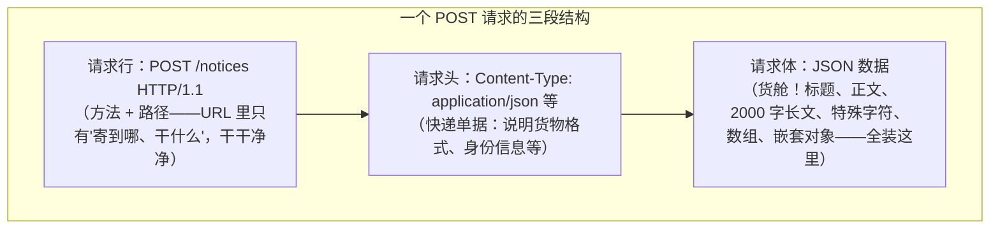
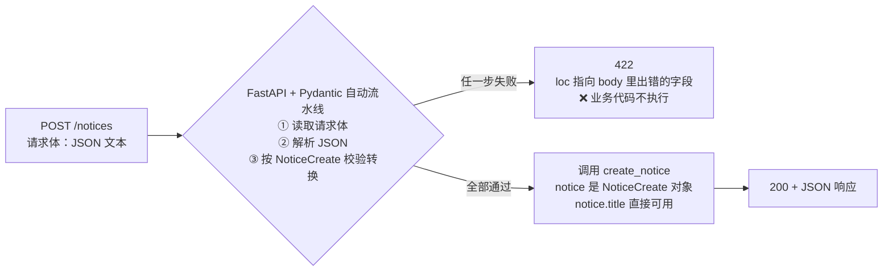
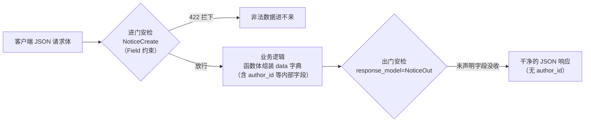
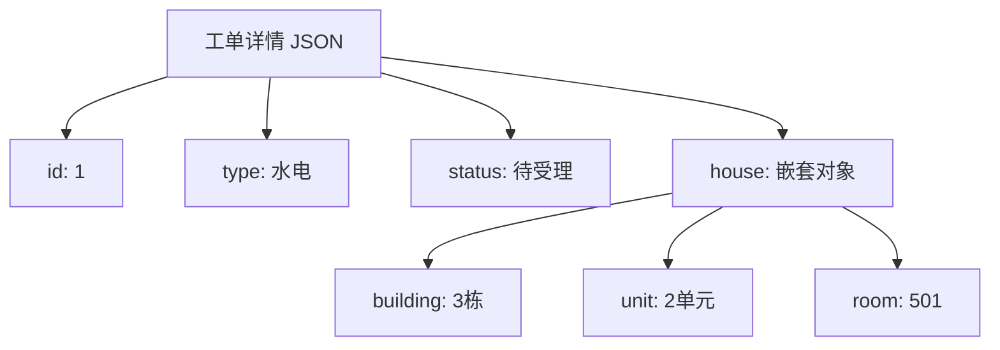
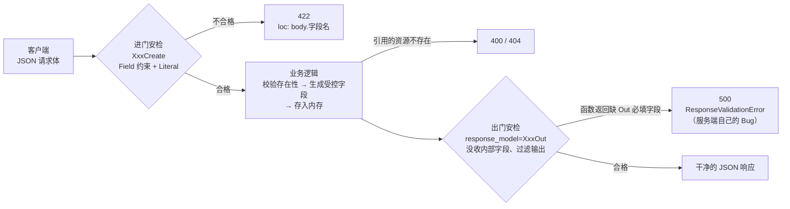

# 第 3 章 Pydantic 数据模型：请求体与响应模型

> **本章定位**：数据进出篇。第 2 章解决了"数据从 URL 进"，本章解决两个更核心的问题：**数据如何从请求体进**（POST + 请求模型）、**数据如何按我们的意愿出**（response_model + 响应模型）。
>
> 本章的教学路线比较特别：我们**先用第 2 章的旧知识做一个"能跑的烂版本"**，亲手用实验把它的问题一个个暴露出来，再引出救星——请求体与 Pydantic 模型。请跟着正文的顺序亲手做每个实验，"先踩坑再填坑"的记忆最牢固。
>
> **开发约定**（延续前两章）：所有代码写在 `main.py`，运行 `uvicorn main:app --reload`，测试用 `http://127.0.0.1:8000/docs`。数据仍暂存内存，第 6 章落库。

---

## 学习目标

完成本章学习后，你应当能够：

1. **能实验**：通过四个实验说出"查询参数不适合承载写入数据"的理由（容量、特殊字符、安全留痕、结构化）。
2. **会接收**：定义 Pydantic 模型接收 JSON 请求体，说出 FastAPI 借此自动完成的四件事；读懂 `loc` 为 `["body", ...]` 的 422 错误。
3. **会约束**：用 `Field()` 为模型字段添加长度/范围约束与文档说明，用 `Literal` 限定合法取值；说出 Field / Path / Query 三兄弟的分工。
4. **会过滤**：用 `response_model` 控制响应字段，说清 Create / Out 双模型的分工；能区分 422（客户端传错）与响应校验 500（服务端拼错）。
5. **会嵌套**：定义嵌套模型，实现"工单详情里带房屋摘要"的复合响应。
6. **交得出**：为安居宝交付发布公告、提交报修单、工单详情三个接口。

---

## 1. 本章项目任务与热身：从"只能查"到"能写入"

### 本章项目任务（回指第 1 章表 1-1 需求清单）

| # | 接口 | 功能 | 本章知识点 |
|---|------|------|-----------|
| 1 | `POST /notices` | 管理员发布公告/规章 | 请求体、Pydantic 模型、Field()、Literal |
| 2 | `GET /repair-orders/{order_id}` | 工单详情（含房屋信息） | 嵌套模型、Path() 与 response_model 会师 |
| 3 | `POST /repair-orders` | 业主提交报修单 | 综合实战、服务端控制字段、400 |

### 承接第 2 章的两个遗留问题

第 2 章结束时，安居宝的"读"能力已经成型，但留下两个问题：

1. 业主想**提交**一张新报修单——数据要从客户端**写入**服务器，怎么办？
2. 工单接口把 `owner_id`、`worker_id`、`house_id` 这些内部字段和盘托出——**返回哪些字段**能不能由我们说了算？

问题 1 是本章前半部分（第 2~4、7 节）的主线，问题 2 是后半部分（第 5~6 节）的主线。

### 设问：用旧知识，你能怎么传？

先别急着学新东西。客户端要把"一张完整的报修单"交给服务器——标题、正文、分类，或者类型、描述、房屋编号——**用第 2 章学过的知识，你有办法传吗？**

有：查询参数。第 2 章我们天天用它筛选数据，那"运货"应该也行吧？下一节就动手试——用你已经完全掌握的知识，先把发布公告接口做出来。

### 小结

- 本章交付安居宝第一批"写"接口，并解决"响应字段失控"问题。
- 教学路线：旧知识做尝试 → 实验暴露问题 → 新知识解决问题。

---

## 2. 一次"天真"的尝试：用查询参数实现发布公告

### 坏版本：纯第 2 章知识就能写出来

需求：管理员发布公告，传标题、正文、分类三样数据。用查询参数实现：

```python
# main.py 新增导入（本章会陆续用到）
from datetime import datetime

# ⚠️ 本节是"问题演示版"，学完第 3 节就会删掉它
@app.post("/notices")
def create_notice_by_query(
    title: str = Query(max_length=100, description="公告标题"),
    content: str = Query(description="公告正文"),
    category: str = Query(default="公告", description="分类：公告/规章"),
):
    """发布公告（查询参数版——即将被证明是个坏主意）"""
    new_id = max(n["id"] for n in NOTICES) + 1
    notice = {
        "id": new_id,
        "author_id": 1,                                    # 简化处理：第 9 章登录上线后改为当前登录用户
        "title": title,
        "content": content,
        "category": category,
        "created_at": datetime.now().strftime("%Y-%m-%d %H:%M"),
    }
    NOTICES.append(notice)
    return notice
```

> 💡 **author_id 为什么写死为 1？** 现在还没有"登录"这个概念，服务器不知道操作者是谁，只能先固定写成 1 号管理员。第 9 章 JWT 登录后，这里会改成**自动获取当前登录用户**——届时客户端想伪造都伪造不了。

打开 `/docs`，找到 `POST /notices`，点 Try it out，填入三个参数：`title=测试公告`、`content=这是一条用查询参数发布的测试公告`、`category=公告`，点 Execute。

预期响应（200）：

```json
{
    "id": 6,
    "author_id": 1,
    "title": "测试公告",
    "content": "这是一条用查询参数发布的测试公告",
    "category": "公告",
    "created_at": "2026-10-23 10:30"
}
```

再访问 `GET /notices`，新公告赫然在列。**发布成功了！**看起来查询参数运货毫无问题——真是这样吗？下面四个实验，请你**亲手做一遍**。

### 实验①：发一篇长公告

物业最重要的《住宅装修管理规定》全文有两千多字。把它塞进 content 参数，看看会发生什么。

**操作**：在 /docs 的 content 框里粘贴一段 2000 字以上的长文，Execute。

**现象**：/docs 里可能侥幸成功（它是程序拼的请求），但换到浏览器地址栏手动访问试试——地址栏装不下这么长的 URL；即使塞进去，URL 总长度超过服务器允许的上限（通常几 KB）时，请求直接被拒绝，常见返回 **414（URI Too Long）** 或 400，严重时连接被重置。

**结论 1**：URL 是有长度上限的**小水管**，装不下大货。公告正文、故障描述、将来的密码……动辄成百上千字，靠 URL 运输随时爆管。

### 实验②：正文里带一个 & 符号

**操作**：发布一条正文含 `&` 的公告，参数填：

- title：`水电费调价通知`
- content：`水电费自11月1日起调价&意见征集进行中`

在 /docs 点 Execute（或在浏览器地址栏访问 `/notices?title=水电费调价通知&content=水电费自11月1日起调价&意见征集进行中&category=公告`），观察响应里的 content 字段：

```json
{
    "id": 7,
    "title": "水电费调价通知",
    "content": "水电费自11月1日起调价",
    "category": "公告"
}
```

**现象**：正文从 `&` 处被**拦腰截断**！后半句"意见征集进行中"变成了一个叫 `意见征集进行中` 的"幽灵参数"（FastAPI 不认识它，直接忽略）。

**原因**：回看第 1 章的 URL 解剖——`&` 在 URL 里的身份是**参数分隔符**。查询参数运货，货里只要含有 `&`、`=`、`?`、`#` 这些"URL 保留字符"，货物就会把车厢隔板撞穿。虽然严谨的客户端会做 URL 编码规避，但你自己拼 URL 测试、或调用方忘了编码时，数据就悄悄坏了——**而且是静默截断，不报错**，比直接报错更可怕。

**结论 2**：查询参数运货，特殊字符会破坏数据结构，且失败是静默的。

### 实验③：看看数据都留在了哪

**操作**：完成实验②后，回头看 PyCharm Terminal 里 uvicorn 的访问日志：

```text
INFO:     127.0.0.1:52344 - "POST /notices?title=%E6%B0%B4%E7%94%B5%E8%B4%B9%E8%B0%83%E4%BB%B7%E9%80%9A%E7%9F%A5&content=%E6%B0%B4%E7%94%B5%E8%B4%B9... HTTP/1.1" 200 OK
```

**现象**：**完整的 URL 连同全部数据，一字不落地印在了服务器日志里**。再想想：浏览器会把带参数的 URL 存进历史记录；如果请求经过代理服务器，代理也会记一份。

**结论 3**：查询参数的货是"押运在车顶上的"，沿途人人可见。公告内容泄露无所谓，那**第 8 章要传的密码呢？**——用查询参数传密码，等于把密码写进日志、历史记录和沿途所有设备。这是安全红线。

### 实验④：想一次提交"结构化的货"

**需求升级**：提交报修单时，业主除了填类型和描述，还要带**多张现场照片的文件名**，将来甚至要带一个"报修位置"对象（楼栋+单元+房号）。数据长这样：

```json
{
    "type": "水电",
    "description": "厨房水管漏水",
    "attachments": ["photo1.jpg", "photo2.jpg"],
    "location": {"building": "3栋", "unit": "2单元", "room": "501"}
}
```

**操作**：试着用查询参数表达上面的数据——你会发现无从下手。

**现象**：查询参数只能表达扁平的 `key=value`。数组勉强能用重复键凑合（`?attachments=a.jpg&attachments=b.jpg`），**嵌套对象彻底没办法**。

**结论 4**：查询参数装不下结构化数据（数组、对象、多层嵌套），而真实业务的数据几乎都是结构化的。

### 问题汇总与出路

| 实验 | 暴露的问题 | 一句话概括 |
|------|-----------|-----------|
| ① 长公告 | URL 长度上限几 KB，超长被拒（414） | **装不下** |
| ② & 截断 | URL 保留字符破坏结构，静默丢数据 | **运不稳** |
| ③ 日志留痕 | 数据全程暴露在日志/历史/代理中 | **不安全** |
| ④ 结构化数据 | 无法表达数组、对象、嵌套 | **装不了** |

还有一个语义问题：第 2 章图 2-2 说过，查询参数的职责是"**怎么筛、看哪页**"——修饰和筛选。拿它运输写入数据，属于工种错配。

那 HTTP 有没有准备一个**容量大、不经过 URL、能装结构化内容**的位置？有——**请求体（Request Body）**。这就是下一节的主角。

### 小结

- 查询参数实现 POST 能跑通，但四个实验证明它：装不下、运不稳、不安全、装不了结构化数据。
- 写操作（提交数据）的货物应该装在请求体里；查询参数继续干它的老本行——筛选与分页。
- **本节坏版本代码保留在你的 main.py 里**，第 3 节末尾我们正式删除它。

---

## 3. 正确姿势：Pydantic 模型接收 JSON 请求体

### HTTP 请求的完整结构：原来还有个"货舱"

带着第 2 节的四个问题重新审视 HTTP 请求，它其实分三段（**图 3-1**）：



**图 3-1 请求体是 HTTP 自带的"大货舱"**

对照四个实验：货舱容量以 MB 计（解决①）；请求体里的 `&` 就是普通字符，不参与 URL 解析（解决②）；请求体不进访问日志和浏览器历史（解决③）；JSON 天生支持数组和嵌套对象（解决④）。

> 💡 **一句话定义**
> **请求体（Body）**：HTTP 请求中独立于 URL 的数据舱，现代 Web 开发中几乎总是装一段 JSON 文本。GET 请求通常没有体（货舱空着），POST/PUT 的"货"都装在这里。

### Pydantic 是什么：数据的"安检员 + 翻译官"

请求体里是一段 JSON **文本**，而你的函数需要的是 Python 数据。谁来负责"读文本 → 解析 → 检查字段齐不齐、类型对不对 → 翻译成好用的 Python 对象"？

答案是 **Pydantic**——FastAPI 内置的数据校验库。你只需定义一个"数据长什么样"的类（称为**模型**），剩下全由它和 FastAPI 配合完成。

> 💡 **一句话定义**
> **Pydantic 模型**：继承 `BaseModel` 的 Python 类，用"类属性 + 类型注解"描述合法数据的结构。它同时是校验规则、转换说明书和接口文档的数据来源。

### 定义模型：NoticeCreate

```python
from pydantic import BaseModel

class NoticeCreate(BaseModel):
    """发布公告时，客户端需要提交的字段（进门规矩）"""
    title: str                      # 标题，必填
    content: str                    # 正文，必填
    category: str = "公告"          # 分类，可选，默认"公告"
```

就这么几行——和你写过的普通 Python 类几乎一样：类属性名就是字段名，类型注解就是字段类型，带默认值就是可选。**必填/可选的规则与第 2 章查询参数完全一致**：无默认值必填，有默认值可选。

### 接收请求体：模型当函数形参

```python
@app.post("/notices")
def create_notice(notice: NoticeCreate):
    """发布公告（请求体版——正式版本）"""
    new_id = max(n["id"] for n in NOTICES) + 1
    data = {
        "id": new_id,
        "author_id": 1,                  # 简化处理，第 9 章改为当前登录用户
        "title": notice.title,           # 点语法访问模型字段
        "content": notice.content,
        "category": notice.category,
        "created_at": datetime.now().strftime("%Y-%m-%d %H:%M"),
    }
    NOTICES.append(data)
    return data
```

> ⚠️ 写这段代码前，**先把第 2 节的 `create_notice_by_query` 整个删掉**——同路径同方法的接口先定义的生效（第 2 章的教训），烂代码不过夜。第 5 节我们还会给这个接口挂上响应模型，届时装饰器会升级为 `@app.post("/notices", response_model=NoticeOut)`。

函数形参 `notice: NoticeCreate` 就是全部魔法所在。FastAPI 看到这个类型注解后，自动完成**四件事**：

1. **读**：从请求体读取 JSON 文本（而不是从 URL 读参数）；
2. **解析**：JSON 文本 → Python 字典；
3. **校验转换**：按 `NoticeCreate` 的字段和类型逐项检查、转换；
4. **传参**：把结果包装成 `NoticeCreate` **对象**传给你的函数。



**图 3-2 请求体校验流水线（第 2 章图 2-3 的升级版）**

### 测试：在 /docs 里发货

重启服务，打开 `/docs` 的 `POST /notices` → Try it out。注意变化：**参数输入框变成了一个 Request body 的 JSON 编辑区**，FastAPI 已按模型自动生成了模板：

```json
{
    "title": "物业服务中心营业时间调整公告",
    "content": "自11月1日起，物业服务中心营业时间调整为8:30-17:30，周末值班电话不变。",
    "category": "公告"
}
```

Execute 后预期响应（200）：

```json
{
    "id": 6,
    "author_id": 1,
    "title": "物业服务中心营业时间调整公告",
    "content": "自11月1日起，物业服务中心营业时间调整为8:30-17:30，周末值班电话不变。",
    "category": "公告",
    "created_at": "2026-10-23 11:02"
}
```

### 新旧对照：重跑四个实验

| 实验 | 查询参数版（第 2 节） | 请求体版（本节） |
|------|---------------------|-----------------|
| ① 2000 字长文 | URL 超长被拒（414） | ✅ JSON 体以 MB 计，轻松装下 |
| ② 正文含 `&` | 静默截断 | ✅ `&` 在 JSON 字符串里就是普通字符，原样保存 |
| ③ 日志留痕 | 全部数据印在访问日志 | ✅ 日志只剩一行干净的 `"POST /notices HTTP/1.1" 200 OK` |
| ④ 数组/嵌套 | 无法表达 | ✅ JSON 天生支持（第 6 节嵌套模型见真章） |

问题驱动的闭环完成——这就是全世界统一用"POST + JSON 请求体"提交数据的原因。

### 点语法 vs 下标：对象和字典别搞混

函数体里出现了两种取数据的写法，学生最容易在此混乱，专门对比：

```python
notice.title          # ✅ notice 是 Pydantic 模型对象 → 用点语法（属性访问）
notice["title"]       # ❌ TypeError！模型对象不是字典，不能用下标

REPAIR_ORDERS[0]["id"]  # ✅ 内存数据是普通字典 → 用下标
REPAIR_ORDERS[0].id     # ❌ AttributeError！字典没有点语法
```

判断方法：**看变量的类型**。形参声明为模型类型的（`notice: NoticeCreate`）用点；从内存列表里捞出来的字典用下标。第 6 章落库后还会出现第三种（SQLAlchemy 对象，用点语法），届时一并总结。

### 422 又来了：请求体的校验错误

请求体版接口的 422 与第 2 章同构，只是 `loc` 的位置信息变了。少传 title 字段：

```json
{
    "detail": [
        {
            "type": "missing",
            "loc": ["body", "title"],
            "msg": "Field required",
            "input": {"content": "只传了正文没传标题", "category": "公告"}
        }
    ]
}
```

`loc` 从第 2 章的 `["path", ...]`、`["query", ...]` 变成了 `["body", "title"]`——**三眼定位法照常好用**：body 里的 title 字段、缺失、客户端实际传的 input 一览无余。

### 常见坑

- ⚠️ **模型类名要表达用途**：本课程规范是"名词 + 动作后缀"——`NoticeCreate`（创建公告的进门数据）、`NoticeOut`（出门数据，第 5 节）。类名写成 `Notice` 或 `NoticeModel` 都能跑，但三个月后你自己都分不清它是进门用还是出门用。
- ⚠️ **JSON 里多传了模型没有的字段**：比如客户端多传了 `"author_id": 999`——默认会被 Pydantic **静默忽略**，不会进入 notice 对象。这是好事：客户端塞不进你没声明的字段（想伪造 author_id？门都没有）。
- ⚠️ **装饰器方法写错**：提交数据用了 `@app.get("/notices")` → /docs 里看不到 Request body 输入区（GET 没有体），客户端 POST 过来还会报 405 Method Not Allowed。**语义对照第 1 章：增=POST，查=GET。**
- ⚠️ **函数形参名随意，但类型注解不能少**：形参叫 `notice`、`body`、`abc` 都行（FastAPI 靠**类型注解**识别这是请求体模型，不靠名字）；但漏写 `: NoticeCreate` 的话，FastAPI 会把它当成查询参数——第 2 节的问题全部复活。

### 小结

- HTTP 请求体是容量大、不进 URL、支持结构化的"货舱"；写操作的数据一律走请求体。
- Pydantic 模型 = 继承 BaseModel 的类 + 类型注解字段；FastAPI 自动完成读体、解析、校验、传对象四件事。
- 模型对象用点语法，内存字典用下标；请求体校验失败的 422，loc 以 `["body", 字段名]` 开头。
- 坏版本已删除——从现在起，安居宝所有"写"接口都走请求体。

---

## 4. Field()：给模型字段立规矩、写说明

### 动机：裸类型又不够严了

现在的 `NoticeCreate` 只要求 title 是字符串——传空串 `""` 合法、传一万字合法；category 只要求是字符串——传 `"告示"`、`"随便"` 都合法。和第 2 章"裸 int 拦不住 0"一模一样的问题，解法也一模一样：**上增强声明**。

### 三兄弟团圆

| | 管什么 | 增强声明 | 典型配置 | 422 的 loc |
|---|--------|---------|---------|-----------|
| 第 2 章 | 路径参数 | `Path()` | ge、le、title、description | `["path", 参数名]` |
| 第 2 章 | 查询参数 | `Query()` | default、max_length、ge、description | `["query", 参数名]` |
| **本章** | **请求体字段** | **`Field()`** | max_length、min_length、ge、description、default | `["body", 字段名]` |

配置项一脉相承，学习成本约等于零。`Field()` 从 pydantic 导入：

```python
from pydantic import BaseModel, Field
```

### 升级版 NoticeCreate

```python
from typing import Literal

class NoticeCreate(BaseModel):
    """发布公告的进门规矩（增强版）"""
    title: str = Field(
        max_length=100,
        description="公告标题，最多 100 字",
        examples=["停水通知：11月5日全小区临时停水"],
    )
    content: str = Field(
        min_length=10,
        description="公告正文，不少于 10 字",
    )
    category: Literal["公告", "规章"] = Field(
        default="公告",
        description="分类：公告（通知类）或规章（管理制度类）",
    )
```

三处升级逐一说明：

- **title**：`max_length=100` 拦截超长标题；description/examples 会出现在 /docs 的参数说明里（第 12 章 AI 生成前端时读的就是这些）。
- **content**：`min_length=10` 拦截"敷衍式"短正文——注意它和 `max_length` 可以同时写在同一个 Field 里。
- **category**：`Literal["公告", "规章"]` 把取值**锁死为两个合法值**，传第三个直接 422；/docs 里该字段自动变成**下拉选择框**。

### Literal：轻量级的"合法值清单"

`Literal["公告", "规章"]` 读作"只能是这两个值之一"。与第 2 章附录 C 的 Enum 相比：

| | Literal | Enum |
|---|---------|------|
| 写法 | 直接列值：`Literal["公告", "规章"]` | 先定义枚举类再引用 |
| 适合 | 取值少、只在一个模型里用（如分类） | 取值多、全项目多处复用（如工单六状态） |
| 附加能力 | 无 | 可以挂方法、集中管理 |

本课程约定：**字段级小清单用 Literal，全局状态集合用 Enum**（第 4 章状态机就是 Enum 的正式战场）。

### 必填、可选、默认值：与查询参数规则完全一致

```python
class Demo(BaseModel):
    a: str                                  # 必填（无默认值）
    b: str = "默认值"                        # 可选，有默认
    c: str | None = None              # 可选，允许为 None
    d: str = Field(..., min_length=2)       # 必填 + 约束：Field 第一个参数写 ... 表示"无默认值"
    e: datetime = Field(default_factory=datetime.now)  # 每次创建对象时现算默认值
```

- **`Field(...)` 里的 `...`**（Python 的 Ellipsis 对象）：既想要约束、又想保持必填时，用 `...` 占住默认值位置。
- **`default_factory`**：默认值需要"每次现算"时用它。写 `e: datetime = datetime.now()` 是经典错误——`datetime.now()` 在**类定义时执行一次**，之后所有对象的 e 都是同一个时间（Python 可变默认值陷阱的 Pydantic 版）。`default_factory=datetime.now` 传的是函数本身，每次创建对象时才调用。本章的 created_at 是在函数体里现算的所以没踩到，第 6 章建表时会正式用到 default_factory。

### 测试三组用例

| # | 请求体 | 预期 |
|---|--------|------|
| 1 | `{"title": "冬季防火通知", "content": "冬季干燥，请勿在楼道堆放纸箱等易燃物，电动车禁止入户充电。", "category": "公告"}` | 200，发布成功 |
| 2 | `{"title": "测", "content": "太短", "category": "公告"}` | 422：content 违反 `string_too_short`（min_length=10） |
| 3 | `{"title": "x", "content": "合法的十字以上正文内容", "category": "告示"}` | 422：category 不在 Literal 清单里 |

用例 3 的 422 响应（注意 msg 里直接列出了合法值）：

```json
{
    "detail": [
        {
            "type": "literal_error",
            "loc": ["body", "category"],
            "msg": "Input should be '公告' or '规章'",
            "input": "告示"
        }
    ]
}
```

### 常见坑

- ⚠️ **约束写在类型注解里还是 Field 里？** 官方文档里有两种形态：`Annotated[str, Field(max_length=100)]`（新风格）和 `str = Field(max_length=100)`（默认值风格）。两种都合法、效果相同，**本课程正文统一用默认值风格**（对初学者更直观），附录 C 带你认识 Annotated 写法，看得懂即可。
- ⚠️ **`Field(default="公告")` 与直接 `= "公告"`**：前者是为了能同时挂 description 等元数据；没有任何元数据要挂时，直接 `= "公告"` 完全等价。
- ⚠️ **Literal 的值写错一个字**：`Literal["公告", "规章"]` 与内存数据里的 `"公告"` 必须逐字一致（包括全角/半角）。校验对不上时先检查有没有多余空格。

### 小结

- `Field()` 是请求体字段的增强声明，与 Path()/Query() 配置项同源；422 的 loc 指向 `["body", 字段名]`。
- `Literal[...]` 锁定合法取值清单，文档自动变下拉框；轻量场景用 Literal，全局状态用 Enum。
- `Field(...)` 表示必填带约束；动态默认值必须用 `default_factory`。

---

## 5. 响应模型 response_model：返回哪些字段，我说了算

### 问题重现：出门的数据也在"裸奔"

看看现在 `POST /notices` 和 `GET /notices` 的响应：

```json
{"id": 6, "author_id": 1, "title": "...", "content": "...", "category": "公告", "created_at": "..."}
```

`author_id` 是内部字段——客户端要它没用，泄露出去还有风险（能推测用户 ID 规律）。第 2 章的工单接口同样把 `house_id`、`worker_id` 全部裸奔。**进门有 Create 模型安检，出门呢？**

### 定义：response_model 是"出门安检"

```python
class NoticeOut(BaseModel):
    """公告的出门规矩：客户端只该看到这些字段"""
    id: int
    title: str
    content: str
    category: str
    created_at: str
    # 刻意没有 author_id —— 内部字段出门即没收
```

挂到接口的装饰器上：

```python
@app.post("/notices", response_model=NoticeOut)
def create_notice(notice: NoticeCreate):
    ...  # 函数体不变，返回的 data 字典里仍有 author_id
```

**见证时刻**：函数返回的字典明明有 `author_id`，但再次提交公告，响应变成：

```json
{"id": 8, "title": "...", "content": "...", "category": "公告", "created_at": "..."}
```

`author_id` 消失了！这就是 response_model 的工作方式：**无论函数返回什么，FastAPI 都先把它按 Out 模型"过一遍安检"——模型里声明了的字段才放行，没声明的一律没收，声明了什么类型就转成什么类型**。



**图 3-3 数据进出双向关卡：Create 管进门，Out 管出门**

### 顺手升级第 2 章的列表接口

`GET /notices` 也挂上出门安检——注意响应是**列表**，写法是 `list[NoticeOut]`：

```python
@app.get("/notices", response_model=list[NoticeOut])
def list_notices(category: str | None = None):
    """公告列表：可按分类筛选（公告/规章），不传则返回全部"""
    if category is None:            # 没传筛选条件 → 全部返回
        return NOTICES
    result = []
    for notice in NOTICES:
        if notice["category"] == category:
            result.append(notice)
    return result
```

> 📌 **升级纪律**：与第 2 章版本相比，**只有装饰器**多了一个 `response_model`，签名与函数体和第 2 章逐字相同。此后本课程所有接口升级都遵守这条纪律：只改声明过的部分，其余一字不动。

从此所有公告类接口的响应字段统一由 `NoticeOut` 说了算——将来要加字段，改一处模型，所有接口同步生效。

### 工单接口升级：隐藏内部字段 + 分页包装模型

工单是内部字段的"重灾区"——`house_id`、`worker_id` 都不该给客户端看。先定义工单的出门规矩：

```python
class RepairOrderOut(BaseModel):
    """工单的出门规矩：house_id、worker_id 都是内部字段，不放行"""
    id: int
    type: str
    description: str
    status: str
    score: int | None
    created_at: str
    finished_at: str | None
```

升级第 2 章的工单列表接口。**先看一个反面写法**：有人会觉得 items 是一组工单，于是写 `response_model=list[RepairOrderOut]`——但这个接口实际返回的是 `{total, page, page_size, items}` **包装对象**，不是裸列表！一运行就是 500（ResponseValidationError）：出门安检按"工单列表"的规矩检查，函数递上来的却是"分页包装字典"，对不上。

**修正**：返回包装对象，就声明包装模型——分页包装也该是个模型：

```python
class OrderPageOut(BaseModel):
    """分页包装的出门规矩"""
    total: int
    page: int
    page_size: int
    items: list[RepairOrderOut]      # 嵌套：items 是一组工单 Out 模型（第 6 节展开嵌套话题）
```

正式升级代码如下——注意一个惊人细节：**只改了装饰器一行，函数体与第 2 章版本一字未动**：

```python
@app.get("/repair-orders", response_model=OrderPageOut)
def list_orders(
    status: str | None = Query(
        default=None, max_length=10,
        description="按状态筛选：待受理/已派单/维修中/已完成/已评价/已取消",
    ),
    type: str | None = Query(
        default=None, max_length=10,
        description="按类型筛选：水电/电梯/门窗/其他",
    ),
    page: int = Query(default=1, ge=1, description="页码，从 1 开始"),
    page_size: int = Query(default=3, ge=1, le=10, description="每页条数，1~10"),
):
    """工单列表：状态 + 类型组合筛选，分页返回"""
    # ── 第一步：筛选（先把不符合条件的排除，再谈分页）──
    result = REPAIR_ORDERS
    if status is not None:
        result = [o for o in result if o["status"] == status]
    if type is not None:
        result = [o for o in result if o["type"] == type]

    # ── 第二步：分页（对"筛选后"的列表切片）──
    total = len(result)                      # 筛选后的总数（给前端画页码条）
    start = (page - 1) * page_size           # 本页起始下标
    items = result[start : start + page_size]  # 切出本页数据

    # ── 第三步：包装响应 ──
    return {
        "total": total,
        "page": page,
        "page_size": page_size,
        "items": items,
    }
```

重启后测试，响应 items 里的 `house_id`、`worker_id` 已经消失：

```json
{
    "total": 6, "page": 1, "page_size": 3,
    "items": [
        {"id": 1, "type": "水电", "description": "厨房水管漏水，橱柜底下一直滴水",
         "status": "待受理", "score": null, "created_at": "2026-10-22 09:15", "finished_at": null},
        {"id": 2, "type": "电梯", "description": "1单元电梯上行时有异响",
         "status": "已派单", "score": null, "created_at": "2026-10-21 16:40", "finished_at": null},
        {"id": 3, "type": "门窗", "description": "阳台推拉门脱轨关不上",
         "status": "维修中", "score": null, "created_at": "2026-10-20 10:05", "finished_at": null}
    ]
}
```

> 📌 **这条教训值得记住**：response_model 必须与**实际返回结构**匹配。返回包装对象就声明包装模型；items 里嵌套的 Out 模型会逐条生效。

### 反面实验：出门安检也会 500

把 `NoticeOut` 临时加一个数据源里不存在的必填字段：

```python
class NoticeOut(BaseModel):
    id: int
    title: str
    content: str
    category: str
    created_at: str
    publisher: str        # ← 临时加的：数据字典里根本没有这个键，也没有默认值
```

访问 `GET /notices` → **500**！终端里能看到 `ResponseValidationError`：函数正常执行完了，返回值却过不了出门安检。

**这是本章最重要的一组对比**：

| | 422 | 500（ResponseValidationError） |
|---|-----|------------------------------|
| 谁的错 | **客户端**：请求数据不合法 | **服务端**：你拼的响应数据不符合自己声明的 Out 模型 |
| 发生在 | 业务代码执行**前**（进门安检） | 业务代码执行**后**（出门安检） |
| 怎么修 | 调用方改传参 | 你改代码：补数据或改模型 |

> 📌 **调试口诀**：422 找调用方，出门 500 找自己。实验做完把 `publisher` 字段删掉恢复原状。

### Create / Out 双模型分工

| | NoticeCreate（进门） | NoticeOut（出门） |
|---|---------------------|------------------|
| 谁定义内容 | 客户端**该提交**的字段 | 客户端**该看到**的字段 |
| id / created_at | ❌ 不该有（服务端生成） | ✅ 必须有 |
| author_id | ❌ 不该有（第 9 章由登录态自动填） | ❌ 不该有（内部字段） |
| 挂在哪 | 函数形参类型注解 | 装饰器 response_model |

**为什么不能一个模型走天下**：进门模型若含 id/status，客户端就能伪造（第 7 节实战会演示这个攻击面）；出门模型若含进门字段，内部数据就泄露。进门出门两套规矩，各司其职。第 4 章将加入 `XxxUpdate`（改门规矩），凑齐**三模型模式**。

### 常见坑

- ⚠️ **response_model 写在装饰器里**：`@app.post("/notices", response_model=NoticeOut)`。也可以写成函数返回类型注解 `def create_notice(...) -> NoticeOut:`，两种效果几乎等价；**本课程统一用装饰器写法**（位置醒目、与文档配置集中在一处）。
- ⚠️ **Out 模型字段给不给默认值，决定"缺字段"是否致命**：`publisher: str` 无默认值，数据源缺这个键就 500（上面的反面实验正是如此）；若写成 `publisher: str | None = None`，缺键也能过安检（自动填 None）。设计 Out 模型时，"数据源可能没有的字段"务必给默认值或允许 None。
- ⚠️ **response_model 是过滤器，不是美容器**：它只做"留字段、转类型、删多余"，不会无中生有——Out 模型里声明的每个字段，函数返回的数据里必须有（或该字段带默认值），否则就是反面实验里的出门 500。

### 小结

- `response_model` 是出门安检：只放行 Out 模型声明的字段，内部字段（author_id、house_id、worker_id）一律没收。
- 返回包装对象就声明包装模型（OrderPageOut），items 里嵌套的 Out 模型逐条生效。
- 422 = 客户端进门数据错；ResponseValidationError 500 = 服务端出门数据错。
- Create 管进门、Out 管出门，两套规矩缺一不可。

---

## 6. 嵌套模型：工单详情里的"房中房"

### 需求

回收第 2 节实验④的伏笔：JSON 能装结构化数据，Pydantic 模型自然也支持**模型里套模型**。

新接口 `GET /repair-orders/{order_id}`（工单详情）。如果响应里只有 `house_id: 1`，客户端还得再查一次房屋接口才能显示"3栋2单元501"——两次请求，体验差。**更好的设计：详情响应里直接"套"一份房屋摘要。**

### 定义嵌套模型

```python
class HouseBrief(BaseModel):
    """房屋摘要：嵌在工单详情里的精简版房屋信息"""
    building: str
    unit: str
    room: str

class RepairOrderDetail(BaseModel):
    """工单详情的出门规矩：字段更全，且嵌套房屋摘要"""
    id: int
    type: str
    description: str
    status: str
    score: int | None
    created_at: str
    finished_at: str | None
    house_id: int                     # 详情场景保留 house_id（列表场景才隐藏它）
    house: HouseBrief                 # ★ 嵌套：字段类型是另一个模型
```

响应的 JSON 将呈树形结构（**图 3-4**）：



**图 3-4 嵌套响应的树形结构**

### 完整实现：查询 + 组装 + 出门安检

```python
@app.get("/repair-orders/{order_id}", response_model=RepairOrderDetail)
def get_order_detail(
    order_id: int = Path(ge=1, title="工单ID", description="要查询的报修工单编号，从 1 开始"),
):
    """工单详情：含房屋摘要（路径参数 + 嵌套响应模型会师）"""
    # 第一步：找工单，找不到 404
    order = None
    for o in REPAIR_ORDERS:
        if o["id"] == order_id:
            order = o
            break
    if order is None:
        raise HTTPException(status_code=404, detail=f"工单 {order_id} 不存在")

    # 第二步：按 house_id 找房屋，组装摘要
    house = None
    for h in HOUSES:
        if h["id"] == order["house_id"]:
            house = h
            break
    house_brief = {
        "building": house["building"],
        "unit": house["unit"],
        "room": house["room"],
    }

    # 第三步：组装详情数据（复制工单字典，嵌入 house，出门安检自动没收其余内部字段）
    data = dict(order)
    data["house"] = house_brief
    return data
```

这个接口是两章知识的会师：路径参数用 `Path(ge=1)` 约束（第 2 章），响应由嵌套模型安检（本章）。

### 测试

访问 `/repair-orders/1`，预期响应：

```json
{
    "id": 1,
    "type": "水电",
    "description": "厨房水管漏水，橱柜底下一直滴水",
    "status": "待受理",
    "score": null,
    "created_at": "2026-10-22 09:15",
    "finished_at": null,
    "house_id": 1,
    "house": {"building": "3栋", "unit": "2单元", "room": "501"}
}
```

访问 `/repair-orders/99` → 404：`{"detail": "工单 99 不存在"}`。

> ⚠️ **路由顺序自查**：`/repair-orders/by-worker`（第 2 章）定义在 `/repair-orders/{order_id}` 之前，所以 by-worker 安然无恙。若顺序颠倒，访问 by-worker 会把 `"by-worker"` 塞给 `order_id: int` 转 int 而 422。写新路由时，先扫一眼有没有已存在的固定路径会被 `{参数}` 抢先匹配。

### 常见坑

- ⚠️ **嵌套字段也要继承 BaseModel**：`house: HouseBrief` 里的 HouseBrief 必须是 Pydantic 模型。若图省事写 `house: dict`，安检就形同虚设——dict 里装什么、什么类型，全无约束，文档里也只显示一个含糊的 object。
- **house_id 和 house 要不要都保留？** 按客户端需要设计：列表接口隐藏 house_id（用不着），详情接口两者共存（前端可能拿 house_id 做跳转链接，拿 house.room 做展示）。**Out 模型的字段取舍，永远站在"调用方需要什么"的角度**。
- ⚠️ **组装嵌套数据的时机**：先在函数里拼好完整字典再 return，安检在 return 之后自动发生。不要试图"return 一半让 FastAPI 帮忙查房屋"——它只安检，不跑腿。

### 小结

- 模型字段类型可以是另一个模型，实现树形响应；嵌套的每一层都享受完整校验与文档。
- 嵌套数据（房屋摘要）在函数里组装，Out 模型负责声明和过滤。
- 新增参数路径时，检查会不会抢了已有固定路径的匹配。

---

## 7. 综合实战：业主提交报修单

### 接口设计卡（先设计后编码）

| 设计项 | 决定 |
|--------|------|
| 方法与路径 | `POST /repair-orders` |
| 请求模型 | `RepairOrderCreate`：house_id（int，ge=1）、type（Literal 四类）、description（5~500 字） |
| 响应模型 | `RepairOrderOut`（第 5 节已定义，直接复用） |
| 服务端生成 | id（内存版自增）、status（强制"待受理"）、worker_id/score/finished_at（None）、created_at（当前时间） |
| 异常 | house_id 不存在 → 400 |

### 请求模型：注意哪些字段"不许客户端碰"

```python
class RepairOrderCreate(BaseModel):
    """提交报修单的进门规矩——只有这三样该由客户端决定"""
    house_id: int = Field(ge=1, description="报修房屋ID，必须是已登记的房屋")
    type: Literal["水电", "电梯", "门窗", "其他"] = Field(description="报修类型")
    description: str = Field(min_length=5, max_length=500, description="故障描述，5~500 字")
```

**安全设计的关键**：Create 模型里**没有** id、status、score、worker_id、created_at。为什么？想象一下如果 Create 模型里有 `status: str`：

```json
{"house_id": 1, "type": "水电", "description": "水管漏水", "status": "已评价", "score": 5}
```

恶意客户端直接提交"已评价 + 5 分"的工单——维修工还没上门，好评已经刷完。**结论：凡是"服务端说了算"的字段，绝不出现在进门模型里。**这是贯穿全书的安全观，第 9 章权限体系会继续深化。

### 完整实现

```python
@app.post("/repair-orders", response_model=RepairOrderOut)
def create_repair_order(order: RepairOrderCreate):
    """提交报修单：业主发起，状态强制从'待受理'开始"""
    # 第一步：校验房屋存在（提交的数据引用了不存在的资源 → 400）
    house_exists = any(h["id"] == order.house_id for h in HOUSES)
    if not house_exists:
        raise HTTPException(status_code=400, detail=f"房屋 {order.house_id} 不存在，无法报修")

    # 第二步：服务端生成全部受控字段
    new_id = max(o["id"] for o in REPAIR_ORDERS) + 1     # 内存版"自增主键"，第 6 章交给 MySQL
    data = {
        "id": new_id,
        "house_id": order.house_id,
        "worker_id": None,                               # 尚未派单
        "type": order.type,
        "description": order.description,
        "status": "待受理",                               # 强制初始状态（图 1-7 状态机起点）
        "score": None,                                   # 尚未评价
        "created_at": datetime.now().strftime("%Y-%m-%d %H:%M"),
        "finished_at": None,                             # 尚未完工
    }

    # 第三步：入库（内存版）并返回（出门安检自动隐藏 house_id、worker_id 等内部字段）
    REPAIR_ORDERS.append(data)
    return data
```

> 💡 **400 还是 404？** 第 2 章查房屋详情，`/houses/99` 返回 404——"你要**找**的资源不存在"。本章提交报修单，house_id=99 返回 **400（Bad Request）**——"你**提交**的数据不合法（引用了不存在的房屋）"。找东西用 404，交货出问题用 400。状态码的完整体系第 4 章展开，此处先建立语感。

### 测试（/docs 四组用例）

| # | 请求体 | 预期 |
|---|--------|------|
| 1 | `{"house_id": 2, "type": "水电", "description": "厨房水龙头关不紧一直滴水"}` | 200：新工单 id=7、status="待受理"（house_id 等内部字段被出门安检没收） |
| 2 | 用例 1 成功后访问 `GET /repair-orders?status=待受理` | total=2（id 1 和 7） |
| 3 | `{"house_id": 99, "type": "水电", "description": "测试不存在的房屋"}` | 400：`{"detail": "房屋 99 不存在，无法报修"}` |
| 4 | `{"house_id": 1, "type": "管道", "description": "类型非法测试"}` | 422：`literal_error`，msg 列出四个合法类型 |

用例 1 的预期响应（注意 house_id、worker_id 已被出门安检没收）：

```json
{
    "id": 7,
    "type": "水电",
    "description": "厨房水龙头关不紧一直滴水",
    "status": "待受理",
    "score": null,
    "created_at": "2026-10-23 14:25",
    "finished_at": null
}
```

最后做个残忍的实验：**重启服务**（Ctrl+C 后再 uvicorn 启动），再查工单列表——id=7 消失了，total 回到 6。内存数据的宿命如此，这正是第 6 章数据库登场的理由。

> 💡 **状态码悬念**：创建成功，业界惯例返回 **201 Created** 而非 200。FastAPI 改起来只要一行（`@app.post(..., status_code=201)`），但状态码是一个完整体系（204、403、409……），第 4 章"状态码"一节统一升级全部接口，本章先按默认 200 跑通。

### 常见坑

- ⚠️ **Create 模型混入受控字段**：id、status、score 出现在进门模型里 = 把伪造数据的钥匙递给客户端。设计 Create 模型时自问：**这个字段该由谁决定？**客户端只能决定"业务输入"（报什么修、描述是什么），其余一律服务端生成。
- ⚠️ **跳过存在性校验**：不查 house_id 是否存在就直接入库，脏数据从此扎根（工单指向不存在的房屋，第 7 章关联查询时就会爆炸）。**引用的资源必须校验存在性**——第 6 章数据库外键会从存储层再保险一次，但业务层的第一道校验不能省。
- ⚠️ **内存版自增 id 的并发隐患**：`max(...)+1` 在两个请求同时到达时可能生成重复 id。内存教学版不必处理，第 6 章 MySQL 的 AUTO_INCREMENT 天生解决此问题——这也是"为什么专业项目从不自己拼 id"的答案。

### 小结

- 提交报修单全流程：设计卡 → Create 模型（只管业务输入）→ 存在性校验（400）→ 服务端生成受控字段 → 入库 → Out 模型出门安检。
- 安全观第一条：服务端说了算的字段（id/status/score/created_at），绝不出现在进门模型里。
- 内存数据重启即失——第 6 章，MySQL 见。

---

## 8. 本章知识地图：数据进出全景

### 一个接口的完整数据流



**图 3-5 数据进出全景（本章所有知识在这张图里）**

### 三兄弟 + 一条边界

| | Path() | Query() | Field() |
|---|--------|---------|---------|
| 管辖 | 路径参数 | 查询参数 | 请求体字段 |
| 数据角色 | 定位哪一个资源 | 筛选/分页修饰 | 提交的完整业务数据 |
| 载体 | URL 路径 | URL 问号后 | 请求体（JSON） |
| 典型配置 | ge、le | default、max_length、ge | max_length、min_length、Literal、default_factory |
| 422 的 loc | `["path", 名]` | `["query", 名]` | `["body", 名]` |

**查询参数运货 vs 请求体运货的边界**（第 2 节四实验的总结）：读操作的筛选条件走查询参数；写操作的业务数据走请求体——**装不下、运不稳、不安全、装不了结构化**，四条理由背下来，面试被问到就是送分题。

### 模型命名规范（全课程统一执行）

| 后缀 | 用途 | 挂在 | 本章例子 |
|------|------|------|---------|
| `XxxCreate` | 创建时的进门规矩 | 函数形参类型 | NoticeCreate、RepairOrderCreate |
| `XxxOut` | 出门规矩（客户端可见字段） | 装饰器 response_model | NoticeOut、RepairOrderOut、OrderPageOut、RepairOrderDetail |
| `XxxUpdate` | 修改时的进门规矩 | （第 4 章） | —— |

### 本章代码全景

main.py 至此累计 8 个接口：

| 接口 | 方法 | 本章变化 |
|------|------|---------|
| `/notices` | GET | 挂上 `response_model=list[NoticeOut]`，category 参数保留 |
| `/notices` | POST | **新增**：请求体版（坏版本已删除） |
| `/notices/search` | GET | 不变（第 2 章） |
| `/houses/{house_id}` | GET | 不变（第 2 章） |
| `/repair-orders` | GET | 升级为 `response_model=OrderPageOut`（隐藏 house_id、worker_id） |
| `/repair-orders` | POST | **新增**：提交报修单综合实战 |
| `/repair-orders/by-worker` | GET | 不变（第 2 章） |
| `/repair-orders/{order_id}` | GET | **新增**：嵌套模型工单详情 |

新增模型 7 个：NoticeCreate、NoticeOut、RepairOrderCreate、RepairOrderOut、OrderPageOut、HouseBrief、RepairOrderDetail。请逐一在 /docs 中回归测试（旧接口升级后也要重测），全部通过即完成本章的代码部分。

### 小结

- 数据进出全景图（图 3-5）：进门 Create 安检 → 业务逻辑 → 出门 Out 安检；三种错误码各就各位（422/400与404/500）。
- Path/Query/Field 三兄弟分工表 + 查询参数与请求体的使用边界。
- 模型命名规范定稿：Create / Out（第 4 章补 Update）。

---

## 本章小结

```mermaid
mindmap
  root((第 3 章<br/>数据进出))
    请求体
      查询参数运货四大罪：装不下、运不稳、不安全、装不了结构化
      HTTP 请求三段：请求行、头、体
      POST + JSON 请求体
    Pydantic 模型
      继承 BaseModel
      类型注解即字段声明
      自动四件事：读体、解析、校验转换、传对象
      点语法访问
    Field()
      与 Path() Query() 同源
      max_length min_length ge le
      Literal 合法值清单
      Field(...) 必填带约束
      default_factory 动态默认值
    response_model
      出门安检：没收内部字段
      包装对象配包装模型 OrderPageOut
      嵌套模型：house 套 HouseBrief
      Create 与 Out 分工
    错误码语感
      422 客户端进门数据错 loc=body
      400 提交的数据引用不合法
      404 要找的资源不存在
      500 出门安检失败是自己的 Bug
    安全观
      受控字段不进 Create 模型
      id status score created_at 服务端说了算
```

**本章你为安居宝交付了什么**：发布公告、提交报修单、工单详情三个接口——安居宝第一次拥有了"写"能力，且进门出门都有安检。对照表 1-1：「发布 / 修改 / 删除社区公告与规章」行完成了"发布"（修改、删除在第 4 章），「提交报修单（含现场照片）」行完成了接口部分（照片上传在第 5 章）。

**遗留的三个问题**，全部指向第 4 章：

1. 创建成功该返回 201，删除成功该返回什么？——**状态码体系**；
2. 公告发错了想改、想删怎么办？——**PUT 与 DELETE**，以及 Update 模型（三模型凑齐）；
3. 工单状态"不许跳步、不许倒退"（图 1-7 的铁律）用什么锁死？——**HTTPException 深入 + Enum 状态机 + RESTful 规范设计**。

---

## 附录

### 附录 A：Field() 常用配置速查表

| 配置项 | 适用 | 含义 | 示例 |
|--------|------|------|------|
| `...`（Ellipsis） | 通用 | 占住默认值位置表示必填 | `Field(..., min_length=2)` |
| `default` | 通用 | 静态默认值 | `Field(default="公告")` |
| `default_factory` | 通用 | 动态默认值（每次现算） | `Field(default_factory=datetime.now)` |
| `min_length` / `max_length` | 字符串 | 长度约束（按字符） | `Field(min_length=5, max_length=500)` |
| `ge` / `le` / `gt` / `lt` | 数值 | 范围约束 | `Field(ge=1, le=5)` |
| `title` / `description` | 通用 | 文档元数据 | `Field(description="故障描述")` |
| `examples` | 通用 | 文档示例值 | `Field(examples=["厨房水管漏水"])` |
| `pattern` | 字符串 | 正则约束（进阶） | `Field(pattern=r"^1[3-9]\d{9}$")` |
| `alias` | 通用 | JSON 字段名与 Python 属性名不一致时的映射（了解） | `Field(alias="houseId")` |

配合使用的类型工具：

```python
Literal["水电", "电梯"]        # 合法值清单（需 from typing import Literal）
str | None                    # 允许为 None（Python 3.10+ 原生语法，全课程统一写法）
list[RepairOrderOut]          # 响应是模型列表（response_model 里用）
```

### 附录 B：Pydantic 模型 ↔ 字典 ↔ JSON 三方对照

| 形态 | 长相 | 出现位置 | 互转方法 |
|------|------|---------|---------|
| JSON 文本 | `{"title": "停水通知"}`（字符串） | 网络传输中 | FastAPI 自动解析/序列化，你不用管 |
| Python 字典 | `{"title": "停水通知"}`（dict 对象） | 内存数据 REPAIR_ORDERS 等 | `notice.model_dump()` 模型→字典 |
| Pydantic 模型对象 | `notice.title`（点语法） | 函数形参 | `NoticeCreate(**data)` 字典→模型 |

```python
# model_dump()：模型对象 → 字典（第 6 章落库前的标准动作，先混个脸熟）
notice = NoticeCreate(title="停水通知", content="11月5日全小区临时停水，请提前储水。")
data = notice.model_dump()
print(data)
# 预期输出：{'title': '停水通知', 'content': '11月5日全小区临时停水，请提前储水。', 'category': '公告'}
# 注意：默认值 category 也出现在字典里
```

### 附录 C：进阶自学——Annotated 写法一瞥

官方文档中你会大量见到另一种 Field 写法——**Annotated 风格**：

```python
from typing import Annotated

class NoticeCreate(BaseModel):
    title: Annotated[str, Field(max_length=100, description="公告标题")]
    content: Annotated[str, Field(min_length=10)]
    category: Literal["公告", "规章"] = "公告"
```

读法：`Annotated[类型, 约束]`——"类型是 str，附带约束 Field(...)"。与默认值风格 `title: str = Field(max_length=100)` **效果完全相同**，纯属书写风格差异：

| | 默认值风格（本课程正文） | Annotated 风格 |
|---|------------------------|---------------|
| 直观度 | 高（像普通默认值） | 稍绕 |
| 官方倾向 | 支持 | 新代码推荐（约束与类型贴在一起，必填字段不再需要 `Field(...)` 的省略号） |
| 混用 | 两种可在同一项目共存 | 同左 |

要求：**看得懂、读官方文档不发怵即可**，本课程作业两种写法都算对。
