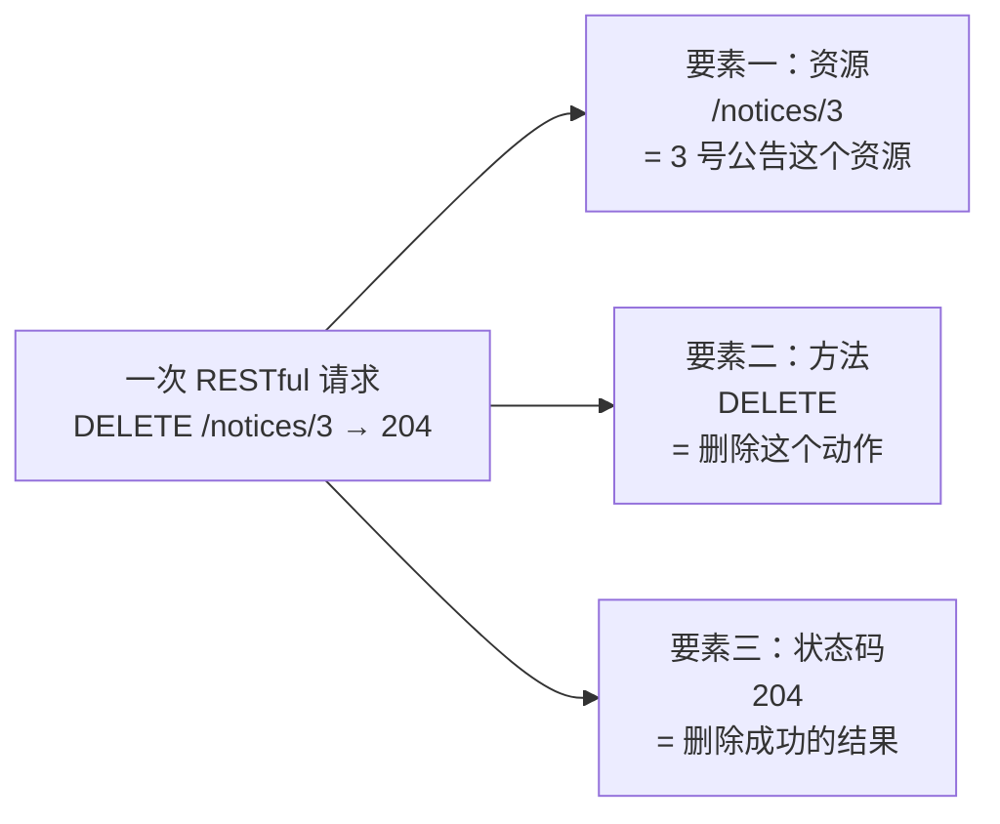
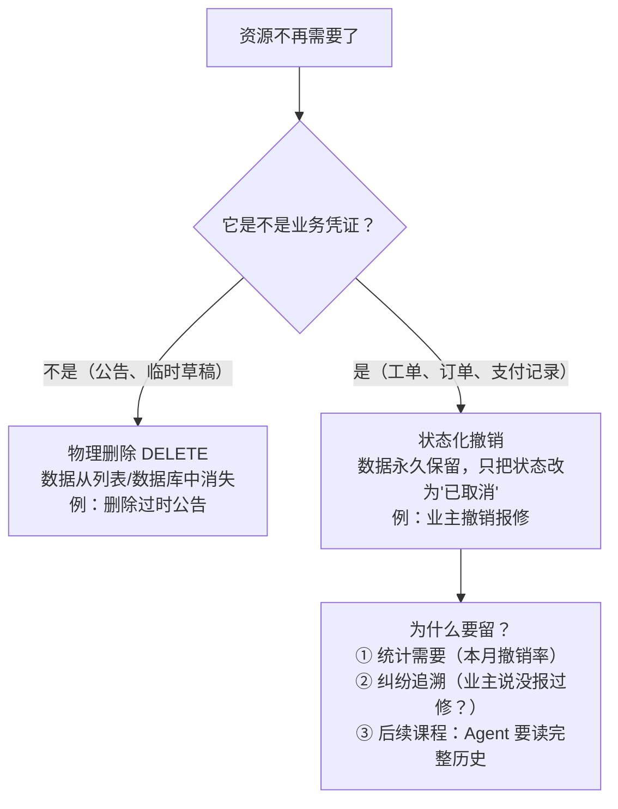
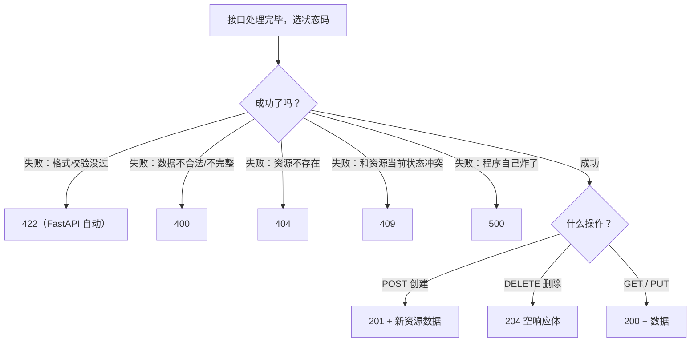
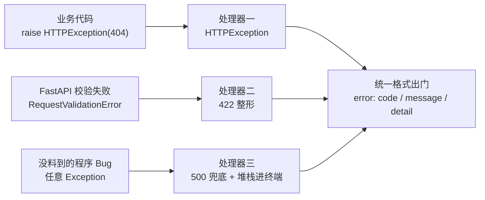
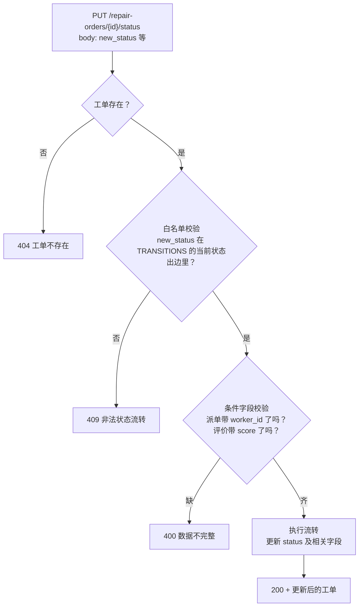
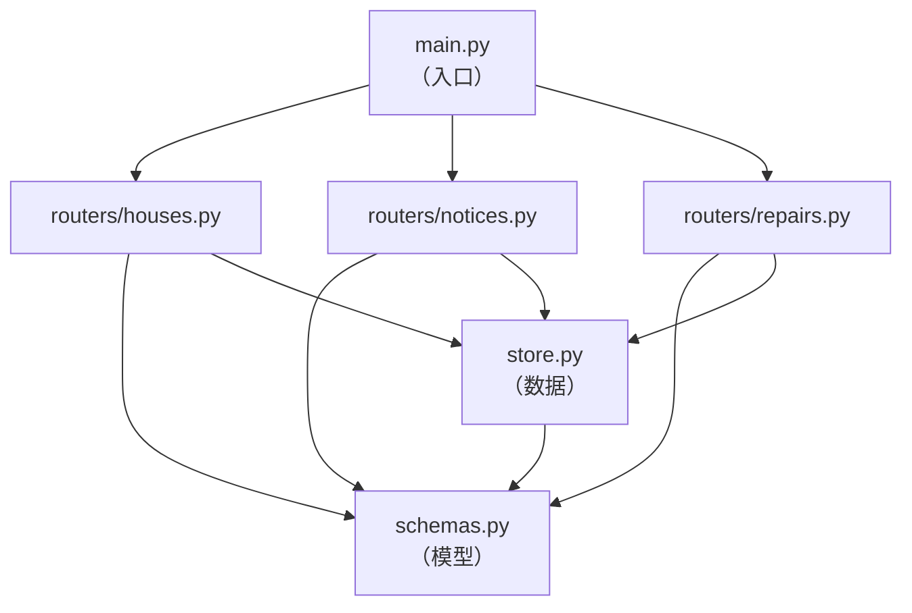
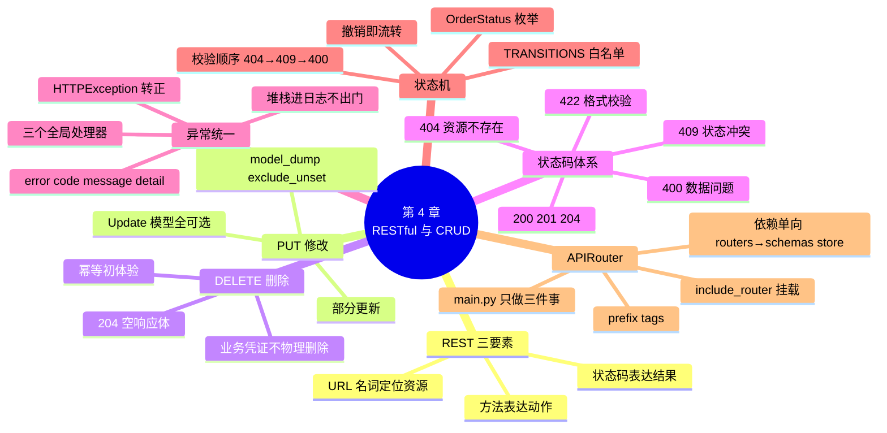

# 第 4 章 RESTful 设计与 CRUD 实战：状态码、异常与工单状态机

> **本章定位**：规范定型篇。前三章安居宝已能"查、增"，本章补齐"改、删"，完成 CRUD 闭环；更重要的是把散落在各章的"语感"——201 悬念、400 vs 404、状态机铁律——全部升级为**正式规范**：状态码体系、HTTPException 深入、全局异常处理器、Enum 锁死工单流转，最后用 APIRouter 把膨胀的 main.py 按资源拆成模块。
>
> 本章结束后，安居宝将拥有一份正式的《接口规范总表》（第 8 节）——它是第 10 章工程化重构的蓝图，也是第 12 章 AI 生成前端时的接口依据。数据仍暂存内存，第 6 章落库。
>
> **开发约定**（延续前几章）：`uvicorn main:app --reload` 运行，`http://127.0.0.1:8000/docs` 测试。**本章第 7 节会进行项目首次多文件拆分**，拆分前所有代码仍写在 main.py 中。

---

## 学习目标

完成本章学习后，你应当能够：

1. **懂规范**：说出 REST 风格的核心思想，按"资源 + 方法 + 状态码"三要素设计和评价接口。
2. **会改删**：用 PUT + Update 模型实现资源修改（含部分更新）；用 DELETE 实现删除并正确返回 204；说清物理删除与状态化撤销的分野。
3. **定状态**：为每个接口选定正确的状态码（200/201/204/400/404/409/422/500），并说出各自适用情形。
4. **统错误**：编写全局异常处理器，把 HTTPException、422、500 三类错误统一为一种响应格式。
5. **锁状态机**：用 Enum + 流转白名单锁死工单状态流转，非法流转返回 409，条件字段缺失返回 400。
6. **拆模块**：用 APIRouter 按资源拆分路由模块，说出 prefix / tags / include_router 的作用，理解模块间依赖方向。

---

## 1. 本章项目任务与热身：REST——给接口立"行业规范"

### 本章项目任务（回指第 1 章表 1-1 需求清单）

| # | 接口 | 功能 | 本章知识点 |
|---|------|------|-----------|
| 1 | `PUT /notices/{notice_id}` | 管理员修改公告 | PUT、Update 模型、部分更新 |
| 2 | `DELETE /notices/{notice_id}` | 管理员删除公告 | DELETE、204 |
| 3 | `PUT /repair-orders/{order_id}/status` | 工单状态流转（派单/开工/完工/评价/撤销） | Enum、状态机白名单、409 |
| 4 | 全部存量接口 | 状态码升级（POST→201）、错误格式统一 | status_code、全局异常处理器 |
| 5 | 整个项目 | 按资源拆分为路由模块 | APIRouter |

完成后，第 1 章表 1-1（角色-功能矩阵）中的「发布 / 修改 / 删除社区公告与规章」「受理并派单给维修工」「更新工单维修状态」「撤销报修单（仅限"待受理"状态）」「确认完工并评价打分」五行全部达成——**安居宝的 CRUD 在本章集齐**。

### 盘点现状：我们缺什么

前三章累计交付 8 个接口：

| 接口 | 方法 | CRUD 归属 |
|------|------|----------|
| `/notices` | GET | Read ✅ |
| `/notices/search` | GET | Read ✅ |
| `/notices` | POST | Create ✅ |
| `/houses/{house_id}` | GET | Read ✅ |
| `/repair-orders` | GET | Read ✅ |
| `/repair-orders/by-worker` | GET | Read ✅ |
| `/repair-orders/{order_id}` | GET | Read ✅ |
| `/repair-orders` | POST | Create ✅ |

问题来了：**只有 C 和 R，没有 U（改）和 D（删）**。公告发错了改不了、删不掉；工单永远停在"待受理"——派单、维修、评价整条业务主线（图 1-6）一步都走不动。而且所有 POST 都返回 200（第 3 章埋的悬念），错误响应也有好几种长相。本章逐一解决，并且解决得**规范**。

### REST 的定义

规范的源头叫 **REST**（Representational State Transfer，表述性状态转移）——名字很唬人，思想很朴素：

> 💡 **一句话定义**
> REST 是一种接口设计风格，三要素：**URL 定位资源（名词），HTTP 方法表达动作（动词），状态码表达结果**。

**图 4-1** 用"管理员删除 3 号公告"把三要素走一遍：



**图 4-1 REST 三要素**

注意 URL 里**只有名词**：`/notices/3`。"删除"这个动作去哪了？在 HTTP 方法里。对比两种设计：

| 动词 URL 风格（坏味道） | REST 风格（本课程规范） |
|------------------------|------------------------|
| `POST /deleteNotice?id=3` | `DELETE /notices/3` |
| `POST /getOrderList?status=维修中` | `GET /repair-orders?status=维修中` |
| `POST /updateNotice` | `PUT /notices/3` |

动词 URL 的问题：① 方法全挤在 POST 上，HTTP 四个方法的语义白白浪费；② URL 五花八门没有规律，`deleteNotice`、`del_notice`、`removeNotice` 各写各的；③ 接口一多就没法管理。REST 风格下，看到 `DELETE /notices/3` 不用查文档就知道它干什么——**URL 管"谁"，方法管"干什么"，各归各位**。

### 安居宝接口全景：资源 × 方法矩阵

按 REST 思路把安居宝的接口排成矩阵（加粗为本章新建）：

| 资源 | GET（查） | POST（增） | PUT（改） | DELETE（删） |
|------|----------|-----------|----------|-------------|
| 公告 /notices | 列表、搜索 | 发布（第 3 章） | **修改** | **删除** |
| 房屋 /houses | 详情（第 2 章） | — | — | — |
| 工单 /repair-orders | 列表、详情、按维修工查 | 提交（第 3 章） | **状态流转** | —（工单永不物理删除） |

最后一格正是本章要讲透的设计决策：**工单没有 DELETE**——它是业务凭证，"撤销"是状态流转而非删除，第 3 节展开。

### 常见误区

- ⚠️ **"REST 是必须遵守的协议标准？"** 不是。它是**风格约定**，不遵守照样能跑。但团队协作必须统一风格——你的接口是给前端（以及第 12 章的 AI）看的，规律性就是可用性。本课程从本章起全面 REST 化。
- ⚠️ **"所有接口都要凑齐四种方法？"** 不是。按业务需要来——工单就没有 DELETE，房屋没有 PUT 需求就不建。**矩阵是盘点工具，不是填表任务。**

### 小结

- REST 三要素：URL 名词定位资源、方法表达动作、状态码表达结果。
- 安居宝接口全景矩阵：本章补齐公告的改/删与工单的状态流转，工单刻意不设 DELETE。

---

## 2. PUT 与 Update 模型：修改公告

### PUT 的语义

管理员发现《停水通知》日期写错了，要修改。用 **PUT**：

```text
PUT /notices/1          ← 路径参数定位"改哪一个"
请求体：{"title": "停水通知：10月26日3栋临时停水"}   ← 请求体装"改成什么"
```

方法回顾（第 1 章口诀）：GET 查、POST 增、**PUT 改**、DELETE 删。PUT 的数据走请求体（第 3 章四实验的结论），定位走路径参数（第 2 章）。

### 三模型凑齐：Update 入队

修改公告的"进门规矩"和创建不一样——创建时 title、content 必填，**修改时只想改哪个传哪个**。所以需要一个新模型：

```python
class NoticeUpdate(BaseModel):
    """修改公告的进门规矩：字段全部可选，传了才改"""
    title: str | None = Field(default=None, max_length=100, description="新标题，不传则不改")
    content: str | None = Field(default=None, min_length=10, description="新正文，不传则不改")
    category: Literal["公告", "规章"] | None = Field(default=None, description="新分类，不传则不改")
```

至此三模型模式正式定稿：

| | NoticeCreate | NoticeUpdate | NoticeOut |
|---|-------------|--------------|-----------|
| 管什么 | 创建时的进门规矩 | 修改时的进门规矩 | 出门规矩 |
| 字段必填性 | 业务字段必填 | **全部可选** | 客户端可见字段全声明 |
| id / created_at | ❌ 没有（服务端生成） | ❌ 没有（**不许改**，改了历史就乱了） | ✅ 有 |
| author_id | ❌ | ❌ | ❌（内部字段） |
| 用在 | `POST /notices` | `PUT /notices/{id}` | 两者的响应 |

**为什么不能三个接口共用一个模型**：Create 若全可选，提交空报修单也能过；Update 若必填，改一个字也得重传全文；Out 若含 author_id，内部字段就泄露了。**每个模型的字段集合，都是精确设计的结果。**

### 部分更新的关键：model_dump(exclude_unset=True)

客户端只传了 `{"title": "..."}`，Update 模型解析后：`title="停水通知：10月26日3栋临时停水"`，`content=None`，`category=None`。此时若直接把三个字段全刷进数据，**content 和 category 就被 None 覆盖冲掉了**——没传的字段必须"原地不动"。

区分"没传"和"传了 None"，靠第 3 章附录 B 混过脸熟的 `model_dump()` 加一个参数：

```python
update.model_dump()                        # {'title': '新标题', 'content': None, 'category': None}
update.model_dump(exclude_unset=True)      # {'title': '新标题'}   ← 只含客户端真正传了的字段
```

- `exclude_unset=True`：**没出现在请求体里的字段**不进结果——正是"只改传了的"所需；
- `exclude_none=True`（对比记忆）：值为 None 的字段不进结果——若客户端显式传 `{"category": null}` 想清空字段，它会把这条也排除掉，语义不对。部分更新用 **exclude_unset**。

### 完整实现

```python
@app.put("/notices/{notice_id}", response_model=NoticeOut)
def update_notice(
    notice_id: int = Path(ge=1, description="要修改的公告ID"),
    update: NoticeUpdate,             # 请求体模型（形参名随意，类型注解决定它从请求体读取）
):
    """修改公告：只更新客户端传了的字段（部分更新）"""
    # 第一步：找公告，找不到 404
    target = None
    for n in NOTICES:
        if n["id"] == notice_id:
            target = n
            break
    if target is None:
        raise HTTPException(status_code=404, detail=f"公告 {notice_id} 不存在")

    # 第二步：取出"客户端真正传了的字段"
    changes = update.model_dump(exclude_unset=True)
    if not changes:
        raise HTTPException(status_code=400, detail="未提供任何要修改的字段")

    # 第三步：逐字段覆盖（dict.update：把 changes 里的键值刷进 target）
    target.update(changes)
    return target
```

> 💡 FastAPI 看到形参的类型是 Pydantic 模型，就自动从**请求体**读取——请求体因此是必传的：完全不传 body 会得到 422（missing）；传空对象 `{}` 能通过模型校验（字段全可选），但会命中 `changes` 为空的 400。

### 测试（/docs 四组用例）

| # | 请求 | 预期 |
|---|------|------|
| 1 | `PUT /notices/1`，body `{"title": "停水通知：10月26日3栋临时停水"}` | 200：title 已变，content/category 原封不动 |
| 2 | `PUT /notices/3`，body `{"title": "住宅装修管理规定（修订版）", "content": "施工时间调整为工作日9:00-12:00、14:00-17:30，周末及节假日禁止噪音施工。"}` | 200：两个字段同时更新 |
| 3 | `PUT /notices/99`，body `{"title": "任意"}` | 404：`{"detail": "公告 99 不存在"}` |
| 4 | `PUT /notices/1`，body `{}` | 400：`{"detail": "未提供任何要修改的字段"}` |

### 常见坑

- ⚠️ **Update 模型字段忘设可选**：`title: str = Field(max_length=100)`（没有 `| None = None`）→ 客户端只改 content 时因缺 title 直接 422。Update 模型的默认形态就是**全可选**。
- ⚠️ **`exclude_unset` 写成 `exclude_none`**：多数情况结果一样，但客户端显式传 null 清空字段时行为不同（见上文对比）。部分更新认准 `exclude_unset`。
- ⚠️ **`target.update(changes)` 改的是内存列表里的原字典**：本章这正是我们想要的（内存数据即"数据库"）；但第 6 章落库后要改为"修改 ORM 对象 + 提交事务"的规范写法，届时对比。
- ⚠️ **id、created_at、author_id 出现在 Update 模型里**：意味着客户端能把 1 号公告"改成" 2 号——受控字段永远不进任何进门模型（第 3 章安全观第二条）。

### 小结

- PUT = 路径定位 + 请求体装修改内容；Update 模型全字段可选。
- 部分更新三件套：全可选 Update 模型 + `model_dump(exclude_unset=True)` + `dict.update()`。
- 三模型模式定稿：Create 管增、Update 管改、Out 管出门。

---

## 3. DELETE 与 204：删除公告

### DELETE 的语义与"返回什么"难题

公告过时了（停水通知的日期已过），管理员删除它：

```text
DELETE /notices/1
```

删除成功后返回什么？返回被删的公告全文？多余——客户端都发起删除了，自然知道删的是谁。返回 `{"message": "删除成功"}`？也行，但业界更经典的答复是一个**专门的空响应状态码**。

### 204 No Content

> 💡 **一句话定义**
> **204 No Content**：操作成功，但**没有响应体**。专为"删除成功""提交成功但无需返回数据"这类场景设计。

204 的写法规矩有两条，都容易踩：

1. 装饰器声明 `status_code=204`；
2. 函数**必须不返回内容**（`return None` 或干脆不写 return）——204 按 HTTP 规范不允许有响应体。

### 完整实现

```python
@app.delete("/notices/{notice_id}", status_code=204)
def delete_notice(notice_id: int = Path(ge=1, description="要删除的公告ID")):
    """删除公告：成功返回 204（无响应体）"""
    target = None
    for n in NOTICES:
        if n["id"] == notice_id:
            target = n
            break
    if target is None:
        raise HTTPException(status_code=404, detail=f"公告 {notice_id} 不存在")

    NOTICES.remove(target)      # 列表的 remove：按对象移除元素
    return None                 # 204：必须空响应体
```

### 测试

| # | 操作 | 预期 |
|---|------|------|
| 1 | `DELETE /notices/5` | **204**，/docs 显示 "No content"，响应体为空 |
| 2 | 再查 `GET /notices` | 只剩 4 条（若做过第 2 节测试，按实际数量） |
| 3 | 再次 `DELETE /notices/5` | 404：已删掉的资源再删，找不到了 |
| 4 | `DELETE /notices/0` | 422：Path(ge=1) 拦截 |

用例 3 值得品一品：同一个 DELETE 请求，执行一次成功、执行两次第二次 404——但**服务器的最终状态是一样的**（5 号公告都不在了）。这种"执行多次与执行一次效果相同"的性质叫**幂等**，DELETE 和 PUT 都有，POST 没有（连发两次报修单会创建两张单）。第 6 章数据库自增主键还会回到这个话题，附录 B 先给了理论小讲堂。

### 物理删除 vs 状态化撤销：为什么工单没有 DELETE

公告可以真删（物理删除），**报修单绝对不行**：



**图 4-2 物理删除与状态化撤销的分野**

所以"业主撤销报修用什么方法"的正式答案是：**既不是 DELETE，也不是单独的撤销接口，而是工单状态从"待受理"流转到"已取消"**——用本节标题里的话讲，撤销是工单状态机的一条边。第 6 节落地。

> 📌 **工程共识**：真实企业系统里，订单、工单、支付流水这类业务凭证几乎从不物理删除；甚至用户注销都常做"软删除"（加一个 is_deleted 标记）。**删数据之前先问：这是不是凭证？**

### 常见坑

- ⚠️ **DELETE 带请求体**：HTTP 规范不禁止，但很多客户端/代理不支持，属于兼容性雷区。删除只需要路径参数定位，**不要给 DELETE 设计请求体**。
- ⚠️ **删除不存在的资源，返回 204 还是 404？** 两派都有：204 派认为"你要的世界里它已经没了，目标达成"；404 派认为"调用方可能拿错了 id，应该告知"。**本课程统一 404**（对初学者更利于排错），但你要知道 204 派的存在，入职后遵循团队规范。
- ⚠️ **204 却 return 了数据**：FastAPI 会忽略响应体（部分版本告警），客户端拿到空——别指望"204 顺便带个 message"，要带内容就改用 200。

### 小结

- DELETE 成功经典返回 204：无响应体，函数 return None。
- 幂等初体验：DELETE 执行一次和十次，服务器最终状态相同。
- 业务凭证不物理删除——工单"撤销"是状态机的边，不是 DELETE。

---

## 4. 状态码体系：给每个响应一个正确的身份

### 从"语感"到"体系"

前三章你已经零散见过 200、201（悬念）、204、400、404、422、500。本节把它们收编成体系。HTTP 状态码共五类：

| 类别 | 含义 | 本课程涉及 |
|------|------|-----------|
| 1xx | 信息性（协议内部过程） | 不涉及 |
| **2xx** | **成功** | 200、201、204 |
| 3xx | 重定向 | 不涉及（浏览器自动跟随） |
| **4xx** | **客户端错误**（请求有问题） | 400、404、409、422、（403/401 第 9 章） |
| **5xx** | **服务端错误**（程序有问题） | 500 |

### 安居宝状态码规范表（本章起强制执行）

| 状态码 | 用在哪 | 安居宝例子 |
|--------|--------|-----------|
| **200** | GET 成功、PUT 成功 | 查询工单、修改公告、状态流转成功 |
| **201** | POST 创建成功 | 提交报修单、发布公告 |
| **204** | DELETE 成功 | 删除公告 |
| **400** | 提交的数据不合法/不完整 | 派单没带 worker_id、PUT 空 body |
| **404** | 要找的资源不存在 | 查无此单、删无此公告 |
| **409** | 与资源**当前状态**冲突 | 非法状态流转、房屋重复登记 |
| **422** | 参数/请求体格式校验失败 | FastAPI 自动（Path/Query/Field/Literal） |
| **500** | 服务端未捕获异常 | 程序 Bug（第 5 节做兜底整形） |

配一张决策流程图（**图 4-3**），写接口选状态码时照着走：



**图 4-3 状态码决策流程**

### 409 Conflict 专讲：和 400 的边界

409 是新面孔，专门留给一类微妙错误——**数据本身没毛病，但和资源当前的状态合不来**：

| 场景 | 用哪个 | 理由 |
|------|--------|------|
| 派单没带 worker_id | 400 | 提交的数据不完整——数据的问题 |
| 派单带的 worker_id=99（查无此人） | 400 | 提交的数据引用不合法——数据的问题 |
| 把"已评价"的工单再改为"维修中" | **409** | 数据完全合法，但工单**当前状态**不允许——状态的问题 |
| 登记一套已存在的房屋 | **409** | 数据合法，但和**现有资源**冲突——冲突的问题 |

判断口诀：**改一改请求数据就能成功的，是 400/422；数据再怎么改也不行、得等资源状态变了才行的，是 409。**

### 存量接口大升级

按规范表把前三章接口全部升级（每处只改装饰器一行）：

```python
# 第 3 章的两个 POST 接口：200 → 201
@app.post("/notices", response_model=NoticeOut, status_code=201)
def create_notice(notice: NoticeCreate): ...

@app.post("/repair-orders", response_model=RepairOrderOut, status_code=201)
def create_repair_order(order: RepairOrderCreate): ...
```

顺手把第 2 章的 `GET /repair-orders/by-worker` 也挂上响应模型（当时还没学 response_model）：

```python
@app.get("/repair-orders/by-worker", response_model=list[RepairOrderOut])
def list_orders_by_worker(worker_id: int = Query(ge=1, description="维修工ID")): ...

@app.get("/notices/search", response_model=list[NoticeOut])
def search_notices(...): ...        # 函数体与第 2 章逐字相同，本次为它补上响应模型
```

> 📌 以上四处升级**全部只动装饰器一行**，函数体与各章原版本逐字相同——这是本课程的升级纪律：只改声明过的部分。

在 /docs 重测 `POST /repair-orders`：响应区左上角的状态码徽标从 200 变成了 **201**——第 3 章的悬念正式回收。

### 常见坑

- ⚠️ **"一律返回 200，错误码放 body 里"**：部分公司前端约定 `{"code": 40001, "msg": "..."}` + HTTP 200 的风格。它能用，但放弃了 HTTP 语义（监控、网关、缓存都靠状态码工作）。本课程不采用，第 5 节讨论错误格式时再对照。
- ⚠️ **201 却不返回创建的资源**：201 惯例带上刚创建的资源数据（含服务端生成的 id、created_at），客户端要用它刷新界面。我们的 POST 接口都遵守了。
- ⚠️ **401 和 403 分不清**：401 = 没登录/凭证无效（"你是谁？"），403 = 登录了但没权限（"知道你是谁，但你不能"）。第 9 章 JWT 实战时正式登场，先记住这句。

### 小结

- 状态码规范表定稿：2xx 三种（200/201/204）、4xx 四种（400/404/409/422）、5xx 一种（500）。
- 400 与 409 的分界：数据的问题 vs 状态的问题。
- 存量接口全部升级：POST→201、重复登记→409、by-worker 挂上响应模型。

---

## 5. HTTPException 深入与全局异常处理器

### 先睹为快的"临时户口"该转正了

从第 2 章起我们一直在用 `raise HTTPException(status_code=404, detail="...")`，当时说好"第 4 章正式深入"——就是现在。它的机制其实一句话：**在函数任何位置 raise，函数立即中断，FastAPI 接住异常并转成对应状态码的响应**。所以它天然适合表达业务规则：

```python
if order is None:
    raise HTTPException(status_code=404, detail=f"工单 {order_id} 不存在")
# 走到这里的一定是"工单存在"的情况——后面的代码不用再嵌套 if
```

detail 也可以传字典（携带结构化错误信息）：

```python
raise HTTPException(
    status_code=409,
    detail={"message": "非法状态流转", "current": "已评价", "target": "维修中"},
)
```

### 问题：错误响应有三种长相

盘点此刻安居宝的错误响应，前端同学要哭了——**三种格式**：

```json
// 长相一：我们 raise 的 HTTPException
{"detail": "工单 99 不存在"}

// 长相二：FastAPI 自动的 422（detail 是数组）
{"detail": [{"type": "missing", "loc": ["body", "house_id"], "msg": "Field required", "input": {...}}]}

// 长相三：未捕获异常的 500（纯文本，还不是 JSON！）
Internal Server Error
```

前端每调一个接口都要写三套错误解析逻辑；第 12 章 AI 生成前端时也会被三种格式搞糊涂。**错误格式必须统一。**

### 全局异常处理器：错误的"统一出口"

FastAPI 允许注册**全局异常处理器**：某种异常发生时，不再走默认响应，而是走你定制的格式化逻辑。安居宝统一错误格式定稿：

```json
{
    "error": {
        "code": 状态码,
        "message": "一句人话",
        "detail": 附加信息或null
    }
}
```

三个处理器覆盖三类错误：

```python
import traceback

from fastapi import Request
from fastapi.encoders import jsonable_encoder
from fastapi.exceptions import RequestValidationError
from fastapi.responses import JSONResponse

# 处理器一：接管所有手动 raise 的 HTTPException
@app.exception_handler(HTTPException)
async def http_exception_handler(request: Request, exc: HTTPException):
    return JSONResponse(
        status_code=exc.status_code,
        content={
            "error": {
                "code": exc.status_code,
                "message": str(exc.detail),   # detail 是字典时 str() 转成文本，信息不丢
                "detail": None,
            }
        },
    )

# 处理器二：接管 FastAPI/Pydantic 的 422 校验错误
@app.exception_handler(RequestValidationError)
async def validation_exception_handler(request: Request, exc: RequestValidationError):
    return JSONResponse(
        status_code=422,
        content={
            "error": {
                "code": 422,
                "message": "请求数据校验失败",
                # jsonable_encoder：把错误列表转成可序列化为 JSON 的形式（保留 loc/msg/input 全部信息）
                "detail": jsonable_encoder(exc.errors()),
            }
        },
    )

# 处理器三：兜底所有未捕获异常 → 500
@app.exception_handler(Exception)
async def unhandled_exception_handler(request: Request, exc: Exception):
    traceback.print_exc()        # 完整堆栈只打进终端日志（开发排错用），绝不发给客户端
    return JSONResponse(
        status_code=500,
        content={
            "error": {
                "code": 500,
                "message": "服务器内部错误，请联系管理员",
                "detail": None,   # 生产安全观：堆栈里可能有路径、SQL、密钥，泄露给客户端就是安全事故
            }
        },
    )
```

> 💡 **两个新面孔，各一句话**
> ① 处理器函数用 `async def` 写——异步函数，第 11 章正式讲异步时你会明白为什么，现在照写即可；
> ② `jsonable_encoder` 是 FastAPI 的"JSON 化转换器"，把复杂 Python 对象转成能序列化的形式，第 6 章落库后还会重逢。

### 整形前后对比

同一个错误（查询 99 号工单），前后对比：

```json
// 整形前
{"detail": "工单 99 不存在"}

// 整形后
{"error": {"code": 404, "message": "工单 99 不存在", "detail": null}}
```

422 整形后（detail 保留完整校验信息，只是搬进了统一结构）：

```json
{
    "error": {
        "code": 422,
        "message": "请求数据校验失败",
        "detail": [
            {"type": "missing", "loc": ["body", "house_id"], "msg": "Field required", "input": {"type": "水电"}}
        ]
    }
}
```

从此安居宝**任何错误**都是 `{"error": {code, message, detail}}` 一种长相——前端（和第 12 章的 AI）只需写一套错误处理逻辑。异常的处理流程如 **图 4-4**：



**图 4-4 全局异常处理流水线**

### 工程讨论：成功响应要不要也统一包装？

错误统一了，成功响应要不要也包一层 `{"code": 0, "message": "ok", "data": {...}}`？企业里两种流派都存在：

| | 全包装流派 | 本课程流派（错误统一、成功裸数据） |
|---|-----------|--------------------------------|
| 成功响应 | `{"code": 0, "data": {...}}` + HTTP 200 | `{...}` + HTTP 200/201 |
| 优点 | 前端解析格式绝对统一 | response_model 文档直观；HTTP 状态码直接表达成败；网关/监控可读 |
| 缺点 | response_model 要套一层壳，文档变啰嗦 | 成功与错误结构不同 |

两种都合理，**入职后遵循团队规范**；本课程选后者，因为它让 FastAPI 的自动文档发挥最大价值。

### 常见坑

- ⚠️ **处理器忘了 return JSONResponse**：返回普通字典不生效（处理器的返回值不走 FastAPI 的自动序列化）。
- ⚠️ **在处理器里再 raise**：处理器是异常的终点站，里面再抛异常没人接了。
- ⚠️ **422 整形时丢掉原始信息**：有的教程把 detail 直接抹成一句"参数错误"——调用方就没法排错了。我们的原则：**格式可以变，信息不能丢**（loc/msg/input 全保留）。
- ⚠️ **兜底处理器把堆栈发给客户端**：开发时看着方便，上线就是安全事故（堆栈里常有文件路径、SQL 语句、配置信息）。**堆栈进日志，客户端只见"请联系管理员"。**

### 小结

- HTTPException 转正：raise 即中断，是表达业务规则的标准姿势；detail 支持字符串和字典。
- 三个全局处理器统一所有错误为 `{"error": {code, message, detail}}`：HTTPException、RequestValidationError、Exception 兜底。
- 堆栈只进日志不出门；成功响应保持裸数据 + 状态码语义。

---

## 6. 综合实战：Enum 状态机锁死工单流转

### 铁律回收

第 1 章图 1-7 给工单状态机立了三条铁律：① 状态只能沿箭头流转，不能跳步倒退；② 只有"待受理"能撤销；③ 每步流转有权限要求（权限第 9 章实现，本章先把①②用代码锁死）。靠什么锁？两样：**Enum 枚举**（消灭非法状态名）+ **流转白名单**（消灭非法流转）。

### OrderStatus 枚举正式版

第 2 章附录 C 预告过的写法，正式入编：

```python
from enum import Enum

class OrderStatus(str, Enum):
    """工单状态枚举：与图 1-7 状态机一一对应"""
    pending = "待受理"
    assigned = "已派单"
    repairing = "维修中"
    finished = "已完成"
    rated = "已评价"
    canceled = "已取消"
```

从此状态名不再是随手敲的字符串——**代码里写错一个字母，编辑器立刻报错；客户端传错一个字，422 直接拦截，/docs 里还自动变成下拉框**。这就是"消灭魔法字符串"的意义。

### 流转白名单 TRANSITIONS

每个状态"允许去哪些状态"，用字典写死（注意键值全用枚举成员，不用字符串）：

```python
# 状态流转白名单：键 = 当前状态，值 = 允许到达的下一状态列表
# 对照图 1-7：不在表里的流转一律非法（默认拦截，而非默认放行）
TRANSITIONS: dict[OrderStatus, list[OrderStatus]] = {
    OrderStatus.pending:   [OrderStatus.assigned, OrderStatus.canceled],  # 待受理 → 派单 或 撤销
    OrderStatus.assigned:  [OrderStatus.repairing],                       # 已派单 → 开工
    OrderStatus.repairing: [OrderStatus.finished],                        # 维修中 → 完工
    OrderStatus.finished:  [OrderStatus.rated],                           # 已完成 → 评价
    OrderStatus.rated:     [],                                            # 已评价：终点，无出边
    OrderStatus.canceled:  [],                                            # 已取消：终点，无出边
}
```

> 📌 **安全观：白名单 vs 黑名单**。白名单=只列出**允许**的，其余全禁（默认拦截）；黑名单=只列出**禁止**的，其余全放（默认放行）。状态机、权限、防火墙，一切安全设计都用白名单——漏写一条是"多拦了"（可补救），黑名单漏写一条是"放行了"（事故）。注意 `rated` 和 `canceled` 的出边是空列表：**评价完的工单谁也改不动了**，铁律①的"不能倒退"由数据结构天然保证。

### 校验流程



**图 4-5 状态流转三层校验（404 → 409 → 400）**

### 接口设计卡

| 设计项 | 决定 |
|--------|------|
| 方法与路径 | `PUT /repair-orders/{order_id}/status`（修改的是工单的"状态"这个属性，URL 体现层级） |
| 请求模型 | `OrderStatusUpdate`：new_status 必填；worker_id / score 按目标状态条件必填 |
| 响应模型 | `RepairOrderOut`，200 |
| 错误 | 404 查无此单；409 非法流转；400 条件字段缺失/无效；422 状态名非法或 score 越界 |

```python
class OrderStatusUpdate(BaseModel):
    """工单状态流转的进门规矩"""
    new_status: OrderStatus = Field(description="目标状态（六个合法值之一）")
    worker_id: int | None = Field(default=None, ge=1, description="派单时必填：维修工ID")
    score: int | None = Field(default=None, ge=1, le=5, description="评价时必填：1~5 分")
```

### 完整实现

```python
@app.put("/repair-orders/{order_id}/status", response_model=RepairOrderOut)
def change_order_status(
    order_id: int = Path(ge=1, description="工单ID"),
    payload: OrderStatusUpdate,
):
    """工单状态流转：白名单校验 + 条件字段校验"""
    # 第一层：工单存在性
    order = None
    for o in REPAIR_ORDERS:
        if o["id"] == order_id:
            order = o
            break
    if order is None:
        raise HTTPException(status_code=404, detail=f"工单 {order_id} 不存在")

    # 第二层：白名单校验（当前状态 → 目标状态是否被允许）
    current = OrderStatus(order["status"])          # 字符串 → 枚举成员
    if payload.new_status not in TRANSITIONS[current]:
        raise HTTPException(
            status_code=409,
            detail=f"非法状态流转：{current.value} → {payload.new_status.value}",
        )

    # 第三层：条件字段校验（不同流转需要不同的附加数据）
    if payload.new_status == OrderStatus.assigned:          # 派单
        if payload.worker_id is None:
            raise HTTPException(status_code=400, detail="派单必须提供 worker_id")
        if payload.worker_id not in WORKERS:
            raise HTTPException(status_code=400, detail=f"维修工 {payload.worker_id} 不存在")
        order["worker_id"] = payload.worker_id

    if payload.new_status == OrderStatus.rated:             # 评价
        if payload.score is None:
            raise HTTPException(status_code=400, detail="评价必须提供 score（1~5 分）")
        order["score"] = payload.score

    if payload.new_status == OrderStatus.finished:          # 完工：记录完工时间
        order["finished_at"] = datetime.now().strftime("%Y-%m-%d %H:%M")

    # 执行流转（存 .value 字符串，与内存数据风格一致）
    order["status"] = payload.new_status.value
    return order
```

### 测试用例表：工单全生命周期

分三步准备数据：① 用 1 号工单走完整生命周期（用例 1~5）；② 新 POST 一张报修单（得到 id=7、状态"待受理"的工单）；③ 用 2、3、4、7 号单逐一测非法操作与撤销。（若你中途重启过服务，内存数据已复原，单号以当前实际数据为准。）

| # | 场景（目标工单） | body（PUT /repair-orders/{单号}/status） | 预期 |
|---|------|------|------|
| 1 | 派单（1 号，待受理） | `{"new_status": "已派单", "worker_id": 2}` | 200：status="已派单" |
| 2 | 开工（1 号） | `{"new_status": "维修中"}` | 200：status="维修中" |
| 3 | 完工（1 号） | `{"new_status": "已完成"}` | 200：status="已完成"，finished_at 已写入 |
| 4 | 评价（1 号） | `{"new_status": "已评价", "score": 5}` | 200：status="已评价"，score=5 |
| 5 | 评价后再改（1 号） | `{"new_status": "维修中"}` | **409**：非法状态流转：已评价 → 维修中 |
| 6 | 跳步（2 号，已派单想直接完工） | `{"new_status": "已完成"}` | **409**：非法状态流转：已派单 → 已完成 |
| 7 | 派单缺 worker_id（7 号） | `{"new_status": "已派单"}` | **400**：派单必须提供 worker_id |
| 8 | 派单给不存在的人（7 号） | `{"new_status": "已派单", "worker_id": 99}` | **400**：维修工 99 不存在 |
| 9 | 评价缺分数（4 号，已完成） | `{"new_status": "已评价"}` | **400**：评价必须提供 score |
| 10 | 评价打 6 分（4 号） | `{"new_status": "已评价", "score": 6}` | **422**：Field(ge=1, le=5) 拦截 |
| 11 | 状态名打错（3 号） | `{"new_status": "维修中中"}` | **422**：枚举拦截，msg 列出六个合法值 |
| 12 | 撤销（7 号，仍是待受理） | `{"new_status": "已取消"}` | 200：status="已取消" |

12 个用例全过，图 1-7 的铁律①②就算被代码焊死了。铁律③（谁有权流转）第 9 章用 JWT 补上。

### 常见坑

- ⚠️ **用字符串比较状态**：`if order["status"] == "已派单"` 拼错一个字静默失效，且不报错。凡有枚举，比较一律用枚举成员（`OrderStatus.assigned`），字符串只在"存取数据"的边界出现（`OrderStatus(order["status"])` 转入、`.value` 转出）。
- ⚠️ **把白名单写成黑名单**：`if new_status in [禁止的状态]` ——新增状态时忘加进黑名单就是漏洞。永远正向列举"允许什么"。
- ⚠️ **TRANSITIONS 漏写终点状态**：`rated` 和 `canceled` 必须显式写上空列表 `[]`，否则 `TRANSITIONS[current]` 抛 KeyError → 500。**白名单要覆盖所有状态，一个不落。**
- ⚠️ **条件校验放在白名单之前**：先查"派单带没带 worker_id"再查"能不能派单"，会出现"已评价的工单提示你缺 worker_id"的荒谬错误。**校验顺序 = 图 4-5 的顺序：存在性 → 合法性 → 完整性。**

### 小结

- Enum 消灭非法状态名（422 + 文档下拉框），TRANSITIONS 白名单消灭非法流转（409），条件字段校验兜住数据完整性（400）。
- 白名单思维：默认拦截，正向列举；终点状态显式空列表。
- 校验顺序铁律：404 存在性 → 409 合法性 → 400 完整性。
- 撤销报修 = 待受理→已取消的流转，不需要独立接口；权限控制留给第 9 章。

---

## 7. APIRouter：把 main.py 按资源拆成模块

### 动机：main.py 撑不住了

数一数此刻的 main.py：11 个接口、10 个 Pydantic 模型、4 份内存数据外加 TRANSITIONS 状态白名单、3 个异常处理器——**500 行上下，全挤在一个文件里**。找个接口靠滚动，改公告时眼前晃着工单代码，多人协作必然天天冲突。

而第 1 节接口矩阵早就给出了答案：**接口天然按资源分组**——公告的、房屋的、工单的。代码为什么不跟着分组？FastAPI 为此准备了专门工具：**APIRouter**。

### 拆分蓝图

```text
anjubao/
├── main.py          # 应用入口：创建 app、挂全局异常处理器、注册各路由模块
├── schemas.py       # 全部 Pydantic 模型 + OrderStatus 枚举（Create/Update/Out 集中营）
├── store.py         # 内存数据 + TRANSITIONS 白名单（第 6 章被 models/ + MySQL 取代）
└── routers/         # 路由模块包：一个资源一个文件
    ├── __init__.py  # 包标记文件（PyCharm 建 Python Package 时自动生成，内容为空即可）
    ├── houses.py    #   房屋接口
    ├── notices.py   #   公告接口
    └── repairs.py   #   工单接口（含状态流转）
```

> 📌 **边界声明**：本章只做"按资源拆文件"这一步，**不做三层架构**——service 业务层、models 数据层是第 10 章的事。现在的 routers/ 目录届时演进为 api/ 层，schemas.py 并入其中，store.py 被数据库取代。今天拆的每一刀，都是第 10 章的伏笔。

### APIRouter 是什么：没有 app 的"迷你 app"

```python
from fastapi import APIRouter

router = APIRouter(prefix="/notices", tags=["公告管理"])

@router.get("")                    # 实际路径 = prefix + "" = /notices
def list_notices(...): ...

@router.get("/search")             # 实际路径 = /notices/search
def search_notices(...): ...
```

写法和 `@app.get` 一模一样，只是装饰器换成了 `@router.xxx`——路由先在模块里"攒着"，最后由 main.py 统一挂载。三个核心参数：

| 参数 | 作用 | 效果 |
|------|------|------|
| `prefix="/notices"` | 给模块内所有路径统一加前缀 | 模块里只写 `"/{notice_id}"`，**消灭每个接口重复敲资源前缀的出错点** |
| `tags=["公告管理"]` | /docs 文档分组标签 | 自动文档按资源折叠分组（拆分前是一长条 11 个接口，拆分后是三个整齐的分组） |
| `responses={404: {...}}` | 模块级状态码文档（可选） | 文档中标注该模块常见错误码 |

> ⚠️ **prefix 的规则**：prefix 不能以 `/` 结尾；模块内路径 `""` 表示资源根路径（`/notices`），`"/{notice_id}"` 表示子路径。拆分后请在 /docs 里逐条核对**完整路径没有变化**——URL 是对客户端的承诺，内部重构绝不能改变它。

### 动手拆：三步走，每步回归

**第一步：抽数据 → store.py**。把 WORKERS、HOUSES、REPAIR_ORDERS、NOTICES、TRANSITIONS 原样剪贴进 store.py（TRANSITIONS 需要枚举，所以从 store.py 导入 schemas 里的 OrderStatus——依赖方向见下文）。跑 /docs 回归。

**第二步：抽模型 → schemas.py**。把全部 Pydantic 模型和 OrderStatus 枚举剪贴进去，文件头补齐导入：

```python
# schemas.py —— 安居宝全部 Pydantic 模型
from datetime import datetime
from enum import Enum
from typing import Literal

from pydantic import BaseModel, Field
```

main.py 里改为 `from schemas import ...`（或暂时 `from schemas import *` 图省事，第 10 章再规范）。跑 /docs 回归。

**第三步：抽路由 → routers/ 三个文件**。在 PyCharm 里右键项目 → New → **Python Package**，命名 routers（自动生成空的 `__init__.py`），再在其中建三个 .py 文件。以 notices.py 为例（完整可运行）：

```python
# routers/notices.py —— 公告资源的全部接口
from datetime import datetime

from fastapi import APIRouter, HTTPException, Path, Query

from schemas import NoticeCreate, NoticeOut, NoticeUpdate
from store import NOTICES

router = APIRouter(prefix="/notices", tags=["公告管理"])


@router.get("", response_model=list[NoticeOut])
def list_notices(category: str | None = None):
    """公告列表：可按分类筛选（公告/规章），不传则返回全部"""
    if category is None:            # 没传筛选条件 → 全部返回
        return NOTICES
    result = []
    for notice in NOTICES:
        if notice["category"] == category:
            result.append(notice)
    return result


@router.get("/search", response_model=list[NoticeOut])
def search_notices(
    keyword: str | None = Query(
        default=None,
        min_length=1,
        max_length=20,
        title="搜索关键词",
        description="在公告标题和正文中模糊搜索，1~20 个字符",
        examples=["停水", "装修"],
    ),
):
    """公告搜索：按关键词模糊匹配标题与正文，不传关键词则返回全部"""
    if keyword is None:
        return NOTICES
    result = []
    for notice in NOTICES:
        # 标题或正文任一命中即算匹配（in 判断子串，Python 旧知识）
        if keyword in notice["title"] or keyword in notice["content"]:
            result.append(notice)
    return result


@router.post("", response_model=NoticeOut, status_code=201)
def create_notice(notice: NoticeCreate):
    """发布公告（请求体版——正式版本）"""
    new_id = max(n["id"] for n in NOTICES) + 1
    data = {
        "id": new_id,
        "author_id": 1,                  # 简化处理，第 9 章改为当前登录用户
        "title": notice.title,           # 点语法访问模型字段
        "content": notice.content,
        "category": notice.category,
        "created_at": datetime.now().strftime("%Y-%m-%d %H:%M"),
    }
    NOTICES.append(data)
    return data


@router.put("/{notice_id}", response_model=NoticeOut)
def update_notice(
    notice_id: int = Path(ge=1, description="要修改的公告ID"),
    update: NoticeUpdate,             # 请求体模型（形参名随意，类型注解决定它从请求体读取）
):
    """修改公告：只更新客户端传了的字段（部分更新）"""
    # 第一步：找公告，找不到 404
    target = None
    for n in NOTICES:
        if n["id"] == notice_id:
            target = n
            break
    if target is None:
        raise HTTPException(status_code=404, detail=f"公告 {notice_id} 不存在")

    # 第二步：取出"客户端真正传了的字段"
    changes = update.model_dump(exclude_unset=True)
    if not changes:
        raise HTTPException(status_code=400, detail="未提供任何要修改的字段")

    # 第三步：逐字段覆盖（dict.update：把 changes 里的键值刷进 target）
    target.update(changes)
    return target


@router.delete("/{notice_id}", status_code=204)
def delete_notice(notice_id: int = Path(ge=1, description="要删除的公告ID")):
    """删除公告：成功返回 204（无响应体）"""
    target = None
    for n in NOTICES:
        if n["id"] == notice_id:
            target = n
            break
    if target is None:
        raise HTTPException(status_code=404, detail=f"公告 {notice_id} 不存在")

    NOTICES.remove(target)      # 列表的 remove：按对象移除元素
    return None                 # 204：必须空响应体
```

对照 main.py 逐一检查：以上五个函数的**函数体与各章现行版本逐字相同**（list_notices/search_notices 来自第 2 章，create_notice 来自第 3 章，update_notice/delete_notice 来自本章第 2、3 节）。装饰器上只有三类**声明过的**结构性变化：`@app.` 换成 `@router.`、路径前缀移入 `APIRouter(prefix=...)`、以及第 4 节已声明的两处升级（create 带 `status_code=201`、search 带 `response_model`）。**拆分不改函数体**，这是与"升级纪律"并列的第二条纪律。

houses.py 最短，完整贴出作为第二个示例——顺便给房屋详情接口补上响应模型：schemas.py 新增 `HouseOut`（隐藏内部字段 owner_id）：

```python
# schemas.py 新增：房屋的出门规矩
class HouseOut(BaseModel):
    """房屋响应模型：owner_id 是内部字段，不放行"""
    id: int
    building: str
    unit: str
    room: str
```

```python
# routers/houses.py —— 房屋资源接口
from fastapi import APIRouter, HTTPException, Path

from schemas import HouseOut
from store import HOUSES

router = APIRouter(prefix="/houses", tags=["房屋管理"])


@router.get("/{house_id}", response_model=HouseOut)
def get_house(
    house_id: int = Path(
        ge=1,
        title="房屋ID",
        description="要查询的房屋编号，从 1 开始",
        examples=[1, 3],
    )
):
    """房屋详情：按编号查询某套房屋的信息"""
    for house in HOUSES:
        if house["id"] == house_id:
            return house
    raise HTTPException(status_code=404, detail=f"房屋 {house_id} 不存在")
```

repairs.py 收纳工单五接口（列表、by-worker、详情、创建、状态流转），写法与 notices.py 完全一致，不再重复贴——**拆分是体力活，但每拆完一个模块就跑一次 /docs 回归是纪律**。

**瘦身后的 main.py**（全文）：

```python
# main.py —— 应用入口：只做三件事（创建应用、挂异常处理器、注册路由）
import traceback

from fastapi import FastAPI, HTTPException, Request
from fastapi.encoders import jsonable_encoder
from fastapi.exceptions import RequestValidationError
from fastapi.responses import JSONResponse

from routers import houses, notices, repairs

app = FastAPI(
    title="安居宝 · 智慧物业报修服务平台",
    description="FastAPI 课程实战项目后端",
    version="0.4.0",
)


# ── 全局异常处理器（第 5 节的三个，代码不变，此处省略正文重复）──
@app.exception_handler(HTTPException)
async def http_exception_handler(request: Request, exc: HTTPException):
    return JSONResponse(
        status_code=exc.status_code,
        content={
            "error": {
                "code": exc.status_code,
                "message": str(exc.detail),   # detail 是字典时 str() 转成文本，信息不丢
                "detail": None,
            }
        },
    )


@app.exception_handler(RequestValidationError)
async def validation_exception_handler(request: Request, exc: RequestValidationError):
    return JSONResponse(
        status_code=422,
        content={"error": {"code": 422, "message": "请求数据校验失败",
                           "detail": jsonable_encoder(exc.errors())}},
    )


@app.exception_handler(Exception)
async def unhandled_exception_handler(request: Request, exc: Exception):
    traceback.print_exc()
    return JSONResponse(
        status_code=500,
        content={"error": {"code": 500, "message": "服务器内部错误，请联系管理员", "detail": None}},
    )


# ── 注册路由模块：一行一个资源 ──
app.include_router(houses.router)
app.include_router(notices.router)
app.include_router(repairs.router)
```

从 500 行瘦到 50 行，且**每一行都是"入口该干的事"**。/docs 打开看效果：接口列表变成"房屋管理 / 公告管理 / 工单管理"三个可折叠分组——这份整齐的文档，第 12 章的 AI 读起来也省力。

### 模块依赖方向：循环导入初体验

拆分后各文件之间的导入关系必须是**单向**的（**图 4-6**）：



**图 4-6 模块依赖方向：永远从上层指向下层**

规则一句话：**routers 可以导入 schemas 和 store，store 可以导入 schemas，反过来一律禁止**。谁要是写了 `schemas.py` 里 `from routers import notices`，Python 启动时就会抛出 `ImportError: cannot import name ... (most likely due to a circular import)`——两个文件互相等对方先加载完，死锁。第 10 章三层架构的依赖规则（api→service→models）就是这张图的升级版，现在先把"依赖单向"刻进肌肉记忆。

### 为第 5 章埋钩子

拆分完成后，第 5 章的文件上传接口将作为**新文件 `routers/files.py`** 加入，main.py 只多一行 `app.include_router(files.router)`——给拆分后的项目加新功能，就是"加一个文件、加一行注册"，再不用在 500 行的巨石里见缝插针。这就是模块化的红利。

### 常见坑

- ⚠️ **拆完忘了 include_router**：最吓人的静默故障——服务正常启动、无任何报错，但那个模块的接口**全部 404**。拆分后第一件事：/docs 里数接口个数。
- ⚠️ **prefix 与模块内路径重复写前缀**：`prefix="/notices"` + `@router.get("/notices/search")` → 实际路径变成 `/notices/notices/search`。模块内路径一律**不带**资源前缀。
- ⚠️ **tags 忘写**：接口全归到默认的 "default" 组，/docs 分组效果全无。每个 APIRouter 创建时就把 tags 写上。
- ⚠️ **拆分改变 URL**：重构的红线是**对外行为不变**。拆完逐一核对 /docs 里每条路径和方法与拆分前完全一致，状态码、响应格式一并回归。

### 小结

- APIRouter = "没有 app 的迷你 app"：模块内攒路由，main.py 用 include_router 挂载。
- prefix 统一前缀、tags 分组文档；拆分三步走（数据→模型→路由），每步 /docs 回归。
- 依赖方向单向：routers → schemas/store，store → schemas；反向导入即循环导入崩溃。
- main.py 瘦身到只做三件事：创建应用、挂异常处理器、注册路由。

---

## 8. 本章收官：安居宝接口规范总表

### 接口规范总表（v0.4.0 定稿）

这张表是安居宝的"法律条文"——第 6 章落库、第 9 章加权限、第 10 章重构、第 12 章 AI 生成前端，都以它为准：

| 方法 | 路径 | 请求模型 | 响应模型 | 成功码 | 错误码 | 路由模块 |
|------|------|---------|---------|--------|--------|---------|
| GET | /houses/{house_id} | — | HouseOut | 200 | 404 | houses |
| GET | /notices | —（查询参数 category） | list[NoticeOut] | 200 | 422 | notices |
| GET | /notices/search | —（查询参数 keyword） | list[NoticeOut] | 200 | 422 | notices |
| POST | /notices | NoticeCreate | NoticeOut | **201** | 422 | notices |
| PUT | /notices/{notice_id} | NoticeUpdate | NoticeOut | 200 | 400/404/422 | notices |
| DELETE | /notices/{notice_id} | — | —（空体） | **204** | 404 | notices |
| GET | /repair-orders | —（查询参数 status/type/page/page_size） | OrderPageOut | 200 | 422 | repairs |
| GET | /repair-orders/by-worker | —（查询参数 worker_id） | list[RepairOrderOut] | 200 | 422 | repairs |
| GET | /repair-orders/{order_id} | — | RepairOrderDetail | 200 | 404 | repairs |
| POST | /repair-orders | RepairOrderCreate | RepairOrderOut | **201** | 400/422 | repairs |
| PUT | /repair-orders/{order_id}/status | OrderStatusUpdate | RepairOrderOut | 200 | **400/404/409**/422 | repairs |

> 💡 表中 HouseOut（id、building、unit、room，不含 owner_id）是本章为房屋详情接口补的响应模型，已加入 schemas.py。第 9 章这张表会加一列"所需角色"。

### CRUD 完成度对照（回表 1-1）

| 表 1-1 原行名 | 状态 |
|--------------|------|
| 发布 / 修改 / 删除社区公告与规章 | ✅ 本章集齐（权限待第 9 章） |
| 提交报修单（含现场照片） | 🔶 第 3 章接口已交付，照片上传待第 5 章 |
| 撤销报修单（仅限"待受理"状态） | ✅ 本章（状态流转实现） |
| 确认完工并评价打分 | ✅ 本章 |
| 受理并派单给维修工 | ✅ 本章（权限待第 9 章） |
| 更新工单维修状态 | ✅ 本章（权限待第 9 章） |
| 浏览、搜索公告与规章 | ✅ 第 2 章 |
| 登记房屋信息 / 查看自己房屋的报修记录 / 查看维修工绩效统计 | ⏳ 第 6~7 章（需要数据库与关联查询） |
| 注册账号、登录 | ⏳ 第 8~9 章 |

### 遗留问题钩子

1. **任何人不用登录就能删公告、派单**——接口在"裸奔"。第 8 章注册与密码哈希、第 9 章 JWT 与角色权限，把规范总表加上"所需角色"一列；
2. **重启服务，数据全部复原**——第 5 章的文件上传先落磁盘，第 6 章 MySQL 让所有数据真正落地；
3. **报修单还传不了现场照片**——业主报"水管漏水"光靠文字说不清，第 5 章文件上传与下载专章解决。

---

## 本章小结



**本章你为安居宝交付了什么**：公告改/删接口、工单状态流转接口（派单/开工/完工/评价/撤销五合一）、全部接口状态码规范化、全局统一错误格式、项目首次模块化拆分——**CRUD 闭环 + 工程雏形**。版本号推进到 v0.4.0。

**下一章预告**：第 5 章《文件上传与下载》——业主报修要传现场照片，管理员发规章要带 PDF 附件；新模块 `routers/files.py` 将体验拆分后"加一个文件、加一行注册"的模块化红利。

---

## 附录

### 附录 A：状态码速查表

**本课程精讲（8 个）**：

| 状态码 | 名称 | 一句话 |
|--------|------|--------|
| 200 | OK | 成功（GET/PUT） |
| 201 | Created | 创建成功（POST），惯例带新资源 |
| 204 | No Content | 成功且无响应体（DELETE） |
| 400 | Bad Request | 提交的数据不合法/不完整 |
| 404 | Not Found | 资源不存在 |
| 409 | Conflict | 与资源当前状态/现有资源冲突 |
| 422 | Unprocessable Entity | 格式校验失败（FastAPI 自动） |
| 500 | Internal Server Error | 服务端未捕获异常 |

**认知级扩展（第 9 章起陆续实战）**：

| 状态码 | 名称 | 一句话 |
|--------|------|--------|
| 401 | Unauthorized | 未登录/凭证无效（"你是谁？"） |
| 403 | Forbidden | 已登录但无权限（"知道你是谁，但你不能"） |
| 405 | Method Not Allowed | 路径存在但不支持该方法（对 GET 接口发 DELETE） |
| 414 | URI Too Long | URL 超长（第 3 章实验①的老朋友） |
| 502 / 503 / 504 | Bad Gateway 等 | 网关出错/服务不可用/网关超时，部署运维场景常见（第 12 章 Docker 部署时可能遇到） |

### 附录 B：HTTP 方法与幂等性小讲堂

**幂等（Idempotent）**：同一请求执行一次与执行 N 次，对服务器状态的影响相同。

| 方法 | 幂等？ | 解释 |
|------|--------|------|
| GET | ✅ | 查询不改状态，查一万次也一样 |
| PUT | ✅ | 把资源改成指定样子——改一次和改十次，最终都是那个样子 |
| DELETE | ✅ | 删一次它没了；再删九次它还是没了（服务器状态不变） |
| POST | ❌ | 每次 POST 都创建一个新资源——连发三次报修单就是三张单 |

幂等不是学术游戏：**网络重试机制依赖它**。客户端/网关对超时请求自动重试时，只敢重试幂等方法（GET/PUT/DELETE 重发无害），POST 重发可能造成重复下单——所以支付类 POST 接口都有"防重令牌"设计。

### 附录 C：RESTful URL 设计规范清单

1. **资源名用复数名词**：`/notices`、`/repair-orders`（不是 /notice、/getNotices）；
2. **路径参数定位单个资源**：`/notices/3`；
3. **层级表达从属**：`/repair-orders/3/status`（3 号工单的状态）——层级不超过两层，再深改用查询参数；
4. **筛选、分页、搜索用查询参数**：`?status=维修中&page=2`；
5. **动作型子路径的边界**：REST 纯粹主义者会用 `PUT /repair-orders/3`（改整个工单）表达状态流转；本课程用 `/status` 子路径，因为它**语义更精确**（只改状态属性）、且能挂专属的 OrderStatusUpdate 模型——工程上"清晰"优先于"纯粹"，但要在团队内统一；
6. **URL 里不用动词、不用大写字母、单词用连字符**：`/repair-orders` 而非 `/repairOrders` 或 `/queryRepairOrder`；
7. **路由模块划分与 URL 资源分组一一对应**：一个资源 = 一个 router 文件 = 一个 prefix = 一个 tags 分组——URL 结构、代码结构、文档结构三位一体，这就是第 7 节拆分的深层逻辑。
