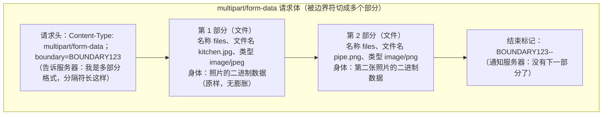
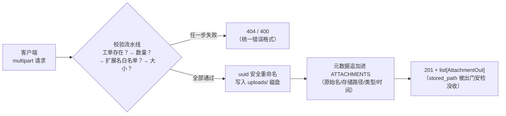
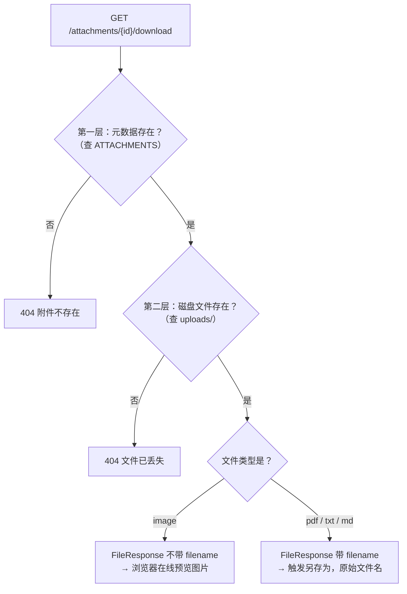
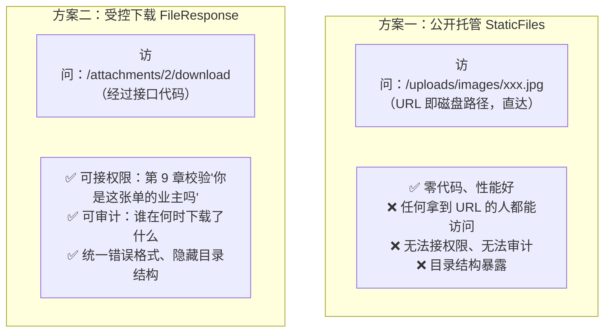
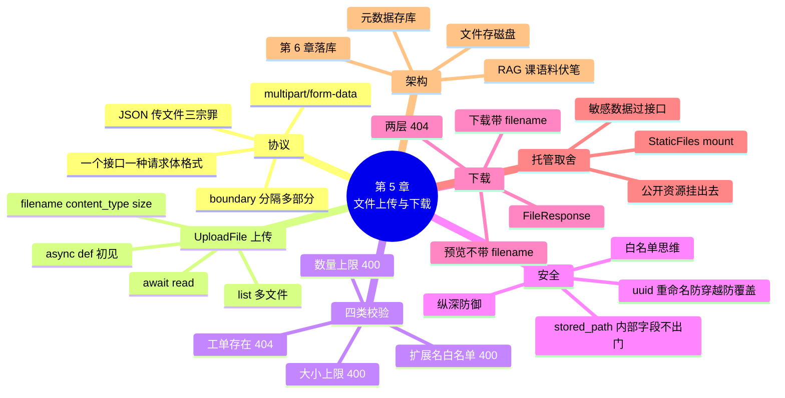

# 第 5 章 文件上传与下载：报修照片与维修文档

> **本章定位**：多媒体篇。前四章的所有数据都是 JSON——但业主手机里的漏水照片、维修工写的维修报告 PDF，都装不进 JSON。本章解决"装不进 JSON 的数据"：**文件**。
>
> 安居宝场景：业主报修上传**现场照片**（图片），维修工完工上传**维修报告**（pdf/txt/md）。架构遵循第 1 章定稿：**文件本体存磁盘 `uploads/` 目录，元数据存内存 `ATTACHMENTS`**（字段与第 1 章 attachment 表逐字对应，第 6 章落库）。
>
> 本章交付 3 个接口，全部放在新模块 `routers/files.py`——第 4 章拆分时预告的模块化红利，本章当场兑现：**给拆分后的项目加新功能 = 加一个文件、加一行注册**。
>
> **开发约定**（延续）：`uvicorn main:app --reload` 运行，`http://127.0.0.1:8000/docs` 测试。本章第一次在接口函数里使用 `async def`（正文有"先睹为快"框，原理第 11 章正式讲）。

---

## 学习目标

完成本章学习后，你应当能够：

1. **懂协议**：通过实验说出"用 JSON 传文件"的三条硬伤（体积膨胀、内存压力、丢失元信息），解释 multipart/form-data 的结构与应用场景。
2. **会上传**：用 `UploadFile` 实现多文件上传接口，完成扩展名白名单、大小限制、数量限制、uuid 安全重命名四类校验。
3. **懂架构**：说出"文件存磁盘、元数据存数据结构"的理由，以及 `stored_path` 为什么是内部字段（出门安检没收）。
4. **会下载**：用 `FileResponse` 实现受控下载，区分"在线预览"与"触发下载"两种浏览器行为。
5. **会托管**：用 `StaticFiles` 挂载静态目录，并说明安居宝为什么选受控下载而不是公开托管。
6. **懂攻防**：列出文件上传的四大攻击（路径穿越、伪造类型、超大文件、数量滥用）及本章对应的防御实现。

---

## 1. 本章项目任务与热身：照片装不进 JSON

### 本章项目任务（回指第 1 章表 1-1 需求清单）

| # | 接口 | 功能 | 本章知识点 |
|---|------|------|-----------|
| 1 | `POST /repair-orders/{order_id}/attachments` | 为工单上传附件（照片/文档，多文件） | multipart、UploadFile、四类校验 |
| 2 | `GET /repair-orders/{order_id}/attachments` | 工单附件列表（可按类型筛选） | 复习查询参数、AttachmentOut |
| 3 | `GET /attachments/{attachment_id}/download` | 受控下载/在线预览 | FileResponse、两层 404 |

完成后，表 1-1 中「提交报修单（含现场照片）」行的**照片部分**达成——该行从第 3 章的"只差照片"变为全部完成。

### 问题驱动：一张 3MB 的照片怎么交给服务器？

业主拍了一张厨房漏水的照片（3MB），要跟着报修单一起交给服务器。用已有的知识，你有两个办法——逐个试：

**尝试一：塞进 JSON 请求体。** JSON 只能装**文本**，图片是**二进制数据**，得先做 base64 编码（把二进制字节翻译成纯文本字符）。这个编码有个要命的属性——**膨胀**。亲手验证（Python 交互环境即可）：

```python
import base64

raw = b"x" * 1000            # 假装这是 1000 字节的图片数据
encoded = base64.b64encode(raw)
print("原始大小:", len(raw), " 编码后:", len(encoded))
```

预期输出：

```text
原始大小: 1000  编码后: 1332
```

1000 字节变 1332 字节——**凭空膨胀约 33%**。这是 JSON 传文件的**第一宗罪：体积膨胀**。

第二宗罪马上来：JSON 请求体必须**整体读进内存**才能解析。传 3MB 照片勉强可行，传 500MB 的监控视频呢？服务器内存直接被拖垮。而且 base64 文本还得再解码回二进制才能存盘，白折腾一趟——**第二宗罪：内存压力 + 双重转换**。

第三宗罪：图片叫什么名字？是 jpg 还是 png？这些**元信息**在二进制数据里根本不存在，你还得在 JSON 里额外加字段自己传（`{"filename": "kitchen.jpg", "type": "image/jpeg", "data": "编码后的一长串"}`）——**第三宗罪：丢失文件元信息**。

**尝试二：放 URL 查询参数。** 更不可能——第 3 章四实验早就证明了 URL 是"装不下、运不稳、不安全、装不了"的小水管，3MB 的 base64 文本塞进 URL 当场爆管（414）。

### HTTP 的答案：multipart/form-data

两条路都走不通，不是你的问题，是**工具选错了**。HTTP 早就为"传文件"准备了专门的请求格式——**multipart/form-data**（多部分表单数据）。

> 💡 **一句话定义**
> **multipart/form-data**：一种请求体格式——把请求体切成**多个部分**，每个部分有自己的头（名称、文件名、类型）和身体（内容），部分之间用"边界符"（boundary）分隔。文件部分可以直接装**二进制数据**，无需任何编码膨胀。

**图 5-1** 解剖一个上传两张照片的 multipart 请求体：



**图 5-1 multipart 请求体结构：每部分自带元信息，二进制原样传输**

对照三宗罪逐一验收：二进制原样传输（无膨胀 ✅）、逐部分读取（无需整体 base64 ✅）、文件名和类型就在每部分的头里（元信息自带 ✅）。

### 三种 Content-Type 对照

| Content-Type | 请求体形态 | 适用 | 本课程 |
|--------------|-----------|------|--------|
| `application/json` | 一段 JSON 文本 | 结构化业务数据（第 3 章主力） | 第 3 章起 |
| `application/x-www-form-urlencoded` | `key=value&key=value` 扁平文本 | 传统网页表单（无文件） | 认知即可 |
| `multipart/form-data` | 边界符分隔的多部分 | **含文件的提交** | 本章主角 |

> 📌 **一条重要约束**：一个接口的请求体格式**只能选一种**。同一个接口不可能"一半 JSON 一半 multipart"——所以"提交报修单（JSON）"和"上传报修照片（multipart）"是**两个接口**，这正是本章接口设计成 `POST /repair-orders/{order_id}/attachments`（对已有工单补附件）而不是把文件塞进 `POST /repair-orders` 的原因。

### 常见坑

- ⚠️ **往 JSON 接口发文件**：客户端把 multipart 请求发给声明了 Pydantic 模型的接口 → 422，loc 指向 body。看到 422 先检查双方约定的 Content-Type 是否一致。
- ⚠️ **"multipart 是不是更高级？"** 不是高级低级，是分工不同：业务数据用 JSON（结构化、可校验、可嵌套），文件用 multipart（二进制友好）。日常开发中经常是"先 POST JSON 建单、再 POST multipart 传附件"两步走——安居宝正是如此。

### 小结

- JSON 传文件三宗罪：体积膨胀 33%、内存压力与双重转换、丢失元信息。
- multipart/form-data 用边界符把请求体切成多部分，每部分自带名称/文件名/类型，二进制原样传输。
- 一个接口一种请求体格式；建单（JSON）与传附件（multipart）是两个接口。

---

## 2. UploadFile 实战：报修附件上传

### 新建 routers/files.py：模块化红利兑现

第 4 章拆分时的预告此刻兑现——**新增功能 = 新建一个文件 + main.py 加一行注册**，再也不用在巨石文件里见缝插针。先建 `routers/files.py` 骨架：

```python
# routers/files.py —— 文件上传与下载接口
import uuid
from datetime import datetime
from pathlib import Path as FilePath    # ← 注意：起了别名，原因见下方"命名冲突"

from fastapi import APIRouter, File, HTTPException, Path, Query, UploadFile
from fastapi.responses import FileResponse

from schemas import AttachmentOut
from store import ATTACHMENTS, REPAIR_ORDERS

router = APIRouter(tags=["文件管理"])
```

三处新面孔，逐一交代：

> 💡 **命名冲突：pathlib 的 Path 和 FastAPI 的 Path 撞名了**
> `Path` 这个名字在两个包里都是主角：`fastapi.Path` 是参数增强声明（第 2 章起一直在用），`pathlib.Path` 是操作磁盘路径的类（Python 基础课学过）。同一文件里两个都要用，后导入的会**覆盖**先导入的——所以必须给其中一个起别名。本课程约定：**FastAPI 的 Path 保持原名**（与前三章一致），pathlib 的写成 `from pathlib import Path as FilePath`。起别名是 Python 处理撞名的标准手段，不是妥协。

第二处：这个 router **没有 prefix**——因为本章三个接口的路径没有公共前缀（`/repair-orders/.../attachments` 和 `/attachments/.../download` 各归各）。**prefix 是可选的便利参数，不是必填**；路径没有规律时，每个接口写全路径即可，tags 照常分组文档。

第三处：`File` 和 `UploadFile` 是本章主角，马上登场。

### 配置与内存数据：先立规矩再写接口

在 files.py 中继续添加模块级配置（与 store.py 的分工：**文件本体相关配置归 files.py，业务数据归 store.py**）：

```python
# ── 上传配置（第 10 章会把它们挪进 core/config.py 统一管理）──
UPLOAD_DIR = FilePath("uploads")            # 文件存储根目录（相对项目运行目录）
UPLOAD_DIR.mkdir(exist_ok=True)             # 模块导入时确保目录存在，不存在则创建
(UPLOAD_DIR / "images").mkdir(exist_ok=True)   # 图片归档子目录
(UPLOAD_DIR / "docs").mkdir(exist_ok=True)     # 文档归档子目录

MAX_FILE_SIZE = 5 * 1024 * 1024             # 单文件上限：5MB
MAX_FILE_COUNT = 5                          # 单次上传上限：5 个

# 扩展名白名单：扩展名 → 归档类型（file_type 与第 1 章 attachment 表取值一致）
EXT_WHITELIST = {
    ".jpg": "image", ".jpeg": "image", ".png": "image",
    ".pdf": "pdf", ".txt": "txt", ".md": "md",
}
```

> 📌 **白名单思维复习**（第 4 章 TRANSITIONS 讲过的安全观）：这里用的是 `EXT_WHITELIST`——"只允许这 6 种扩展名"，而不是"禁止 .exe 和 .bat"。黑名单永远列不全（.svg、.html、.bat、.scr……），白名单漏列顶多是"少支持了一种格式"，不会放进危险文件。

store.py 新增附件的内存数据（字段与第 1 章 attachment 表**逐字对应**）：

```python
# 附件表 attachment 的内存版（文件本体在磁盘 uploads/ 目录，这里只存目录记录）
# 注意：预置的这条记录指向的文件并不真实存在于磁盘——第 3 节专门用它演示"元数据在、文件丢"的 404
ATTACHMENTS = [
    {"id": 1, "order_id": 5, "filename": "维修报告.pdf",
     "stored_path": "uploads/docs/5f3ab2c4e7d9.pdf",
     "file_type": "pdf", "uploaded_at": "2026-10-16 09:30"},
]
```

schemas.py 新增附件响应模型：

```python
class AttachmentOut(BaseModel):
    """附件的出门规矩：stored_path 是服务器内部路径，不放行"""
    id: int
    order_id: int
    filename: str
    file_type: str
    uploaded_at: str
```

**为什么 `stored_path` 不放行**：它是服务器磁盘上的存储路径——泄露给客户端等于告诉外人你的目录结构（攻击的第一步永远是侦察）；而且客户端要下载文件走下载接口就行，根本用不着这个路径。这与第 3 章 `author_id`、`worker_id` 被出门安检没收是同一个道理：**内部字段一律不出门**。

### UploadFile：FastAPI 专为文件准备的类型

先睹为快它的属性和方法（**表 5-1**，正文边用边体会）：

| 名称 | 类型 | 说明 | 例子 |
|------|------|------|------|
| `file.filename` | 属性 | 客户端上传时的**原始文件名**（含扩展名） | `"kitchen.jpg"` |
| `file.content_type` | 属性 | 客户端声明的 MIME 类型 | `"image/jpeg"` |
| `file.size` | 属性 | 文件大小（字节） | `3145728` |
| `await file.read()` | 方法 | **异步**读取文件内容（二进制） | 图片字节 |
| `await file.seek(0)` | 方法 | 读取指针归零（读完想再读时用，了解） | — |

形参声明为 `files: list[UploadFile]`——**类型是 UploadFile 说明来自 multipart 的文件部分，包上 list 说明可以一次传多个**（业主常常连拍好几张）。

### 上传数据流

**图 5-2** 是本节实现的完整流水线，五步校验/处理一步不缺：



**图 5-2 上传流水线：校验 → 落盘 → 记元数据**

### 完整实现

```python
@router.post("/repair-orders/{order_id}/attachments", response_model=list[AttachmentOut], status_code=201)
async def upload_attachments(
    order_id: int = Path(ge=1, description="工单ID"),
    files: list[UploadFile] = File(description="要上传的文件（图片/pdf/txt/md），可多选"),
):
    """为工单上传附件：现场照片、维修报告等（multipart 请求）"""
    # 第零步：工单存在性校验（附件必须挂在真实工单上）
    order_exists = any(o["id"] == order_id for o in REPAIR_ORDERS)
    if not order_exists:
        raise HTTPException(status_code=404, detail=f"工单 {order_id} 不存在")

    # 第一步：数量校验（空列表与超上限都是 400）
    if not files:
        raise HTTPException(status_code=400, detail="请至少选择一个文件")
    if len(files) > MAX_FILE_COUNT:
        raise HTTPException(status_code=400, detail=f"单次最多上传 {MAX_FILE_COUNT} 个文件")

    saved = []                                   # 收集本次成功入库的附件记录
    for file in files:
        # 第二步：扩展名白名单校验（suffix 取扩展名；lower 统一小写，.JPG 也能匹配白名单）
        ext = FilePath(file.filename).suffix.lower()
        if ext not in EXT_WHITELIST:
            raise HTTPException(
                status_code=400,
                detail=f"不支持的文件类型：{file.filename}（仅支持图片/pdf/txt/md）",
            )

        # 第三步：大小校验
        if file.size is None or file.size > MAX_FILE_SIZE:
            raise HTTPException(status_code=400, detail=f"文件 {file.filename} 超过 5MB 上限")

        # 第四步：安全重命名 + 落盘
        file_type = EXT_WHITELIST[ext]                       # 由白名单反查归档类型
        subdir = "images" if file_type == "image" else "docs"
        stored_name = f"{uuid.uuid4().hex}{ext}"             # 随机文件名：防路径穿越、防重名覆盖
        stored_path = UPLOAD_DIR / subdir / stored_name
        content = await file.read()                          # 异步读取文件内容（await 不能少！）
        stored_path.write_bytes(content)                     # 写入磁盘

        # 第五步：元数据入内存（字段与第 1 章 attachment 表一一对应）
        data = {
            "id": max((a["id"] for a in ATTACHMENTS), default=0) + 1,   # 内存版自增（default=0 兼容空列表）
            "order_id": order_id,
            "filename": file.filename,                       # 保留原始文件名，下载时还原给客户端
            "stored_path": str(stored_path).replace("\\", "/"),         # 统一用 / 分隔（Windows 兼容）
            "file_type": file_type,
            "uploaded_at": datetime.now().strftime("%Y-%m-%d %H:%M"),
        }
        ATTACHMENTS.append(data)
        saved.append(data)

    return saved
```

> 💡 **先睹为快：async def 与 await（本课程接口函数的第一次）**
> 注意两处新写法：函数声明是 `async def`，函数体里有 `await file.read()`。现在只需记住三条：
> ① `UploadFile.read()` 是**异步方法**，调用必须加 `await`，接口函数也必须声明 `async def`；
> ② **漏写 await 不会立刻报错**，但拿到的不是文件内容而是一个协程对象，下一行 `write_bytes` 会抛 TypeError——遇到这个错先检查 await；
> ③ 原理（事件循环、为什么快）第 11 章正式讲。第 4 章异常处理器已用过 `async def`，当时说"照写即可"，本章依然如此。

**为什么必须 uuid 重命名，不能用原始文件名**——三连问：

1. **路径穿越攻击**：恶意客户端把文件名设为 `../../main.py`，直接拼接路径就会把文件写到 uploads 之外，覆盖你的代码！uuid 重命名后，客户端给的任何文件名都只是一段**普通文本**，不参与路径拼接；
2. **重名覆盖**：两个业主都传 `photo.jpg`，第二个直接覆盖第一个的文件——业主 A 的漏水证据凭空消失；
3. **非法字符与编码**：Windows 文件名不允许 `\/:*?"<>|`，中文文件名跨系统还有编码问题——uuid 全是十六进制字符，绝对安全。

原始文件名没有丢：它存在 `ATTACHMENTS` 的 `filename` 字段里，下载时通过 FileResponse 的参数**还原**给客户端（第 3 节）。**"存儲用安全名，展示用原始名"**，两头兼顾。

### main.py 的全部改动：一行

```python
# main.py 本章全部改动（复贴纪律：其余部分与第 4 章逐字相同，仅两处增量）
from routers import files, houses, notices, repairs      # ← files 是新增的

# ── 注册路由模块：一行一个资源 ──
app.include_router(houses.router)
app.include_router(notices.router)
app.include_router(repairs.router)
app.include_router(files.router)                          # ← 本章新增的一行
```

重启服务，/docs 出现第四个分组"文件管理"，内含一个上传接口——**加一个文件、加一行注册**，第 4 章的承诺兑现。

### 测试（/docs 三组用例）

打开 `/docs` 的 `POST /repair-orders/{order_id}/attachments` → Try it out：注意参数区不再是 JSON 输入框，而是**文件选择按钮**（order_id 填 1，files 点击选择文件——可按住 Ctrl 多选）。

| # | 操作 | 预期 |
|---|------|------|
| 1 | order_id=1，选择 2 张图片（随意截图即可） | 201，响应 2 条记录：filename 是原始名、file_type 是 image，**没有 stored_path** |
| 2 | order_id=99，任选 1 个文件 | 404：工单 99 不存在 |
| 3 | 任选一个 .py 或 .exe 文件 | 400：不支持的文件类型 |

用例 1 的预期响应：

```json
[
    {"id": 2, "order_id": 1, "filename": "kitchen.jpg", "file_type": "image", "uploaded_at": "2026-10-23 16:40"},
    {"id": 3, "order_id": 1, "filename": "pipe.png", "file_type": "image", "uploaded_at": "2026-10-23 16:40"}
]
```

顺手到 PyCharm 的项目树里看一眼：`uploads/images/` 下躺着两个随机名文件（如 `a3f8c2d1....jpg`）——文件本体已落盘，ATTACHMENTS 里记着它们的目录信息。

### 常见坑

- ⚠️ **漏写 await**：`content = file.read()` 不加 await，`write_bytes` 时报 `TypeError: a bytes-like object is required`——这个 TypeError 的八成原因就是漏 await。
- ⚠️ **uploads 目录没建**：本章把 `mkdir(exist_ok=True)` 写在模块顶层，模块一导入目录就绪；如果自己写示例时忘了这一步，`write_bytes` 抛 `FileNotFoundError`。
- ⚠️ **保存了文件、忘写元数据**（或反之）：文件在磁盘上、ATTACHMENTS 里没记录 → 这个文件成了"孤儿"，永远没人能下载到；反过来是"幽灵记录"，下载必 404。**落盘与记元数据必须是紧挨着的两步**，中间不夹其他逻辑。
- ⚠️ **用原始文件名直接拼路径**：三连问里讲过的路径穿越与覆盖。.uuid 重命名不是"代码洁癖"，是安全底线。
- ⚠️ **`file.size` 在部分客户端下可能为 None**：所以校验写成 `if file.size is None or file.size > MAX_FILE_SIZE`——None 也按超限处理（宁可错杀，不可放过）。

### 小结

- UploadFile 自带 filename/content_type/size 元信息；`list[UploadFile]` 支持多文件；读取内容要 `await`。
- 四类校验：工单存在（404）、数量（400）、扩展名白名单（400）、大小（400）。
- uuid 重命名防路径穿越防覆盖；原始文件名存元数据、下载时还原；stored_path 是内部字段不出门。
- 新模块 = 新文件 + main.py 一行注册——模块化红利兑现。

---

## 3. 附件列表与受控下载：FileResponse

### 附件列表接口：复习课

先写简单的（列表接口全是旧知识的复习——查询参数筛选、response_model、404）：

```python
@router.get("/repair-orders/{order_id}/attachments", response_model=list[AttachmentOut])
def list_attachments(
    order_id: int = Path(ge=1, description="工单ID"),
    file_type: str | None = Query(default=None, max_length=10, description="按类型筛选：image/pdf/txt/md"),
):
    """工单附件列表：可按类型筛选"""
    order_exists = any(o["id"] == order_id for o in REPAIR_ORDERS)
    if not order_exists:
        raise HTTPException(status_code=404, detail=f"工单 {order_id} 不存在")

    # 复习第 2 章分页接口的套路：先筛归属，再筛条件
    result = [a for a in ATTACHMENTS if a["order_id"] == order_id]
    if file_type is not None:
        result = [a for a in result if a["file_type"] == file_type]
    return result
```

- `GET /repair-orders/5/attachments` → 1 条（预置的维修报告.pdf）；
- `GET /repair-orders/1/attachments?file_type=image` → 2 条（第 2 节测试上传的）。

### FileResponse：以文件为响应体

下载接口的响应不是 JSON，而是**文件本身**。一种笨办法：`return FileResponse(...)` 之前先把文件读进内存再返回——大文件又回到"撑爆内存"的老问题。FastAPI 提供了专用响应类型：

> 💡 **一句话定义**
> **FileResponse**：以磁盘文件为响应体的 Response——它把"读文件→分块发送→设置下载头"整件事包办了，文件再大也只占很小的发送缓冲，不整体进内存。

```python
# files.py 导入区已有：from fastapi.responses import FileResponse
@router.get("/attachments/{attachment_id}/download")
def download_attachment(
    attachment_id: int = Path(ge=1, description="附件ID"),
):
    """受控下载：图片在线预览，文档触发下载"""
    # 第一层 404：元数据不存在（查无此附件）
    target = None
    for a in ATTACHMENTS:
        if a["id"] == attachment_id:
            target = a
            break
    if target is None:
        raise HTTPException(status_code=404, detail=f"附件 {attachment_id} 不存在")

    # 第二层 404：元数据在，但磁盘文件丢失（两套存储的一致性问题）
    stored = FilePath(target["stored_path"])
    if not stored.is_file():
        raise HTTPException(status_code=404, detail=f"附件文件已丢失，请联系管理员")

    # 按类型决定浏览器行为：
    # 图片 → 不带 filename 参数 → 浏览器直接显示（在线预览）
    if target["file_type"] == "image":
        return FileResponse(path=stored)

    # 文档 → 带 filename 参数 → 触发"另存为"，且用原始文件名命名
    return FileResponse(path=stored, filename=target["filename"])
```

**图 5-3** 是这个接口的完整校验流程：



**图 5-3 受控下载的两层校验与两种浏览器行为**

三个设计点专门讲：

1. **两层 404**。"文件存磁盘、元数据存数据结构"是两套独立存储（第 1 章定稿的架构），一致性没有数据库外键兜底（第 6 章落库后也一样——外键管不了磁盘文件），**必须两层都查**。现在用预置附件演示：`GET /attachments/1/download` → 元数据在（id=1 维修报告.pdf），但磁盘上没有对应文件 → **404 附件文件已丢失**。真实生产中这层校验拦住的是"文件被误删、磁盘故障、迁移遗漏"等事故。

2. **在线预览 vs 触发下载**。区别只在 FileResponse 的 `filename` 参数：
   - 不带 filename → 响应头没有 `Content-Disposition: attachment` → 浏览器按文件类型**直接显示**（图片、PDF 都会内联打开）；
   - 带 filename → 通知浏览器"这是要保存的附件" → 弹出**另存为**，保存名就是这个 filename。
   
   安居宝的策略：照片给预览（业主和管理员快速查看现场），文档给下载（维修报告要存档转发）。media_type 不用手动设置——FileResponse 会根据文件扩展名自动判断。

3. **为什么叫"受控"下载**。这个下载请求**经过我们的接口代码**——意味着可以加任何控制：第 9 章会在返回文件之前校验"你是不是这个工单的业主"；将来还能记录下载日志、限速、加水印。对比第 4 节的公开托管，你就明白"受控"二字的分量。

### 测试（四组用例）

| # | 操作 | 预期 |
|---|------|------|
| 1 | `GET /attachments/2/download`（第 2 节上传的 kitchen.jpg，id 以你的数据为准） | 浏览器直接**显示图片** |
| 2 | 上传一个 pdf 到任一工单，再下载它 | 弹出**另存为**，文件名是原始文件名 |
| 3 | `GET /attachments/99/download` | 404：附件 99 不存在 |
| 4 | `GET /attachments/1/download`（预置数据） | 404：附件文件已丢失（两层 404 的第二层） |

用例 2 特别有仪式感：客户端收到的文件名是 `维修报告.pdf` 而不是磁盘上的 `7c9e6629....pdf`——uuid 安全名与原始名的分工，在此刻闭环。

### 常见坑

- ⚠️ **FileResponse 的路径基准**：`stored_path` 存的是相对路径（`uploads/docs/xxx.pdf`），它是相对于**运行 uvicorn 的目录**（项目根）解析的。若你换了个目录启动服务，就会命中第二层 404——排错时先确认启动目录。
- ⚠️ **media_type 手滑写成 application/octet-stream**（万能二进制类型）：连图片也会变成"下载"而不是预览。本章策略下根本不用手写 media_type，交给 FileResponse 自动判断。
- ⚠️ **只查元数据不查文件**：返回的 FileResponse 指向不存在的文件，FastAPI 在响应阶段抛 500——用户体验和日志都难看。两层 404 都要写。

### 小结

- 列表接口：查询参数筛选 + AttachmentOut 安检，纯复习。
- FileResponse 包办文件响应；filename 参数决定"预览"还是"另存为"；media_type 自动判断。
- 受控下载 = 请求过我的代码 = 未来可加权限、日志、审计（第 9 章回指）。
- 两层 404：元数据层、磁盘层——两套存储的固有代价，必须都兜住。

---

## 4. StaticFiles：静态托管与访问控制的取舍

### StaticFiles 是什么

除了"写接口自己控制下载"，FastAPI 还有一条更省事的路——把整个目录**公开托管**成静态资源：

```python
# main.py ——【演示代码：安居宝最终不采用，原因见下文】
from fastapi.staticfiles import StaticFiles

app.mount("/uploads", StaticFiles(directory="uploads"), name="uploads")
```

> 💡 **一句话定义**
> **StaticFiles**：静态文件服务——把一个磁盘目录挂载（mount）到某个 URL 路径下，浏览器按 URL 直接访问目录里的文件，**不经过任何接口代码**。

`app.mount("/uploads", ...)` 的意思是："凡是 `/uploads` 开头的请求，都交给这个静态文件服务处理"。挂载后（需要重启服务）：

```text
http://127.0.0.1:8000/uploads/images/a3f8c2d1....jpg
```

浏览器直接显示图片——没有接口、没有校验、没有 404 定制，目录里有什么就能访问什么。

### 工程讨论：安居宝该用哪种？

两种方案的对比（**图 5-4**）：



**图 5-4 公开托管 vs 受控下载**

决策的关键在**数据敏感性**。报修照片不是公开资源——照片里有住户的门牌号、屋内环境、家里老人小孩的样子；维修报告含住户联系方式。**把 uploads/ 整个公开挂载，等于把住户隐私挂在裸奔的 URL 上**，任何人猜到或拿到链接就能看。

而第 12 章 AI 生成的前端页面、logo、样式文件，是**真正公开的资源**——那才是 StaticFiles 的正确使用场景。

> 📌 **结论**：两种工具都进工具箱——**安居宝的附件走受控下载（本章已实现），公开静态资源用 StaticFiles（第 12 章正式使用）**。判断口诀：**"人人都该看到的，挂出去；要看身份的，过接口。"**
>
> 本章的演示代码请勿保留在 main.py 里——若已尝试，注释掉 mount 那行重启（否则 uploads 下的附件都能被直链访问，受控下载形同虚设）。

### 常见坑

- ⚠️ **mount 路径与 API 路由冲突**：如果 mount 了 `/uploads` 又定义了 `/uploads` 开头的接口，先注册的先生效——mount 通常放路由注册之后，减少踩坑。
- ⚠️ **directory 指向不存在的目录**：`StaticFiles(directory="uploads")` 在目录不存在时启动即报错（可加 `check_dir=False` 关闭检查，但一般应该确保目录存在）。
- ⚠️ **以为 StaticFiles 也能做权限**：它不过你的代码，没有任何校验机会。需要权限控制的资源，从架构上就不该走静态托管。

### 小结

- StaticFiles 一行挂载整个目录，浏览器按 URL 直达，零接口代码。
- 敏感数据（报修照片、维修报告）必须走受控下载：为第 9 章权限留接口；公开资源（前端页面）用 StaticFiles。
- 口诀：人人都该看到的挂出去，要看身份的过接口。

---

## 5. 上传安全清单与全流程测试

### 四大攻击与防御对照表

本章散落在正文里的安全设计集中收编（这张表值得抄进你的面试笔记）：

| 攻击手法 | 攻击效果 | 本章防御（代码位置） |
|---------|---------|---------------------|
| **路径穿越**：文件名填 `../../main.py` | 把文件写到 uploads 之外，覆盖代码 | uuid 重命名，原始文件名不参与路径拼接（第 2 节第四步） |
| **伪造类型**：把 .exe 改名为 .jpg | 上传可执行文件伺机执行 | 扩展名白名单（只放 6 种）；`file.content_type` 与扩展名交叉核对可进一步加强，深度校验见附录 A 的魔数思路 |
| **超大文件**：传 2GB 文件 | 撑爆内存与磁盘 | 单文件 5MB 上限（`file.size` 校验，第 2 节第三步） |
| **数量滥用**：一次请求 1000 个文件 | 刷爆磁盘与连接 | 单次最多 5 个（第 2 节第一步） |

> ⚠️ 诚实地说明白名单的局限：扩展名校验挡不住"把病毒改名叫 photo.jpg"——它只是让恶意**可执行文件**更难混进来（服务器不会执行 jpg）。真正的深度防御要校验**文件头魔数**（文件开头几个字节标识真实格式），属于进阶内容，思路在附录 A 留了指引。**上传安全是纵深防御：白名单 + 重命名 + 大小限制 + 权限，层层叠加，没有单点银弹。**

### 全流程测试用例表（9 组，按序执行）

| # | 操作 | 预期 |
|---|------|------|
| 1 | `POST /repair-orders/1/attachments` 上传 2 张图片 | 201，2 条记录，无 stored_path |
| 2 | `GET /repair-orders/1/attachments` | 2 条 |
| 3 | `GET /repair-orders/1/attachments?file_type=pdf` | `[]`（该单无 pdf） |
| 4 | `GET /repair-orders/5/attachments` | 1 条（预置维修报告.pdf） |
| 5 | 下载用例 1 上传的图片附件 | 浏览器在线预览 |
| 6 | 上传一个 pdf 到 2 号单，再下载它 | 另存为，原始文件名 |
| 7 | 上传 .exe 文件 | 400：不支持的文件类型 |
| 8 | 造一个 >5MB 的 txt 上传 | 400：超过 5MB 上限 |
| 9 | `GET /attachments/1/download`（预置幽灵记录） | 404：附件文件已丢失 |

> 💡 用例 8 造大文件的小技巧：复制粘贴几百万字符进 txt 太笨——在 PyCharm 里跑一行 `'x' * 6_000_000` 写入文件即可（Python 旧知识：字符串乘法）。

### 工程习惯补充

- **磁盘目录按类型归档**（uploads/images、uploads/docs）：单目录文件上千后极难管理，分类是最低成本的组织方式；
- **测试残留清理**：本章测试会往 uploads 里塞不少文件，收尾时清空 uploads/ 下的测试文件（保留目录结构），养成"测试数据不过夜"的习惯（第 11 章 pytest 会用临时目录自动化解决这件事）。

### 小结

- 四大攻击四道防御：uuid 重命名、扩展名白名单、大小上限、数量上限——纵深防御，层层叠加。
- 9 组用例覆盖全部成功/失败路径；两层 404 与"幽灵记录"是"文件+元数据"双存储架构的特有考点。

---

## 6. 本章收官：接口规范总表 v0.5.0

### 总表新增 3 行

前 11 行与 v0.4.0 **逐字相同**（复贴纪律），仅追加文件模块 3 行：

| 方法 | 路径 | 请求模型 | 响应模型 | 成功码 | 错误码 | 路由模块 |
|------|------|---------|---------|--------|--------|---------|
| GET | /houses/{house_id} | — | HouseOut | 200 | 404 | houses |
| GET | /notices | —（查询参数 category） | list[NoticeOut] | 200 | 422 | notices |
| GET | /notices/search | —（查询参数 keyword） | list[NoticeOut] | 200 | 422 | notices |
| POST | /notices | NoticeCreate | NoticeOut | **201** | 422 | notices |
| PUT | /notices/{notice_id} | NoticeUpdate | NoticeOut | 200 | 400/404/422 | notices |
| DELETE | /notices/{notice_id} | — | —（空体） | **204** | 404 | notices |
| GET | /repair-orders | —（查询参数 status/type/page/page_size） | OrderPageOut | 200 | 422 | repairs |
| GET | /repair-orders/by-worker | —（查询参数 worker_id） | list[RepairOrderOut] | 200 | 422 | repairs |
| GET | /repair-orders/{order_id} | — | RepairOrderDetail | 200 | 404 | repairs |
| POST | /repair-orders | RepairOrderCreate | RepairOrderOut | **201** | 400/422 | repairs |
| PUT | /repair-orders/{order_id}/status | OrderStatusUpdate | RepairOrderOut | 200 | **400/404/409**/422 | repairs |
| POST | /repair-orders/{order_id}/attachments | multipart 文件（无 JSON 模型） | list[AttachmentOut] | **201** | 400/404 | files |
| GET | /repair-orders/{order_id}/attachments | —（查询参数 file_type） | list[AttachmentOut] | 200 | 404/422 | files |
| GET | /attachments/{attachment_id}/download | — | 文件流（非 JSON） | 200 | 404 | files |

> 💡 注意上传接口的"请求模型"列写的是 **multipart 文件（无 JSON 模型）**——这是全表第一个不走 Pydantic 模型的请求体；下载接口的响应是**文件流**，同样不适用响应模型。第 9 章总表还将增加"所需角色"列。

### 表 1-1 更新

「提交报修单（含现场照片）」行 → ✅ **全部达成**（第 3 章接口 + 第 5 章照片上传）。截至本章，表 1-1 十二行功能中已完成七行（提交报修单、撤销报修单、确认完工并评价打分、受理并派单给维修工、更新工单维修状态、发布 / 修改 / 删除社区公告与规章、浏览与搜索公告），剩余五行全部依赖数据落库与登录体系（登记房屋信息、查看自己房屋的报修记录、查看派给自己的工单、查看维修工绩效统计、注册账号与登录）。

### 遗留问题钩子

1. **重启服务，ATTACHMENTS 清零、上传的文件成了孤儿**——元数据必须进数据库：第 6 章 attachment 表落库，外键约束保证附件必须挂在真实工单上；
2. **"文件存磁盘、元数据存库"的一致性**从此有数据库背书，但磁盘文件仍需自己管理（例如将来删除附件时，元数据与文件本体的双删除要保持一致）；
3. **RAG 课程伏笔（明牌）**：维修工上传的 pdf/txt/md 维修报告，就是后续 RAG 课里 AI 管家要检索的资料——将来业主问"我家上次维修换了什么零件"，AI 的答案就藏在这些文档里。你今天写的上传接口，是在给 AI 管家攒"记忆"。



**本章你为安居宝交付了什么**：附件上传（多文件 + 四类校验 + 安全落盘）、附件列表（类型筛选）、受控下载（预览/下载两种行为）三个接口；routers/files.py 新模块；接口规范总表 v0.5.0（14 个接口）；表 1-1 又点亮一行。

**下一章预告**：内存数据时代正式谢幕。第 6 章《连接 MySQL：SQLAlchemy 入门》——5 张表建进 MySQL 5.6，四份内存数据（WORKERS/HOUSES/REPAIR_ORDERS/NOTICES/ATTACHMENTS）全部下岗，接口的函数体将迎来"数据源换心脏"式的升级（升级纪律照旧：每次只改数据访问层，校验逻辑原样保留）。

---

## 附录

### 附录 A：UploadFile 速查表

| 名称 | 类型 | 说明 |
|------|------|------|
| `file.filename` | 属性 | 客户端原始文件名（**不可信**，只用于展示与元数据） |
| `file.content_type` | 属性 | 客户端声明的 MIME 类型（同样不可信，可伪造） |
| `file.size` | 属性 | 文件字节数（个别客户端下可能为 None） |
| `await file.read()` | 方法 | 读取全部内容（二进制）；大文件慎用——一次性读入内存不适合大文件，分块读取是进阶方向 |
| `await file.seek(0)` | 方法 | 读指针归零（读两次之间需要） |
| `file.file` | 属性 | 底层文件对象（进阶：可交给分块读写的工具） |

**进阶指引（文件头校验）**：真实格式校验看"魔数"——jpg 开头是 `FF D8 FF`、png 是 `89 50 4E 47`、pdf 是 `25 50 44 46`（`%PDF`）。读取文件前 4~8 字节比对即可识破"改名的 exe"。思路：`head = content[:8]`，与魔数表比对（可搜 python-magic 库）。

### 附录 B：Response 家族速查

| Response 类型 | 用途 | 本课程出场 |
|---------------|------|-----------|
| 默认（return dict/list） | 自动 JSON 序列化 | 第 1 章起，绝对主力 |
| `JSONResponse` | 手动构造 JSON 响应（可定制状态码/头） | 第 4 章异常处理器 |
| `FileResponse` | 以磁盘文件为响应体（自动流式发送） | **本章** |
| `StreamingResponse` | 以生成器/流为响应体（边生成边发送） | 认知级（大文件、AI 流式输出的官方答案，RAG 课程会重逢） |
| `RedirectResponse` | 重定向（302） | 认知级 |

### 附录 C：进阶自学——Form()：表单字段与文件混合上传

multipart 请求里除了文件部分，还可以有**普通字段部分**（一段带名称的文本，与文件部分并列、用同一个 boundary 分隔），用 `Form()` 接收：

```python
from fastapi import File, Form, UploadFile

@router.post("/repair-orders/{order_id}/attachments", ...)
async def upload_attachments(
    order_id: int = Path(ge=1),
    note: str | None = Form(default=None, max_length=100, description="附件备注"),
    files: list[UploadFile] = File(description="文件"),
):
    ...
```

- `Form()` 与 `Query()`/`Path()`/`File()` 是一族——分别管表单字段、查询参数、路径参数、文件；
- 限制：**JSON 模型（Pydantic）和 Form/File 不能在同一接口混用**（请求体格式互斥，本章第 1 节的结论在此有了代码形态）。需要"大量结构化字段 + 文件"时，惯例是拆两个接口（先 POST JSON 建单、再 multipart 传附件），安居宝正是这么设计的。
