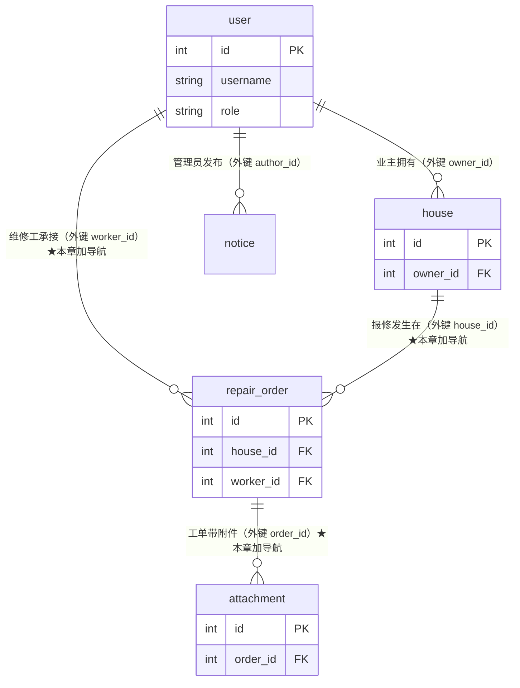
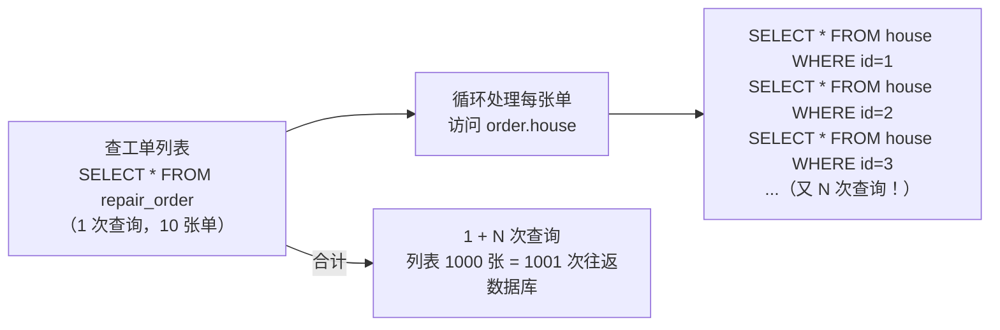
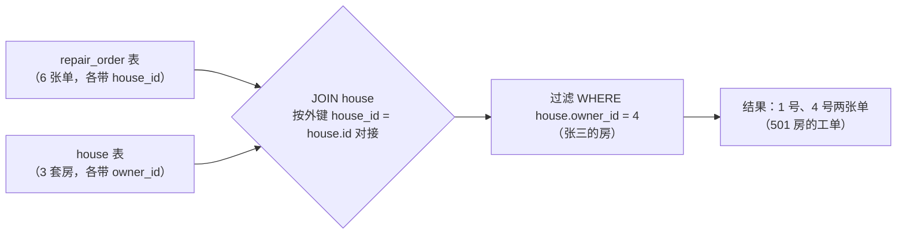
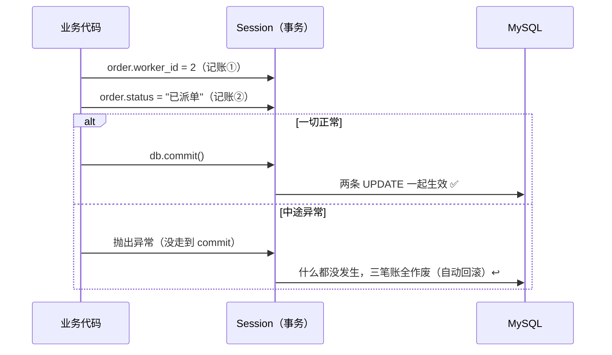
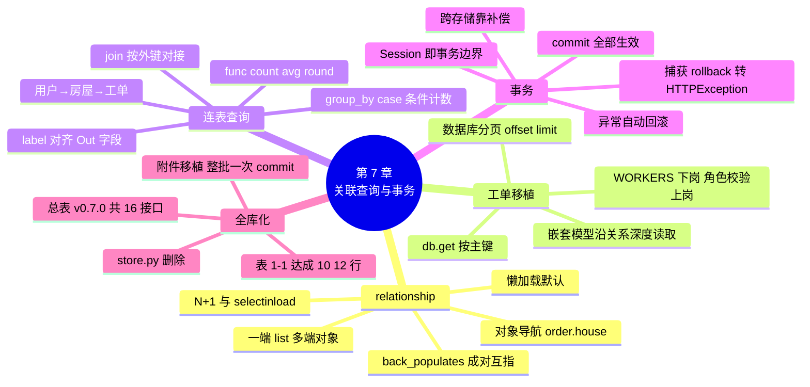

# 第 7 章 数据库进阶：关联查询与业务落地

> **本章定位**：数据库落地篇（下）。第 6 章完成了"单表 CRUD 数据库化"，本章三线并进：① **relationship** 让 ORM 对象互相"认识"（工单认识自己的房屋，房屋认识自己的工单）；② **连表查询**解锁两行压了七章的功能——「查看自己房屋的报修记录」「查看维修工绩效统计」；③ **事务**保住多步写操作的原子性。章末附件接口移植完成，**store.py 整个文件删除，安居宝全面数据库化**。
>
> **本章的升级纪律**：延续第 6 章"心脏移植"条款——只换数据访问行，校验、错误码、docstring 原样，逐接口附改动清单；附带升级（时间字段、from_attributes）与第 6 章声明一致，工单系模型本章补齐。
>
> **开发约定**（延续）：`uvicorn main:app --reload` 运行，`http://127.0.0.1:8000/docs` 测试。

---

## 学习目标

完成本章学习后，你应当能够：

1. **会建关系**：在一对多关系的两端声明 relationship（back_populates 成对互指），用对象导航（`order.house`）替代手工二次查询。
2. **懂加载**：解释 N+1 查询问题的成因，说出 selectinload 的解法。
3. **会连表**：用 join 完成跨表条件查询（按业主查工单），用 func + group_by 完成分组统计（COUNT/AVG）。
4. **懂事务**：说出 Session 的事务边界（commit 前的所有操作是整体、异常自动回滚），设计多步写的原子流程。
5. **会移植**：独立完成工单与附件模块的数据库移植（复用第 6 章移植套路），RepairOrderOut 系模型正确配置 from_attributes。

---

## 1. 本章项目任务与热身：跨表的事，手工做太累

### 本章项目任务

| # | 交付物 | 说明 |
|---|--------|------|
| 1 | relationship × 3 对 | house↔repair_order、user↔repair_order（维修工）、repair_order↔attachment |
| 2 | 工单模块移植 × 5 | 列表/按维修工查/详情/创建/状态流转，全部切到 MySQL |
| 3 | 新接口 × 2 | 「查看自己房屋的报修记录」「查看维修工绩效统计」——表 1-1 两行解锁 |
| 4 | 附件模块移植 × 3 | 上传/列表/下载切到 MySQL |
| 5 | store.py 删除 | 最后三个内存数据集下岗，总表 v0.7.0 全库化（16 接口） |

### 热身：手工维护关系太累

回忆第 3 章的工单详情接口：为了让响应里嵌一份房屋摘要，我们**手工查了两次**——先遍历工单找到单，再遍历房屋按 house_id 找房，最后手工拼字典。数据之间的关系（这张单属于那套房）明明就写在外键里，代码却全靠人脑记住。

第 6 章建表时我们说过：ForeignKey 本章只建列，"关联的深玩法第 7 章见"——现在兑现。**图 7-1** 是增强版 ER 图：实线是第 6 章已建的 ForeignKey（数据库层的约束），箭头标注的是本章要建的 relationship（代码层的导航通道）：



**图 7-1 安居宝关系全景（★ 标注本章要"点亮"的三条导航）**

### 小结

- 外键管数据库层约束（第 6 章），relationship 管代码层导航（本章）——分工不同，配合使用。
- 本章还要用 join 与 func 解锁两个连表功能，用事务保住多步写的原子性。

---

## 2. relationship：让 ORM 对象认识彼此

### 定义

> 💡 **一句话定义**
> **relationship()** 在两个 ORM 类之间架起**对象级**的通道：配置好之后，`某个工单.house` 直接给出房屋对象、`某套房屋.repair_orders` 直接给出工单列表——SQL 由 SQLAlchemy 自动生成，人脑不用再记"先查哪张表再查哪张表"。

### 一对多的两端怎么声明

以 house ↔ repair_order 为例（一个房屋多张工单；一张工单只属于一个房屋）：

```python
class House(Base):
    __tablename__ = "house"
    ...
    # 一的一方：持有"多"的列表（注意类型是 list["RepairOrder"]）
    repair_orders: Mapped[list["RepairOrder"]] = relationship(back_populates="house")


class RepairOrder(Base):
    __tablename__ = "repair_order"
    ...
    # 多的一方：持有"一"的对象（类型是 "House"，不带 list）
    house: Mapped["House"] = relationship(back_populates="repair_orders")
```

两条规矩：

1. **两端都要写**，且 `back_populates` **成对互指**——House 的 back_populates 写对方属性名 `"repair_orders"`，RepairOrder 的写 `"house"`。像两个人互相存了对方的电话，拨任何一个都能找到另一个；
2. 类型注解按方向写：**一的那端是 `Mapped[list["对方"]]`，多的那端是 `Mapped["对方"]`**（工单只有一套房屋，房屋有多张工单）。类名加引号是前向引用（两个类互相提及，Python 需要字符串形式）。

### models.py 的三对关系（声明过的模型升级）

按上述规矩，models.py 补三对 relationship（这是第 6 章 models.py 的**声明升级**，函数体无关，直接加属性）：

```python
class User(Base):
    ...
    # 该维修工名下的工单（worker_id 这条外键的导航）
    repair_orders: Mapped[list["RepairOrder"]] = relationship(back_populates="worker")


class House(Base):
    ...
    repair_orders: Mapped[list["RepairOrder"]] = relationship(back_populates="house")


class RepairOrder(Base):
    ...
    house: Mapped["House"] = relationship(back_populates="repair_orders")
    worker: Mapped["User | None"] = relationship(back_populates="repair_orders")
    attachments: Mapped[list["Attachment"]] = relationship(back_populates="order")


class Attachment(Base):
    ...
    order: Mapped["RepairOrder"] = relationship(back_populates="attachments")
```

> 📌 User.repair_orders 与 House.repair_orders 同名不冲突（分属两个类）；RepairOrder.worker 与外键列 worker_id 并存（一个是对象、一个是数字，各干各的）。

### 对象导航演示

重启服务前，先在 PyCharm 里新建临时脚本体验导航（跑完删除）：

```python
# demo_nav.py —— 体验对象导航（临时脚本）
from db import SessionLocal
from models import House, RepairOrder

db = SessionLocal()
house = db.get(House, 1)
print("房屋：", house.building, house.unit, house.room)
for order in house.repair_orders:          # ← 没写任何 SQL，房屋的工单直接到手
    print("  工单", order.id, order.type, order.status)

order = db.get(RepairOrder, 2)
print("工单2所属房屋：", order.house.building, order.house.room)   # ← 反向导航
db.close()
```

预期输出：

```text
房屋： 3栋 2单元 501
  工单 1 水电 待受理
  工单 4 水电 已完成
工单2所属房屋： 3栋 2单元 502
```

第 3 章"查工单再查房屋再拼字典"的三步，现在是两个属性访问。

### 懒加载与 N+1 问题（进阶框）

relationship 默认**懒加载**（lazy）：`order.house` 在**被访问的那一刻**才发 SQL。好处是按需查询，坏处是循环场景下会爆炸——**图 7-2**：



**图 7-2 N+1 问题：一次列表查询 + N 次循环内的关联查询**

这就是著名的 **N+1 查询问题**。解法是**立即加载**（eager loading）——查列表时顺手把关联数据批量取回：

```python
from sqlalchemy.orm import selectinload

orders = (
    db.query(RepairOrder)
    .options(selectinload(RepairOrder.house))     # 预加载关联房屋（再发一条 IN 查询批量取回）
    .all()
)
```

> 💡 **本项目现状说明**（诚实交代，不为画而画）：安居宝的列表接口响应模型 RepairOrderOut **不嵌套**房屋信息（列表要轻量），所以目前没有真实触发 N+1 的接口；详情接口是单条查询（1+1 次可接受）。但**将来任何"列表 + 嵌套关联"的需求都会立刻踩中 N+1**——把成因和解法记在附录 A，需要时直接取用。

### 常见坑

- ⚠️ **back_populates 拼错不报错**：导航单方面失效（访问属性时 SQLAlchemy 找不到另一端），排错极难。成对声明后，用一个临时脚本把两个方向都访问一遍（如 demo_nav.py）验证。
- ⚠️ **relationship 与外键列混淆**：`order.house_id` 是数字（外键列），`order.house` 是对象（关系导航）。`filter(RepairOrder.house_id == 1)` ✅、`filter(RepairOrder.house == 1)` ❌。
- ⚠️ **Mapped 里的类名忘加引号**：两个类文件内互相引用，类还没定义完就要提及对方——引号（前向引用）是必需的。
- ⚠️ **改了 models.py 忘记重启**：`--reload` 一般会自动生效，但模型类被缓存时偶尔失灵；导航行为怪异先重启。

### 小结

- relationship 一对多两端声明：一端 `Mapped[list["对方"]]`、多端 `Mapped["对方"]`，back_populates 成对互指。
- 对象导航替代手工二次查询；默认懒加载，循环场景防 N+1 用 selectinload。
- 外键列是数字、关系属性是对象——筛选用列、取数用关系。

---

## 3. 心脏移植（工单模块）：五接口数据库化

### 移植前声明

> 📌 **附带升级（与第 6 章两份声明同款）**：① RepairOrderOut、RepairOrderDetail、OrderPageOut、HouseBrief 四个模型加 `model_config = ConfigDict(from_attributes=True)`；② 时间字段（created_at、finished_at）类型 str → datetime（响应为 ISO 8601 格式，与第 6 章公告的行为一致）；③ TRANSITIONS 白名单从 store.py **搬入 schemas.py**（store.py 本章末尾将整个删除，业务规则跟模型住一起）。
>
> **改造前基准说明**：repairs.py 里的函数体自第 4 章拆分后与第 3 章正文逐字相同（第 4 章只动了装饰器），所以下文的"改造前"以第 3 章函数体为准、装饰器呈 router 形态。

### list_orders：筛选 + 数据库分页

第 6 章"认知"正式落地。改动清单：形参加 db；第一步筛选换 filter；第二步分页换 offset/limit + count；第三步包装原样。

```python
@router.get("", response_model=OrderPageOut)
def list_orders(
    status: str | None = Query(
        default=None, max_length=10,
        description="按状态筛选：待受理/已派单/维修中/已完成/已评价/已取消",
    ),
    type: str | None = Query(
        default=None, max_length=10,
        description="按类型筛选：水电/电梯/门窗/其他",
    ),
    page: int = Query(default=1, ge=1, description="页码，从 1 开始"),
    page_size: int = Query(default=3, ge=1, le=10, description="每页条数，1~10"),
    db: Session = Depends(get_db),                                        # ← 改动①
):
    """工单列表：状态 + 类型组合筛选，分页返回"""
    # ── 第一步：筛选（先把不符合条件的排除，再谈分页）──
    query = db.query(RepairOrder)                                         # ← 原：result = REPAIR_ORDERS
    if status is not None:
        query = query.filter(RepairOrder.status == status)                # ← 原：列表推导筛选
    if type is not None:
        query = query.filter(RepairOrder.type == type)                    # ← 原：列表推导筛选

    # ── 第二步：分页（数据库分页：只取本页数据 + 统计筛选后总数）──
    total = query.count()                                                 # 筛选后的总数（给前端画页码条）
    items = (
        query.order_by(RepairOrder.id)                                    # 排序保证分页稳定
        .offset((page - 1) * page_size)                                   # 跳过前面页（原：start 换算切片）
        .limit(page_size)                                                 # 只取本页条数（原：切片右边界）
        .all()
    )

    # ── 第三步：包装响应 ──（原样）
    return {
        "total": total,
        "page": page,
        "page_size": page_size,
        "items": items,
    }
```

记忆锚点：`offset(跳过几行)` 对应切片的**左边界**、`limit(取几行)` 对应**步长**——`result[3:6]` ≈ `.offset(3).limit(3)`。注意先筛选后分页的顺序原样保留（第 2 章的坑别再踩）。

### get_order_detail：两章知识会师（本节高光）

改造前后对比——函数体从 18 行缩到 6 行：

```python
# ── 改造前（第 3 章函数体，装饰器为第 4 章拆分后形态）──
@router.get("/{order_id}", response_model=RepairOrderDetail)
def get_order_detail(
    order_id: int = Path(ge=1, title="工单ID", description="要查询的报修工单编号，从 1 开始"),
):
    """工单详情：含房屋摘要（路径参数 + 嵌套响应模型会师）"""
    order = None
    for o in REPAIR_ORDERS:                 # 手工找单
        if o["id"] == order_id:
            order = o
            break
    if order is None:
        raise HTTPException(status_code=404, detail=f"工单 {order_id} 不存在")

    house = None                            # 手工找房
    for h in HOUSES:
        if h["id"] == order["house_id"]:
            house = h
            break
    house_brief = {
        "building": house["building"],
        "unit": house["unit"],
        "room": house["room"],
    }

    data = dict(order)                      # 手工拼装
    data["house"] = house_brief
    return data
```

```python
# ── 改造后（数据库版）──
@router.get("/{order_id}", response_model=RepairOrderDetail)
def get_order_detail(
    order_id: int = Path(ge=1, title="工单ID", description="要查询的报修工单编号，从 1 开始"),
    db: Session = Depends(get_db),                                            # ← 改动①
):
    """工单详情：含房屋摘要（路径参数 + 嵌套响应模型会师）"""
    order = db.get(RepairOrder, order_id)      # ← 改动②：按主键取单（原：6 行手工找单）
    if order is None:                          # （校验、404 原样）
        raise HTTPException(status_code=404, detail=f"工单 {order_id} 不存在")

    # ← 改动③：原"第二步找房 + 第三步拼字典"整体删除——
    # RepairOrderDetail 的嵌套字段 house 由出门安检沿 relationship 自动读取：
    # 安检看到 house: HouseBrief，就去 ORM 对象上取 order.house（房屋对象），
    # HouseBrief 再从房屋对象读 building/unit/room——嵌套模型 + from_attributes 深度取值
    return order
```

**两章知识在此会师**：第 3 章设计的嵌套模型（`house: HouseBrief`）字段名恰好与第 2 节的 relationship 名（`house`）对上——安检序列化时自动"顺着关系走"。`db.get(模型, 主键)` 是按主键取行的专用快捷写法（对应 `WHERE id = ...`）。

### list_orders_by_worker：一行查询

```python
@router.get("/by-worker", response_model=list[RepairOrderOut])
def list_orders_by_worker(
    worker_id: int = Query(ge=1, description="维修工ID"),
    db: Session = Depends(get_db),                    # ← 改动①
):
    """按维修工查工单：worker_id 不在路径里 → 自动成为查询参数"""
    return db.query(RepairOrder).filter(RepairOrder.worker_id == worker_id).all()   # ← 改动②：原 6 行遍历
```

### create_repair_order：房屋校验改查库

```python
@router.post("", response_model=RepairOrderOut, status_code=201)
def create_repair_order(order: RepairOrderCreate, db: Session = Depends(get_db)):
    """提交报修单：业主发起，状态强制从'待受理'开始"""
    # 第一步：校验房屋存在（提交的数据引用了不存在的资源 → 400）（原样；数据行更换）
    house = db.get(House, order.house_id)                                  # ← 原：any() 遍历 HOUSES
    if house is None:
        raise HTTPException(status_code=400, detail=f"房屋 {order.house_id} 不存在，无法报修")

    # 第二步：服务端生成全部受控字段（原样；id/created_at 改由数据库生成）
    data = RepairOrder(
        house_id=order.house_id,
        worker_id=None,                               # 尚未派单
        type=order.type,
        description=order.description,
        status="待受理",                               # 强制初始状态（图 1-7 状态机起点）
        score=None,                                   # 尚未评价
        finished_at=None,                             # 尚未完工
    )

    # 第三步：入库并返回（出门安检自动隐藏 house_id、worker_id 等内部字段）
    db.add(data)                                      # ← 原：REPAIR_ORDERS.append(data)
    db.commit()
    db.refresh(data)
    return data
```

### change_order_status：WORKERS 字典下岗仪式

这个接口的改动最多，逐条列清单：

| # | 位置 | 改动 |
|---|------|------|
| ① | 形参 | 加 `db: Session = Depends(get_db)` |
| ② | 查单 | 6 行遍历 → `order = db.get(RepairOrder, order_id)` |
| ③ | 状态读取 | `OrderStatus(order["status"])` → `OrderStatus(order.status)`（下标 → 点语法） |
| ④ | 维修工校验 | `payload.worker_id not in WORKERS` → 查 User 表且校验角色（见下） |
| ⑤ | 字段写入 | `order["worker_id"] = ...` → `order.worker_id = ...`（四处下标全改点语法） |
| ⑥ | 完工时间 | `datetime.now().strftime(...)` → `datetime.now()`（时间类型升级，声明过） |
| ⑦ | 收尾 | 新增 `db.commit()` + `db.refresh(order)` |

```python
@router.put("/{order_id}/status", response_model=RepairOrderOut)
def change_order_status(
    order_id: int = Path(ge=1, description="工单ID"),
    payload: OrderStatusUpdate,
    db: Session = Depends(get_db),
):
    """工单状态流转：白名单校验 + 条件字段校验"""
    # 第一层：工单存在性（原样；数据行更换）
    order = db.get(RepairOrder, order_id)
    if order is None:
        raise HTTPException(status_code=404, detail=f"工单 {order_id} 不存在")

    # 第二层：白名单校验（当前状态 → 目标状态是否被允许）（原样）
    current = OrderStatus(order.status)
    if payload.new_status not in TRANSITIONS[current]:
        raise HTTPException(
            status_code=409,
            detail=f"非法状态流转：{current.value} → {payload.new_status.value}",
        )

    # 第三层：条件字段校验（不同流转需要不同的附加数据）
    if payload.new_status == OrderStatus.assigned:          # 派单
        if payload.worker_id is None:
            raise HTTPException(status_code=400, detail="派单必须提供 worker_id")
        worker = db.get(User, payload.worker_id)            # ← 原：WORKERS 字典查成员
        if worker is None or worker.role != "worker":       #   升级：必须是真实存在的维修工
            raise HTTPException(status_code=400, detail=f"维修工 {payload.worker_id} 不存在")
        order.worker_id = payload.worker_id

    if payload.new_status == OrderStatus.rated:             # 评价
        if payload.score is None:
            raise HTTPException(status_code=400, detail="评价必须提供 score（1~5 分）")
        order.score = payload.score

    if payload.new_status == OrderStatus.finished:          # 完工：记录完工时间
        order.finished_at = datetime.now()

    # 执行流转（存 .value 字符串，与库中数据一致）
    order.status = payload.new_status.value
    db.commit()
    db.refresh(order)
    return order
```

**WORKERS 字典光荣下岗**：内存时代的 `{2: "王师傅", 3: "李师傅"}` 名册，现在由 User 表接管——而且校验更严了（`role != "worker"` 拒绝把管理员当维修工派单，第 9 章角色权限的前奏）。

### 回归测试：状态机 12 用例全量重跑

第 4 章第 6 节的 12 组用例**必须全绿**——白名单逻辑一行未动（TRANSITIONS 原样搬家），状态流转行为不允许有任何变化。重跑时注意：seed 之后 1 号单是"待受理"，可完整走"派单→开工→完工→评价"链路；跳步、缺参、越界的错误响应与第 4 章逐字相同（统一错误格式也没变）。

### 常见坑

- ⚠️ **`db.get()` 的参数顺序**：`db.get(模型类, 主键值)`——模型在前。它只适合主键查询，其他条件一律 query.filter。
- ⚠️ **datetime 直接赋值**：落库后时间字段是真 datetime，`order.finished_at = datetime.now()` 即可——还写 `strftime(...)` 反而把字符串塞进 DATETIME 列（MySQL 可能报错或隐式转换）。
- ⚠️ **详情接口 house 为 None**：若数据被手工改坏（工单的 house_id 指向不存在的房屋——外键正常时不可能），`order.house` 为 None，安检会 500。外键约束在数据库层保证这种情况不会发生——这就是第 6 章坚持建 ForeignKey 的红利之一。
- ⚠️ **TRANSITIONS 搬家后忘改导入**：repairs.py 的 `from store import TRANSITIONS` 要改为 `from schemas import TRANSITIONS`（连同 OrderStatus 一起），否则 store.py 删除时报 ImportError。

### 小结

- 移植套路与第 6 章完全一致：加 db 形参、数据行换 query/get、增删改补 commit。
- get_order_detail 是本章高光：嵌套模型 + relationship + from_attributes 三方会师，18 行缩到 6 行。
- WORKERS 下岗，角色校验（role == "worker"）提前上岗——第 9 章的预演。

---

## 4. 连表查询解锁新功能：两行压了七章的需求

### "查看自己房屋的报修记录"（表 1-1 行达成）

**接口设计卡**：

| 设计项 | 决定 |
|--------|------|
| 方法与路径 | `GET /users/{user_id}/repair-orders`——子资源路径表达"报修记录从属于用户"（第 2 章第 7 节选型决策树的落地） |
| 所属模块 | 新建 `routers/users.py`（用户资源；第 8~9 章的注册、登录接口也将住在这里——为它们留的房间） |
| 响应模型 | list[RepairOrderOut]（列表不嵌套房屋，保持轻量——取舍重申） |
| 过渡声明 | user_id 暂由 URL 传入；**第 9 章登录上线后改为自动取当前登录用户**，届时谁也看不了别人的 |

**核心语法：join（连表）**。需求链条是"用户 → 他的房屋 → 这些房屋的工单"，跨了两张表：

```python
# routers/users.py —— 用户资源接口（第 8~9 章的注册登录也将住在这里）
from fastapi import APIRouter, Depends, HTTPException, Path
from sqlalchemy.orm import Session

from db import get_db
from models import House, RepairOrder, User
from schemas import RepairOrderOut

router = APIRouter(prefix="/users", tags=["用户管理"])


@router.get("/{user_id}/repair-orders", response_model=list[RepairOrderOut])
def list_my_orders(
    user_id: int = Path(ge=1, description="业主用户ID（第 9 章起自动取当前登录用户）"),
    db: Session = Depends(get_db),
):
    """我的报修记录：该业主名下所有房屋的全部工单"""
    user = db.get(User, user_id)
    if user is None:
        raise HTTPException(status_code=404, detail=f"用户 {user_id} 不存在")

    query = (
        db.query(RepairOrder)
        .join(House)                          # 工单表连上房屋表（按外键 house_id = house.id 自动对接）
        .filter(House.owner_id == user_id)     # 过滤条件落在房屋表上：房子属于这位业主
        .order_by(RepairOrder.id.desc())       # 最新报修排前面
    )
    return query.all()
```

**图 7-3** 理解 join 在做什么（MySQL 旧知的可视化回收）：



**图 7-3 join：两表按外键对接成一张宽表，再统一过滤**

`.join(House)` 不写条件时，SQLAlchemy 自动按两表之间的外键对接（我们建的外键在这一刻又立功了）。测试：`GET /users/4/repair-orders` → 工单 1、4（seed 数据中张三的 501 房）；`GET /users/9/repair-orders` → 404。

### "维修工绩效统计"（表 1-1 行达成）

**接口设计卡**：

| 设计项 | 决定 |
|--------|------|
| 方法与路径 | `GET /stats/workers`——统计类接口独立成 stats 资源（新建 routers/stats.py） |
| 响应模型 | `list[WorkerStatOut]`：worker_id、username、total（接单数）、finished（完结数）、avg_score（平均分） |
| 权限 | 暂无（谁能调都行），**第 9 章加管理员权限**（钩子声明） |

**核心语法：func 聚合 + group_by**。统计是"把多行压成一行"：每个维修工一行，列是算出来的：

```python
# routers/stats.py —— 统计类接口（管理员视角，第 9 章加权限）
from fastapi import APIRouter, Depends
from sqlalchemy import case, func
from sqlalchemy.orm import Session

from db import get_db
from models import RepairOrder, User
from schemas import WorkerStatOut

router = APIRouter(prefix="/stats", tags=["统计报表"])


@router.get("/workers", response_model=list[WorkerStatOut])
def worker_stats(db: Session = Depends(get_db)):
    """维修工绩效统计：接单量、完结量、平均评分（GROUP BY 聚合）"""
    # 条件计数：完结 = 状态为"已完成"或"已评价"
    # 生成 SQL：SUM(CASE WHEN status IN ('已完成','已评价') THEN 1 ELSE 0 END)
    finished_expr = func.sum(
        case((RepairOrder.status.in_(("已完成", "已评价")), 1), else_=0)
    )

    query = (
        db.query(
            User.id.label("worker_id"),                          # .label() 起别名，对齐 Out 模型字段名
            User.username.label("username"),
            func.count(RepairOrder.id).label("total"),           # COUNT(*)：接单总数
            finished_expr.label("finished"),                     # 条件计数：完结单数
            func.round(func.avg(RepairOrder.score), 1).label("avg_score"),   # 平均评分留 1 位小数
        )
        .join(RepairOrder, RepairOrder.worker_id == User.id)     # 连表条件显式写：工单的维修工 = 用户
        .group_by(User.id, User.username)                        # 按维修工分组（每组压成一行）
        .order_by(func.count(RepairOrder.id).desc())             # 按接单量降序
    )
    return query.all()
```

三个新面孔：

- **func.count / func.avg / func.round**：SQL 聚合函数的 ORM 写法，echo=True 开着能亲眼看到生成的 `GROUP BY`——"ORM 不是黑盒"第二弹；
- **group_by**：分组——每个维修工一组，每组算出自己的 count/avg（MySQL 旧知）；
- **case(...)**：条件表达式——"完结"没有单独的列（已完成、已评价都算完结），用 CASE WHEN 数出来。

响应模型（schemas.py 新增）：

```python
class WorkerStatOut(BaseModel):
    """维修工绩效的出门规矩（统计接口的字段是聚合计算结果，不是任何表里的列）"""
    model_config = ConfigDict(from_attributes=True)

    worker_id: int
    username: str
    total: int
    finished: int
    avg_score: float | None       # 没有任何评分时为 None（AVG(全 NULL) = NULL）
```

用 seed 数据验证：`GET /stats/workers` 预期响应——

```json
[
    {"worker_id": 2, "username": "wang", "total": 2, "finished": 1, "avg_score": null},
    {"worker_id": 3, "username": "li", "total": 2, "finished": 1, "avg_score": 5.0}
]
```

（王师傅：2 号单已派单未完结 + 4 号单已完成，故 finished=1、暂无评分；李师傅：3 号维修中 + 5 号已评价 score=5，故 avg_score=5.0。两人 total 相同，顺序由 order_by 决定。）

main.py 注册两个新模块（一行一个，老规矩）：

```python
from routers import files, houses, notices, repairs, stats, users
...
app.include_router(users.router)
app.include_router(stats.router)
```

### 常见坑

- ⚠️ **join 的方向**：`query(RepairOrder).join(House)` 是"以工单为主连房屋"；反过来 `query(House).join(RepairOrder)` 主表变成房屋——主表决定"结果每一行是谁"。想清楚"结果一行代表什么"再定主表。
- ⚠️ **join 条件什么时候能省**：两表之间只有一条外键时 SQLAlchemy 能自动推断（用户↔工单）；repair_order 与 user 之间将来若出现第二个指向 user 的外键，就必须显式写条件——养成显式写的习惯更稳（统计接口已示范）。
- ⚠️ **统计忘了 group_by**：所有行被压成一行（数据库直接报错或给出总数）——"select 了聚合列就要 group_by 非聚合列"，MySQL 旧知。
- ⚠️ **avg 忘了 round**：平均分出现 4.333333333333333——展示型数值记得 `func.round(..., 1)`。
- ⚠️ **label 与 Out 字段名不一致**：`User.id.label("worker_id")` 的别名必须与 WorkerStatOut 的字段名对上（from_attributes 按名字读），拼错就是 500。

### 小结

- join：两表按外键对接成宽表再过滤——"用户→房屋→工单"的跨表链条一行搞定。
- func + group_by + case：分组统计三件套；.label() 对齐 Out 字段名。
- 两个新模块 users.py、stats.py 各司其职；权限钩子全部留给第 9 章。

---

## 5. 事务：要么都成功，要么都不发生

### 动机：写到一半崩了怎么办

看 change_order_status 的写入段——一次流转最多写**三个字段**：

```python
order.worker_id = payload.worker_id     # 记账①
order.finished_at = datetime.now()      # 记账②（完工时）
order.status = payload.new_status.value # 记账③
db.commit()
```

如果写完 ①③ 之后、commit 之前程序崩了呢？想象工单变成"状态已派单、但 worker_id 没写上"——**脏状态**，业务上一张没有维修工的"已派单"工单，后续全部流转都会卡死。

### 定义与机制

> 💡 **一句话定义**
> **事务（Transaction）**：一组数据库操作被捆绑成一个不可分割的整体——**要么全部生效（commit），要么全部作废（回滚）**。Session 就是事务的载体：**从会话开始到 commit 之间的所有写操作，是一个整体**。

第 6 章 Session 三铁律的第三条（"commit 之前未真正入库"）说的就是它：`order.status = ...` 这类赋值只是**记账**，本子上记三笔、commit 时一起结账；中途出异常，三笔账**一笔都不算**——自动回滚。

**图 7-4**：



**图 7-4 事务：commit 是"全部生效"的开关，异常是"全部作废"的开关**

### 亲手实验：验证"写到一半崩了 = 什么都没发生"

新建临时脚本（跑完删除）：

```python
# demo_txn.py —— 事务实验（临时脚本）
from db import SessionLocal
from models import RepairOrder

db = SessionLocal()
order = db.get(RepairOrder, 1)
print("流转前：", order.status, order.worker_id)

order.status = "已派单"          # 记账①
order.worker_id = 2              # 记账②
raise RuntimeError("程序在 commit 之前崩溃了！")   # 故意崩溃，永远走不到 commit

db.commit()                      # ← 这行永远不会执行
```

运行它（预期以 RuntimeError 崩掉），然后再查一次：

```python
db2 = SessionLocal()
order2 = db2.get(RepairOrder, 1)
print("崩溃后再查：", order2.status, order2.worker_id)
db2.close()
```

预期输出：

```text
流转前： 待受理 None
崩溃后再查： 待受理 None      ← 两笔记账一笔都没生效！
```

这就是事务的价值：**部分成功这个状态在数据库层面就不存在**。

### 显式 rollback：带伤事务的处置

**捕获到数据库异常后，当前事务已经"带伤"**（连接上挂着未决的错误状态），必须显式回滚（rollback）才能继续用这个会话：

```python
from sqlalchemy.exc import IntegrityError

try:
    db.add(house)
    db.commit()
except IntegrityError:            # 唯一约束冲突（房屋重复登记）等数据库层错误
    db.rollback()                 # 带伤的事务先清零
    raise HTTPException(status_code=409, detail="该房屋已登记")
```

范式三步：**捕获 → 回滚 → 转成带状态码的业务异常**（统一错误格式照常接管）。第 8 章注册接口的"重复用户名 409"正是这个范式的下一次实战。

### 跨存储的诚实讨论（认知级）

事务保护的是**数据库内**的原子性。但第 5 章的附件上传是"写磁盘文件 + 写数据库元数据"两套存储——**数据库事务管不了磁盘文件**。如果文件写盘成功、元数据 commit 失败，孤儿文件就留下了。生产环境的常见思路：对账任务定期清理孤儿、或失败分支里主动删文件（补偿）。安居宝的土办法是第 5 章那句"落盘与记元数据紧挨着，中间不夹其他逻辑"——降低出错窗口。**知道边界在哪，比背结论重要。**

### 常见坑

- ⚠️ **"不 commit 至少保存了一半"**——不会。不 commit 就是全没保存，这正是保护机制（想想如果反过来：崩了还能保存一半，那才是灾难）。
- ⚠️ **异常后继续用同一个会话**：事务带伤后继续操作会连环报错——要么 rollback 后继续，要么让 get_db 的请求级生命周期直接结束它（本章接口代码走的是后者：异常抛出 → 统一异常处理器接管 → 会话随请求关闭）。
- ⚠️ **把事务当成"万能撤销"**：commit 之后就落定，没有"反 commit"。业务上的撤销（如撤销报修）是**新的写操作**（状态流转），不是回滚——第 3 章讲过的"撤销是状态机的边"在数据库时代依然成立。

### 小结

- Session 即事务边界：commit 前的所有记账是整体，异常自动全作废。
- 实验：写一半崩溃 = 什么都没发生；异常后范式 = 捕获 → rollback → 转 HTTPException。
- 事务只保数据库内；文件 + 数据库的跨存储一致性靠补偿，知道边界。

---

## 6. 附件移植与全库化收官

### files.py 移植（改动清单式，套路你已经会了）

| 接口 | 数据访问改动 | 其余 |
|------|-------------|------|
| upload_attachments | `ATTACHMENTS.append(data)` → 逐条 `db.add(Attachment(...))`；id/uploaded_at 交数据库生成；循环结束统一 `db.commit()` + 逐条 refresh（**一次 commit 提交整批元数据——第 5 节事务的直接应用**）；工单校验换 `db.get(RepairOrder, ...)` | 四类校验、uuid 重命名、落盘逻辑**原样** |
| list_attachments | `db.query(Attachment).filter(Attachment.order_id == order_id)` + file_type 筛选 | 两层校验原样 |
| download_attachment | 第一层 404 换 `db.get(Attachment, ...)`；第二层（磁盘）原样 | FileResponse 行为原样 |

上传接口的核心变化段（其余原样，改动处已标注）：

```python
        # 第五步：元数据入库（字段与 attachment 表一一对应；id/uploaded_at 由数据库生成）
        data = Attachment(                                  # ← 原：手工拼 id/时间戳的字典
            order_id=order_id,
            filename=file.filename,                         # 保留原始文件名，下载时还原
            stored_path=str(stored_path).replace("\\", "/"),
            file_type=file_type,
        )
        db.add(data)                                        # ← 原：ATTACHMENTS.append(data)
        saved.append(data)

    db.commit()                     # 整批元数据一次入库（要么全成功要么全没有——事务）
    for a in saved:
        db.refresh(a)              # 回读数据库生成的 id / uploaded_at
    return saved
```

> 📌 幽灵记录的结局：预置的"元数据在、文件不在"附件，现在住进了数据库（seed 已插入）——下载它依然命中第二层 404，第 5 章的教学梗原样保留。

### store.py 删除仪式

最后一步：**删除 store.py 整个文件**。它的五个数据集全部完成历史使命——HOUSES/NOTICES（第 6 章下岗）、WORKERS/REPAIR_ORDERS/ATTACHMENTS（本章下岗）。routers 各文件的 `from store import ...` 全部改为 `from models import ...`。从本章起，**安居宝的唯一数据源是 MySQL**——双数据源的幽灵风险彻底清零。

### 总表 v0.7.0（16 接口，全库化）

前 14 行与 v0.5.0/v0.6.0 **逐字相同**，撤销数据源标注，新增 2 行：

| 方法 | 路径 | 请求模型 | 响应模型 | 成功码 | 错误码 | 路由模块 |
|------|------|---------|---------|--------|--------|---------|
| GET | /users/{user_id}/repair-orders | — | list[RepairOrderOut] | 200 | 404 | users |
| GET | /stats/workers | — | list[WorkerStatOut] | 200 | — | stats |

main.py 的路由注册区最终形态（六个模块）：

```python
# ── 注册路由模块：一行一个资源 ──
app.include_router(houses.router)
app.include_router(notices.router)
app.include_router(repairs.router)
app.include_router(files.router)
app.include_router(users.router)
app.include_router(stats.router)
```

### 表 1-1 更新：12 行达成 10 行

「查看自己房屋的报修记录」✅（本章 join 解锁）、「查看维修工绩效统计」✅（本章聚合解锁）。**仅剩两行**：「注册账号、登录」——正是第 8、9 章的主场。

### 遗留钩子

1. user 表的 password_hash 还是占位文本——第 8 章**注册接口 + 密码哈希**正式登场；
2. "我的报修记录"靠 URL 传 user_id、统计接口谁都能调、状态流转没有角色校验——第 9 章 **JWT 登录 + RBAC** 一次性收口；
3. 连接密码硬编码在 db.py——第 10 章 Settings/.env 收编。



**本章你为安居宝交付了什么**：relationship 三对、工单与附件八接口数据库化、两个连表新功能、事务原子性保障、store.py 删除——**安居宝从此只有一个数据源：MySQL**。

**下一章预告**：第 8 章《用户注册与密码哈希》——注册接口上线，password_hash 迎来真身；为什么密码绝不能明文存储（一套真实的泄露案例推理）；passlib 哈希、重复用户名 409、"维修工/管理员账号由管理员创建"的账号体系。

---

## 附录

### 附录 A：relationship 与加载策略速查

| 写法 | 含义 | 适用 |
|------|------|------|
| `Mapped[list["X"]] = relationship(back_populates="...")` | 一端的"多"列表 | 一对多的"一"方 |
| `Mapped["X"] = relationship(back_populates="...")` | 多端的"一"对象 | 一对多的"多"方 |
| 默认（lazy="select"） | 访问属性时才发 SQL | 单条访问、详情接口 |
| `.options(selectinload(RepairOrder.house))` | 批量预加载（一条 IN 查询） | **列表 + 循环访问关联**（治 N+1） |
| `.options(joinedload(RepairOrder.house))` | JOIN 一次取回 | 单条详情、一对一 |

### 附录 B：join 与 func 聚合速查

```python
# join：自动按外键对接 / 显式写条件
db.query(RepairOrder).join(House)
db.query(User).join(RepairOrder, RepairOrder.worker_id == User.id)
db.query(A).outerjoin(B)                          # LEFT JOIN：右边没有也保留

# 聚合三件套
func.count(RepairOrder.id)                        # COUNT
func.avg(RepairOrder.score) / func.round(x, 1)    # AVG / 保留小数
func.sum(case((条件, 1), else_=0))                # 条件计数（CASE WHEN）
.group_by(User.id)                                # 分组
.order_by(func.count(...).desc())                 # 按聚合值排序
.column.label("别名")                             # 对齐 Out 模型字段名
```

### 附录 C：多对多认知（为后续课程留接口）

安居宝的关系全部是一对多（一房屋多工单、一维修工多工单）。真实世界还有**多对多**：一个学生选多门课、一门课有多个学生——两端谁也不该持有对方的外键，解法是**中间表**（student_id + course_id 各一个外键，联合主键）。SQLAlchemy 的 `relationship(secondary=中间表)` 能自动处理它。

本课程刻意不深入多对多：安居宝没有这个需求，**不为画而画**。认知接口留在这里——后续课程（或实习）遇到"选课""购物车""标签"时，你知道该搜什么关键词。
