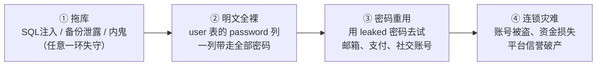
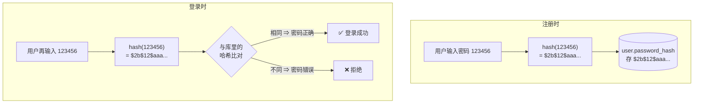
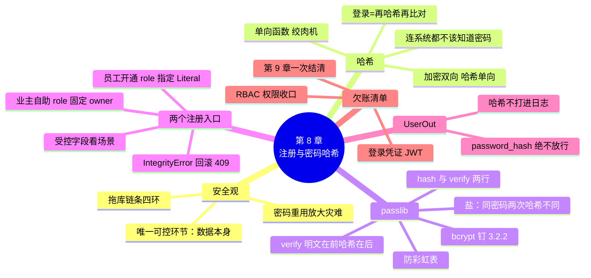

# 第 8 章 用户注册与密码哈希

> **本章定位**：账号体系篇（上）。user 表从第 6 章建好至今一直在"空转"（只有种子数据），本章让它迎来真身：**业主自助注册**接口上线，`password_hash` 列从占位文本变成真正的哈希值。
>
> 本章的重头戏不是接口本身（说到底就是一个普通的 POST + add/commit——第 6 章你早就会了），而是它背后的**安全观**：为什么密码绝不能明文存储、哈希为什么能"校验却不能解密"、盐防的是什么。登录与 JWT 按坡度设计留到第 9 章——本章先把"存得住、存得安全"做对。
>
> **开发约定**（延续）：`uvicorn main:app --reload` 运行，`http://127.0.0.1:8000/docs` 测试。本章两个接口住进 `routers/users.py`——第 7 章为它们预留的房间，今天入住。

---

## 学习目标

完成本章学习后，你应当能够：

1. **懂安全**：完整复述"明文存密码 → 拖库 → 密码重用 → 连锁灾难"的泄露链条，说出防线应该设在数据本身。
2. **辨概念**：区分"加密"与"哈希"（可逆 vs 单向），解释登录校验为什么用 verify 而不是"解密比对"。
3. **会哈希**：用 passlib 的 CryptContext 完成密码哈希与校验（两行 API），解释"同一密码两次哈希结果不同"的原因（盐）。
4. **会注册**：实现注册接口——UserCreate 进门模型（role 绝不收客户端的）、IntegrityError → rollback → 409 范式、密码长度校验。
5. **懂账号体系**：说出业主自助注册与"管理员创建员工账号"两种入口的业务理由，并完成两个接口。

---

## 1. 本章项目任务与热身：一个特殊的 POST

### 本章项目任务（回指第 1 章表 1-1 需求清单）

| # | 接口 | 功能 | 说明 |
|---|------|------|------|
| 1 | `POST /users/register` | 业主自助注册（201） | role 强制 owner；重复用户名 409 |
| 2 | `POST /users/staff` | 管理员创建维修工/管理员账号（201） | role 由请求指定；权限第 9 章收口 |

完成后，表 1-1「注册账号、登录」行的**注册部分**达成（登录在第 9 章）——12 行功能还剩最后 1.5 行。

### 热身：注册不就是往 user 表插一行吗？

对，也不对。插行谁都会（User(...) → add → commit，第 6 章的套路），但**密码这一列的值，不能是你输进来的那串字符**。

先做一个思维方式实验。假如安居宝的 user 表这样存：

```text
username | password
zhangsan | 123456
lisi     | wzf@2026
```

谁能看到这两行明文密码？数据库管理员、拿到数据库备份文件的人、打进内网的攻击者、打印错误日志把整行 data 打进日志的程序员（第 3 章说过日志会记录响应）……而根据公开的安全统计，**大量用户在多个网站使用同一个密码**——拿到他在安居宝的密码，就大概率拿到了他的邮箱、支付账号。**一个小区物业系统的失误，可能烧掉用户的整个数字身份。**

所以本章要回答三个问题：

1. 密码应该以**什么形态**存？
2. 存了这种形态，登录时**怎么校验**？
3. "加密"和"哈希"到底是不是一回事？（90% 的新手认为是，这正是第 2 节要拆的误区）

### 小结

- 注册的技术骨架是普通 POST；安全灵魂在密码列的**存储形态**。
- 明文密码的受害者不止本系统——密码重用会放大灾难。

---

## 2. 为什么密码绝不能明文存储

### 拖库：数据泄露的标准剧本

"拖库"是黑话，指攻击者把整个数据库拷走。剧本通常是这么演的（**图 8-1**）：



**图 8-1 明文密码的泄露链条：①和③都不是你能控制的，唯一能斩断的是②**

注意链条的残酷之处：①（拖库）和③（用户重用密码）**你都无法完全控制**——再严的服务器也可能有漏洞，用户的教育你管不着。唯一握在你手里的是**②：让拖走的那一列毫无价值**。防线必须设在数据本身。

### 哈希：进得去、回不来

> 💡 **一句话定义**
> **哈希（hash）**：单向函数——同一个输入永远得到同一个输出，但**从输出无法算回输入**。像一台单向绞肉机：肉（密码）进去肉泥（哈希值）出来，没人能把肉泥还原成肉。

```text
hash("123456")   → "$2b$12$N9qo8uLOickgx2ZMRZoMye..."
hash("wzf@2026") → "$2b$12$KIXQ2TVd3aWpOkBnEfWdSu..."
hash("123456")   → "$2b$12$N9qo8uLOickgx2ZMRZoMye..."   ← 同输入必同输出
```

从 `"$2b$12$..."` 反推 `"123456"`？不存在这种算法。攻击者唯一能做的是**穷举猜**：拿候选密码一个个哈希了对比——这正是第 3 节 bcrypt 的"慢"要对付的（附录 C 算这笔账）。

### 登录校验的正确姿势

存哈希、不存明文，那登录时怎么知道密码对不对？——**把用户输入的密码再哈希一次，比对两个哈希值**（**图 8-2**）：



**图 8-2 注册存哈希、登录比哈希——全程没有任何一秒存过明文**

### 加密 vs 哈希：高频误区专项

| | 加密（Encryption） | 哈希（Hash） |
|---|-------------------|-------------|
| 方向 | **双向**：有密钥能解密还原 | **单向**：谁也还原不了 |
| 例子 | HTTPS 传输、文件加密 | 密码存储、文件校验 |
| 密码场景适用吗 | ❌ | ✅ |

为什么密码**必须**用哈希？因为加密意味着**系统自己有能力还原密码**（密钥在服务器上）——服务器一旦失守，密钥和数据一起被拖走，等于白干。哈希则从数学上保证：**连系统自己都"不知道"用户的密码**——它只认识哈希值。这是"设计上不可作恶"的安全思想。

### 常见误区

- ⚠️ **"我们服务器很安全，明文存没事。"** 安全是纵深防御（第 5 章上传安全的老朋友）：备份文件、日志、离职员工、上游组件漏洞——任何一环失守都是全量泄露。你在自己这一环把数据变成"拖走也没用"的形态，才是真正的防线。
- ⚠️ **"存之前先加密一遍，更安全。"** 加密可逆 = 密钥被拖走时全盘皆输，反而多了一个攻击目标。密码存储界的答案只有一个：**单向哈希**。

### 小结

- 泄露链条四环，能斩断的只有"明文全裸"——存哈希。
- 登录校验 = 重新哈希再比对，全程无明文、无解密。
- 加密双向、哈希单向；密码场景必须哈希——连系统都不该知道密码。

---

## 3. passlib 实战：两行代码的密码安保（简易版）

### 安装：先排一个必踩的坑

```bash
pip install "passlib[bcrypt]"
pip install bcrypt==3.2.2
```

> ⚠️ **著名兼容坑（直接给答案）**：passlib 1.7.4（当前主流版本）与 **bcrypt 4.x 不兼容**——4.x 移除了一个 passlib 读取的版本属性，首次调用时报警告甚至报错 `AttributeError: module 'bcrypt' has no attribute '__about__'`。解法就是上面第二行：**把 bcrypt 钉在 3.2.2**。装完 `pip freeze > requirements.txt`，把版本锁进依赖清单，换机器也不怕。

### 两行 API

```python
from passlib.context import CryptContext

pwd_context = CryptContext(schemes=["bcrypt"], deprecated="auto")

hashed = pwd_context.hash("123456")          # 哈希：存进数据库的形态
ok = pwd_context.verify("123456", hashed)    # 校验：登录时用（明文在前、哈希在后）
```

就这么两行——`hash` 负责"绞肉"，`verify` 负责"比对"，密码安保的核心 API 到此全部学完（简易版承诺兑现）。

### 动手实验一：同一密码，两次哈希，结果不一样？

在 PyCharm 里新建临时脚本跑一跑：

```python
from passlib.context import CryptContext

pwd_context = CryptContext(schemes=["bcrypt"], deprecated="auto")

h1 = pwd_context.hash("123456")
h2 = pwd_context.hash("123456")
print("第一次：", h1)
print("第二次：", h2)
print("两次相同吗：", h1 == h2)
print("但都能验过：", pwd_context.verify("123456", h1), pwd_context.verify("123456", h2))
```

预期输出（哈希串每次不同，形如下面）：

```text
第一次： $2b$12$KIXfZd3aWpOkBnEfWdSu.e7BkUvJG3hOq1mRZxcYN8pL0VjtQwH2S
第二次： $2b$12$N9qo8uLOickgx2ZMRZoMyeIjZ.B2D7CqWr9pDcS5tGhU8vF1xYzAe
两次相同吗： False
但都能验过： True True
```

**两次哈希不同，却都能验过**——为什么？这引出密码学的一个重要设计：

> 💡 **盐（salt）的简易解释**：bcrypt 每次哈希前都会生成一段**随机佐料**混进密码一起绞，并把盐明晃晃地放在输出里（所以两次输出不同）；verify 时从哈希串里读出这段盐、用同样方式再绞一遍、比对（所以两次都能验过）。
> **盐防的是什么**：彩虹表——攻击者预先算好"常见密码 → 哈希值"的百万级对照表，拖库后直接查表破解。没有盐，`123456` 的哈希值全世界都一样，查表秒破；有盐，每个用户的哈希都独一无二，对照表全部作废，只能一个一个穷举。

### 动手实验二：verify 三连

```python
print(pwd_context.verify("123456", h1))      # True  ← 正确密码
print(pwd_context.verify("123457", h1))      # False ← 错误密码
print(pwd_context.verify(h1, h1))            # False ← 拿哈希当密码也不行
```

第三个实验有深意：就算攻击者拖库拿到哈希值、又想办法把它当密码提交——verify 会把"哈希值"再哈希一遍去比对，必然失败。**设计上的第二重保险。**

### 哈希串解剖（一句话认知）

`$2b$12$N9qo8uLOickgx2ZMRZoMye...` 三段用 `$` 分隔：`2b` 是算法版本、`12` 是代价因子（绞多慢，附录 C）、剩下是盐与哈希本体。**verify 能自己读懂这串**——你不需要解析它，知道结构即可。

### 常见坑

- ⚠️ **verify 参数顺序**：`verify(明文, 哈希)`——写反了永远返回 False，且不报错（它真的会拿哈希当明文去校验）。记住口诀：**明文在前，哈希在后**。
- ⚠️ **哈希过的串重复哈希**：注册时 hash 一次入库；下次"修改密码"若不小心对旧哈希再 hash 一遍，旧密码立即永久失效。库里的列只存 hash(明文) 的结果。
- ⚠️ **bcrypt 有 72 字节输入上限**：超长密码会被静默截断——这就是密码 max_length=64 的原因之一（第 4 节的模型约束不是拍脑袋）。

### 小结

- CryptContext 两行 API：hash 存库、verify 校验；bcrypt 钉 3.2.2 版本。
- 盐让每个用户的哈希独一无二，彩虹表作废；verify 自带防"哈希当密码"的保险。
- 全程不需要理解算法内部——会用、知道防什么，就是本章"简易版"的边界。

---

## 4. 业主注册接口：POST /users/register

### 接口设计卡

| 设计项 | 决定 |
|--------|------|
| 方法与路径 | `POST /users/register`（住 users.py；业界也常见 routers/auth.py 的划分，本课程按资源归属统一放 users） |
| 请求模型 | UserCreate：username（4~20）、password（6~64 明文进门）、phone（可选）——**没有 role** |
| 响应模型 | UserOut：id / username / phone / role / created_at——**password_hash 绝不放行** |
| 状态码 | 201 创建成功；409 用户名已被注册；422 格式校验失败 |

### 模型定义（schemas.py 新增）

```python
class UserCreate(BaseModel):
    """业主注册的进门规矩：role 不收客户端的——注册入口永远是业主"""
    username: str = Field(min_length=4, max_length=20, description="用户名，4~20 字符")
    password: str = Field(min_length=6, max_length=64, description="密码，6~64 字符")
    phone: str | None = Field(default=None, max_length=20, description="手机号，可选")


class UserOut(BaseModel):
    """用户的出门规矩：password_hash 是绝密字段，绝不放行"""
    model_config = ConfigDict(from_attributes=True)

    id: int
    username: str
    phone: str | None
    role: str
    created_at: datetime
```

**两处安全设计值得专门说**：

1. **UserCreate 没有 role 字段**——这是"受控字段不进进门模型"安全观的第三击（第一击：Create 不含 id/status；第二击：Update 不含 id/created_at）。注册入口的 role **永远是 owner**：客户端就算在请求体里偷偷加 `"role": "admin"`，也会被 Pydantic 静默忽略（第 3 章"多传字段忽略"的机制，此刻成了安全特性）——网上随便注册个管理员？门都没有。
2. **password 与 password_hash 是两个世界的名字**：进门字段叫 `password`（明文，只活在请求那一瞬）；库里的列叫 `password_hash`（哈希，长期存储）。**函数体里那行 hash 调用，就是两个世界之间唯一的桥。**

### 完整实现（routers/users.py 新增）

users.py 模块头新增两处：导入 pwd_context 相关、CryptContext 实例（放在模块级，全应用一份）：

```python
# routers/users.py 头部新增
from passlib.context import CryptContext
from sqlalchemy.exc import IntegrityError

# 密码哈希工具（第 10 章将挪入 core/security.py 统一管理）
pwd_context = CryptContext(schemes=["bcrypt"], deprecated="auto")
```

接口本体：

```python
@router.post("/register", response_model=UserOut, status_code=201)
def register(data: UserCreate, db: Session = Depends(get_db)):
    """业主自助注册：role 强制为 owner（UserCreate 里根本没有 role 字段）"""
    user = User(
        username=data.username,
        password_hash=pwd_context.hash(data.password),   # 存哈希，绝不存明文
        phone=data.phone,
        role="owner",                                    # 服务端说了算
    )
    db.add(user)
    try:
        db.commit()
    except IntegrityError:                               # username 撞了唯一约束
        db.rollback()                                    # 第 7 章范式：捕获 → 回滚 → 转业务异常
        raise HTTPException(status_code=409, detail=f"用户名 {data.username} 已被注册")
    db.refresh(user)
    return user
```

### 验证时刻

**用例表**：

| # | 操作 | 预期 |
|---|------|------|
| 1 | `POST /users/register`，body `{"username": "testowner", "password": "abc123456", "phone": "13700000001"}` | 201：响应含 id=7、role="owner"，**没有 password / password_hash 字段** |
| 2 | 再发一次同样的 body | 409：用户名 testowner 已被注册 |
| 3 | body `{"username": "abc", "password": "abc123456"}` | 422：username 违反 min_length=4 |
| 4 | body `{"username": "testowner2", "password": "abc123456", "role": "admin"}` | 201 且 **role="owner"**——多传的 role 被静默忽略（亲手试！） |

用例 1 之后，到 MySQL 里看真身（占位文本时代的终结）：

```sql
SELECT username, password_hash, role FROM user WHERE username = 'testowner';
```

```text
testowner | $2b$12$LJ3mQ...一长串... | owner
```

**库里没有 abc123456 这六个字母的任何痕迹**——第 2 节的防线落成。

### 常见坑

- ⚠️ **把哈希打进日志**：`print(user.password_hash)` 或调试时打印整个对象——哈希虽不等于明文，但泄露哈希缩小了攻击面（攻击者可以离线穷举这一个用户）。日志里出现用户对象时只打 id/username。
- ⚠️ **IntegrityError 忘 rollback**：第 7 章讲过的"带伤事务"——捕获后必须先 `db.rollback()` 再 raise，否则该会话后续操作连环报错。
- ⚠️ **用 username 大小写区分用户**：MySQL 默认排序规则下 `"Test"` 与 `"test"` 的唯一约束可能行为不一致（utf8mb4_general_ci 不区分大小写）——严谨做法是注册时统一转为小写再入库；本课程从简，保持用户输入原样。

### 小结

- 注册 = 普通 POST + 一行 hash：进门明文只活一瞬间，库里只有哈希。
- UserCreate 无 role 是设计出来的安全（注册入口只能是业主）；多传字段被静默忽略是特性不是缺陷。
- IntegrityError → rollback → 409，范式第二次实战。

---

## 5. 管理员创建员工账号：POST /users/staff

### 为什么需要两个入口

回看第 1 章表 1-1 的设计：业主**自助注册**（✅ 任何人都可以成为业主），维修工/管理员**账号由管理员创建**（— 两个"—"格子）。业务理由：

- 业主是**外部用户**，开放注册获客；
- 维修工/管理员是**内部岗位**——谁来当维修工是物业的用人决定，不是网上填表能定的；管理员账号更是权限的源头，绝不能自助开通。

两个入口，两种信任级别——这正是第 9 章 RBAC（基于角色的访问控制）的账号基础。

### StaffCreate：role 从"禁止传入"变为"必须指定"

```python
class StaffCreate(BaseModel):
    """管理员创建员工账号的进门规矩：role 必须指定"""
    username: str = Field(min_length=4, max_length=20, description="用户名，4~20 字符")
    password: str = Field(min_length=6, max_length=64, description="初始密码，6~64 字符")
    phone: str | None = Field(default=None, max_length=20, description="手机号")
    role: Literal["worker", "admin"] = Field(description="岗位角色：worker=维修工 / admin=管理员")
```

与 UserCreate 对照——**同一个字段（role），两个模型一个禁止一个必填**。这不是矛盾，是"受控字段看场景"的精确含义：**谁有权决定这个值，模型就把它放在谁的门口**。注册场景 role 由规则决定（写死 owner）；员工创建场景 role 由管理员决定（开门收取）。

### 实现

```python
@router.post("/staff", response_model=UserOut, status_code=201)
def create_staff(data: StaffCreate, db: Session = Depends(get_db)):
    """管理员创建员工账号（维修工/管理员）——权限待第 9 章收口：届时仅管理员可调"""
    user = User(
        username=data.username,
        password_hash=pwd_context.hash(data.password),
        phone=data.phone,
        role=data.role,                                   # 员工岗位由创建请求指定
    )
    db.add(user)
    try:
        db.commit()
    except IntegrityError:
        db.rollback()
        raise HTTPException(status_code=409, detail=f"用户名 {data.username} 已被注册")
    db.refresh(user)
    return user
```

> 📌 **权限欠账的醒目声明（延续"先跑起来再专业起来"）**：此刻**任何人都能调这个接口**创建管理员——因为还没有"登录"这个概念，服务器不知道调用者是谁。第 9 章 JWT 上线后，这个接口将被锁死为**仅管理员**可调（表 1-1 的权限列一并结清）。在那之前，别把服务暴露到公网。

> 💡 **代码重复的忍耐**：register 与 staff 的 409 块一模一样——现在忍着不抽公共函数（就 6 行，抽象收益低于可读性损失）；第 10 章分层重构时，注册逻辑将沉入 service 层统一收敛。**过早抽象和过早优化同罪。**

### seed 的呼应（为第 9 章备货）

seed_data.py 里 6 个用户的 password_hash 还是占位文本——现在升级为真实哈希，为第 9 章登录备货。两步：

1. seed_data.py 顶部加 `from routers.users import pwd_context`（第 10 章重构后这个导入改为 `from core.security import pwd_context`）；
2. 六行 `password_hash="占位-第8章换哈希"` 全部替换为 `password_hash=pwd_context.hash("dev123456")`。

重跑 `python seed_data.py` 后，六个账号（admin / wang / li / zhangsan / lisi / wangwu）的密码统一为 **dev123456**——第 9 章的登录测试与第 12 章的前端联调都用它们。

### 常见坑

- ⚠️ **Literal 漏角色**：`Literal["worker"]` 漏了 "admin"——创建管理员直接 422。字面量清单与业务角色表（第 1 章三种角色）对齐。
- ⚠️ **员工给了 role="owner"**：422 拦截（Literal 不含 owner）——业主走注册入口，语义正确。

### 小结

- 两个入口两种信任：外部用户自助注册（role 固定），内部岗位管理员开通（role 指定）。
- 同一字段在不同模型中"禁止/必填"的切换，是"受控字段看场景"的精确版。
- 权限欠账显式声明，第 9 章统一结清。

---

## 6. 本章收官：总表 v0.8.0

### 总表 v0.8.0（18 接口）

前 16 行与 v0.7.0 **逐字相同**，新增 2 行：

| 方法 | 路径 | 请求模型 | 响应模型 | 成功码 | 错误码 | 路由模块 |
|------|------|---------|---------|--------|--------|---------|
| POST | /users/register | UserCreate | UserOut | **201** | 409/422 | users |
| POST | /users/staff | StaffCreate | UserOut | **201** | 409/422 | users |

### 表 1-1 更新

「注册账号、登录」行 → 🔶 **注册达成**（本章 register + staff 两入口），登录待第 9 章。

### 遗留钩子（全部指向第 9 章）

1. **登录缺的不是"对密码"，是"凭证"**——verify 已经就位（把输入哈希后比对即可），真正的难题是：登录成功后返回什么？只返回一句 `{"message": "OK"}`？下一次请求时服务器就不认识你了——**HTTP 是无状态的**，每个请求在服务器眼里都是陌生人。答案是一张"通行证"：**JWT**；
2. **权限欠账清单**（第 9 章一次结清）：staff 接口仅管理员、统计接口仅管理员、状态流转按角色限制（派单=管理员、维修状态=维修工、评价=业主）、"我的报修记录"自动取当前用户；
3. seed 六账号密码已统一为 dev123456（第 5 节升级），为第 9 章登录测试备货。



**本章你为安居宝交付了什么**：注册双入口（register/staff）、真实密码哈希落库、UserOut 绝密字段过滤——账号体系的地基打完，只差登录这块顶门石。

**下一章预告**：第 9 章《JWT 登录与权限控制》——为什么登录成功必须发一张"通行证"（HTTP 无状态的困境）；JWT 的三段结构像"防伪造的工牌"；OAuth2PasswordBearer + Depends 的组合让"当前用户"成为接口的一个参数；全部权限欠账一次结清，表 1-1 十二行全部点亮。

---

## 附录

### 附录 A：passlib 速查

```python
from passlib.context import CryptContext

pwd_context = CryptContext(schemes=["bcrypt"], deprecated="auto")

pwd_context.hash("明文")            # → 哈希串（每次不同，因盐）
pwd_context.verify("明文", "哈希串")  # → True / False（明文在前、哈希在后）
```

- `schemes=["bcrypt"]`：指定算法；`deprecated="auto"`：将来换算法时旧哈希自动标记待升级（认知级）；
- 版本钉死：`passlib` 1.7.4 + `bcrypt` **3.2.2**（4.x 不兼容，见第 3 节）；
- 常见 schemes 认知：`pbkdf2_sha256`（标准库系，无需第三方依赖）、`argon2`（新一代，见附录 B）。

### 附录 B：密码存储方案演进认知（知道名字和方向即可）

| 时代 | 方案 | 问题 |
|------|------|------|
| 上古 | 明文 | 第 2 节的全部灾难 |
| 早期 | MD5 / SHA1 | 太快，彩虹表 + 穷举都便宜；无盐用法遍地 |
| 中期 | MD5 + 盐 / SHA256 + 盐 | 方向对了，但依然太快（GPU 每秒万亿次） |
| **现代** | **bcrypt / PBKDF2**（慢哈希 + 内置盐） | 专为密码设计：故意慢，穷举成本指数级上升 |
| 新一代 | argon2 | 抗 GPU/ASIC 的内存困难哈希（注册新系统时的优先选项） |

方向感一句话：**密码哈希要"慢"，慢是对攻击者的惩罚、对用户的保护。**

### 附录 C：进阶——为什么 bcrypt 的"慢"反而安全（一笔账）

bcrypt 的代价因子（哈希串里的 `$12$`）决定哈希一次的耗时：12 轮 ≈ 单次 0.25 秒左右。

- 对用户：登录时多等 0.25 秒，无感；
- 对攻击者：拖库后穷举 1 亿个候选密码 = 1 亿 × 0.25 秒 ≈ **2900 万秒 ≈ 11 个月**（单核）；若用快的 MD5，同样规模几分钟就扫完。

这笔账就是"慢哈希"的全部意义：**把攻击者的单位成本抬高四个数量级**。代价因子可调（4~31），每 +1 耗时翻倍——将来硬件变快了就调大，这也是它写进哈希串、verify 能自动识别的原因。
