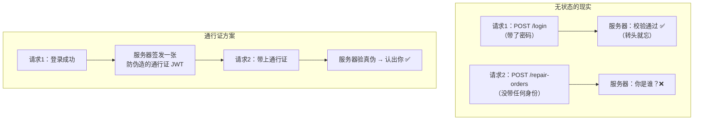
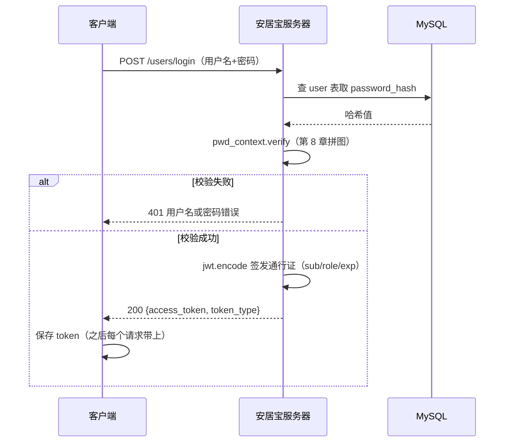
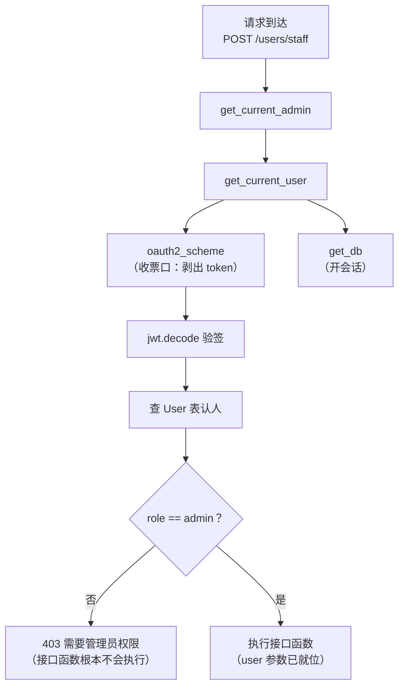
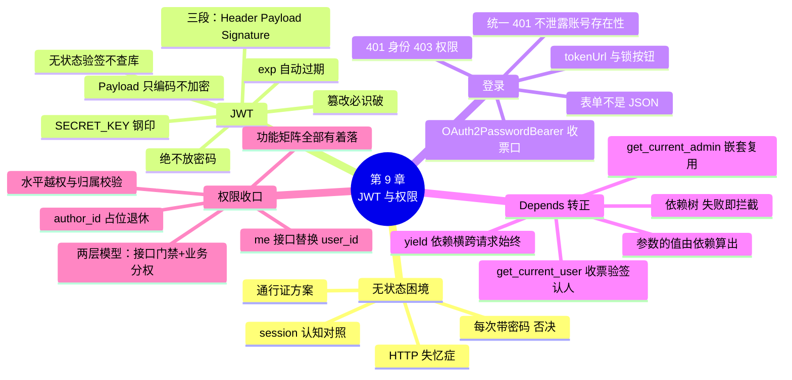

# 第 9 章 JWT 登录与权限控制

> **本章定位**：账号体系篇（下）。第 8 章解决了"存得住、存得安全"，本章解决"认得出、管得住"：登录接口签发 JWT 通行证，`get_current_user` 依赖让"当前用户"成为接口的普通参数，**第 8 章立下的权限欠账一次结清**——staff 与统计锁管理员、状态流转按角色分权、`author_id=1` 占位退休、"我的报修记录"自动化。
>
> 本章结束，**表 1-1 功能矩阵全部有着落**，总表新增"所需角色"列——安居宝从"接口裸奔"进化为"带门禁的完整系统"。第 6 章先睹为快的 Depends 在本章转正深入。
>
> **开发约定**（延续）：`uvicorn main:app --reload` 运行，`http://127.0.0.1:8000/docs` 测试。按"简易"承诺，JWT 只教 PyJWT 的 encode/decode 两行与三段结构，算法细节不展开（附录 A/B 给认知级延伸）。

---

## 学习目标

完成本章学习后，你应当能够：

1. **懂困境**：解释 HTTP 无状态带来的登录困境，逐个否决朴素方案，说出"通行证"方案的必要性。
2. **懂 JWT**：画出三段结构并说出各段职责；解释签名为什么不可伪造、验签为什么不用查库；说出 Payload 里绝不放密码的原因。
3. **会实验**：用 PyJWT 完成 encode/decode；亲手验证"篡改 Payload → 验签失败"“过期 token → 拒绝"。
4. **会登录**：实现登录接口（OAuth2PasswordBearer + OAuth2PasswordRequestForm），正确使用 401/403 并解释为什么错误信息不区分"用户不存在"与"密码错误"。
5. **会鉴权**：编写 get_current_user / get_current_admin 依赖链（嵌套依赖），说出 yield 依赖的完整生命周期。
6. **会收口**：完成全部权限升级——接口级门禁 + 状态流转的业务级分权，逐接口给出改动清单。

---

## 1. 本章项目任务与热身：HTTP 的"失忆症"

### 本章项目任务（回指第 1 章表 1-1 需求清单）

| # | 交付物 | 说明 |
|---|--------|------|
| 1 | `POST /users/login` | 登录：校验密码、签发 JWT（表 1-1「注册账号、登录」行最后一环） |
| 2 | get_current_user / get_current_admin | 认证依赖链——"当前用户"成为接口参数 |
| 3 | 权限收口 × 6 | staff、stats、notices 写操作、提交报修、状态流转分权、我的报修记录自动化 |
| 4 | 占位退休 × 2 | author_id=1（第 3 章埋）、user_id 靠 URL 传（第 7 章埋） |

### 热身：登录成功之后，然后呢？

最直觉的登录接口长这样：收用户名密码 → verify（第 8 章就位的拼图）→ 返回 `{"message": "登录成功"}`。

然后呢？用户下一秒提交报修单，服务器问：**你是谁？** 他明明十秒前刚输过密码——但服务器不记得。**HTTP 是无状态的**：每个请求在服务器眼里都是初次见面的陌生人，上一个请求里发生过什么（比如登录成功），这一个请求一无所知（**图 9-1**）。



**图 9-1 HTTP 的失忆症与通行证解法**

朴素方案逐个否决：

1. **每次请求都带用户名密码**？等于每个请求都过一遍全身安检——密码这个最敏感的信息裸奔频率最大化，第 8 章的白讲；
2. **服务器记小本本**（"会话编号 → 用户"，即 session 方案）？能用，但每来一个请求都要查一次小本本，服务器集群还得共享这本账——认知级对照放附录 C；
3. **发一张防伪造的通行证，之后每个请求出示**——这就是 JWT，业界当前的主流答案。

### 小结

- HTTP 无状态：登录成功这个"事实"不会自动延续到下一个请求。
- 通行证方案：登录时签发、请求时出示、服务端验真伪——本章主角 JWT。

---

## 2. JWT：防伪造的电子工牌（简易）

### 定义与三段结构

> 💡 **一句话定义**
> **JWT**（JSON Web Token）：一段**自带信息、自带签名、不可伪造**的字符串。服务器签发、客户端保存、每个请求携带——像一张带防伪钢印的电子工牌。

JWT 长这样（三个部分用两个点分隔）：

```text
eyJhbGciOiJIUzI1NiJ9 . eyJzdWIiOiJ6aGFuZ3NhbiIsInJvbGUiOiJvd25lciJ9 . SflKxwRJSMeKKF2QT4f...
└──────┬──────┘      └──────────────┬──────────────────┘      └─────────┬────────┘
   Header 头              Payload 载荷（信息）                Signature 签名（钢印）
```

**图 9-2 三段职责**：

| 段 | 内容 | 谁能看 | 防伪吗 |
|----|------|--------|--------|
| Header | 算法声明（`{"alg": "HS256"}`） | 谁都能解码看 | — |
| Payload | **声明 claims**：sub（用户名）、role、exp（过期时间） | **谁都能解码看**（base64 而已，不是加密！） | — |
| Signature | 用 **SECRET_KEY** 对前两段算出的签名 | — | **✅ 没有密钥造不出来** |

两个最要紧的认知，先钉死：

1. **Payload 只是编码，不是加密**——任何人拿到 token 都能解出里面的内容。所以**绝不做放密码哈希、手机号等敏感信息**（第 8 章安全观接力：JWT 里只放"足够验明身份"的最小信息：用户名、角色、过期时间）；
2. **Signature 是防伪的全部**——它由只有服务器知道的 SECRET_KEY 参与计算。攻击者想伪造"我是管理员"的工牌？他可以随便改 Payload（反正不加密），但没有密钥就造不出配套的签名——验签时两个点之后那一段对不上，当场识破。

**工牌类比**：牌面上印着姓名岗位（Payload，人人可读）；钢印盖在牌上（Signature，伪造不了）；门禁**验钢印，不查员工数据库**（无状态验签）——最后这点是 JWT 对 session 的核心优势：验签只是算一次签名比对，**不用查库**，服务器集群里任何一台都能独立验（附录 C 对照）。

### 动手实验三连（临时脚本，可跟敲）

先装库：`pip install pyjwt`（轻量主流；教程圈还常见 python-jose，维护已放缓，本课程不用）。

**实验①：签发与验签（两行 API，简易承诺兑现）**：

```python
import jwt
from datetime import datetime, timedelta, timezone

SECRET_KEY = "dev-secret-key-第10章换环境变量"

# 签发：把声明（claims）交给 encode
token = jwt.encode(
    {"sub": "zhangsan", "role": "owner",
     "exp": datetime.now(timezone.utc) + timedelta(hours=2)},   # exp：有效期 2 小时
    SECRET_KEY,
    algorithm="HS256",
)
print("签发：", token)

# 验签：decode（签名不对、过期了都会抛异常）
print("验签：", jwt.decode(token, SECRET_KEY, algorithms=["HS256"]))
```

预期输出：

```text
签发： eyJhbGciOiJIUzI1NiJ9.eyJzdWIiOiJ6aGFuZ3NhbiIsInJvbGUiOiJvd25lciIsImV4cCI6MTc5M...wRJSMeKKF2QT4f
验签： {'sub': 'zhangsan', 'role': 'owner', 'exp': 1792845600}
```

decode 拿回了完整的 claims——**这就是"认出你"的全过程，全程没查任何数据库**。

**实验②：篡改 Payload，当场识破**：

```python
# 攻击者拿到 token，伪造一个"我是 admin"的 Payload，再拼上旧签名
header, payload, sig = token.split(".")
fake_payload = (jwt.encode({"sub": "admin", "role": "admin",
                            "exp": datetime.now(timezone.utc) + timedelta(hours=2)},
                           SECRET_KEY, algorithm="HS256")).split(".")[1]
forged = header + "." + fake_payload + "." + sig

try:
    jwt.decode(forged, SECRET_KEY, algorithms=["HS256"])
except jwt.InvalidSignatureError:
    print("篡改的 token 被识破：签名对不上")
```

预期输出：

```text
篡改的 token 被识破：签名对不上
```

Payload 换了，签名还是旧的——防伪钢印和牌面对不上号，门禁不放行。

**实验③：过期的通行证**：

```python
expired = jwt.encode({"sub": "zhangsan",
                      "exp": datetime.now(timezone.utc) - timedelta(seconds=1)},   # 一秒前过期
                     SECRET_KEY, algorithm="HS256")
try:
    jwt.decode(expired, SECRET_KEY, algorithms=["HS256"])
except jwt.ExpiredSignatureError:
    print("过期的 token 被拒绝")
```

exp 是 PyJWT **自动校验**的声明——过期即抛异常，连"先解出来再看时间"都不用你写。

### SECRET_KEY 的纪律

SECRET_KEY 泄露 = 任何人可以伪造任何身份（包括管理员）——它是整个认证体系的根。本章先用模块级常量（与第 6 章 DATABASE_URL 同款的过渡形态），**第 10 章 Settings/.env 收编**，生产环境必须是长随机串并保密。

### 常见坑

- ⚠️ **请求头里的 "Bearer " 前缀**：HTTP 规范的 Authorization 头格式是 `Bearer <token>`——Bearer（持票人）表示"出示这张票的人就是持有人"。本章的 oauth2_scheme 会自动剥掉前缀，但自己用 curl 调试时忘写它是最常见的 401 来源。
- ⚠️ **exp 是时间戳不是字符串**：encode 时给 datetime 对象（PyJWT 自动转时间戳）；手写字符串不会报错但校验行为错乱。
- ⚠️ **把 JWT 当加密用**：Payload 人人可读（实验①里我们没给任何密钥就读出了……等等，实验①给了密钥——那是因为 decode 需要密钥验签；**只需要读内容的话任何人 base64 解码即可**，试试把 token 第二段拿去 base64 解码，内容一览无余）。记住：JWT 防篡改，不防偷看。

### 小结

- JWT 三段：Header（算法）+ Payload（声明，**只编码不加密**）+ Signature（密钥签名，**防伪的全部**）。
- 验签无状态：算一次签名比对，不查库——"门禁验钢印不查员工数据库"。
- 三连实验：签发/验签两行、篡改必被识破、过期自动拒绝。

---

## 3. 登录接口：OAuth2PasswordBearer

### 登录的完整时序

**图 9-3** 把登录到使用的全程画出来——注意 verify（第 8 章）和 encode（第 2 节）各就各位的位置：



**图 9-3 登录时序：verify 管对不对，encode 管发不发**

### OAuth2PasswordBearer：token 的"入口"

JWT 是通行证本身，但服务器还需要一个"收票口"——从请求头里把 token 取出来。FastAPI 提供了现成的：

```python
from fastapi.security import OAuth2PasswordBearer

oauth2_scheme = OAuth2PasswordBearer(tokenUrl="/users/login")
```

> 💡 **一句话定义**
> **OAuth2PasswordBearer**：token 提取器——声明"本 API 使用 Bearer token 认证"，自动从请求头 `Authorization: Bearer xxx` 中剥出 token 字符串；tokenUrl 告诉 /docs"去哪个接口拿票"。

挂上它之后的甜头：**/docs 右上角出现 Authorize 锁按钮 🔒**——点开输入用户名密码，FastAPI 文档页自动帮你调登录、存 token，之后在文档里点任何接口都自动带票。这把"接口测试"的体验拉满（第 5 节测试全靠它）。

### 登录实现（routers/users.py 新增）

头部新增（JWT 配置与 oauth2_scheme，紧挨第 8 章的 pwd_context）：

```python
# routers/users.py 头部新增
from datetime import datetime, timedelta, timezone

import jwt
from fastapi.security import OAuth2PasswordBearer, OAuth2PasswordRequestForm

# ── JWT 配置（第 10 章将挪入 core/config.py 统一管理）──
SECRET_KEY = "dev-secret-key-第10章换环境变量"   # 泄露 = 可伪造任何身份
ALGORITHM = "HS256"
TOKEN_EXPIRE_MINUTES = 120                       # 通行证有效期：2 小时

oauth2_scheme = OAuth2PasswordBearer(tokenUrl="/users/login")
```

接口本体：

```python
@router.post("/login")
def login(
    form: OAuth2PasswordRequestForm = Depends(),   # 无参 Depends()：内置表单模型（见下方说明）
    db: Session = Depends(get_db),
):
    """登录：校验用户名密码，签发 JWT 通行证"""
    user = db.query(User).filter(User.username == form.username).first()

    # 统一 401：不区分"用户不存在"与"密码错误"——不给攻击者探路信息
    if user is None or not pwd_context.verify(form.password, user.password_hash):
        raise HTTPException(status_code=401, detail="用户名或密码错误")

    # 签发 JWT：Payload 只放验明身份所需的最小信息（绝不放密码）
    expire = datetime.now(timezone.utc) + timedelta(minutes=TOKEN_EXPIRE_MINUTES)
    payload = {
        "sub": user.username,      # subject：这张通行证属于谁（JWT 规范的习惯字段名）
        "role": user.role,
        "exp": expire,             # 过期时间（PyJWT 自动校验）
    }
    access_token = jwt.encode(payload, SECRET_KEY, algorithm=ALGORITHM)

    # OAuth2 规范的响应格式：字段名 access_token / token_type 固定
    return {"access_token": access_token, "token_type": "bearer"}
```

三个细节专门讲：

1. **`OAuth2PasswordRequestForm`**：FastAPI 内置的登录表单模型——username、password 两个必填字段，外加 grant_type 等 OAuth2 规范字段（本课程用不到，忽略即可）。注意**它是表单不是 JSON**（OAuth2 规范如此），所以登录接口的请求体是表单格式；`Depends()` 无参写法是 `Depends(OAuth2PasswordRequestForm)` 的简写——类本身被用作依赖时可以省略。
2. **统一 401 的细节课**：用户不存在返回"用户不存在"、密码错返回"密码错误"？攻击者拿百万用户名撞一遍就能摸清哪些账号存在。**统一说"用户名或密码错误"**，两种失败一个答案。
3. **401 vs 403 正式登场**（第 4 章附录 A 的预告回收）：**401 = 你是谁**（未登录、token 无效/过期——身份层面的失败）；**403 = 知道你是谁，但你不能**（登录了，角色不够——权限层面的失败）。本章接下来会反复用到这对搭档。

### 测试（/docs）

先跑 seed（六个账号密码已统一为 dev123456，见第 8 章第 5 节）。然后：

| # | 操作 | 预期 |
|---|------|------|
| 1 | 用 admin / dev123456 登录 | 200：`{"access_token": "eyJhbG...", "token_type": "bearer"}` |
| 2 | 用 admin / 错误密码 | 401：用户名或密码错误 |
| 3 | 用不存在的用户名 | 401：**同一句**"用户名或密码错误" |

### 常见坑

- ⚠️ **用 JSON 调登录接口**：422——登录收的是表单。/docs 会自动用对格式；自己 curl 时记得 `-d "username=...&password=..."`。
- ⚠️ **tokenUrl 写错**：/docs 的 Authorize 按钮会去调一个不存在的登录接口，点 Login 报 404——tokenUrl 必须与登录接口的真实路径一致。
- ⚠️ **verify 参数顺序**（第 8 章的坑，登录里最容易再踩）：明文在前、哈希在后。

### 小结

- 登录 = 查库 + verify + encode 签发；响应是 OAuth2 规范格式。
- OAuth2PasswordBearer 是收票口，tokenUrl 喂给 /docs 的锁按钮。
- 统一 401 不泄露账号存在性；401 管身份、403 管权限。

---

## 4. Depends 转正：get_current_user 与嵌套依赖

### Depends 机制详解

第 6 章 get_db 首秀时说过"依赖注入第 9 章正式深入"——现在兑现。机制一句话：

> 💡 **一句话定义**
> **依赖注入（Depends）**：接口参数的值**不是客户端给的，是依赖函数算出来的**——FastAPI 在调用接口函数前，先调用依赖函数，把返回值塞进对应形参。"参数的参数"。

回头看已用过的两个依赖：`db: Session = Depends(get_db)`——参数 db 的值是 get_db 算出来（开一个会话）的；`form: OAuth2PasswordRequestForm = Depends()`——表单模型本身当依赖。客户端从未直接提供过这两个值。

**yield 依赖的完整生命周期**（第 6 章只说了一半）：

```python
def get_db():
    db = SessionLocal()     # ① 请求开始：执行到 yield 之前
    try:
        yield db            # ② 把 db 交给接口函数（接口在"暂停"中执行）
    finally:
        db.close()          # ③ 请求结束（响应已生成）：执行 yield 之后的代码
```

**普通依赖**（函数 return）只值一程；**yield 依赖**横跨请求的始终——"前半段准备、后半段收尾"的结构，资源管理（会话、文件句柄、锁）的标准姿势。

### get_current_user：本章核心资产

```python
def get_current_user(
    token: str = Depends(oauth2_scheme),     # 嵌套：依赖里再依赖（token 由收票口提取）
    db: Session = Depends(get_db),
) -> User:
    """依赖：验签 token，返回当前登录用户"""
    try:
        payload = jwt.decode(token, SECRET_KEY, algorithms=[ALGORITHM])
        username = payload.get("sub")
        if username is None:
            raise HTTPException(status_code=401, detail="无效的登录凭证")
    except jwt.ExpiredSignatureError:
        raise HTTPException(status_code=401, detail="登录已过期，请重新登录")
    except jwt.InvalidTokenError:            # 签名不对、格式不对等一切无效情况（含上面 raise 的 401 之外的 jwt 异常）
        raise HTTPException(status_code=401, detail="无效的登录凭证")

    user = db.query(User).filter(User.username == username).first()
    if user is None:                          # token 合法，但用户已被删除（员工离职删号）
        raise HTTPException(status_code=401, detail="无效的登录凭证")
    return user
```

阅读顺序就是校验顺序：**收票 → 验签 → 认人**。三处 401 对应三种失败：票坏了（签名/格式）、票过期了、人是查无此人了。

### 嵌套依赖：get_current_admin

```python
def get_current_admin(user: User = Depends(get_current_user)) -> User:
    """嵌套依赖：先验明正身（复用 get_current_user），再校验管理员角色"""
    if user.role != "admin":
        raise HTTPException(status_code=403, detail="需要管理员权限")
    return user
```

**依赖调用依赖**——get_current_admin 的形参本身又是注入来的（先过 get_current_user 这一关，过了才有 user 可查）。这就是"链式复用"：不需要管理员权限的接口只挂 get_current_user，需要的再挂 get_current_admin，一层不加重复代码。

**图 9-4** 画出一个挂了 get_current_admin 的接口被调用时的依赖树：



**图 9-4 依赖树：任何一环失败，接口函数都不会执行——校验永远在业务之前**

> 📌 本章的认证资产（pwd_context、SECRET_KEY、oauth2_scheme、两个 get_current_*）都住在 users.py——其他模块要用就从这里导入（如 stats.py 的 `from routers.users import get_current_admin`）。第 10 章工程化时它们将搬进 core/security.py，导入路径统一收敛。

### 常见坑

- ⚠️ **依赖里抛 HTTPException 完全合法**——和接口函数里一样，会被全局异常处理器接住转统一错误格式（第 4 章的基建在此继续服役）。
- ⚠️ **没登录却怪接口坏了**：挂上门禁后，忘了在 /docs 点 Authorize 就调接口 → 401（detail: Not authenticated）。**先锁按钮后调接口**是本章测试的新纪律。
- ⚠️ **get_current_user 每次都查库**：每个受保护请求都多一次 User 查询——这是"身份实时准确"（改角色/删号立即生效）换来的，认知级权衡，附录 C 的 session 方案对比同款话题。

### 小结

- Depends = 参数的值由依赖函数算出；yield 依赖横跨请求始终（前半准备、后半收尾）。
- get_current_user：收票 → 验签 → 认人；get_current_admin 嵌套其上——链式复用。
- 依赖树任何一环失败，接口函数不执行；401 管身份、403 管权限。

---

## 5. 权限收口：欠账清单一次结清

### 两层权限模型

上锁前先立框架（这是真实 RBAC 的最小完整形态）：

| 层 | 手段 | 管什么 | 例子 |
|----|------|--------|------|
| **接口级门禁** | 装饰器形参挂 `Depends(get_current_xxx)` | **谁能进这扇门** | stats 接口：仅管理员 |
| **业务级校验** | 函数体内按业务规则分支 | **门内哪些动作谁能做** | 状态流转：派单=admin、维修=本单维修工、评价=本单业主 |

状态流转一个接口承载五种操作，单靠接口级锁不住（锁 admin 则业主没法评价）——所以它必须用两层。其余接口用一层就够。

以下逐项上锁，**复贴纪律执行方式**：每个接口只加形参/分支，校验逻辑、错误码、docstring 原样（新增行均有 ← 标注）。

### ① staff 接口：第 8 章欠账结清

```python
@router.post("/staff", response_model=UserOut, status_code=201)
def create_staff(
    data: StaffCreate,
    db: Session = Depends(get_db),
    admin: User = Depends(get_current_admin),      # ← 新增：仅管理员可创建员工账号
):
    """管理员创建员工账号（维修工/管理员）"""
    ...
```

### ② stats 接口：锁管理员

```python
@router.get("/workers", response_model=list[WorkerStatOut])
def worker_stats(
    db: Session = Depends(get_db),
    admin: User = Depends(get_current_admin),      # ← 新增：绩效统计仅管理员可见
):
```

### ③ notices 写操作三接口：锁管理员 + author_id 占位退休

POST / PUT / DELETE 三个接口各加 `current_user: User = Depends(get_current_admin)` 形参；GET 两个读接口**不锁**（公告人人可看——表 1-1 的设定）。同时兑现第 3 章埋的占位：

```python
    data = Notice(
        author_id=current_user.id,           # ← 原：author_id=1（第 3 章"简化处理"占位，今日退休）
        title=notice.title,
        ...
```

从今往后，公告的发布者是**真实签发的 token 里的那个人**——客户端想伪造 author_id？Create 模型里根本没收这个字段（第 3 章安全观第四击）。

### ④ 提交报修：锁业主 + 房屋归属校验（水平越权防线）

```python
@router.post("", response_model=RepairOrderOut, status_code=201)
def create_repair_order(
    order: RepairOrderCreate,
    db: Session = Depends(get_db),
    current_user: User = Depends(get_current_user),      # ← 新增：需登录
):
    """提交报修单：业主发起，状态强制从'待受理'开始"""
    # 第零层（新增）：角色校验——只有业主能报修
    if current_user.role != "owner":
        raise HTTPException(status_code=403, detail="只有业主可以提交报修")

    # 第一步：校验房屋存在（原样）
    house = db.get(House, order.house_id)
    if house is None:
        raise HTTPException(status_code=400, detail=f"房屋 {order.house_id} 不存在，无法报修")

    # 第 1.5 层（新增）：归属校验——只能为自己的房屋报修（水平越权防线）
    if house.owner_id != current_user.id:
        raise HTTPException(status_code=403, detail="只能为自己的房屋报修")
    ...
```

**水平越权**值得专门记一笔：张三登录了（身份合法），但试图给李四的房子报修——**身份没错，对象错了**。这类漏洞比"没登录就能操作"更隐蔽：接口明明上了锁，锁却没锁住"东西是谁的"。防法就是这行归属校验。

### ⑤ 状态流转：业务级分权（两层模型的完整实战）

只注入 get_current_user（门内再分权），在白名单校验**之前**加角色层（校验顺序：先"能不能做这个操作"，再"这个流转合不合法"——权限不够时没必要暴露状态机细节）：

```python
@router.put("/{order_id}/status", response_model=RepairOrderOut)
def change_order_status(
    order_id: int = Path(ge=1, description="工单ID"),
    payload: OrderStatusUpdate,
    db: Session = Depends(get_db),
    current_user: User = Depends(get_current_user),      # ← 新增：需登录
):
    """工单状态流转：权限校验 + 白名单校验 + 条件字段校验"""
    # 第一层：工单存在性（原样）
    order = db.get(RepairOrder, order_id)
    if order is None:
        raise HTTPException(status_code=404, detail=f"工单 {order_id} 不存在")

    # 第 1.5 层（新增）：操作权限——按目标状态分权（对照表 1-1 的角色-功能矩阵）
    if payload.new_status == OrderStatus.assigned:                       # 派单：管理员
        if current_user.role != "admin":
            raise HTTPException(status_code=403, detail="派单仅管理员可操作")
    elif payload.new_status in (OrderStatus.repairing, OrderStatus.finished):   # 维修：本单维修工
        if current_user.id != order.worker_id:
            raise HTTPException(status_code=403, detail="只能操作派给自己的工单")
    elif payload.new_status in (OrderStatus.rated, OrderStatus.canceled):      # 评价/撤销：本单业主
        if order.house.owner_id != current_user.id:
            raise HTTPException(status_code=403, detail="只能评价/撤销自己房屋的报修")

    # 第二层：白名单校验（原样）
    ...
```

注意 `order.house.owner_id`——第 7 章的 relationship 导航在这里当了权限判定的"抄近道"（不用再 join 一次）。规则对照表 1-1 逐条核：受理并派单给维修工=管理员 ✅、更新工单维修状态=维修工 ✅（且只能动自己的单）、确认完工并评价打分=业主 ✅、撤销报修单=业主 ✅。

### ⑥ 我的报修记录：接口替换（声明过的升级）

第 7 章的 `GET /users/{user_id}/repair-orders` 有个先天缺陷：**user_id 靠 URL 传，谁都能查别人的报修记录**（水平越权的又一例）。本章用 token 把身份焊死，**旧接口删除，新接口上位**：

```python
@router.get("/me/repair-orders", response_model=list[RepairOrderOut])
def list_my_orders(
    current_user: User = Depends(get_current_user),      # ← 身份来自 token，不来自 URL
    db: Session = Depends(get_db),
):
    """我的报修记录：当前登录业主名下所有房屋的工单"""
    query = (
        db.query(RepairOrder)
        .join(House)
        .filter(House.owner_id == current_user.id)       # ← 原：== user_id（URL 传来）
        .order_by(RepairOrder.id.desc())
    )
    return query.all()
```

`/me` 是 REST 世界的惯例路径段——"当前登录者"。第 7 章预告的"user_id 将改为自动取当前登录用户"正式兑现。

### 验收：测试三连模式

每个上锁接口按三连验收（在 /docs 先 Authorize 对应角色）：

| 接口 | ① 无 token | ② 角色不符 | ③ 正常 |
|------|-----------|-----------|--------|
| POST /users/staff | 401 | 用 wang（worker）登录 → 403 | 用 admin → 201 |
| GET /stats/workers | 401 | 用 zhangsan → 403 | 用 admin → 200 |
| POST /repair-orders | 401 | 用 wang → 403 | zhangsan 报自己的房 → 201；报李四的房 → 403 |
| PUT /{id}/status 派单 | 401 | zhangsan 派单 → 403 | admin → 200；wang 改**非自己**的单 → 403 |
| GET /users/me/repair-orders | 401 | —（登录即可） | zhangsan → 他家 2 张单 |

### 数据范围的边界说明（诚实交代）

本章做到"角色门禁 + 单据归属"。更深一层是**数据范围过滤**——比如工单列表里，业主只看到自己房屋的单、维修工只看到派给自己的单（改的是**查询条件**而不是权限，属于另一个维度的工程）。课程主线不展开，思路提示：在 list_orders 的 query 上按 current_user.role 分支加 filter。

### 小结

- 两层权限模型：接口级门禁（Depends 挂角色）+ 业务级校验（函数内分支）。
- 占位双双退休：author_id=1 → current_user.id；URL 传 user_id → /me + token。
- 水平越权专项：身份合法 ≠ 对象合法，归属校验（房屋的 owner、工单的 worker）是防线。

---

## 6. 本章收官：总表 v0.9.0 + 十二行点亮

### 总表 v0.9.0（新增"所需角色"列）

本次是**声明过的表格升级**：各接口"行为列"与 v0.8.0 逐字一致，新增角色列；login 新增一行、me 替换旧行：

| 方法 | 路径 | 响应模型 | 成功码 | 错误码 | 模块 | 所需角色 |
|------|------|---------|--------|--------|------|---------|
| GET | /houses/{house_id} | HouseOut | 200 | 404 | houses | — |
| GET | /notices | list[NoticeOut] | 200 | 422 | notices | — |
| GET | /notices/search | list[NoticeOut] | 200 | 422 | notices | — |
| POST | /notices | NoticeOut | **201** | 422 | notices | 管理员 |
| PUT | /notices/{notice_id} | NoticeOut | 200 | 400/404/422 | notices | 管理员 |
| DELETE | /notices/{notice_id} | —（空体） | **204** | 404 | notices | 管理员 |
| GET | /repair-orders | OrderPageOut | 200 | 422 | repairs | — |
| GET | /repair-orders/by-worker | list[RepairOrderOut] | 200 | 422 | repairs | — |
| GET | /repair-orders/{order_id} | RepairOrderDetail | 200 | 404 | repairs | — |
| POST | /repair-orders | RepairOrderOut | **201** | 400/403/422 | repairs | 业主 |
| PUT | /repair-orders/{order_id}/status | RepairOrderOut | 200 | **400/401/403/404/409**/422 | repairs | 登录（按流转分权） |
| POST | /repair-orders/{order_id}/attachments | list[AttachmentOut] | **201** | 400/404 | files | —（门禁属后续迭代） |
| GET | /repair-orders/{order_id}/attachments | list[AttachmentOut] | 200 | 404/422 | files | — |
| GET | /attachments/{attachment_id}/download | 文件流 | 200 | 404 | files | — |
| POST | /users/register | UserOut | **201** | 409/422 | users | — |
| POST | /users/staff | UserOut | **201** | 401/403/409/422 | users | 管理员 |
| POST | /users/login | —（token） | 200 | 401/422 | users | — |
| GET | /users/me/repair-orders | list[RepairOrderOut] | 200 | 401 | users | 登录（业主视角） |
| GET | /stats/workers | list[WorkerStatOut] | 200 | 401/403 | stats | 管理员 |

> 📌 附件三接口的门禁本章未上（欠账清单本就没有它），留作后续迭代（业主传照片、维修工传报告、按工单归属判权限）。"—"表示无需登录即公开。

### 表 1-1：功能矩阵收官

| 功能 | 业主 | 维修工 | 管理员 | 交付 |
|------|:---:|:---:|:---:|------|
| 注册账号、登录 | ✅（自助注册） | —（账号由管理员创建） | —（账号由管理员创建） | 第 8~9 章 |
| 登记房屋信息 | — | — | 🔶 | 第 6 章数据层就绪（接口属扩展功能） |
| 提交报修单（含现场照片） | ✅ | — | — | 第 3、5 章 |
| 撤销报修单（仅限"待受理"状态） | ✅ | — | — | 第 4 章（第 9 章加归属校验） |
| 查看自己房屋的报修记录 | ✅ | — | — | 第 7 章（第 9 章 me 化） |
| 确认完工并评价打分 | ✅ | — | — | 第 4 章（第 9 章加归属校验） |
| 查看派给自己的工单 | — | ✅ | — | 第 2 章接口（by-worker 查询） |
| 更新工单维修状态 | — | ✅ | — | 第 4 章（第 9 章分权） |
| 受理并派单给维修工 | — | — | ✅ | 第 4 章（第 9 章分权） |
| 查看维修工绩效统计 | — | — | ✅ | 第 7 章（第 9 章锁管理员） |
| 发布 / 修改 / 删除社区公告与规章 | — | — | ✅ | 第 3~4 章（第 9 章锁管理员） |
| 浏览、搜索公告与规章 | ✅ | ✅ | ✅ | 第 2 章 |

（表头与行名与第 1 章表 1-1 逐字一致。）**第 1 章蓝图的功能需求至此全部有着落：十一行由主线接口直接交付，「登记房屋信息」行数据层就绪**（低频管理操作，房屋档案由 seed 维护，登记接口属于练手级扩展）。

### 里程碑盘点

回望来路：第 1 章的认知地图 → 第 2~5 章接口开发基本功 → 第 6~7 章数据库 → 第 8~9 章账号权限。安居宝如今拥有 **19 个接口、5 张表、三层校验（参数/身份/权限）、统一错误格式、完整状态机**——第 1 章简历三条里的前两条（后端接口开发 + 分层架构 + RBAC）已是现实，只差工程化包装与 AI 前端。

### 遗留钩子（全部指向第 10 章）

1. **SECRET_KEY、DATABASE_URL 硬编码**——Settings/.env 配置管理；
2. **users.py 快 200 行**（接口 + 认证资产混居）——三层架构重构：认证资产进 core/security.py、业务逻辑沉入 service 层（第 8 章忍住的重复 409 块终于要收敛了）；
3. **中间件、CORS、日志**——AI 前端联调（第 12 章）的前置基建。



**本章你为安居宝交付了什么**：登录与 JWT 签发、认证依赖链、六个方向的权限收口、两个历史占位的退休、总表 v0.9.0（19 接口 + 角色列）——**带门禁的完整系统**。

**下一章预告**：第 10 章《依赖注入深入与工程化》——安居宝从"能跑"走向"专业"：三层架构重构（api/service/models）、Settings 与 .env、请求耗时日志中间件、CORS 跨域（AI 前端联调的最后一块拼图）、uvicorn 多进程认知。

---

## 附录

### 附录 A：PyJWT 速查

```python
import jwt
from datetime import datetime, timedelta, timezone

jwt.encode(payload, SECRET_KEY, algorithm="HS256")
# payload 常用 claims：sub（主体，谁）、role（自定义）、exp（过期，datetime 对象）
# exp 必须用带时区的时间：datetime.now(timezone.utc) + timedelta(...)

jwt.decode(token, SECRET_KEY, algorithms=["HS256"])
# 成功 → 返回 claims 字典；失败 → 抛异常：
#   jwt.ExpiredSignatureError    过期
#   jwt.InvalidSignatureError    签名不对（篡改）
#   jwt.InvalidTokenError        其他一切无效（格式坏、缺字段等，是前者的父类）
```

- 算法 HS256：对称加密签名（签发和验签同一把 SECRET_KEY）——简易场景的标准选择；RS256（公私钥分离）认知级了解：多系统互认时才需要。

### 附录 B：OAuth2 Password Flow 与 /docs 的锁

完整流程（本课程实现的子集）：客户端 POST 表单（username/password）→ 服务端返回 access_token → 之后每个请求带 `Authorization: Bearer <token>`。/docs 的 Authorize 按钮 🔒 把这套流程自动化了：输入账号密码 → 自动调 tokenUrl 登录 → 存 token → 后续请求自动带头。**测试受保护接口的正确姿势：先锁按钮，后调接口。**

### 附录 C：Session vs JWT + 注销难题认知

| | Session（记小本本） | JWT（防伪工牌） |
|---|-------------------|----------------|
| 状态存哪 | **服务端**（内存/Redis：sessionId→用户） | **客户端**（token 自带信息） |
| 每次请求 | 查一次小本本 | 本地算一次验签（不查库） |
| 服务器集群 | 要共享小本本（Redis 集中式） | 任何一台独立验签 |
| 主动注销 | 容易（撕掉小本本那页） | **难**（票已发出去，收不回） |

JWT 的优势（无状态、分布式友好）和代价（注销难）是同一枚硬币的两面——上面两个方向就是补代价的工程手段。**没有银弹，只有权衡**——这句写给将来面试时的你。
